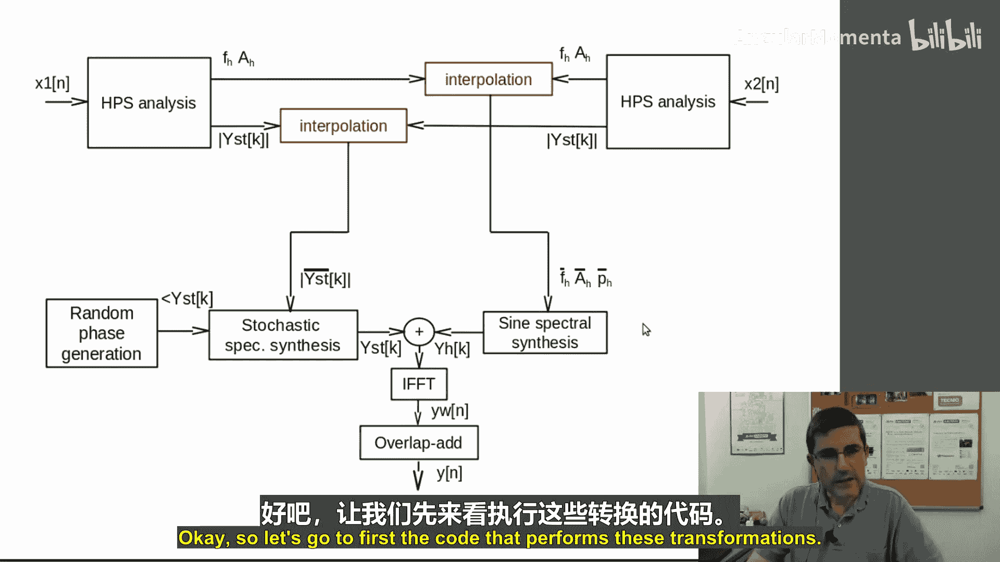
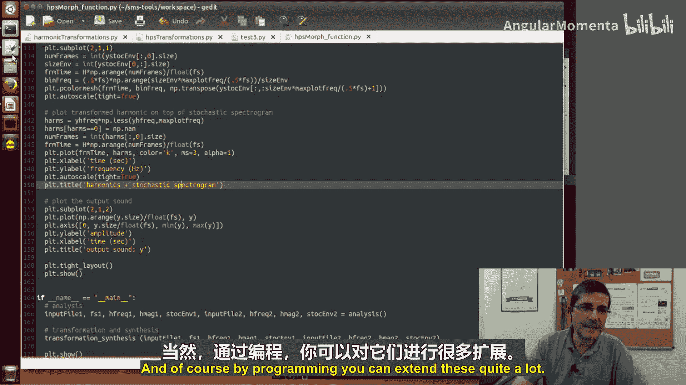
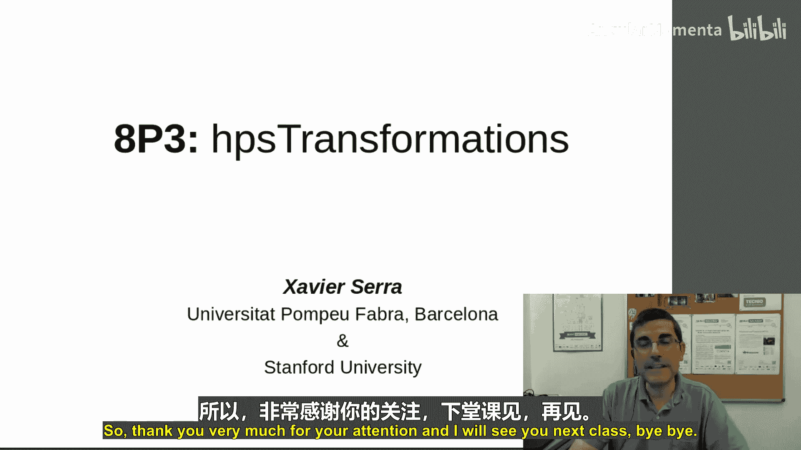

# 【巴塞罗那庞培法布拉大学】音乐应用中的音频信号处理-｜-Audio-Signal-Processing-for-Music-Applications-p62-08_03_03_HPST变换--BV18Xr6BeEX5_p62-

Hello， welcome to the course on othering processing for music applications。

This week we are focusing on transformations on describing one application of the spectral modeling techniques that we are covering in this course。

And in these programming lectures we are actually trying to understand the programming aspect of it and the code that we have been putting together on the SMS toolsol package。

 so in this lecture I want to talk about the most sophisticated model that we have covered which is the harmonic plus stochastic model and the transformations we can do with that。

So we have been describing this type of block diagram in which after all these analysis that we do of understanding the harmonics。

 extracting their information and then subtracting them from the original signal we obtain this stochastic approximation and now we are focusing on these two red blocks in which we can apply transformations to both stochastic representation and harmonic representation and of course then we can synthesize back one of these transformations is a little bit special which is the morphine。

The morphing requires two analysis of two sounds， so we have one sound that performs all these analysis and another one that does the same。

 and we are basically interpolating these two set of functions。

 the arrays of frequency amplitudes and the envelopes of test stochastic approximation。

And then we do the synthesis in the same way。OkaySo let's go to first the code that performs these transformations and the one for the harmonics is harmonic transformation。

 so we have this file called harmonic transformations in which we do the transformation just on the harmonic component of this model。

And the ones that we have implemented transformations that we have in the SMS tools are the idea of scaling the harmonics。

Then stretching the harmonics in a non harmonic way。

And then the idea of preserving or not the spectral shape or the timber of the sound。 Okay。

 so within this function。Harmonic frequency scaling。

 we can do all these at the same time if we pass these three control parameters。

 we're not going to go into the detail of this code。

 but basically we can see there is here at the end the three basic transformation lines which we have the frequencies that these are the input frequencies of all the harmonics of a particular frame and a particular kind of set of harmonics。

 the ones that exist and we apply a scaling factor a multiplicative scaling factor。

 so these would be the transposition， what we call transposition。And then once we can transpose。

 we can also do the stretching。And this stretching is a factor that depends on the harmonic and this variable in ball is basically the harmonic number if it exists。

 there is so we are elevating this stretching factor to these value so it's a way to change the frequency depending on the harmonic。

 there are several ways of implementing this idea of stretching we can do it in fact the other way around by having the harmonic number to the power of the stretching factor or this we can play around with these two implementations。

And then there is the idea of timber preservation。So in this particular function we are not manipulating the magnitudes。

 but we are doing is if we are preserving the timber。

 then we are changing the magnitudes in a way that we give to every harmonic。

 the magnitude that is closer to the frequency that it originally had so basically we have a spectral envelope。

And then we recompute the magnitudes in a way that。It preserves the shape that originally had。

Then we have the transformations that are specific for the combination of the harmonic and e stochastic components。

Wwhich are in this H transformation file and there is basically two functions。

 one that performs time scaling and the time scaling is done on the three components at the same time。

 the frequency and amplitude of the harmonics and the stochastic envelope so it's performed in this core loop and basically it interpolates well in fact it just adds or delete lead frames depending on these time scaling parameter and then there is the more complex function which is the morphing。

That accepts the arrays from the two sounds， so the analysis of the two sounds。

And according to these interpolation functions， it chooses a part of each。So the core。Function。

 the core of the function is just this loop that basically iterates over the whole the set of frames of the sound。

 It finds the harmonics that are present in both sounds because。

 of course the interpolation between two sounds can only happen if there is content in the two one has a zero harmonic that becomes a very complex thing to handle。

 So in this code， it looks for the intersection。 So the harmonics that are present。

 and then it just performs the interpolation of the frequencies。

 the magnitudes and the stochastic envelope。When there is some information existing in both sounds at the frame of both sounds。

 so clearly the number of frames has to be the same and ideally the number of harmonics and the stochastic envelope the number of elements or break points in the approximation function has to be the same。

And that's what it does。 and basically then we have this function called H morph function that wraps these functions and allows us to do analysis and synthesis and is the one that is called from the interface so we have basically two functions。

 one is the analysis that returns the results of the analysis and then another is the transformation and synthesis that perform the transformation and synthesis of the sound。

And if we run these， we can just execute that， we can just type a run on HF morph。嗯。Okay。

And this will execute both functions， of course we can also execute one on and the other independently by importing the file and then just calling the two by separately。

 so this is the result of the analysis function that performs analysis of the two and this is the result of the transformation and synthesis that performs the reynthesized version of that。

Since we already have listened to this sound， so there is no need to listen them here now。

 but please feel free to play around with these functions is quite interesting what you can do and of course by programming you can extend this quite a lot。

And that's all basically we have gone through the H part of the transformations within SMS tools。

 there is a number of transformations that are specific for the harmonic plus stochastic model and being the most sophisticated one。

 it can perform some interesting things， but it's a little bit difficult to use it。

 so you have to know to do proper analysis and to control these representations that are a little bit more sophisticated。

Anyway， so hopefully with these you got an idea of the harmonic plus stochastic model in terms of each potential for transforming sounds。

 sounds that of course have to be harmonic and they have to have a meaningful stochastic representation if those sounds fulfill that model then the number of things we can do with it is really great。

 So thank you very much for your attention。 and I will see you in next class。

拜拜。