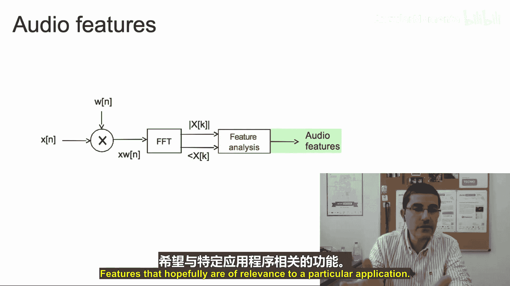
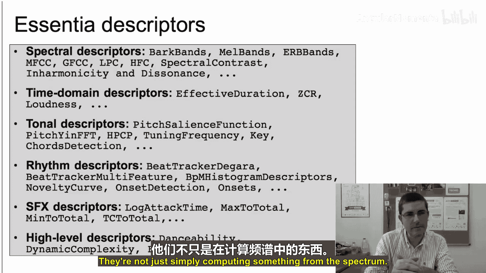
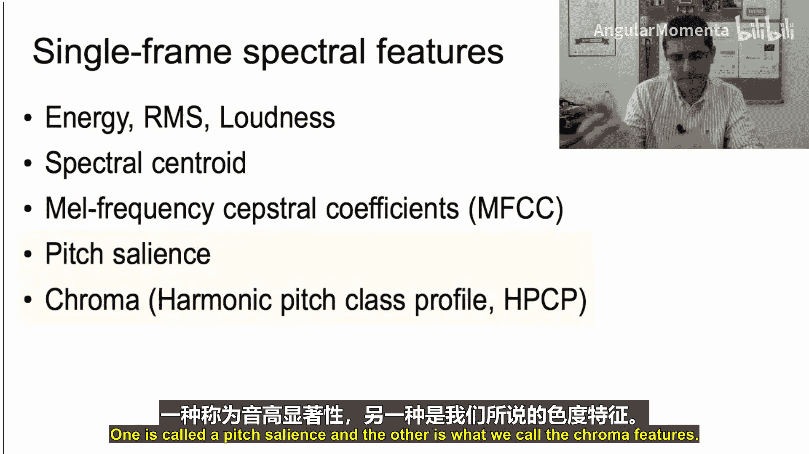
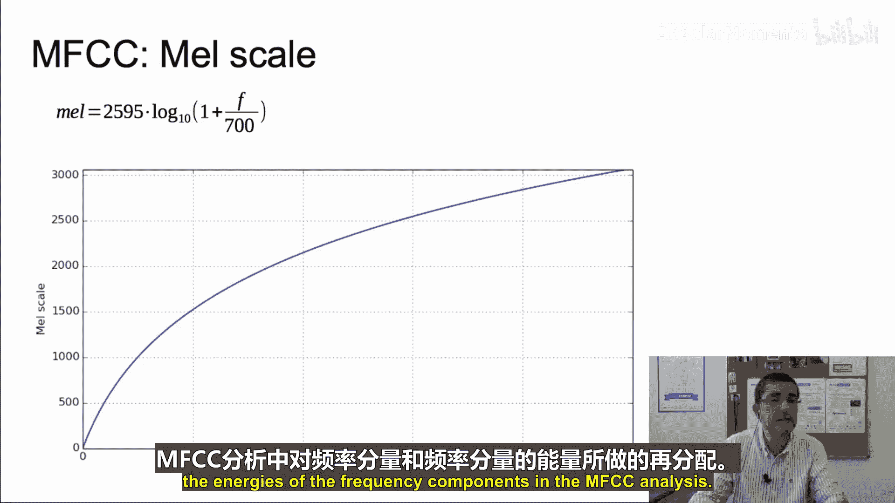
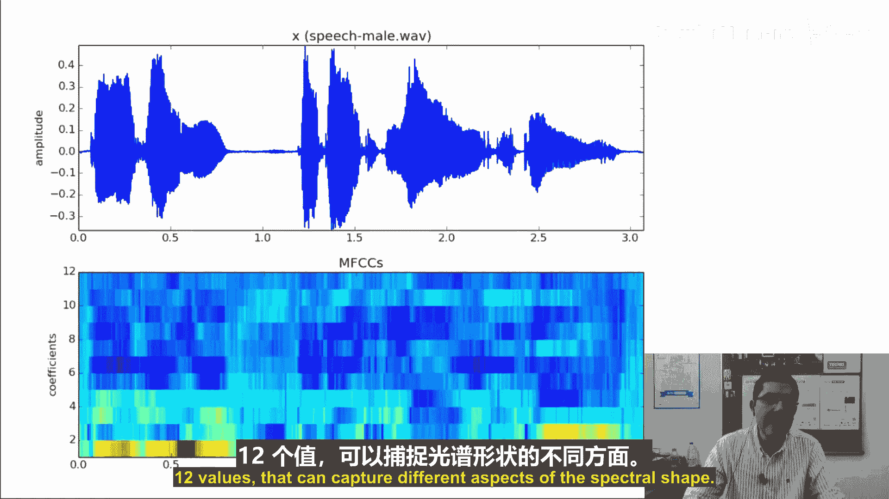
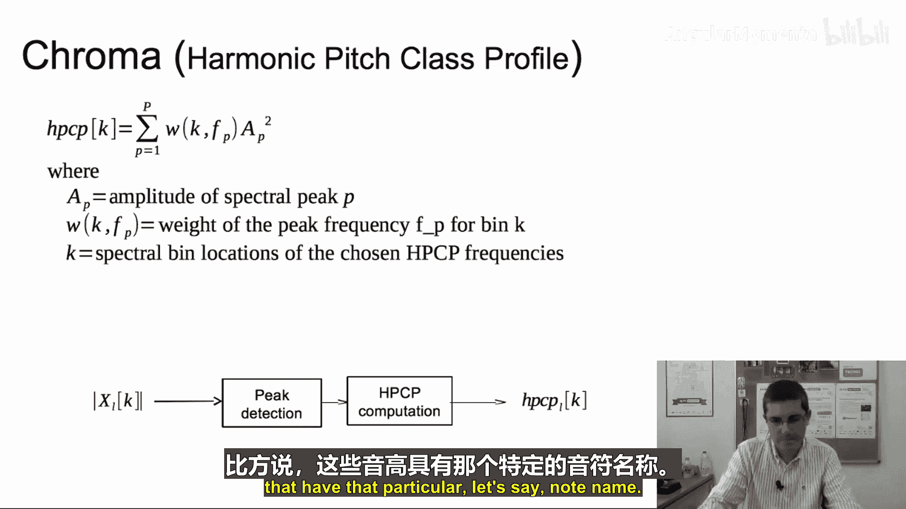
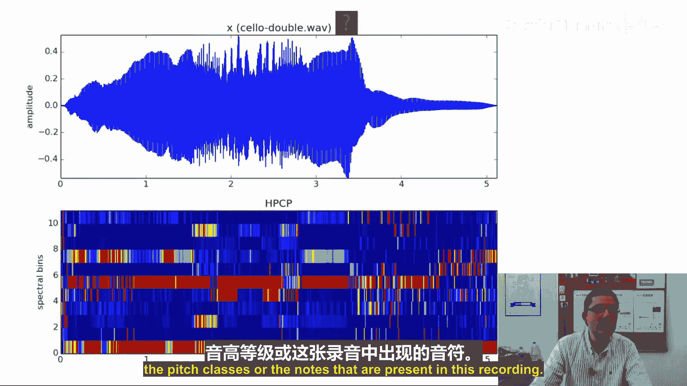
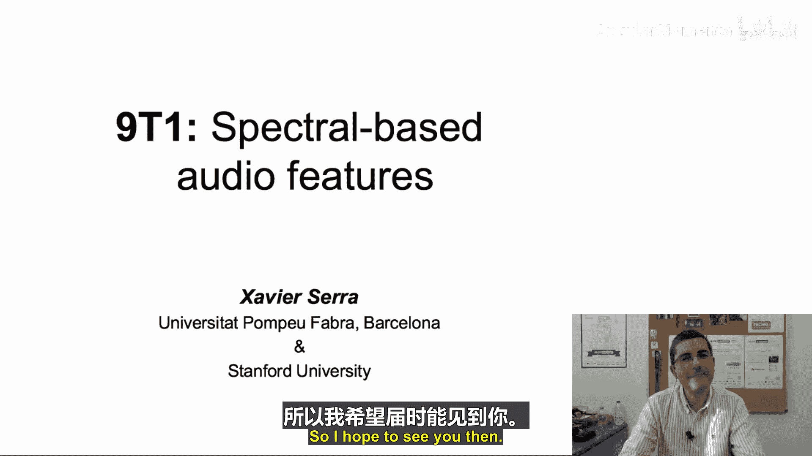

# 【巴塞罗那庞培法布拉大学】音乐应用中的音频信号处理-｜-Audio-Signal-Processing-for-Music-Applications-p63-09_01_01_音频特征--BV18Xr6BeEX5_p63-

Welcome back to the course on audio single processingces for music applications。Last week。

 we discussed some applications of the spectral modeling techniques that we have been presenting in the course。

Applications that were related with sound transformations。This week。

 we will cover another type of applications， the ones that relate with describing sounds。

In this first lecture， we start by talking about spectral based audio features。

So we'll start by presenting what we understand for audio features。

And then talk about the audio features that can be extracted from a single frame of a sound。

 from a single spectrum of the analysis。And then we will discuss about audio features that require more than one frame that requires a series of frames。

 a segment of a sound in order to be computed。This is a generic block diagram of the extraction process of audio features based on spectral analysis。

 We have seen this diagram before。We start from our signal X。

 then we window portion of it with a window。And then we compute the spectrum using the fast Fourier transform。

Resulting into the magnitude and phase spectrum。And it's from here that we are then extracting relevant features of the audio signal。

 features that hopefully are of relevance to a particular application。

There are many types of features that can be extracted from audio signals。

 and many algorithms implementing their extraction in this class。

 we will use Accentthia as the software tool to extract the audio features。

 Accentthia is an open source library for audio analysis developed and will maintained at the music technology group in Barcelona that contains algorithms for a large set of music descriptions。

In in the programming lectures， we will explain how to use this N and you will have the opportunity to learn how to use it。

Here we just present some of the most common descriptors。

 So in this slide you see some of the descriptors that are available in Ecentia go into some categories。

 So， for example， we have features that are extracted from the spectrum。

 So what we call spectral descriptors。 And here we have things like bar bands。

 Mel bands or the MFCC that we'll talk about LPC， etc cetera， et cetera。

 there are a lot of features based on spectral characteristics of the sound。

Another group of features are extracted directly from the time signal。

 from the time domain representation of the sound， and here we can of course。

 talk about the defect duration of a sound or we can talk about discreteors like the zero crossing rate。

And another group of descriptors relate with pitch related information。

Typically they are also using spectral based techniques and here we can talk about pitch salience or we can talk about what is called HPCP or the harmonic pitch class profile type of analysis。

 or identifying the key of sound， etc。Then there is another group of the scooors that relate with rhythm type of the scooors again。

 some might be implemented in the spectral domain， some are implemented in the time domain and here are the idea is to identify things related with the beat。

Or the tempo。 Or the onset of the sound。Then we have a group some descriptors in what we call sound effects that relate more with standard type of sound characteristics like the attack of a sound or things related to the energy of a particular sound that maybe be of use for some des and finally there are some higher level descriptors that attempt to describe higher concepts of sound of music。

 things like densibility or the complexity of a sound。

 some of these descriptors are living more complex to be computed。

 theyre not just simply computing something from the spectrum。

So most of the features or descriptors are computed one frame at a time。

 So let me now discuss a few examples of these descriptors so you can get an idea of how to go about that。

 So we'll first talk about descriptors that relate with energy。

Then we'll talk about the scors that relate with the spectral shape of a sound。

 and this includes the spectral centroid or what we call male frequency capsule coefficients。

And then let me present two descriptors or two features that relate with pitch related information。

 one is the call it's called the pitchach salience and the other is what we call the Cha features。

So the energy of an audio frame can be computed from the magnitude spectrum。

 can also be computed from the time signal in the magnitude spectrum。

 we do it by summing over the square of the magnitudes。 So the first equation here shows that。

 So we are summing over the square of every magnitude spectrum of the sound。

Another energy related measure is what we call the RMS or root mean square。

 and thats a modified version of the energy is the square root of the arithmetic mean of the energy。

So it's another way to visualize or to at least compute the energy of the signal。And then finally。

 there is another feature or descriptor that is implemented in Ecentia。

 which is called the Stevens power law， which is a proposed measure that tries to emulate a more perceptual kind of view so it tries to emulate perceived intensity and this is done by using the sound pressure level of a 3000 hertz stone as a way to perform a perceptual normalization。

This is a very simple measure of loudness， and we call it loudness， strictly speaking。

 if we have to compute the perceived loudness of a sound。

 we have to develop more sophisticated algorithms for that， but anyway。

 this is the first approximation to the concept of a perceptual measure in this case， the loudness。

And in here we see these three energy related features as they have been computed from our piano sound that we have been listening before。

 so we have the time information so we are analyzing these measures throughout the whole sound one frame at a time and we can see that they are very much correlated。

 of course theyre all energy related， but there is quite a bit of difference between these three measures and clearly we can have other measures related with energy。

 maybe more related with perceptual issues that might result into a different type of function。

 but this is quite useful for measuring energy or loudness related things of a complete sound。

So now we talk about the scriptor， a feature that tries to characterize the spectral shape of particular sound。

This is the spectrocentroid， which indicates where the center mass of the spectrum is。

 Perceptualally， it is very much related with the impression of brightness of a sound。

And it is calculated as the weighted mean of the frequencies present in the signal。

So this equation that we see here sums over the whole spectrum。

 weighting it by every frequency and normalizing it by the total energy。

 so we have a measure and we can see that in this plot that we can see as the sound varies in time。

 how the brightness changes in time。 So this is the sound of speech。

We also have heard the speech before the male speech and below it， we see this spectraltrocentroid。

 So the values are frequencies。 So it's the center of the spectrum， the mass。

 the center point of the spectrum as it changes in time。

 So we see here that this speech sound varies in between 1000 herz and 7000 herz。And the noisy parts。

 and in fact， the silence clearly has a high centroid and the voiced parts of the sound have a match lower centroid So this is a good measure that can be used to characterize quite a bit of quite a few aspects of the sound。

 in particular， this idea of brightness。Another feature that attempts to characterize the spectral shape but in a more complex way。

 so the spectral shape of a sound is what we call the male frequency caps coefficients and we normally use the abbreviation we say MFCCs。

 the male frequency capsule coefficients is a representation of the magnetnes spectrum。

And it is computed by taking the cosine transform of the lock magnitude spectrum on a scale that is nonlinear on a scale that is called the male scale。

 So this equation shows that so shows how we take every spectrum， a x of k。

 and then we multiply by filter bank， so we multiply by a window。

 so that we keep changing this weighting for every frequency in a way that is dependent on this male scale。

And the attempt of that is to do a more perceptual base weighting off the magnitude spectrum of the result of the FFT。

And then we do the lock of that and finally we do the discrete cosine transform and the equation of the discrete cosine transform is here too。

And we see the block diagram of this whole process so we start from the magnet spectrum。

 then we split this magnet spectrum with this bank of filters or bank of portions of the spectrum according to this male scale。

 and we take the lock 10 of that and then we compute the DCCT and finally we obtained this this coefficients and male frequency coefficients。

The male scale approximates the frequency resolution of the auditory system。

 It relates the perceived frequency or pH of a pure tone to its actual measure frequency。

We humans are much better at discerning small changes in pe at low frequencies than at high frequencies。

So by incorporating this scale， we are making the spectral features much more closely with what we actually hear。

 So in this diagram we see this function， the ME scale。And horizontal axis is the linear scale。

 and then on the vertical axis is this new scale， this modified frequency scale that， as you see。

 puts more emphasis on the low frequencies and on the high frequencies it puts less emphasis。

 So this is the redistribution that we do of the frequency components and the energies of these frequency components in the MFCC analysis。

This is a visualization of the MFCC analysis of this same speech sound that we saw before the male speech。

The resulting representation， which is this plot below， is not so intuitive。In fact。

 the issue is that every coefficient is a representation of a different level of abstraction of the spectral shape。

And therefore， it has to be clearly distinguished from what we would consider a normal spectrogram it's quite different。

So here for example， we see the first 12 coefficients， we can choose a number of coefficients。

 12 coefficients is a quite standard number that is used。And in fact。

 the zeroth coefficient is not shown。 Normally， we do not display the0th zeroth coefficient because that relates to the loudness or to the energy of the sound。

 and that we have other measures for that。 So we normally show starting from the first coefficient up until normally。

 like， let's say， 12 coefficients。 The first coefficient is the one that describes the bigger picture of the spectrum。

 So the the bigger overall shape。 And as we go higher up， it describes more details。

 more small changes in the spectrum。And so this is normally used as a vector。

 including all these coefficients at every frame。So we have a very compact representation。

 just 11 or 12 values that can capture different aspects of the spectral shape。

Let's now talk about some features， some descriptors that relate with the pitch information of a sound。

 and the first one is the idea of pitch salience。Palions is a measure of the presence of pitchach sounds in a signal。

 This particular implementation of pitchalions that is available in Ecentthia starts from the spectropics。

 and we know about that。 and from then it computes the salience of all possible pees present。

So it does it by summing the weighted energies found at multiples of every particular peak。

 so it tries to find the possible harmonics that are present of a particular peak and then it sums all that and it computes this pitch salience per every peak value。

Here in this block diagram we see the manual spectrum， how we find the peaks。

 we get the amplitude and frequencies of every peak and then we have this speech salience function which is a quite complex equation and here we just see a very overall picture of overall equation of this computation but basically at every peak and for every amplitude of every peak we apply a weighting function that measures these multiples and measures the energy of all these multiples of the fundamental frequency of a peak being considered a fundamental frequency and then it sums all and SB is this salience at every beam frequency that we are starting with so we are basically computing。

The salience of all possible frequencies being considered as fundamental frequency。

And this is the result that we obtain if we only take the maximum salience at every particular frame。

 so at every particular frame we have many salient values but this idea of pitch salience normally relates to how much of a pitch is present at a particular frame。

 so by taking the maximum of a bit is a good measure of how probable let's say there is a good pitch sound at every particular frame so this is an orchestral sound is this Chinese orchestra that we have heard before and there are many instruments playing together。

 some are pitch sound， some are percasive sounds， so by looking at these function。

 this pitch sals we can sort of visualize and estimate， the presence of the pitch sound in in。

Very frame。 And that can be quite useful to characterize quite a number of sounds。

And then let me talk about another type of feature that is also related with pitch information。

 and this is the Chroa feature。And in particular， we'll talk about the harmonicbleach class profile。

But Chroa， which is a concept used in music perception and in music theory。

 is a concept that represents the inherent circularity of pitch organization。

 the same pitch notes in different octaves have the same chroma。So when we talk about pitch classes。

 we refer to all the pitches that have the same chroma。And the HPP， the harmonic pitch class profile。

 is a particular implementation of this idea of Cha features。

And it is a distribution of the signal energy across a predefined set of pitch classes。

So the idea and this equation shows that again starts from the spectral peaks， a sub p。

 and then by applying a function to that and summing over all possible peaks。

 we can get a measure of the different pitches that are present within a particular octave。

 so the idea of chroma is that we fold everything into one octave and we can divide the octave in 12 semitones or in any other type of frequency quantization and these equation and these implementation basically finds the pees that have that particular chroma that have that particular let's say node name。

So this is an example of analyzing a sound with HPCP implementation available in Cthia。

 this is the celllo sound in which I played two notes， in fact let's listen to that。

So in here what we see is basically the pitches， the pitch classes that are present in this fragment。

 this is a fragment in which I play basically two strings double string in which one is very stable。

 the low node and in fact the zero value that we see here。

 the more red horizontal line relates to one of these very stable pitches which is basically is the a sound that is always present and then what we see is the other pitches that is a very strong D sound that is also present throughout so we see it all throughout and we see also the other notes a little bit it's not very clear but it gives us an idea that there is some clear pitches and by tuning it a little bit。

Could get quite a decent view of the pitch classes， not the absolute frequencies of the pitches。

 but the the pitch classes or the notes that are present in this recording。

Okay， now let's go to multiple frames， so features that require to be analyzed with multiple frames。

And let me give you just three examples of things that we could do with multiple frames。

 One is the idea of segmenting an audio recording and identifying onset， for example。

 another is to find the prominent pitch and for the prominent pitch we need to see the continuation of the pitch。

And finally， the idea is that we can compute the statistics of。The single frame features。

 but on a larger scale on fragment of a sound。So the segmentation of a recording and， for example。

 identification of the onset can be obtained by calculating some spectral features that measure the change in frequency content。

For example， the spectral flux， which is a very common feature used in segmentation， what it does。

 it compares to consecutive spectra and then it it sums over all these differences。

 this is basically the L1 norm of these differences and this can give a measure of the spectral variation and this can be an indication of where things are changing in the sound。

 there are many implementations of this idea of its spectral flux and we can develop variations that can focus on a particular aspect。

For the particular case of identifying the onset， so segmenting the sound by finding where the beginning of an event or of a note starts。

 there is a number of features that we can use， in fact the spectral flux could be used for that。

 but here I have put another feature which is the high frequency content。

So what this thescriptor does is find the。Content， the high frequency content。

 So how much of the high frequencies are present。 And then we compared with the previous one。

 So in the case of identifying the onsets，  clearly。

 an onset is a part of the sound in which there is an increase of high frequencies。

 most attacks represent a higher presence of high frequencies。

 So if we identify where we have an increasing presence of high frequencies。

 we can detect where the onsets are。and this is an example of the results of running these two feature analysis on again on this speed sound and one is the spectral fluxs。

 so the red line is the spectral flux and the blue line is the normalized on and detection so both are normalized。

 so we don't see the absolute values of them， but with them by looking at them and if we we basically zoom into these function we would see that the text or it has a higher value at frames or at the fragments of the sound that are a transition portion of the sound so all the attacks and in the case of the spectral flux we also can see sort of changes in the the case or the ending of of the no。

不ち。Okay， another feature related with pitchach is this idea of predominant pitchach。

And this one that in fact， we introduce when we talked about F0 detection in week6。

Is a measure of the predominant pitch within a more complex sound。

And we don't have time to go into details of that， but basically this feature starts again from the manuscript spectrum and then finds the peaks and then compute the pitch salience that we have seen before and from this pitch salience it tries to identify different pitch contours。

 it tries to identify different pitches that are evolving in a particular sound fragment and then out of those it selects the one that is is the most prominent one。

Okay， so in this case， we have this sound that again， we have heard before。

 which is a kinetic piece of music in which there is accompanying instrument and the green line is the prominent melody that has been obtained。

And again， this is an algorithm that is present in a Cthia and can be used for identifying the prominent melodies in complex signals。

Okay and finally most audio frame type of features can be aggregated over a complete recording or over fragment of the sound and we can compute the statistics to get a view of more overall type of behavior of a particular audio feature。

 so we normally what we do is we compute the moment of the particular feature and the first moment would be the aritic mean so we get the mean of a particular feature or we can get the second moment which corresponds to the variance。

 so how it varies this particular feature and then finally the skewness which is the third moment which is a little more analyzing the distribution of this variance。

 so how this feature。iss deviating from kind of a normal or a Gaussian type of variation。

 so with these three statistical measures， we can get a pretty good view of how a particular audio feature is evolving or is behaving in a particular fragment or sound recording。

In terms of references， there are many references on the topics that I discuss in this lecture。

For the actual thescriptors that we mention， SNia is a good starting point。

 there is documentation on on the website of SNia that then links to the articles or where the particular algorithms were obtained from in Wikipedia you can find a lot of information about these things and here is just a few links of the features that I talk about so spectraltrocentroid or the MfCCs or loudness or the HCP or the idea of detecting onset and moments。

 the mathematical moments that we also mention and finally the code that showed the plot so that may be also a good starting point to understand some of these things are available on the SMS tools。

 Github location。And that's all for this lecture， we introduce the application of sound and music description by discussing several audio features that can be extracted from audio signals and that can be used to characterize sounds。

In the next lecture， we will continue on this topic by extending the idea of characterizing a sound to the idea of characterizing collections of sounds。

So I'll hope to see you then， bye bye。

