# 【巴塞罗那庞培法布拉大学】音乐应用中的音频信号处理-｜-Audio-Signal-Processing-for-Music-Applications-p64-09_01_02_声音与音乐描述--BV18Xr6BeEX5_p64-

Welllcom back to the course on our resume processing for music applications。This week。

 we are talking about the application of audio analysis in the description of sounds。

In the last lecture， we talked about audio features。

Presenting various spectral based analysis methods with which we can obtain features of a sound that might be relevant for describing it。

Now in this lecture， we want to go beyond the idea of describing single sounds and introduce the concept of describing collections of sounds。

So we'll first present the idea of the music information plane。

And then we will distinguish between sounds and music with the aim of developing methodologies that are either relevant to the more generic concept of sound or more specific for the characteristics of music。

So we'll first talk about sounds and sound recordings and then collections of sound recordings。

 and then we'll continue with the idea of music recordings and collections of music recordings。

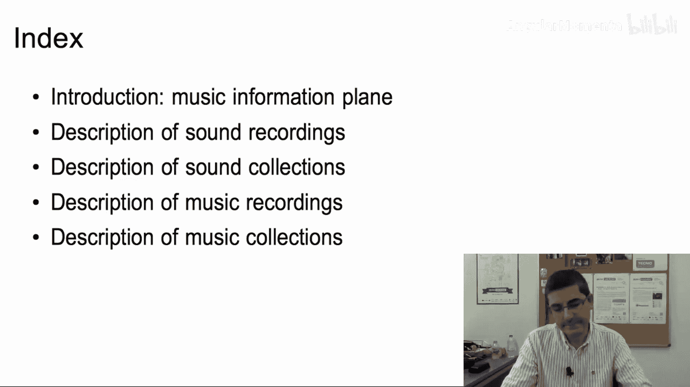

So this is the music information plane。That should help us understand。

What do we mean by music description？In a particular context。

So we consider different abstraction levels and the left column are these different abstraction levels and we can go from the physical level。

 which is basically the lowest level that we are dealing with and we go up to the cognitive level so that would be the highest level that we consider and some steps in between。

So at the physical level when we talk about sounds and music。

 we can talk about concepts like the frequency or the duration of the sound or the spectrum and some clear characteristics of the spectrum like the centroid and also we can talk about intensity of the sound if you go level higher the sensorial level then instead of frequency。

 we can talk about the pitch of the sound and then instead terms of duration we can talk about time or the sensorial time of the duration and then instead of talking about spectrum we can talk about timbber which is a sensorial concept and finally in terms of intensity now we talk about loudness which again is a sensorial concept。

And we can go a level higher and talk about perceptual topics or perceptual concepts that are more musical。

 that are relate to related to musical concepts。 So in here we talk about successive and simultaneous intervals of pitch。

 what will be called nodes， and then in the when we talk about time。

 we talk about the structuring of time and we talk about things like the beat。And then the timber。

 we talk about aspects of the timber that we can identify and characterize with some aspect of a musical sound and for example。

 the spectral envelope would be that and then finally instead of allowness when we talk about musical allowness we normally refer to dynamics and we have a vocabulary that talks about the dynamics of musical sounds。

And we can still go a level higher and go towards a more formalized way of talking about musical concepts and therefore when we talk about pe related concepts。

 we talk about things like melody or key or tonality， when we talk about timing related concepts。

 we talk about rhythmic patterns， we talk about tempo， we talk about meter。

 and when we talk about spectral timber characteristics。

 we identify musical instruments or the voice as entities that have characteristic timber。

 and then finally when we talk about dynamics or loudness。

 we are interested in the articulations of the sounds and how sounds change from one to another。

And finally we can reach the highest level， the cognitive level。

 the level that relates to us humans in a very subjective way and how we listen to music and what issues are relevant for us in the interaction with music so at this level the columns are not any more valid。

 there is interaction between all these different concepts and then we can talk about the emotion or the musical style or semantic concepts that clearly integrate all these other levels of descriptions to obtain these concepts。

 these ways of describing music that are clearly more generic and definitely are subjective or cultural and that would be a level that definitely would be hard to reach and in this class we are definitely not going to talk much about that。

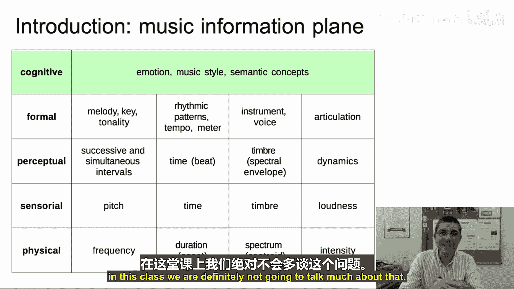

So we will focus on the low level descriptions of sounds。

 hopefully reaching a high enough level of description that is of relevance to user applications。

If we want to describe sounds in a generic way， sounds like the ones we find in free sound。

We can group audio features， the audio features that we talked about in the last lecture and we can group them in different categories so we can talk about the timber related features and we mention quite a few of them like the Spectrocentroid or MFCCs or the high frequency content etc then we can talk about another group of features that relate with dynamics and that's basically the loudness and the level of particular recording。

Then we can talk about the pitch related features。And here is where we can talk about the pitch。

Or the pitch salience。And finally， we have to describe also the time varying aspects of it。

 aspects of a sound that relate to the evolution of the sound， to the texture of the sound。

 and these we can group them under the termmorphological features and here we can talk about a thing like the envelope of a sound。

Or the onset rate or many other type of descriptions that we could include under this。

We already have seen quite a few of these descriptors。

 so what is interesting now is from these descriptors， from these features that we analyze analyze。

 we can now talk about collections of sounds。

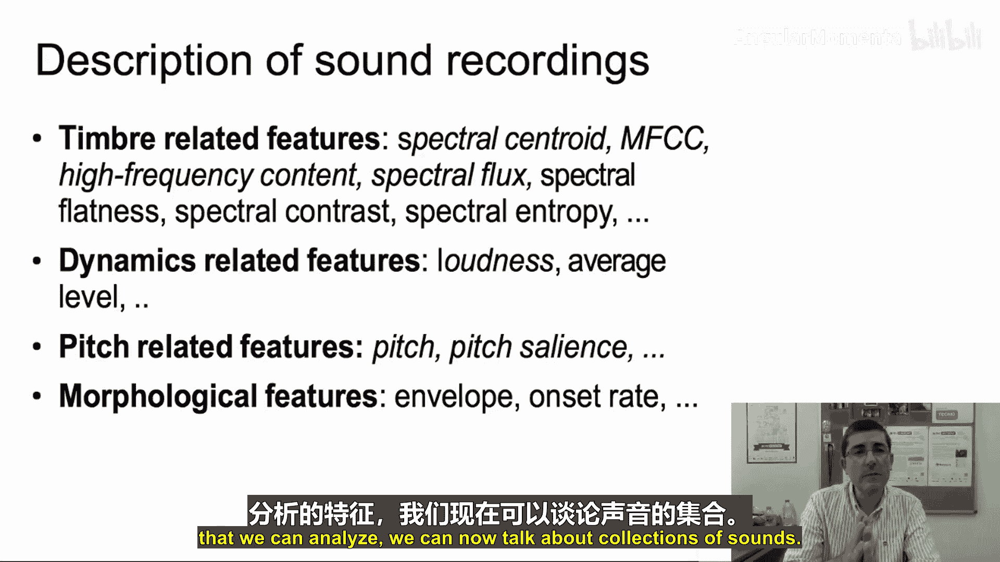

So let's talk about how to describe collections of sounds and clearly there are many ways that we can analyze a collection of sounds and describe it and we'll focus on three basic concepts。

 the first one and the most important concept that we need to develop is the idea of similarity if we want to talk about a collection of sounds we have to talk about the similarity between the sounds so we can form the idea of collections and group them Once we can talk about similarity。

 then we can cluster sounds， we can group sounds according to some criteria。And finally。

 if we know some classes， some existing labels that we use to describe a particular group of sounds。

 then we can classify sounds， we can assign classes to particular sounds。

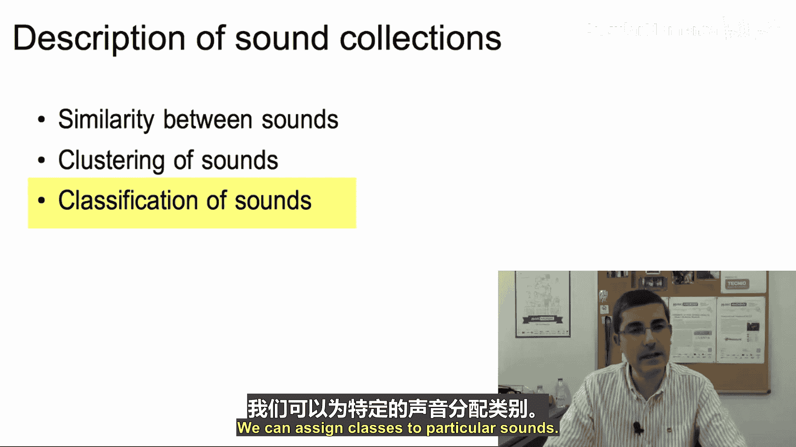

In our context， sound collection can be represented by a diagram like this one。

We consider a sound as a set of audio features， each feature having an numerical value。

In order to properly describe a sound， we have to use many features。

 but for simplicity we will be taking only in this case two features。

 So if we consider a sound as represented by two features we can display a sound as sub point in a two dimensional space and that's what we are seeing here。

 every feature is one dimension。 So here we are showing two audio features。

 the horizontal line is the mean of the spectraltrocentroid。

 So we have analyzed notes of three instruments of violin flute and trumpet we have computed the spectraltrocentroid and we have taken the mean of it。

 So this is a multi frame feature。And also， we have done the mean of one of the of the MFCCC coefficient。

 the second coefficient。 So that's the mean of the second coefficient in the vertical line。

And we can see that the violin has a quite high value for this coefficient for the MFCCC value。

 and it has a centroid that it quite covers quite a bit of space。

The trumpet has this MfCC coefficient quite lower， so these blue dots are more in the lower side and the flu sound is kind of an in between and also the MFCCs are in between so that we can kind of see that these types of sound are distinct according to these two features。

Now， in order to play around with this space， the most fundamental thing is to measure the distance between sounds。

 between points。So we have to find a way to in a multidimensional space。

 not just in this simple 2d space， how we compared two sounds。

 how do we find a similarity between the two so Euclidean distance is one of the simplest ways to measure the distance between two points in a multidimensional space。

 so in this case P would correspond to one sound， the collection of features of one sound and Q would correspond to another sound the collection of feature values of the other sound。

 and then for every dimension I we just take the distance between those two values at that particular feature。

 then we square it and with sum over all the features。

All the dimensions and then we take the square root and that's the Ouclidean distance in the case of a 2 d space of just two features that becomes much simpler so in this case the red and the blue are two sounds with two features and we can just measure this Euclidean distance and is basically the line that that separates these two points the length of these line。

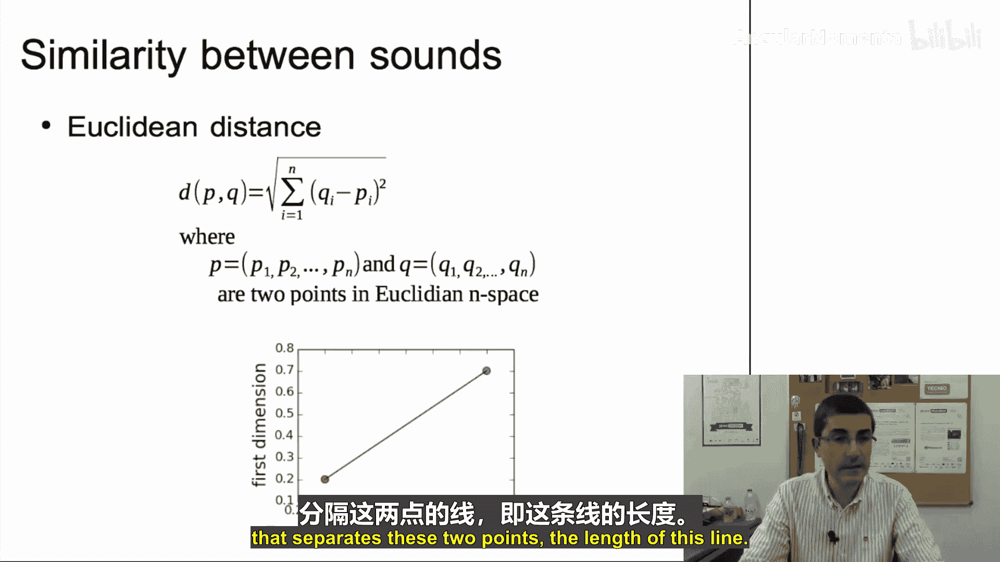

Now that we know how to measure distance， we can cluster sounds。K means is a clustering algorithm。

And if we give to the algorithm the desired number of clusters。

 it will create the clusters and it will return the mean value of each of these clusters。

K means clustering aims to partition N observations。

 so the observations would correspond to the number of sounds into k clusters。

 so into K categories or groups of sounds。And each observation belongs to the cluster that has the nearest mean。

 Okay， so this mean serves as the prototype of the cluster that we are creating。

The problem of finding these means or this clustering is computationally difficult is what is called NP heart。

 however， there are efficient heuristic algorithms that are commonly employed and that converge quickly to local optimum。

So this equation expresses this minimization process that we have to go through in the K means algorithm。

 so the goal is to find the mu for every cluster， so we have this K cluster that minimizes this overall sum。

 so we have to do it sort of holistically of obtaining this overall minimization result。

So here in the plots we see like the three steps in this process of obtaining these clusters on the left one。

 we start from a collection of points， In fact this is not sound features this is just random points in space and the goal is to cluster them according to two two clusters so we want to find two clusters so we initialize the algorithm by putting two points that will be used as the initial means of two clusters so the middle diagram。

 the red and the blue are the two initial means and we these two initial means these collection of samples of sounds get cluster in the way that we see here with the red cluster and the CN cluster。

And now with claimings， we iterate over this minimization that this equation that we have here and after certain iteration it converges and it converges to the clustering that we have on the right。

 so it has cluster the red dots in the lower left corner and the C dots in the upper right corner and clearly this is a much better clustering than the initial random clustering that the algorithm started with。

Okay， so now with that， we can have collections of sounds。

And automatically fine classes that group sounds that might have similar audio features。

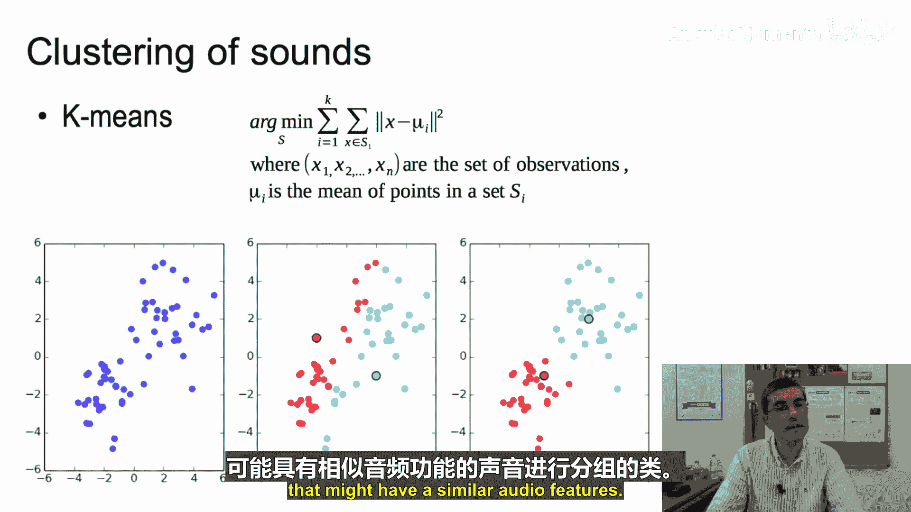

Okay， the last thing that we talked about for describing sound collections is the classification of sounds。

And that means that we know some classes， we have identified certain categories of sounds。

 and what we want to do is given a new sound， we want to classify to one of these known classes。

So the K nearest neighbor classifier， K andN is an algorithm used for this type of classification。

And the rule that we implement with KNN， it classifies a sound by assigning to it the class that is most frequent。

In the neighbors。 So we find key neighbors。And whatever is the majority both of those neighbors then becomes the class of this query or of this new sound。

 So this block diagram exemplifies this this process。

 this set of rules that are implemented in the canan algorithms。 So we start from a query。 Okay。

 so that would correspond to a new sound。And we are starting with target examples。

 so we are starting with a collection of samples of sounds that have a label。 So for example。

 in the diagram below we have two such collections， label collections。

 the blue and the red ones and the CN dots are our query so we have two label or assigned these query samples to one of these two collections。

So what we do is we measure the distance with the Euclidean distance we measure from every query sample to the to all the neighbors。

And we take the K top results， so we only look at the K nearest neighbors。And from those。

 what we do is we take a majority vote based on the classes they belong to。

So the last box is basically we know the the classes that the neighbors belong to and we take the majority of the boat and we assign the class。

 That is the majority。 So on the right。Diagram， we see the result。 So the。

 the C N dots have been assigned a color。 So some have been assigned the， the blue class。

 and the rest have been assigned And the red class。 Okay， so this is very simple。

 but quite efficient way to classify sounds or， of course， any other type of data into classes。

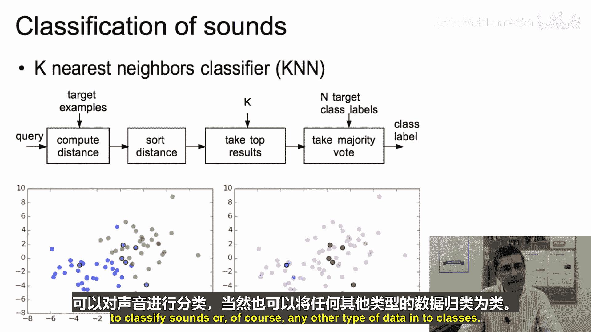

If we now go to musical sounds， recordings of pieces of music。

The features to be analyzed should be more specific and more related to musical and meaningful concepts。

So let's try by defining some categories of features or descriptors that are relevant musically。

So we can talk about tamper related scriptors and things that we mentioned like instrument characterization or instrumentation characterization。

 or even the remixing of musical recordings that is also an important feature of music。

Then another category would be related to melody and harmony。

 and that includes things like the phrase， the motivetif or the tonic of a piece of music。

 And even if we talk about nonwester music traditions， like Indian music tradition。

 we talk about Raga or like in the Turkish music tradition。 we talk about Maam。

 So these are melodic concepts that can be described and that are important to characterize particular piece of music。

Then we can talk about rhythm and then again we talk about patterns or we can talk about tempo or we can talk about beat。

And in the case of many music traditions， the concept of metrical cycle is an important way to think about rhythm。

 and finally another way of describing music is by describing the structure of a piece of music defining the sections or the movements that a bigger piece of music might have。

These descriptions cannot be obtained by just performing audio analysis。

 we normally start from audio features， but then we have to develop models from a combination of features that can capture the essence of each concept and clearly this is beyond the aim of this class and this is very much an open research area very active and that hopefully will be evolving through the years and we'll be able to eventually do things like this。

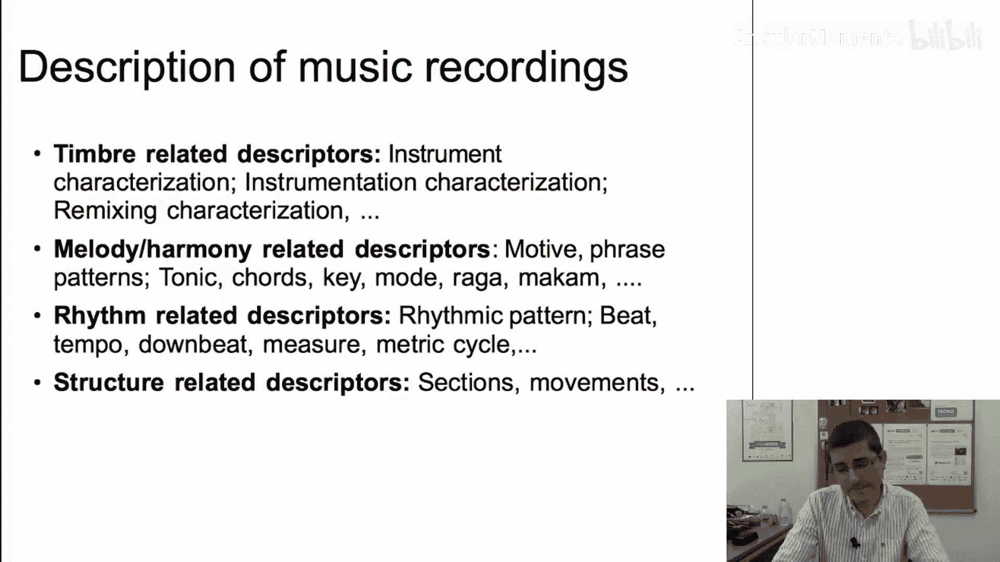

And if we go to music collections is even harder， the description of music collections can be very complex if we want to do musically relevant tasks。

This is a very active research topic again。And this is what is referred as music information retrieval。

In which we want to automatically classify pieces of music and be able to perform tasks such as recommending a piece of music or finding pieces of music that might be related to another one。

And then the concepts that we talk about sounds also apply， but they have to be adapted here。

 so similarity is a fundamental concept， but then we have to divide or we can find different facets of the similarity and we can talk about rhythmic similarity。

 we can talk about similarity of the instrumentation of the melodic aspects or the harmonic aspects。

 structural similarity and then of course we could combine them in order to find similar songs。

 and these types of similarity are clearly not Ouclidean distances we have to develop similarities that are much more sophisticated。

And then we can classify and cluster this piece of music according to different criteria。

 and the classification， for example， can be classified according to genre or style or artist or the school that music tradition comes from。

Again， this is much beyond what we can cover in this class。

 that is a fascinating topic that is a natural continuation of the kinds of things we talked about。

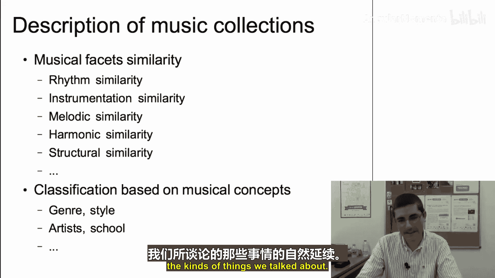

So given that this is a very open research problem。

 the references come from research papers and typically a lot of these research is labeled under what we call music information retrieval。

 so the Wikipedia entry for music information retrieval is a good starting point。

And then for the more specific things that we have talked about。

 you can look at the specific entries for a Cleveland distance or for different the clustering。

 the K means clustering has a good entry in Wikipedia or the concept of classification based on K years neighbors。

 of course these are just two examples of different clustering and classification strategies there is a lot of different strategies coming from the field of machine learning that has brought many new possibilities to do these type of tasks。

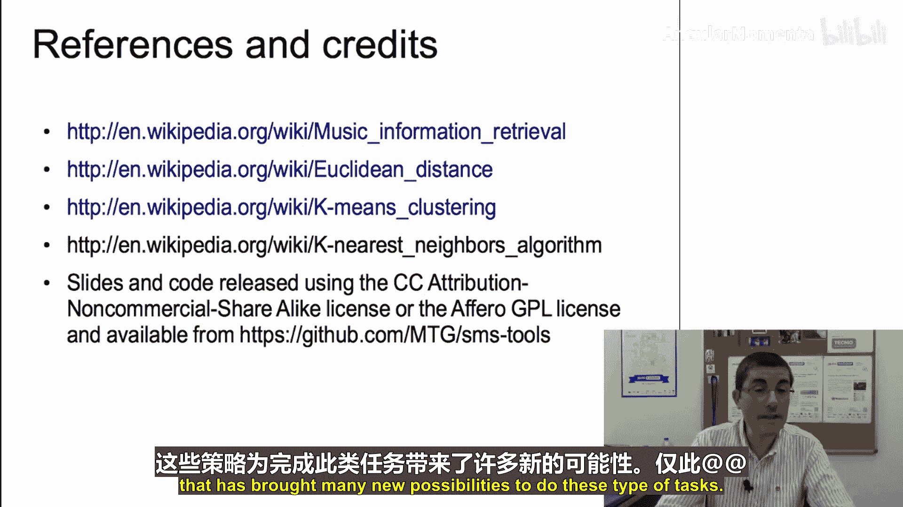

And that's all so in this lecture， we have opened the door into a huge research field that aims at automatically describing and organizing a large collection of sounds and music recordings。

 which just introduce some of the basic concepts and specific methodologies that can be used to start working on this topic。

In the programming lectures， we will show a little bit examples of how to actually do some of this。

 but clearly we cannot make justice to this field of research。However， I hope you got a taste of it。

And I will see you next class we will present some more demonstrations and practical examples of all this。

 see you next time， bye bye。

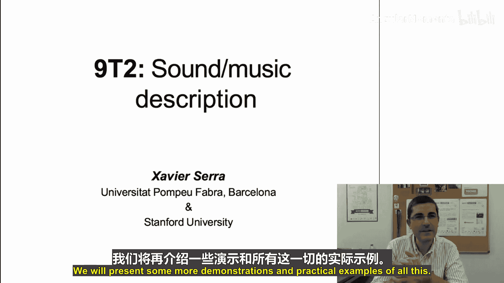