# 【巴塞罗那庞培法布拉大学】音乐应用中的音频信号处理-｜-Audio-Signal-Processing-for-Music-Applications-p65-09_02_01_声音描述符--BV18Xr6BeEX5_p65-

Hello， welcome again to the course on our single processingces for music applications。

In the theory lectures of this week， we introduced several methodologies to do feature analysis to analyze sounds using spectral aspects and with them to be able to describe sounds with which then we can compare sounds。

 we can describe collections of sounds， we can find the similarity between sounds。

So now in this demonstration class， I want to exemplify the extractions of these features using some existing software in this case。

 Sonic visualizer。

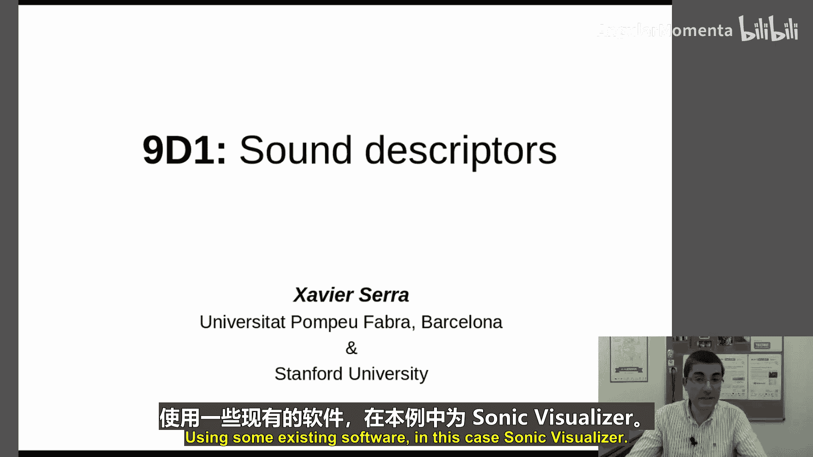

So let's go to Sonic Viualizer。

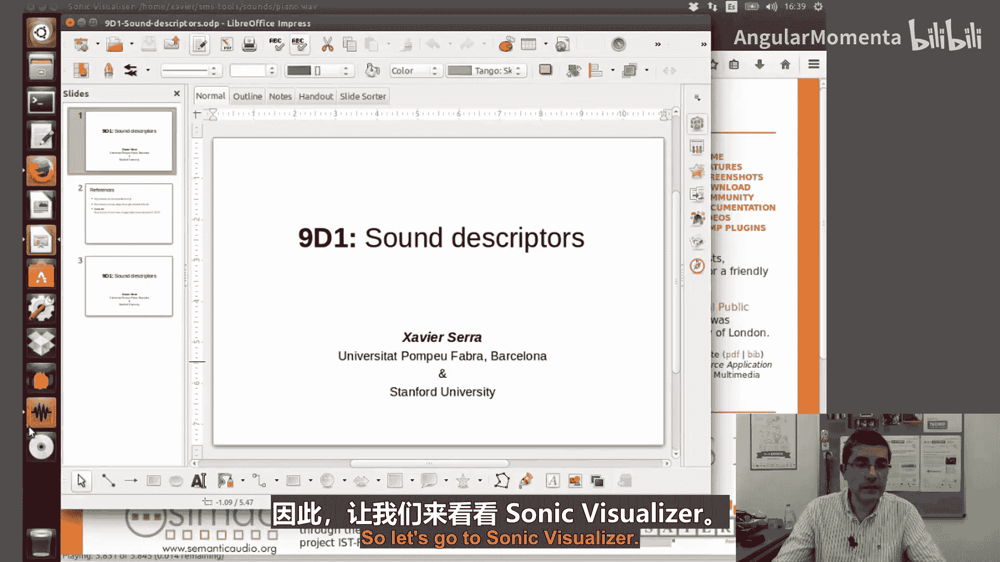

🎼Okay， I have already opened this piano sound that we know quite well。Okay。

 and now what I want to do is to use some plugins that I have downloaded from the website of Sonic visualizer to perform some analysis。

 So in fact， if we go to the Sonic visualizer website and we go to the menu bump plugins。

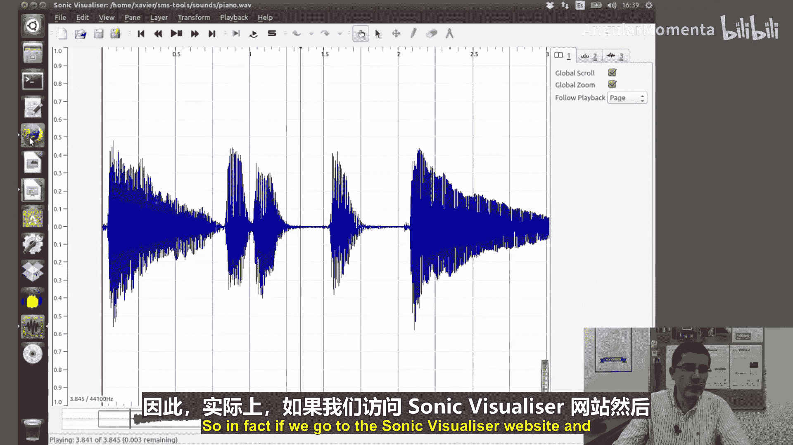

In here， there is a list of many collections of plugins。

Most of them do the kind of things that we have been talking about。

Analyzing different aspects of low and meat level type of features from sounds。 so I already。

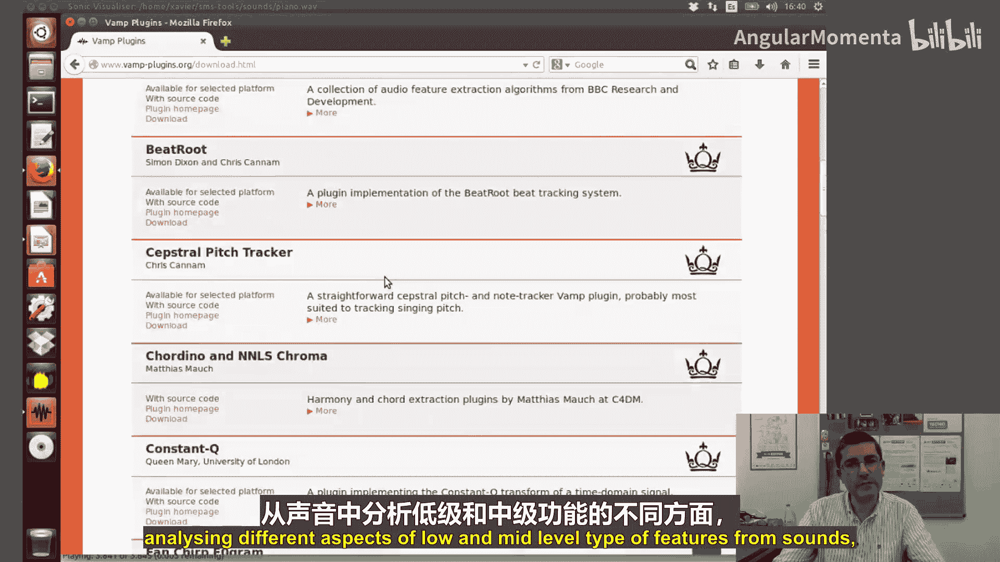

Got some of these plugins mainly the ones from Queen Mary。

 who is the institution that maintains and develops this Sonic visualizer software。

 so first in order to analyze some audio features let's create an empty paint so here we have an empty paint in which we will be displaying these features。

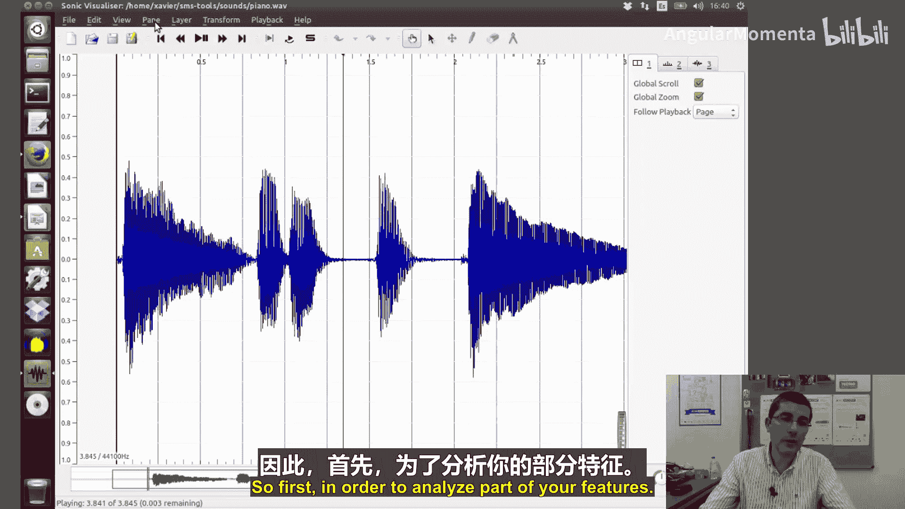

So now in the transform menu， there is a menu that says analysis by category in which we have a classification of different types of features。

And for example， let's try to study the onset of this piano sound。

 So we will go to to the time type features and the onsets。

And there is this onset detection function。 and this is the description of this plugin。

 it's developed by Queen Mary。And we have different parameters that we can control。So， for example。

 the type of feature that is used， there are several。Features that can be used。In theory class。

 we talked about high frequency content。 So maybe let's use that。Okay， and of course。

 being a frequency domain analysis。We can choose the window size。

 the hop size or the type of window but let's just leave it as default。 and okay let's say okay。

 and this will compute quite efficiently these onset function and clearly it shows like the dynamic。

 in fact it kind of follows quite well the energy of these signal and clearly there is the highest change of these onset function is and the attacks。

 So now if we want to actually identify where the onsets are。

 we can choose from the same group of plugins， the one that actually will try to find the onset。

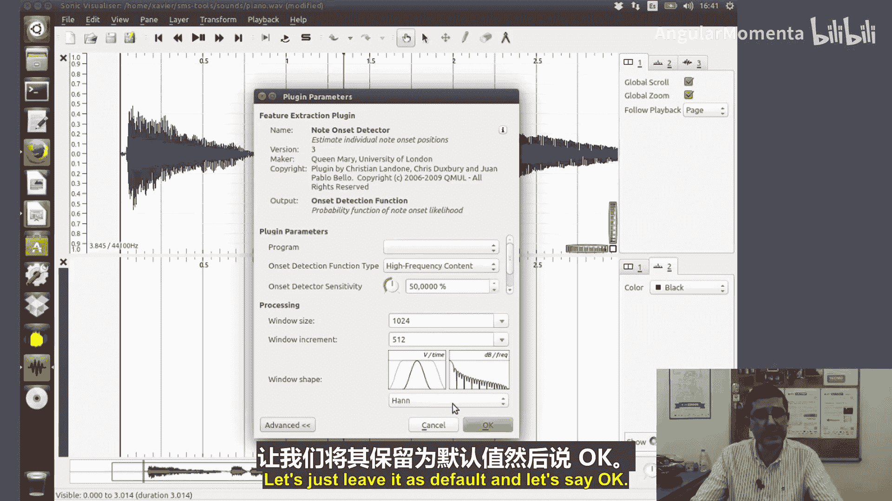

so these will use that function。 So let's use again， the high frequency content。

 and we will attempt to look at the variation of high frequency content in a way that we can identify where the transitions are。

 so let's just say， okay， at these the default default parameters。Okay。

 and now these vertical lines are what the algorithm has considered to be the onsets of this phrase。

The first one is clearly in the right position of the first note， the second one， same thing， third。

 the same thing。 it's pretty good here， I guess that's a mistake。 This is not really an onset。

 In fact， this is kind of the decay。 So it has confused the high frequency content of the decay and it has labeled that as an onset and the same here。

Okay， and the rest is okay。 So maybe let's undo this。Okay， and let's do it again。

But with sensitivity， different sensitivity。 So let's go at the same。

 And now we saw high frequency content。 But in terms of the sensitivity to being 50%。

 let's reduce the sensitivity。 So， for example， let's just make it very low。Maybe 19， okay。

 and let's repeat the analysis。And now， yes， these onsets are clearly where。I think they should be。

 So at the beginning of every note。Okay， now let's open another file。

And look at another type of feature analysis。 So， for example， let's。Get that speech mail sound。

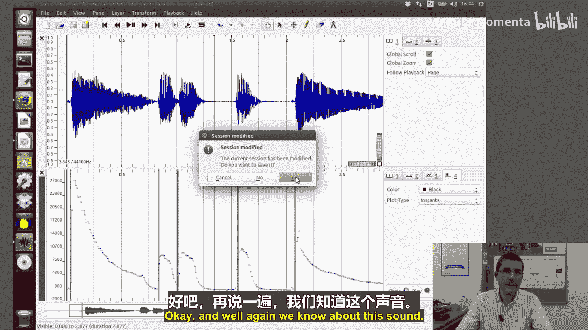

Okay。And well， again， we know about this sound。Okay， and let's do the same thing。

 Let's create a pain。

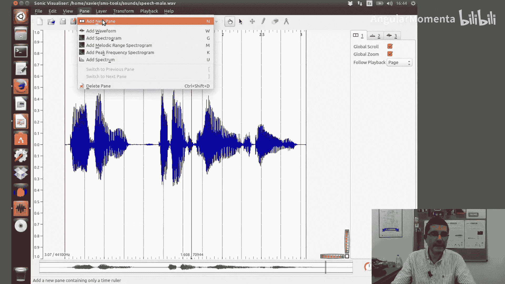

And let's look at the MFCCs that also in class， in the theory class we talk about。

 so we can go to analysis category and it's， in fact， in low level features。

And there is the male frequency coefficients， so let's click there。And again。

 this is a plugin developed by Qui Mary。In which we have some parameters。

 the first one is the number of coefficients in music， we use quite a few more than in speech。 So 20。

 So in speech， there is no need to take so many coefficients。 So 12 should be fine。And for example。

 there is an option here to display or not the zeroth coefficient， the coefficient 0。

 which I mentioned in the theory class that relates to basically the lowness energy。

 let's leave it so that we will see it。And again， we can specify the spectral analysis。

 the window size increment。 Let's just leave it as default。

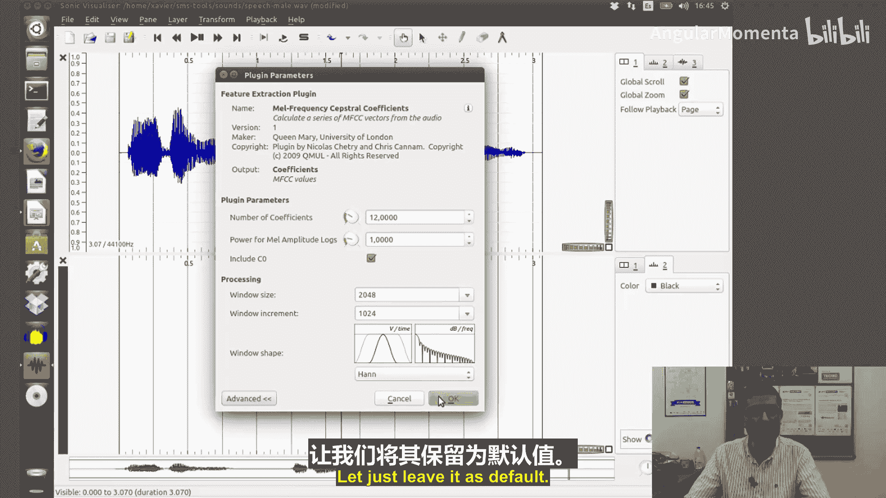

Okay， and that's in the life。Okay， and these are the all the the coefficients as they change in time。

呃As。Okay， let's open it here。 if we open it more， we actually see the values of them。Okay。

 so we start at the beginning。 We see these values。 Again， the first coefficient will be the the。

When I said kind of the loudness of the sound， and then here we see the different coefficients and the different values。

Again， by looking at it is not that intuitive what it does。

 but is definitely a very useful set of features because basically every coefficient is a feature with which we can do quite a lot of things in speech。

 all the speech recognition type of task are done like this and for a lot of timber based analysis。

 this is a very good， very compact description that is very useful。

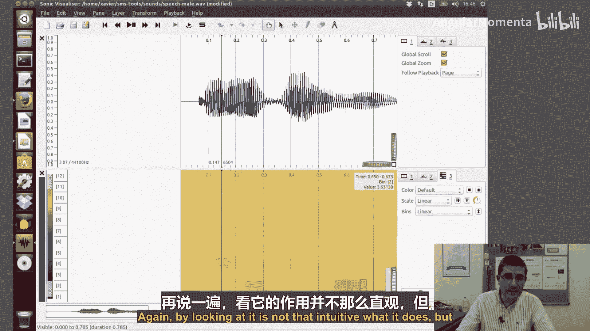

Okay， and finally， let's open another sound。Maybe let's open the cello sound that。

We have been using sometimes。Okay， the yellow double， okay？嗯。

This is a sound of a cello play with a double string。

 so we have two strings playing at the same time。

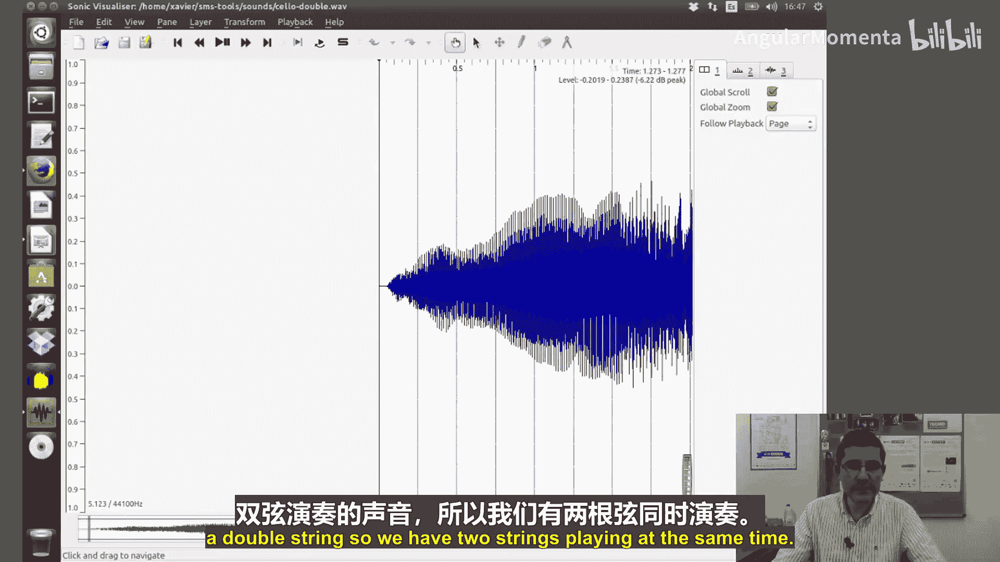

あ。

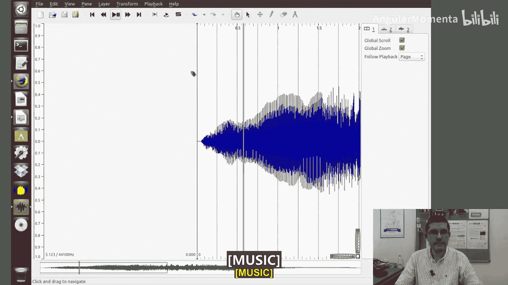

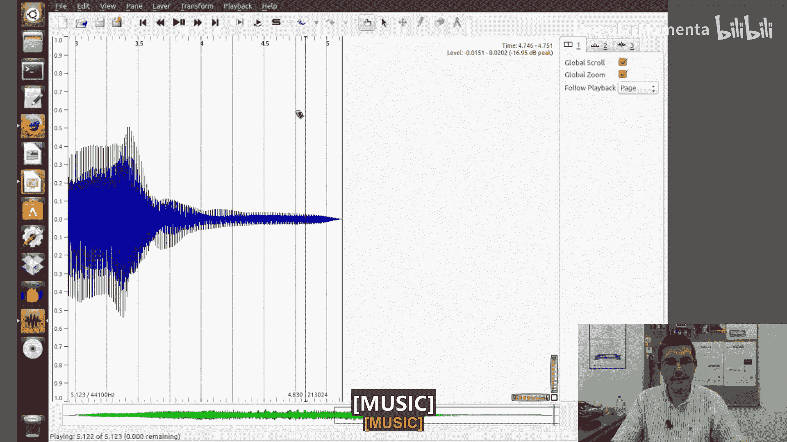

Okay so。This is a good sound in order to analyze the node of it because there is two phrases or two nodes playing at the same time。

 so we can perform the analysis of the chroma type pictures and in here under visualization there is a very nice chroma analysis different from the one that we showed in the theory class。

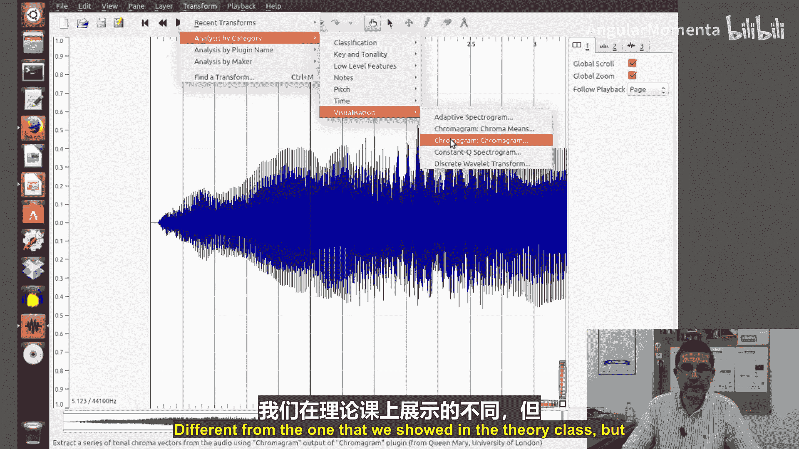

But let's first open an empty paint。And now let's analyze this chroma。Okay， let's 그런ogram。

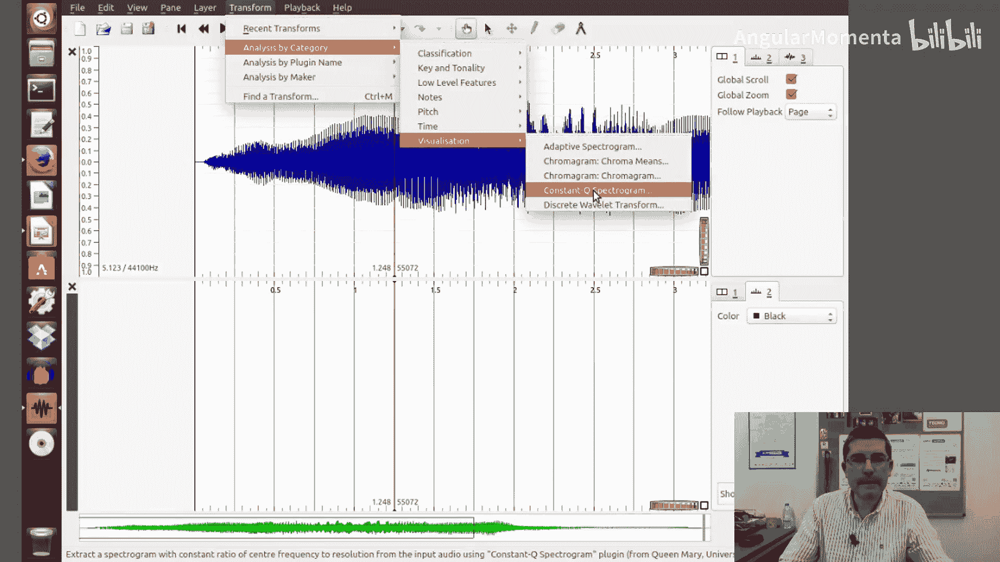

， and it has several parameters also， like the minimum a maximum each so that the range that it will look and the tuning frequency because these will basically do an equal tempered analysis and it will center a set of filters on these particular frequencies。

And we can specify the number of divisions per one octave。

 so in Western music makes sense to have 12 bins or 12 semitones。

And then again we can have window size and ho size since here we want a very fine frequency resolution。

 a large window size is very good and then the ho size also can be equally large。

 so let's just use these default parameters。And let's see what it does。

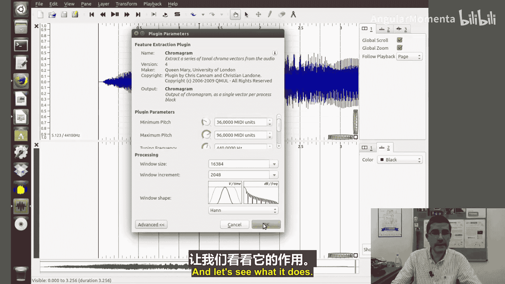

Okay， so this is the result。 And well is maybe we can make it a little bit。More。Pronounce。And well。

 we see that there is this low sound。 There was this D sound that was playing all along。Okay。

 this is the normalization that indeed it was an octave going from C to the next octave。 So to the B。

 And here we have all the semitones on the left。And the nodes I played。

 One was the D and the other was a little scale played on the A。 So here at the beginning。

 we see clearly the C playing all along and it gets confused with C sharp。

 maybe it was not so good at playing the Cs。 maybe the tuning frequency should be a change a little bit。

 but anyway， so the D clearly is here。 and then the little scale on the A。

 So this started with the fifth。 So a and then there was B。

 and then clearly well here I guess is that the C was being played。 and then again。

 I guess the D was played。 So here' is in fact that's why D comes from this fact that the upper D that I played in fact。

 gets merged with gets folded because we're doing this chromme analysis with the lower D。

 So in fact this is good。 This is what it should be。Of course， again。

 this is not a visualization of the melodic analysis。 This is of the chroma features。

 So we see the pitch classes。 We don't see the optta of the note。And again。

 this is a very good representation that can be used to study chords， for example。

 or to study different aspects， key type aspects of music that can help us understand and compared pieces of music and pieces of recordings of sounds like this one。

 So that's pretty good。Okay， and that's all I wanted to say， basically。

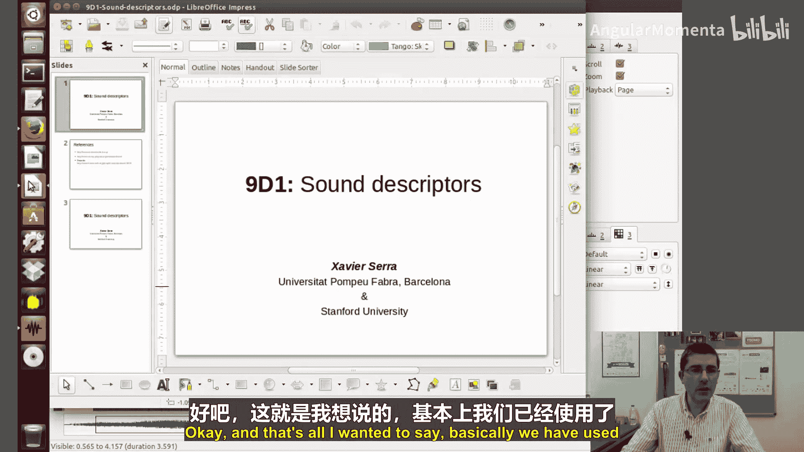

We have used a Sonic visualizer and you can look at the website of Sonic visualizer。

 especially the section on plugins in which you can download a lot of these plugins。

 the ones have been using and these were from Queen Mary and of course。

 the sounds I use are the ones we use for the class and available in in Freeso。

And that's all so we have used the concepts that we explain in the theory class but explain them with a very demonstration type of approach。

 we have used Soonic visualizer and I believe that gives us a very intuitive point of view into these sound attributes。

 of course the interest of them especially when we computationally compared with other sounds and we can do sort of more quantitative type of analysis based on these features。

And that's all for today So thank you very much。 And in the next demonstration class。

 we will do another demonstration and in that case related with freesome。 so thank you very much。

 See you then。😊。

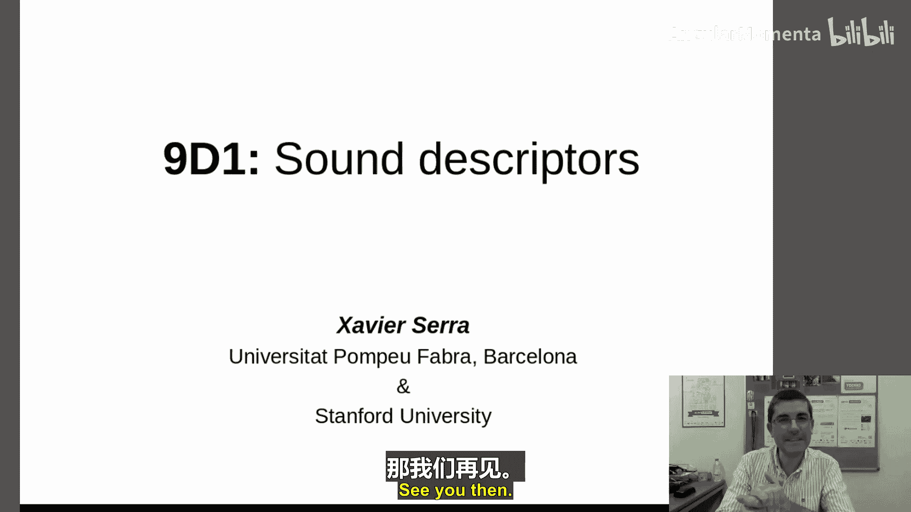