# 【巴塞罗那庞培法布拉大学】音乐应用中的音频信号处理-｜-Audio-Signal-Processing-for-Music-Applications-p67-09_03_01_Essentia-入门简介--BV18Xr6BeEX5_p67-

Hello， welcome again to the course on othering processing for music applications。

This week were talking about sound and music description in the theory lectures。

 we talked about how to analyze sounds and obtain some features based on spectral analysis or on the things that we have been talking all along this course。

 but specifically to describe large collections of sounds。

 so the idea of obtaining features with which then you can measure the similarity between sounds or we can cluster sounds or we can classify sounds。

And we mentioned about Acia， the software library tool that we're going to be using in this week and also a little bit next week。

 so let's talk a little bit about Acia and how to install it and how to use it in some simple examples。

Okay， so you can go to the website of aia， centthia。upf。edu。And in it。

 you can find a lot of the documentation where to download it。

 things that have been done with the Cnthia and other related information。So again。

 Cthia is an open source C++ library that has been developed thinking about audio analysis and audio based music information retrieval。

 so this idea of describing sounds and music， and it's an open software project。

 so it's the license is a fair GPL。And it has quite a few things。

 it has a whole bunch of algorithms and a whole bunch of ways to extract features from sounds。

 but also have a whole bunch of utilities that makes that quite easy so it can it can facilitate our programming of more complex ways of extracting these features so for example。

 this is a block diagram of a series of algorithms that have been put together using these Cthia facilities and therefore we can easily and efficiently generate this type of descriptors of sounds。

It uses Python quite a bit， in fact， it has a good support for Python for wrapping this C++ library with Python。

 so we get the benefit of an efficient library， an efficient C++ implementation and at the same time quite easy and convenient Python framework that can be used to call the C++。

So the first thing that we should do is just go to the download page。

And it's in Github so you can find the source code in Github and also there is some accompanying software that you might use which is this guyya software it supports Devviian and Uuntu and also Mac OSX even though of course in this class we are going to use the Uuntu version and and show examples using Uuntu So if we go to the Cia Github page okay so here is all the source code of Cthia that's a pretty large piece of software。

So to install it， the normal way when you want to really keep updated on these things and not have to reinstall it every time is to use this clone URL so we can copy this URL Okay。

 and now we go to the terminal we can go to a specific directory or。

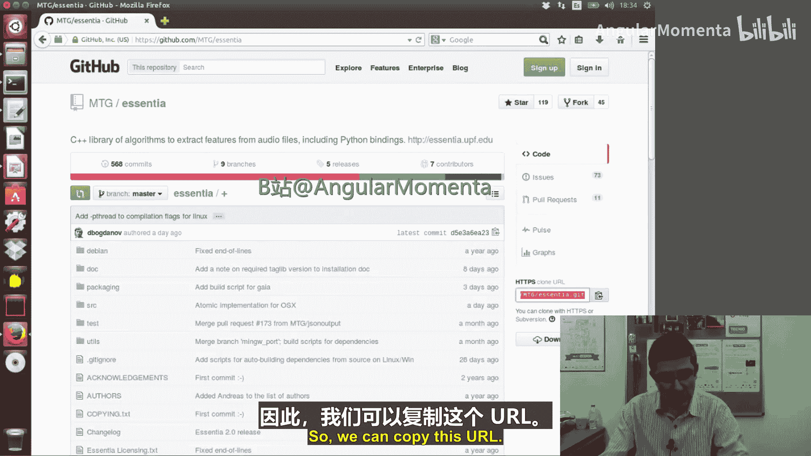

I guess I have a TmpP directory and I will clone the repository into my machine。

 so I will type Git clone and I just put the HCTP address of the repository。

And now we'll start copying everything into my computer。

 That may take a little bit because that's quite a large library。

So maybe let's just stop it because I already copy it。 So I will stop it here。

 now I will go to the place where I already copy this。These libraries， so I have here。

All the structure of what I copy that is in Github。Okay。

 now in order to we have to compile it and install it。

 so for that we can go back to the Acia website and within documentation。

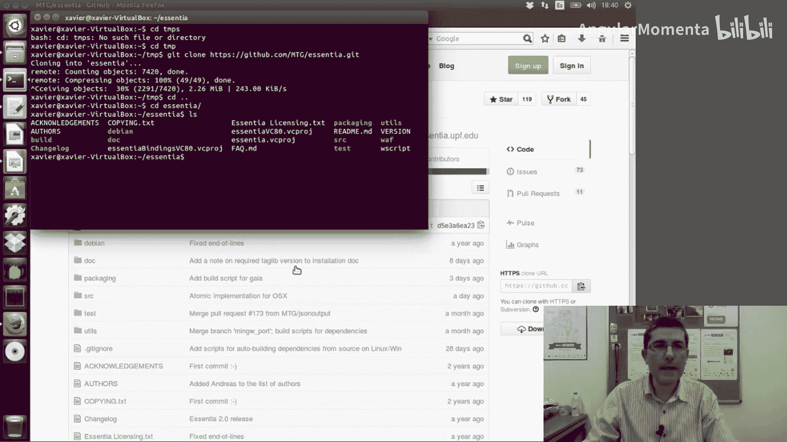

There is well explanations about again what it is， and then in user documentation。

 there is a section on building and installing sentia。so once we have downloaded， well。

 there is quite a few dependencies of libraries that they used like the Fftw or FFm pack for all the audio in and out for changing something rates。

 etctera， etc So we have to install all these dependencies so we will just copy this complete line and we go there and we can just we are in our home page and we just type pseudo and we get all these dependencies that might be needed。

 so I have to type the password because we are doing it as super user。

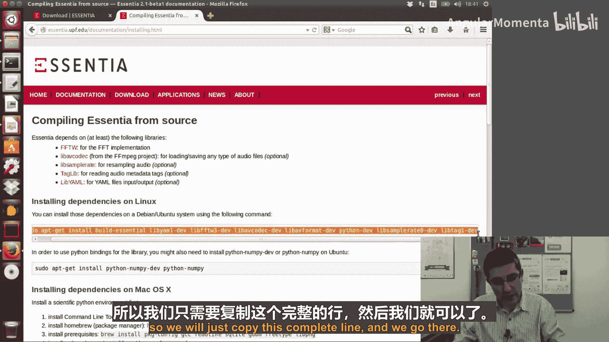

And well， I had it installed already， so it just checks and it sees that everything is there。

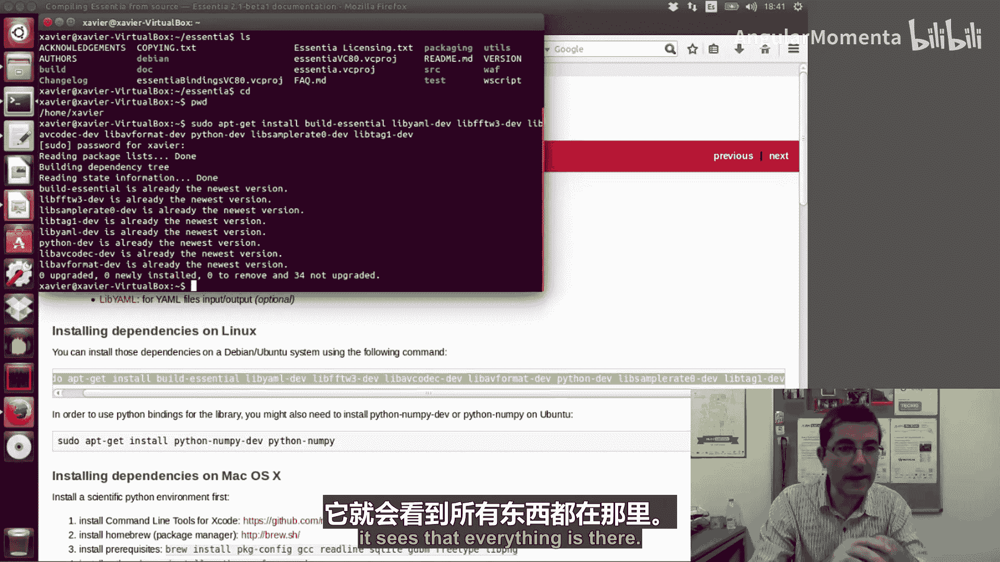

Then if I want to use a Python and I want to use this wrapper for Python。

 it needs also some Python packages， but in fact I believe these packages were already installed because these are the ones that are used by the SMS tools and Ny and the development and Ny。

 but we can just make sure that are there， so we just do pseudo。

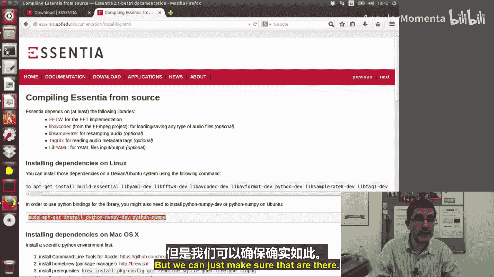

And yes， everything is there， so no need to install anything else。

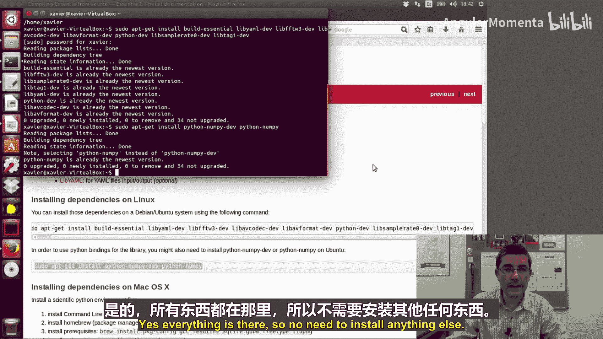

let's continue well there is the instructions for Mac OSX and now there is the instructions for compiling Cthia and this is what we need now。

So we have to first configure all the the structure of of the library in order to be compiled。

 So we are using these W。Compilation tool。 And again， we can copy that and we can go to ourthia。

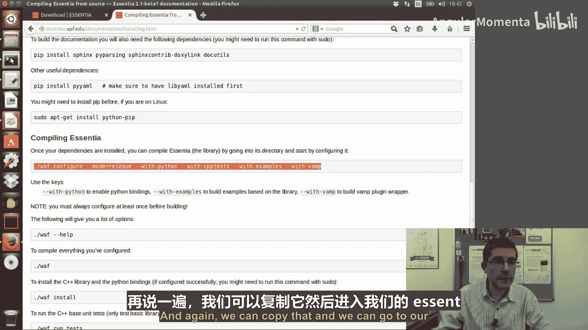

Dictory， that's here。Okay， that's where we have all our sentia。

 And now we again configure out what it needs to be configured。And it will check everything。

 it checks if everything is there and it says， yes， it's fine， it has been configured。

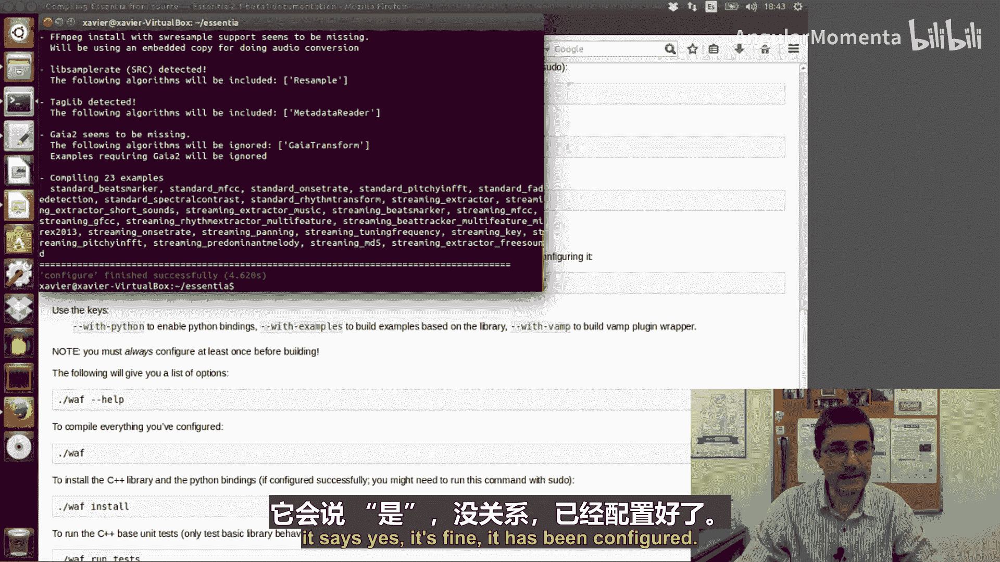

And now we have to compile it and to compile it， we just have to type this。

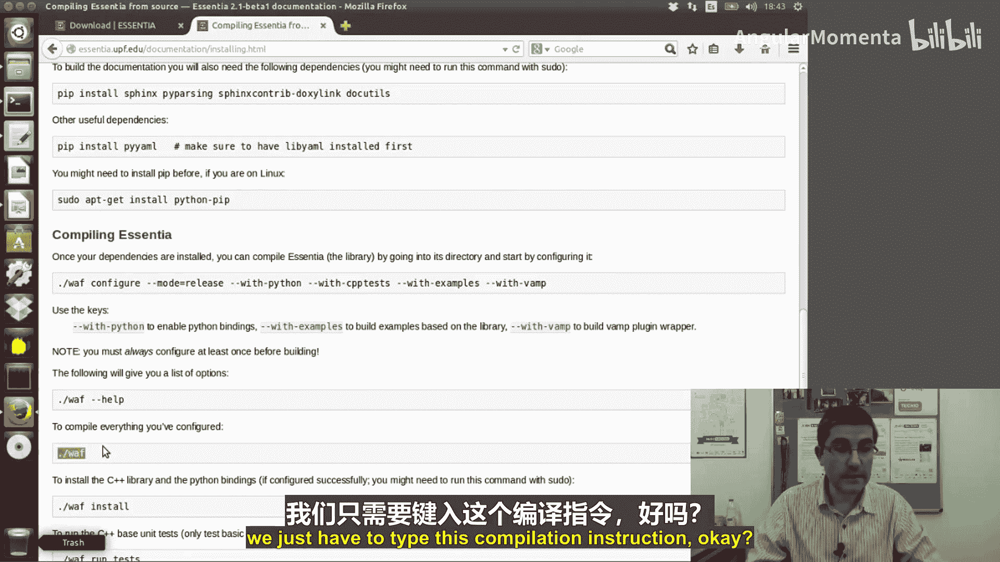

Compilation instruction。Okay。And these will go through all the directories。

 all what needs to be compile all the C files and compile them as object files。Okay。

 so it's it's building everything。And again， these may take quite a bit。

Because it's a pretty large library。So let's stop here because in fact。

 I already have compile all this， so let's stop it。

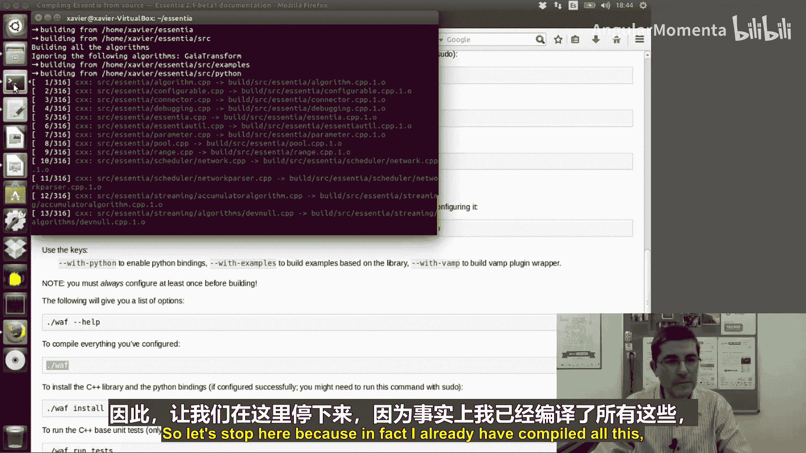

And we can just continue this。 so we have compiled。

 then we need to install so that all the Python bindings can find all the information。And we can。

 well， there is some， you can run some tests or you can run the Python test or you can generate the documentation。

 but the documentation is basically the same documentation that we have here。Okay。

 so that that's done。 and then the in this directory again。

 we have everything compiled and we will have the directory where we have all the binaries and we have everything else ready ready to be used。

Now we can go back to the documentation。And start looking at some documentation for actually using asia。

 So in here， there is some tutorials。And the one I recommend is this Python tutorial for beginners。

 so this is a tutorial that explains how to use Python as a way to call all these Cynthia algorithms so if you go through that。

 you will see pieces of code that you can basically copy and by following that you will be able to do some analysis of some sounds。

But let's do our own example， so in this text file I have a piece of code that is basically the one that I use in the theory lecture。

That I use to compute the MFCCs。 so in fact， you can see this code exactly in the plots from the lectures。

But now let's explain what it is and so that you can actually do it yourself。

So it's a Python file that has the standard import packages， the Nai， the Matpl Li。

 and the one that now is specific for Ecentia is this one so theia has been compiled so Python will be able to find package we are not importing the wholecentia。

 we are just importing one of the packages within Ecentia。

 which is what we call the standard package， that is also another package which is meant to be more efficient for streaming is the streaming package。

 but we are not going to use that。 were going to use this more standard package。Okay。

 and then well we have some initialization of some variables that will be used for analysis。

We have seen all that。 So no need to now to talk about that。 the core of Ecentia starts now here。

In which we are initializing the algorithms that we will be using。Sthia is is being written in C++。

 so it's a collection of classes。 every algorithm is a class。

 and this is in the in the sort of object oriented approach。So in order to use an algorithm。

 we first have to instantiate the algorithm and give it a name。

 So here we are instantiating the class spectrum。Okay。

 we inated with initial initialization the size of the FftT size n。

 which we have here declared as 1024。And now， the variable spectrum has an instance of the spectrum。

And we do the same thing for windowing。 So there is an algorithm for windowing in aentia and we initialize it with a given window size and a given type。

And therefore， window now is an instance of this windowing algorithm。And again。

 the same thing for the MFCC algorithm， the MFCC algorithm can be initialized with different parameters。

 and here we initialize with the number of coefficients that we will be using and the size of the spectrum that will be required。

So these MFCCCs is now the instance of this algorithm。And one very。

 very useful set of tools from Asentia is the way to read audio files。In this case。

 we're using an algorithm called monoloader。And this is an algorithm that accepts any type of file format or at least a wide variety of file formats。

And then by specifying the sampling grade。It returns a mono。File。

 independently if it was a stereo or even more channels。 It returns a monophie。

 It returns it with the sampling rate that we specify， and it returns it as a set of samples。

 So X is our array of samples of the input sound。Then we initialize the output array or metrics where we will store the coefficients and the core of the computation comes now。

so we will be iterating over the sound， computing the spectrum。

 windowing and then computing the M Fccs， and incentia is amazing compact with these four lines we are able to do all that。

So one of the core algorithms here is the frame generator。 This is an algorithm that automatically。诶。

Iterates over the the array X with a given frame size with a given hop size。 and also。

 there is several parameters of how we actually placed these windows in the sound。

And then this returns then frame。Fra will keep having the samples of that particular frame that we have chosen。

So now frame will keep having the different values of our frame and therefore the window here now will accept the frame。

And then we can put it within the spectrum automatically。 So okay。

 so the spectrum will be computed from the windowed frame signal。

An Mx spectrum returns just the magnet spectrum。And then this is what it is。

 the positive magnitude spectrum of this particular frame。And now we can compute the MFCCs。

 So the MFCC is again， now is is this object that accepts the array of magnitude values and it returns。

Both the coefficients and also， in fact， it look8。 it returns the bands of the of the MFCCs if we want to use that。

 But for us， what we are interested is in the coefficients。

And since this is being computed at every frame we need to append to an existing initialized to the empty array and then it will keep appending and create a metrics for that and then finally in order to be able to visualize with plots or to be able to pass to something else it's good to convert to to a nuI array so that we have all the nuI possibilities to handle that so now if we go to the directory where this file is and I believe is in SMS tools workspace so here I have the MfCC。

pyy and I start with I Python with Pla if I want to use Matpl leap automatically。

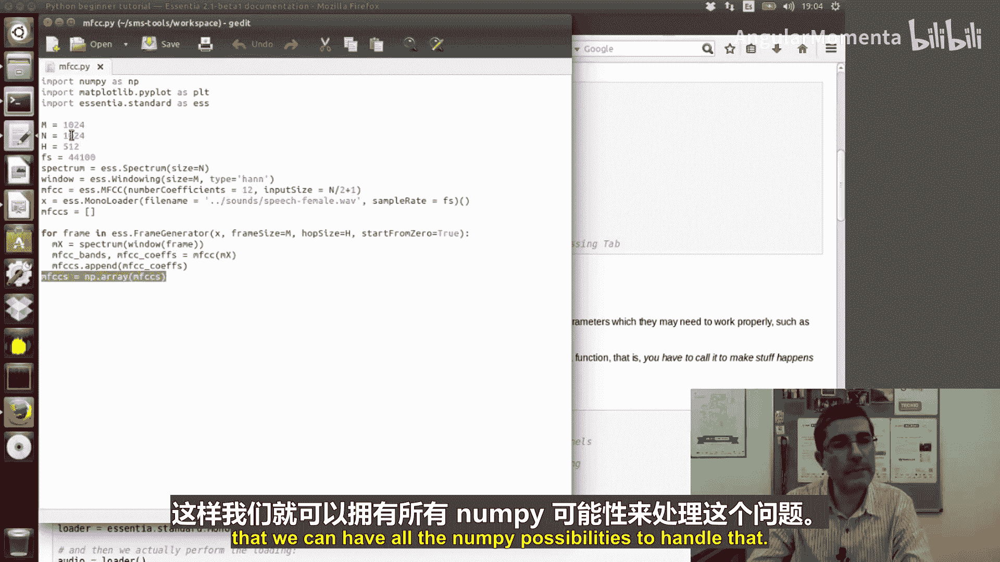

Okay， and now I basically can execute this file so I can just run an MFCCs dot Py。

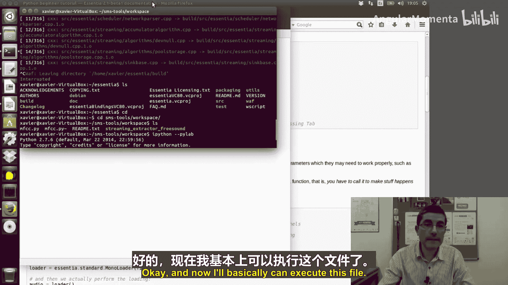

And these will have computed the， the the M FCCs。 So now if we type M C。Cs this is this array。 Well。

 this metrics of all the coefficients at every frame throughout the sound。 So， in fact， now， if I。

 if I do。P color mesh， this plotting function of matpl leap。 And I give it the MFCCs。

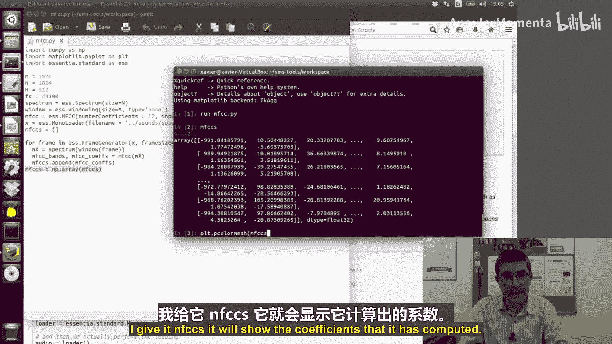

It will show the coefficients that it has computed。

 So here we see it horizontally as the coefficients， the 12 coefficients。

 well with the zero and then here is the frame location。

 So this blue line is the the zeroth coefficient， then we have the first etctera， etc ceter。

So that's pretty good， pretty useful。 And in order to understand how to call any of these algorithms。

 what we have to do is to go to the sentia documentation。

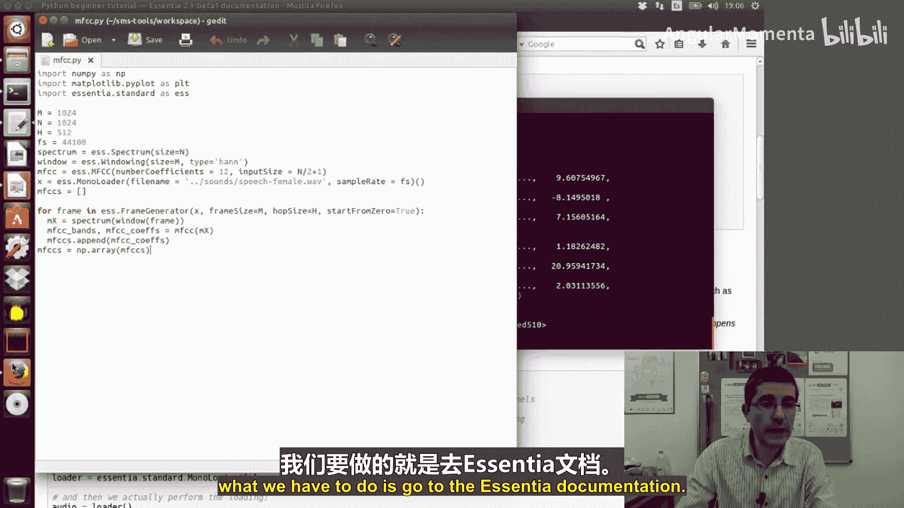

And go to the algorithm section。 There is the algorithm reference。And in here。

 you will see all the algorithms that Ecentia has。ok。Okay so here we have as I mentioned。

 we have two packages in Eia， one is the standard algorithm。

 the standard package that's the one we we're using and the other is the streaming one so in here in the standard one we have all the algorithms that are currently implemented in Ecentia and for example。

 if we go to any of the ones that we're talking about， for example the windowing one。

 we just go here and it gives me the input output and the parameters that this function accepts and also very importantly it gives us a link to where these algorithm comes from or what we use as the implementation for for for these version of this algorithm。

And of course， you can find all of them。Here， that's pretty good。

Now let's go back to the documentation and talk about something else。

 something another feature of Asynthia， we have been talking about the algorithms that are included in asthia and that we can use and write Python wrappers to call them but there is also the idea of complete extractors。

 so sort of extractors that have been developed in a way that are useful for some particular applications and that extract a whole bunch of things。

 so extract a whole bunch of these features and then we have a binary quite efficient code that can be used。

So for example， these are some of the extractors that are already available in Ecentia and there is one that is in fact this streaming extractor free sound。

 and this is the extractor that free sound uses to extract low level and other type of features from every single sound and then is the core of this similarity engine that we showed。

And all these extractors are in this built source examples directory of Acia。

 so if we go to the file browser， this is the Acthia directory and we go to build。

 we go to source S C and examples。Okay， and here we have a whole bunch of extractor， in fact。

 more than the ones that are in the documentation。 So these are have been already compiled and we can just。

Just use them。 So here there is a binary of the streaming extractor free sound。

 and we can just copy it。 And if we go to the directory where we work from the SMS tools。

Work is space。I already， in fact， have this binary there， the streaming extractor free sound。

And I can just then use it。 I can just。Copy it。啊。Okay， and I can execute it。

And I can give as input the name of a sound。 So here the sounds are in the sounds directories。

So sound， and maybe let's take the sound of rain。Okay， rain dot Wav。

 maybe let's make it so that we see it better。And then we put an output file。

 let just gave it the name of rain。Okay， now we execute it。And that's it。 It went very quick。

 so it created two files， it created a JSO file and a Yal file。

That are the files that include all the results of the analysis。

So if we now go to the editor and open this file， for example， the J file。

This is a particular format that is quite standard and in which we have all what we have extracted from this rain sound and well there is a lot of numbers。

But it's pretty good information for a lot of the things that we'll be talking about。

 even it attempted to extract the keys of this rain sound throughout the duration of the sound。

But anyway， we will be talking more about this in the next programming class of how to use this。Okay。

 so now if we go back to the documentation。Here we see other extractors that are going to be quite useful and we'll be talking about。

 One is this streaming extractor music。And this will be very much useful for analyzing pieces of music and we'll talk about that next week。

 and in fact this is the one that acoustic brains， which is an initiative that we started recently users to automatically extract the scriptors from music。

And that's all I wanted to say， so let's go back here。

 so we made an introduction to Acia and we were able to download and compile Eia from Gitthub。

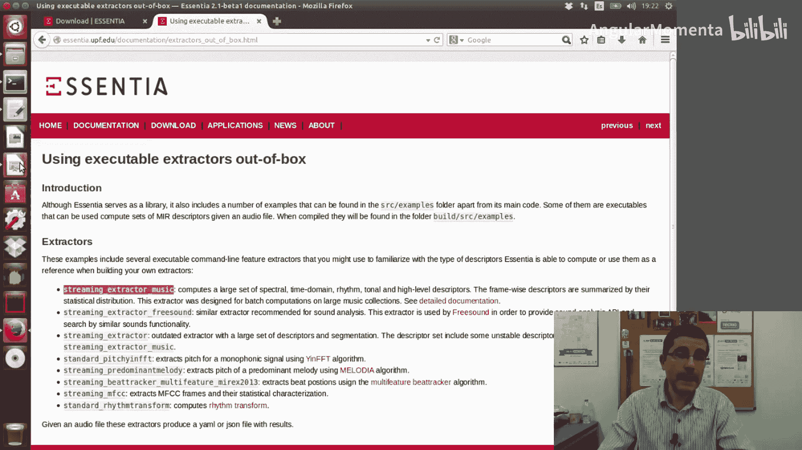

And that in Linux is quite easy， quite straightforward。

 and we talk quite a few things about the features of Eia， what we can do。

And we then ended by talking about the extractor that Free sound uses and that can be used to generate a whole bunch of discreteors of all the sounds。

 and then we will be able to use for quite a lot of things。

So that was all hopefully you got a little bit of a very introductory view to Asentthia that's a quite complex library and it can be quite complicated to use in terms of all the features that it has but it has an easy way in and so we can start using it with simple examples and we will see in the next programming lecture how powerful it is for doing some interesting sound description and describing collections of sounds so thank you very much and I will see you next class bye bye。

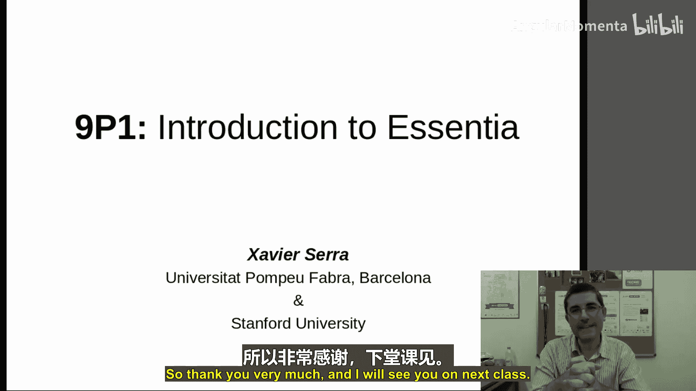