# 【巴塞罗那庞培法布拉大学】音乐应用中的音频信号处理-｜-Audio-Signal-Processing-for-Music-Applications-p68-09_03_02_Freesound-API--BV18Xr6BeEX5_p68-

Hello， welcome back to the course on reducinging or processing for music applications。This week。

 we are talking about sound and music description。And in particular。

 we are talking about how to analyze sounds in order to then be able to describe them within sound collections so that we can compare sounds。

 we can classify， we can cluster sounds and describe in that way collections of sounds。

Therefore we need access to collections of sounds from a software type of perspective。

 so we need to be able to access these sounds programmatically and then obtain these analysis results and play around with them。

The free sound API that's an excellent tool for doing that。

 So free sound has a lot of sounds and through the API we can using Python， for example。

 we can access all the information within free sound。And then process it in many different ways。

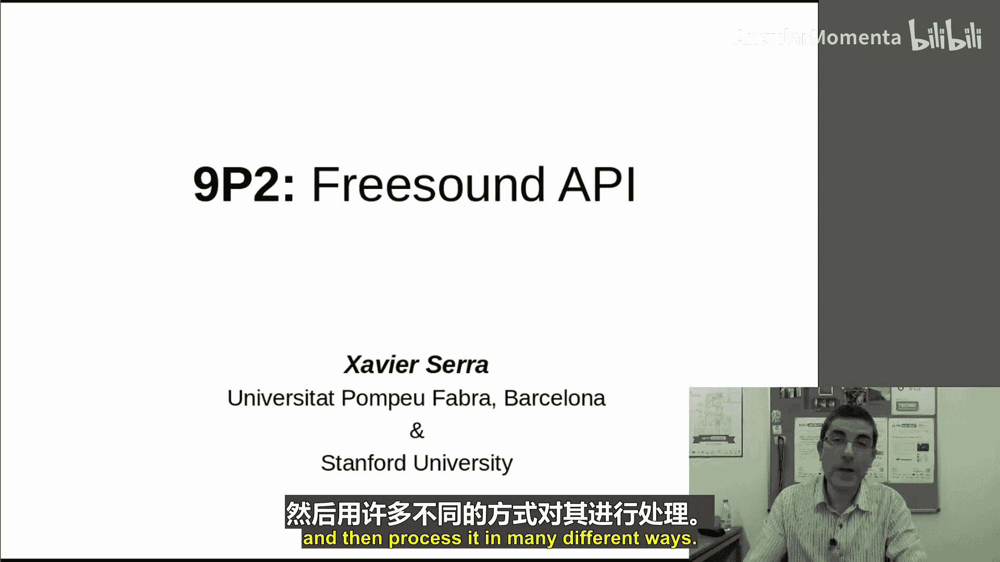

So let's try that。 So let's go first to the。Free sound website。Okay。

 and in order to learn how to use the API， we can go to theDevelop section down here。

Okay and here it tells me a little bit about the API so first of all what's an API well an API is basically it's a protocol and in the case of web APIs is a protocol that uses the HTTP protocol and we can make calls HtTP calls to free sound in a way to query the specific content of what is in the database so we don't have to use the web type of interface to access that。

And in the documentation， there is information about how to actually do that。Okay。

 so there is information about how to access the different sources of information。

 So if we go to the resources page here， it tells me how to search the different content types。

 So for example， here in the search resources。It starts by talking about a text search。

So we can query and we can do the standard text query that Free sound has。

 but programmatically and we can apply filters and we have basically access to all the information that has a text label inside free sound。

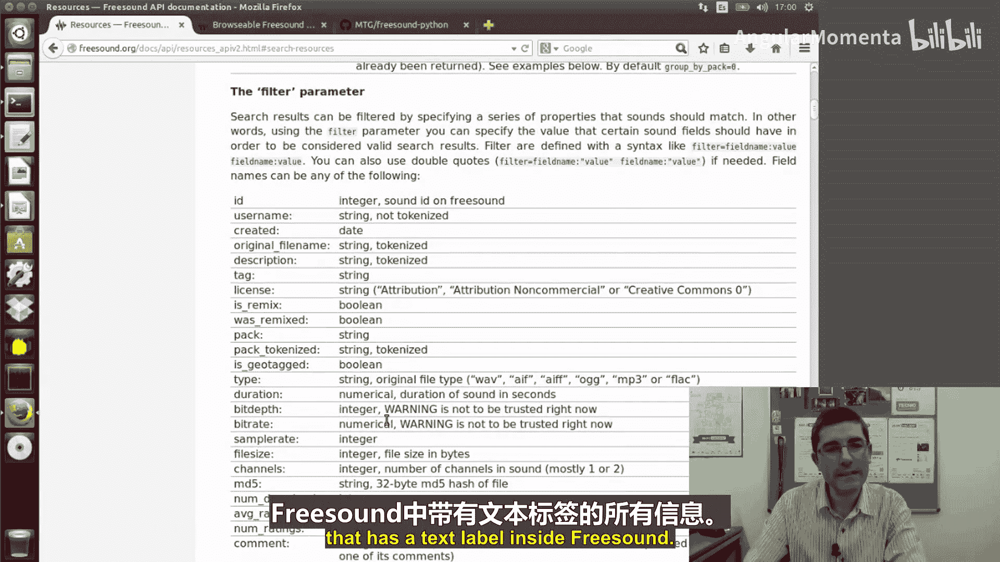

But we can do a lot more than that， and we can also search for the content so we can search。

 for example， to the analysis data， these low level features。

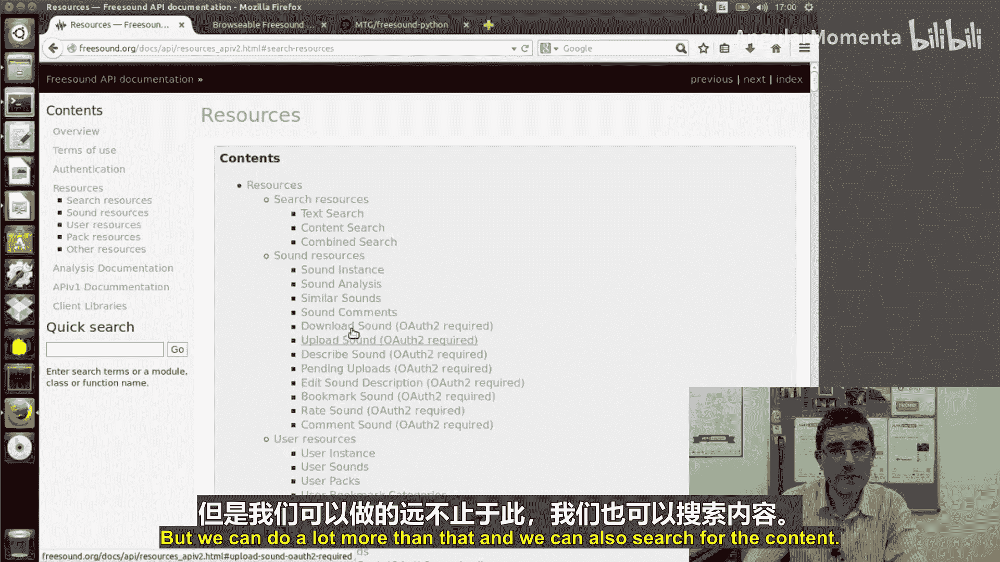

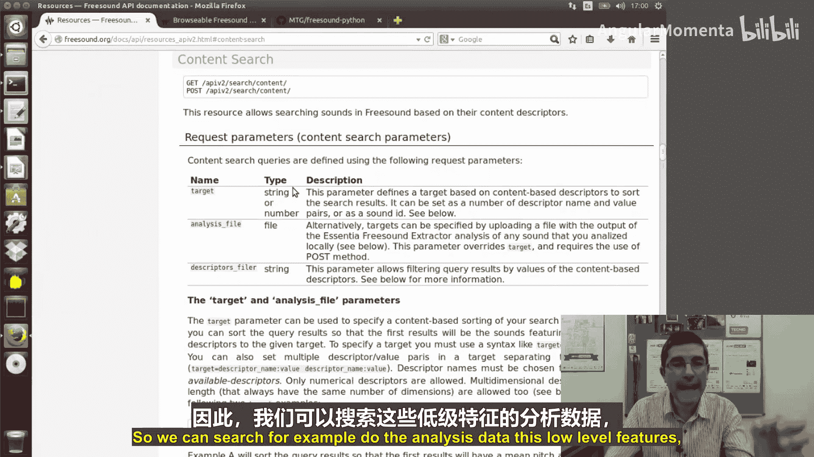

And then not only just get them， but filter them。 So， for example， here。

 there is an example of how to get the pitch of of the mean of of the pitch of a sound that is 220 Hz。

 So you will find sounds whose mean pitch is 220 Hz。 So that's pretty good。

 It can be quite quite powerful to do that。To get a visualization of that， we can go here。

This is a specific call of the API， strictlyly speaking is not a call to the API because we are not using kind of a software to make this call。

 but it's an option to have a URL。That displays the information of one of the resources of the API。

 so if we specify the free sound website and then follow by API version 2。

 so API V2 which is the API version that we are using and then specify the name sound and the number of the sound。

 every sound in free sound has an ID a number。And it returns the information of this resource。

 which basically has a summary of all the information of that particular sound。

 So in here we see some specific examples of API calls that return more specific information。

 but then the default information is the one here。So this is the actual call of the API that we are now doing and in here is the information that is returned so we have for example。

 the core information of the sound， its ID its URL the name of the file。

 the tag that the user specify the description of the sound， etca。

 a whole bunch of things when it was created， the license， the bid rate， the bit depth duration。

 and also things like preview so we have access through the API through some like low quality or high quality previews or the images that display images that are shown in freesome so that's a very good information that of course we can get it all together or we can just through the API ask for some specific items of this information。

And then there are things like also the analysis information or the sounds that are similar to this one。

 so we can also access that through the API so for example， let's click at the analysis statistics。

Okay。So these returns the。Low level descriptors that have been analyzed the statistics of them。

 So we see here the the different statistics for spectral complexity， etca， all the descriptors。

 So it's a pretty big list of all the low level features。 and again。

 these can be accessed directly from the API and access specific items for that。

So that's pretty good。So now let's go into again， into the resources。And。

We can then talk about the client libraries， so the client libraries are the libraries that have been written in a particular language。

Through wheat then we have access to this API and we have some code that facilitates this API call。

 so let's use let's go to this Python library。

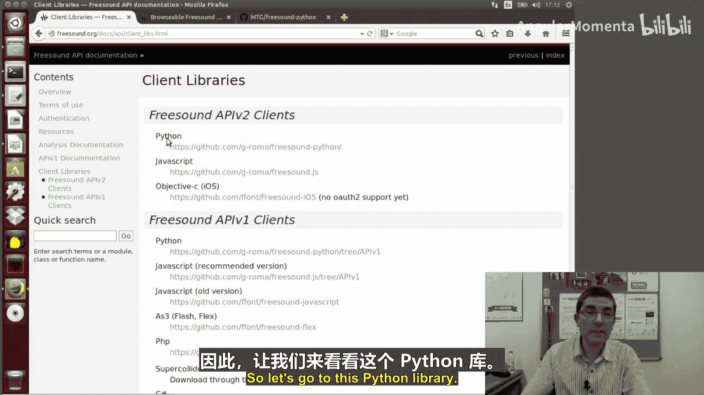

So this is the library that has been written in Python to access the API。Okay。

 so it's's a simple library。 Basically， it has。Two major files。

 So one is this free soundund dot Py that specifies a series of classes of functions。

Through which we can do all these queries through the API so we can do the text search queries or we can get sounds or do combined search or different things。

And then， there is。Another file that is quite useful， which is the examples file。

So in these examples。We have some example pieces of code that perform different things。

 so for example， they can perform we request a sound for example here and then we can just display the information about this sound or we can get the analysis data etca。

 et ceter。 anyway， so let's use it， So in order to use it。

 the first thing we will have to do is basically clone it so we would just go here and get this Htps URL and then do from our computer git clone this and we will get it but in order to use the API we need to have an API key。

Okay， so the first thing we need to do is go to。Free sound。And apply。 So this is the again。

 the developers page of free sound。 and we need to apply for a key。That's a key that is。

spececific to us and specific to our computer and therefore it should be personal。

 so now I apply for a key and I will delete it after I do this demonstration。

 but basically let's just use this key in in this lecture to exemplify how to use it but you should apply for your own key and then use it and then you have this API key which。

It should be secret， and you would use it。 Okay， so let's go to。

A text editor in which I copied the files that this client library had。It had this free sound。

t Py file with all these functions that allow us to call the API。

 and then it has these examples file in which we can do a number of calls to the API to put them as an examples。

 and there was a place in which I have to put the API key。

 So in Cet token we go to the to the where we started before in here and in the examples。

In the original file， in the examples files， this is where I had to type the API key。

 And so if we go back to our。Our text editor here is where I place the API key。

Now in this example code what I do is I get one instance of this free sound client。

 this again is a object that I create is an instance of an object is a class so this free sound client and then I have the variable C and now from this instance I can ask a specific queries to the API so for example I can get a given sound with a given ID and this will return the sound in fact it also again an object and then I can query this object and for example。

 obtain the lowleve analysis parameters。And then print some of them。

 or I can ask for similar sounds so I can get the list of the most similar sounds based on these descriptors to this one and I can do other type of queries to these basic function。

 so for example， instead of asking for a sound I can do a query of a text query with some filters and this will return these results。

And also， I can do other types of queries based on， for example， the content。

 I can search for all the sounds that have a particular range of a given low level descriptor。

 for example， here， a given variant of a peach or a given a salience， etc。

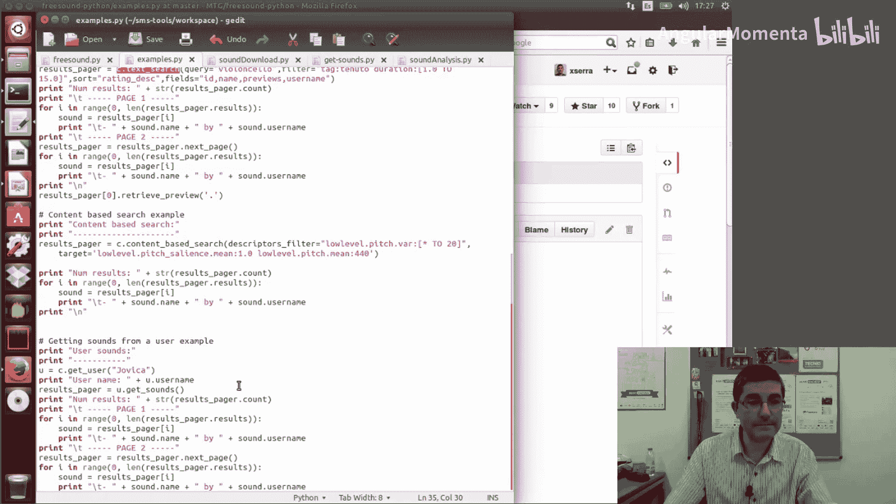

So let's in fact run this， let's go to a terminal and I am in the directory where I have these files and I can just run examples dot well theres not P wide run examples。

Okay and this is all the result well it's pretty long so we are not going to be able to go through everything but the result of the examples。

 it gives me the sound info and that's the first print statements that we had then it gives me the analysis。

 the MFCCs that I ask， it gives me similar sounds， the names， the names of those similar sounds。

 or then when I have these example of searching for the word Biolello。

 it gives me the names of different files。And then again。

 that other search that is in here that finds specific queries to low level descriptors， etc。

 and this last one is about the sounds of a particular user and do something with that。Okay。

 so that's pretty good， so let's now go to one example that we are going to build。So， this is。

Some code that in fact， we wrote for the assignment， for the assignment of this week。

 to facilitate you to play around with the Free sound API。So in this piece of code。

 what we are doing is facilitating the downloading of a collection of sounds based on some specific query。

So we defined taking this free sound code from this client library， we are。5120。

Putting together a function， this download sounds free sound that you can give a query text。

 some tag， some duration， your API key， and then the directory that you want to put these sounds into and then you can specify how many results it should obtain and the extension of the files。

And so what I did was to just write a little。Example that in fact I could tie directly on I Python that basically makes calls to this function。

 so I import that file， the sound download file， I typed my key here。

 and these are three calls to this function。So I want to get sounds from the z。

And I want to store them in the TNP directory。And I want to get 20 the top 20 results and with the restriction that duration has to be from0 to5 and the tag has to be multisample and I do that for bazoon guitar and violin with kind of similar I guess this bass I could put also from0 to3 that would make it easier so these are three function calls to these function that now we are not going to go through that。

 but basically this is going to be part of your assignment and you will get this code and you will be able then to write something like this to be able to get some sounds。

 So let's go to the terminal and again here I have get sounds。

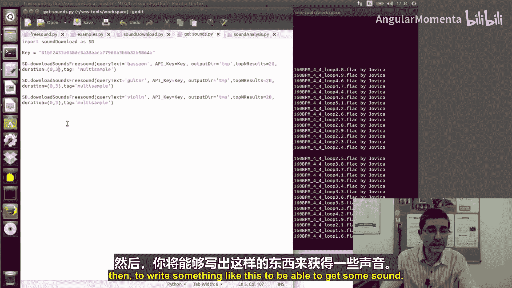

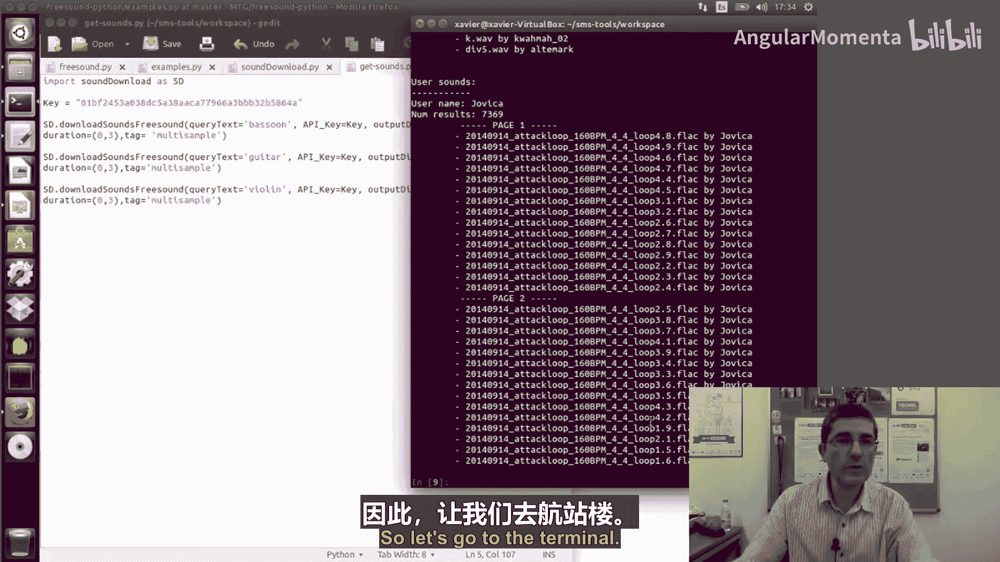

File。And if I run it。ok。It obtains， it downloads。20 sounds for every query。

This of course depends on the query labels， this might not be possible if the attack is wrong or the query is not correct。

 we are not going to get so many sounds for that particular query so if we now go to the file system and go we are now in the TMP directory that I created。

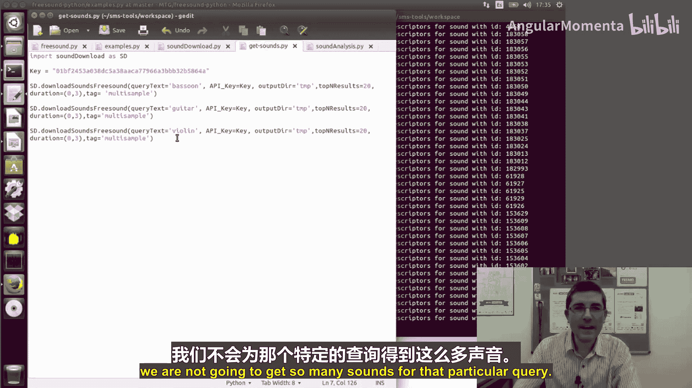

This is the three folders that。This little program。Created。So one to store the sounds of the bassoon。

 for example， so these are 20 sounds。And in every directory there is the JSON file with the description of the low level descriptors that I ask for and the MP3 file。

 so in fact the low level descriptions if we just open it with G editit。

Okay I didn't ask for all of them so in fact if we go to sound download again the only descriptions that have been asked for are these ones。

 the centroid contrast dissonance high frequency content MFCC's look at that time and in heronicity so in my JO file we have all that some of those file some of those descriptors like MFCCC has several values so this is the information we have for every sound I also ask for an MP3 file so we can listen to that to see if that works。

So now basically we have。All these sounds， all these directories with all the descriptions of the sound and also sort of a little version of the sound so we can also listen to them。

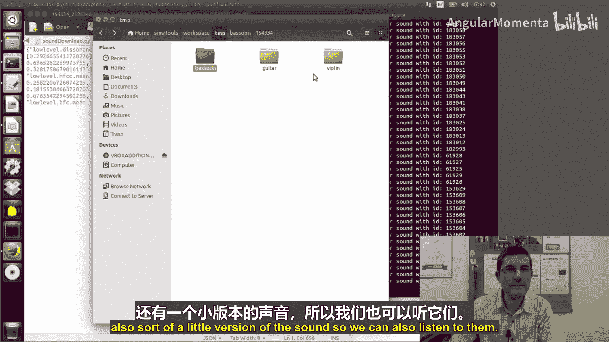

And we can start doing things with that。So as part of the assignment。

 we are also distributing another Python code。That facilitates doing things with these sounds that we just obtained from the API。

So this sound analysis code that you will get with the assignment。

 we have created different functions that allows us to do a display of these features and do some K means and KNN type of processing and that you will do in the in the lab。

 so no need for going through that now but let me just at least show you one of these functions。

 this one， this is a very simple function that what it does。

 it will display we give it this input directory， the directory that we want to look for the sounds。

 this is this TmpP directory that I created， and then I can specify the descriptors that I want to show and then it will plot it in a 20。

of all the sounds that I have there。 So I have to figure out what I want to plot。

 So this is the all the descriptors that I have obtained。 So the number of descriptors was less。

 but some of these descriptors had a number of different values for these。 So for example， the MFCC。

 So here we just have the the mean of the first five。Okay， so now I am in in this the same directory。

 I can import the sound analysis。

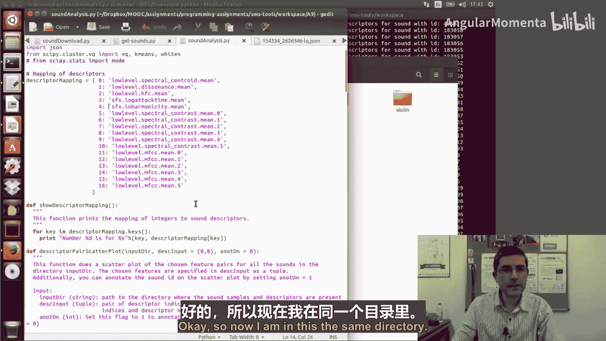

File so that I have the functions here where I can better import as for example， SA。

And now I can call essay dot， and I can just get this function。And呃。

And I will ask for the directory is the TmpP directory where I have the sounds in。

 So this is this directory here。And in terms of the discors， I can just put desk。Input， and I will。

 for example， use0， which is the spectraltrocentroid。

 So here we we see that0 is a spectraltrocentroid。 and maybe let's take one of the MFCCs。

 for example， the first MFCC and that's number 12。 So I can put 12 here。

And let's see that should do something。Okay so here is the result I haven't paid much attention to what the scriptors to use。

 but in fact it's already interesting and we can discuss certain things about this plot so the sounds I have our guitar sounds。

 violin sounds and bassoon sounds， Of course I have not listened to them so I don't know exactly what they are like。

But well， it's interesting bassoon， it's quite cluster。

 so that means that all the sounds of the bassoon were quite similar and interestingly enough。

 the centroid is quite low， which makes sense。 bassoon is a low instrument and the MFCC。

 this particular coefficient number one is quite high。The other two sounds。

 the violin and guitar are quite mixed， maybe violin has a little bit higher MfCCs and a little bit lower centroid。

 but basically the centroid means that the sounds are in the same register the violin in terms of the yeah it's a little bit more spread but that's quite interesting and we can learn a few things about the sounds and about the features by trying to understand why a particular set of features results in in a particular distribution。

 of course we have to listen to the sounds to make sure that we understand what's going on。And well。

 that's all I wanted to show in terms of the free sound API。 again。

 if you want to actually go into more information， you should look at the developers。

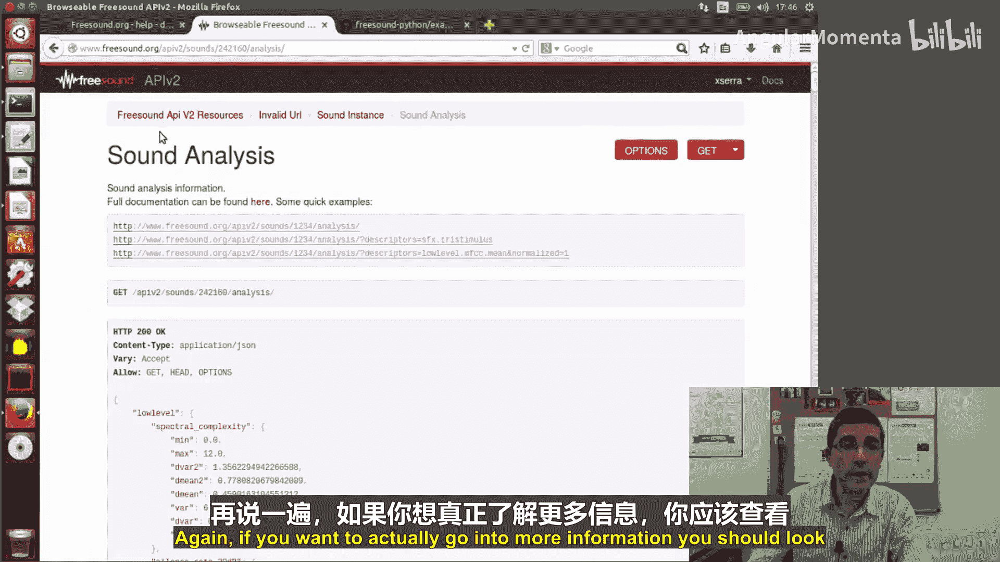

Page of free sound。 And that should give you more information。Okay， let's go back to here。

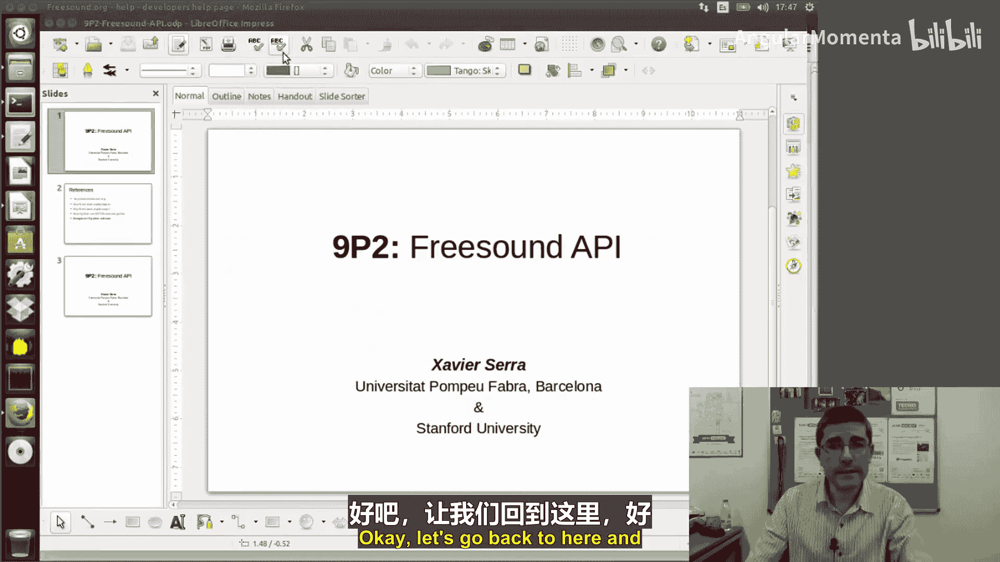

And well for references， again free sound and you need to apply for an API for an API key so this is the URL for applying for the API key。

 the documentation of the API and this client library that we are using so that is a Python wrapper to the API。

 so we have access to the different resources of free sound and through the API and finally we use two Python software files that in fact come from assignment 9 from this week's assignment so if you want to reproduce what I just did。

 you should look at the assignment and get that piece of code。

And that's all So this was a presentation of the Free soundund API very much in tune with what we have been talking about this week which is to analyze sounds and collections of sounds。

 something like an API for free sound is basic in order to be able to to do that in practice so for programming and exercising this week's type of work we need such a tool and this is what we have presented so hopefully that was useful for you I'm sure it's not easy and there is a lot of things that you might have to learn if you want to really go deep into that but that gave you a basic introduction to it。

 so thank you very much that's all and I hope to see you next class bye bye。

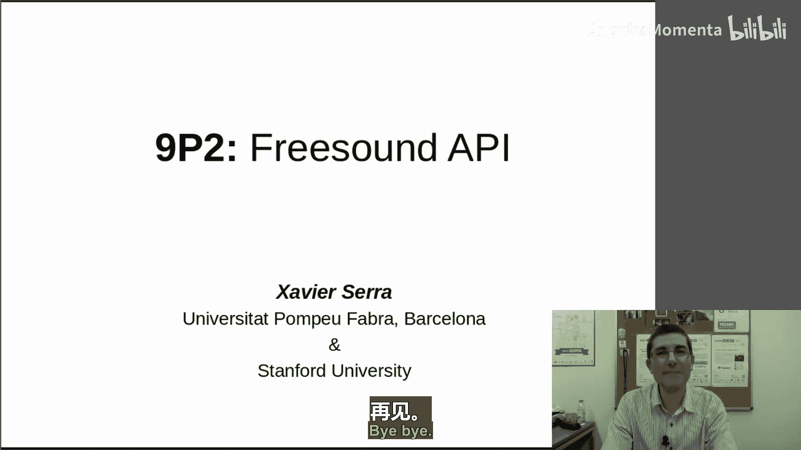