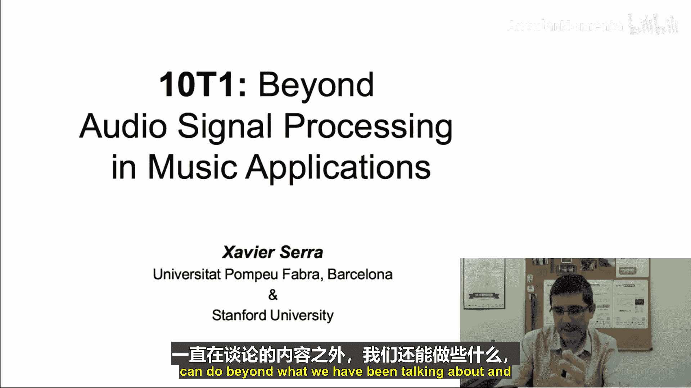
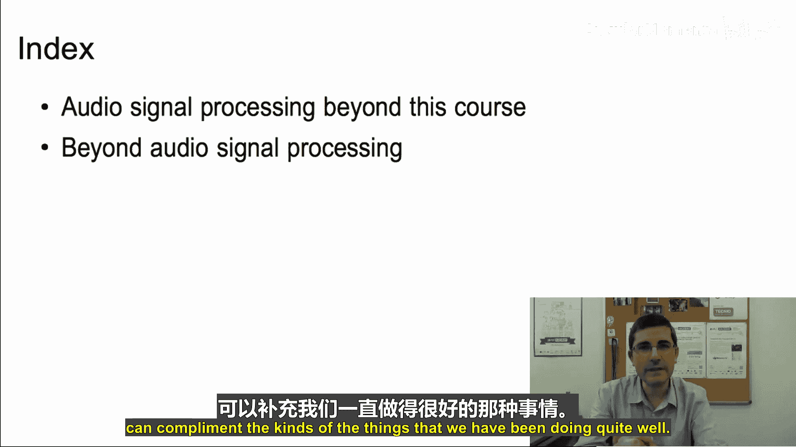
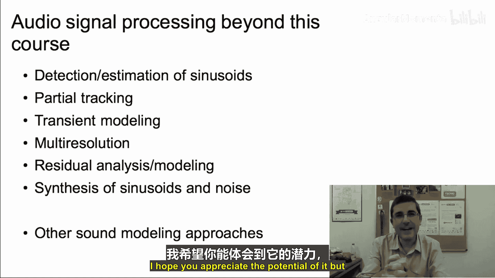
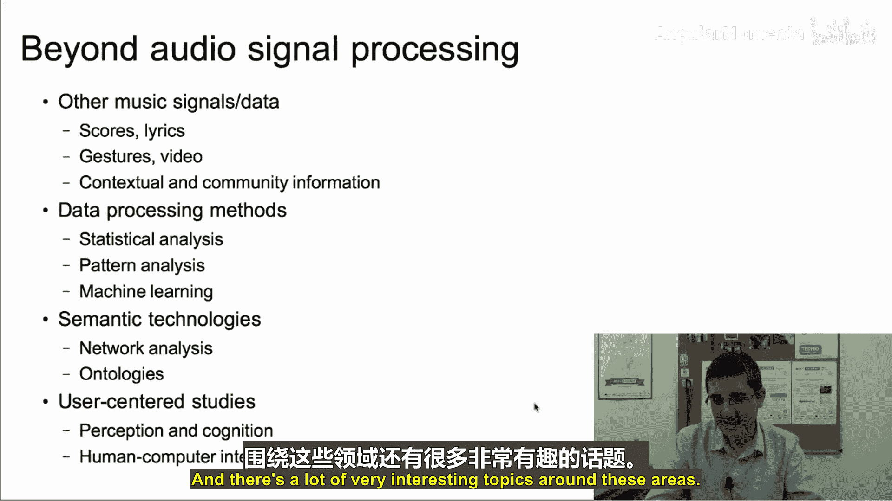
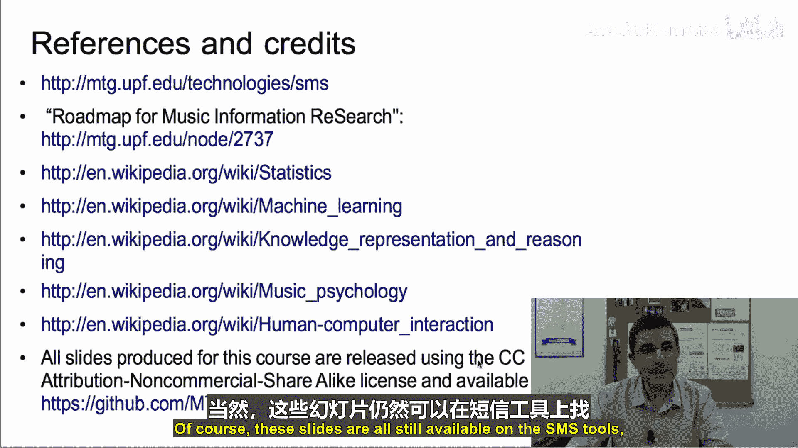
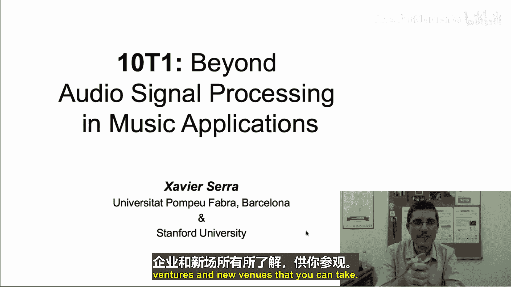

# 【巴塞罗那庞培法布拉大学】音乐应用中的音频信号处理-｜-Audio-Signal-Processing-for-Music-Applications-p69-10_01_01_超越音频处理--BV18Xr6BeEX5_p69-

Hello， welcome again to the course on signal processing for music applications。

We are in the last week of the course。And this week。

 we do not have a coherent topic like the ones we had every week。Instead。

 we're going to cover some small topics， topics that will help us wrap up the course by reviewing some aspects。

 by identifying some trends， by complementing the material to help you see what could you do next and what type of things you might also be interested in if you were interested with this topic。

So in particular in this lecture， I want to go over the idea of beyond audio signal processing in music applications。

 so in the case of music， what other things we can do beyond what we have been talking about。

And we will talk about two aspects。 One is within the field of audit or processing。

 we will identify some of the topics that we have covered。

 but that maybe we have covered a little bit lightly and that there is room for a lot of much more in- depth studying。

And then finally， I want to talk about aspects that are also relating with analyzing music signals or musical information but that are not strictly based on audioing or processing techniques and that therefore can complement the kinds of things that we have been doing quite well。

Let's talk about audio signal processing beyond this course and identify some topics that either we have touched a little bit lightly。

Or that we have not touched and that could deserve more attention if we had had time to do so。

So here is a list of such topics， the first one is the detection and estimation of sinusoids。

 that's a pretty big topic that we did a very first approximation。

 we simplified the problem quite a bit。But clearly。

 there is many more advanced techniques and methods that can be used to detect and estimate the values of a sinusoid within a complex signal。

Another topic， the idea of partial tracking。Again， we track the harmonics or the partials of an audio signal using a quite simple technique that was sufficient for the kind of sounds we analyze。

 but again that can be sophisticated much more and we can develop techniques that track the behavior of partials in time and can use more sophisticated methodologies。

The idea of transient modeling， in fact， is an idea that we didn't touch。

 but maybe you experience in when analyzing and synthesizing sounds that one of the parts of sounds that have a harder。

Time to be model are the transients。So when we have an attack of a note or a very sharp change of some signal in those parts。

 there is quite a few approaches that go beyond what we have done and try to identify those areas。

 these transs and develop some specific methodologies to handle those transs。

 independent of the steady states or the more stable parts of the sound that can be analyzed with the kinds of things that we did。

Another topic is multireolution， and that's typically one of the biggest shortcomings of the fast Fourier transform approach。

 or at least what people say that is one of the things that it clearly lacks is the idea of multire。

 the FFT treats all the frequencies， all the spectrum with a linear resolution。And this is not right。

 especially if we talk about audio signals and we talk about perception。

 our perceptual system is not linear it doesn't have a linear resolution a frequency resolution like the FF1 So there has been quite a few attempts and approaches to to take care of that and develop methodologies。

 developing spectral analysis techniques that account for this idea of multi resolution for having resolutions that are different different parts of the spectrum or of the frequency ranges and in fact。

 this can be done with the FF this can be done with the fastphoier transform and in in the lab of these week。

 In fact， if you are interested you can explore that and we propose that as an option for an assignment。

Of this week。Another area is the residual analysis that we have been doing we have done again a quite simple analysis of the residual of a signal。

 we have subtracted the sinusoids of a signal and we have approximated this residual with an e stochastic model。

 a quite simple e stochastic model and again there is room for a lot of new developments that approach the idea of approximating this residual。

Either from a perceptual point of view or from a source point of view。

 depending on what type of signals to develop specific models for those type of signals。 And again。

 there has been quite a bit of work done on these areas。And finally， the idea of synthesis。

 we have been synthesizing sinusoids and this filter noise for the harmonic plus stochastic type of modeling。

 and we have been doing an implementation that is quite efficient using the inverse FFT。

 but again there has been quite a few methodologies proposed as alternative for that。

 and we can synthesize sine waves and noise in other different approaches。

And then as a separate topic that is a huge topic and that would deserve many new classes like this one is the idea of completely different modeling approaches。

 we have done a spectral- based approach for modeling an approach that has been based on analyzing sinusoids and obtaining the residuals and there are zillions of other modeling approaches that can be used for these or other applications。

 we can model sounds using physical modeling approaches。

 we can model sounds using other transforms other than than the fourier transform and in general there have been many proposals for modeling or synthesizing sounds that are quite different from what we have been talking about so anyway so the idea is that there is a lot out there on audioing or processing。

apply to music and I don't want you to get the impression that what we have been doing is a comprehensive view of the field of audioing or processinging for music applications no this was a particular view that I think is quite powerful and I hope you appreciate the potential of it but there is much more than this。

Let me now mention a few topics that really go beyond auditing or processing。

And the idea is that when we want to study music from an engineering perspective。

 there is much more than just the audio， audio is a fundamental part。

 but music is a much more complex phenomena， and we can obtain data to study it and different types of data。

So for example， if we just actually focus on the types of data and signals。

 we can also analyze the scores or the lyrics of songs， or we can study the gestures。

 and a video of recording of a particular performance。

 and we can apply some signal processing related methodologies to these type of signals。

 but we can also have a lot of textual type of data。

 contextual or community information that means comments about the music descriptions about the music。

From which we can extract quite meaningful information to describe a piece of music to characterize some particular recording。

And in terms of the methodologies to analyze this type of data。

 apart from the signal processing type of topics， there are quite a few areas of mathematics engineering that are quite useful for analyzing this other type of data。

 of course statistical analysis is a very big topic that we have mentioned a few things but that has evolved and there is a quite interesting methodologies that can be used to characterize complex phenomena and music in particular。

Also， pattern analyses。 And we， we think of many of these types of data as some time。

Information and the idea of patterns。Is very important concept to extract And within that field。

There has been quite a lot of progress in terms of methodologies that allow to identify patterns in general and that can be applied to these type of music signals。

And finally， the area of machine learning that we have introduced last week to talk about clustering or classification of sound within a collection has yielded quite a very sophisticated methodologies that can be applied to a wide variety of problems and a wide variety of data and develop methodologies that learn from the data so that we can automatically extract knowledge from the data。

And then there is another area of research or of methodologies that is what we call the semantic technologies or also called the semantic web。

That is a quite recent field of research that again。

 has brought quite a few new approaches to understand data。

 to extract information about data and things like network analysis。

 so when you have a corpus of data and you want to find relationships between these types of data or these data points。

 network analysis can give us quite quite a lot of insight on the structure of these relationships。

Ontologies is another area of computer science coming from these semantic web type of approaches that has been a very good source of structuring the data。

 so the idea of developing ontologies of developing structure data ways to to describing the relationships between entities within a particular feel of knowledge in this case。

 music can help us a lot in then describing describing and analyzing these data。And finally。

 well music is not just the data music involves people involves relationships。

 so all usercented studies and there are many types of user centered studies can also bring quite a bit of insight into the music so all the issues of perception。

 cognition， how we perceive the music and developing sort of experiments or user driven experiments on the interaction between people and music can definitely give us a lot of insight into the music and the human computer interaction fields。

 so the more the interface aspect of things also is a very fruitful area of study。

 the idea we interact with instruments， we interact with the music we need interfaces so the study of these interfaces and how they relate to our understanding or。

Our sort of use of music is also a very fruitful area of study that can help us in understanding and modeling music signals。

Anyway， so this was some of just some some highlights。

 some mention of some things that hopefully gives you a much broader view of what we're talking about。

 and that clearly extend our feel of a study to many different directions， many fields of study。

 many methodologies， and there is a lot of very interesting topics around these areas。😊。

In terms of references for these type of things since I have been talking about so many things。

 of course it' huge and you can search in many different places in the SMS page of the MTG there is some information especially links to articles that extend the type of analysis and synthesis techniques that we have been doing and introduce many other approaches for modeling and parameterizing and synthesizing sound so that's a good source of articles that you can look at。

There is this roadmap on music information research that was recently published in which you have the link here。

 and that's also a good source of。Lines of directions related to stunning music information and bringing all these different new areas of a study and identifying what things are interesting or not。

And in terms of these different fields of methodologies that can be used in Wikipedia。

 you can find a lot of references for statistics and for machine learning。

 for other types of these semantic type analysis， what is also called knowledge representations and reasoning。

 and all these user type of studies you can look at music psychology。

 you can look at human computer interaction and through them I am sure you will be able to find a lot of very interesting literature that describes all these studies that music is at the center。

 but that approach it from quite different perspectives。

Of course these slide are all still available on the SMS tools and that was all So this was just one lecture in this week that tried to open up what we have been talking about opening up within audio signal processing but also outside signal processing and hopefully that give you some insights into new ventures and new venues that you can take so thank you very much see you next class。

