# 【巴塞罗那庞培法布拉大学】音乐应用中的音频信号处理-｜-Audio-Signal-Processing-for-Music-Applications-p70-10_01_02_复习--BV18Xr6BeEX5_p70-

Hello， welcome back to the course on other single processing for music applications。

 We are in the last week of the course and we are just touching some small topics to basically wrap up the course and give you some relevant complementary topics that I believe you should be interested in。

 So for example， in this lecture I want to just review a few things of every week and highlight some of the core topics that we have been going over so that you can see kind of our perspective of the things that are relevant。

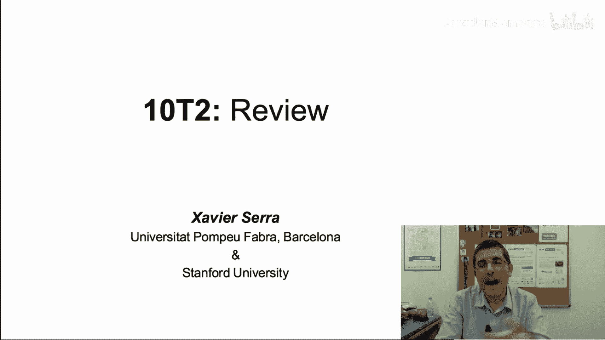

So， we will。Basically go through every week we'll start by just describing the general framework of the course and what we consider as the basic ideas that we cover and then we'll go through the different topics like the first one on the sound spectra and basically on the DFT and the SDFT then we will talk about the sinusoids and harmonics then we'll go through the residual and stochastic components and the idea of modeling sound with sinusoidal plus residual components and then we'll talk about the two applications that we use one was the idea of transforming sounds。

And the other， the one of last week was about describing sounds and music in collections。

And then the previous lecture， we just did a short attempt at looking beyond this course and seeing what other topics could be continuations of this。

 So let's go through everything。 And first the idea is the spectrogram。

 So this is a view of a spectrogram of this piano sound that we have seen in the class。

 and this captures a little bit the essence of what we are doing。

 we are basically starting from these spectral representation of a sound。 the idea is a sound。

 the basic representation is the time domain waveform。 but for us， that's really not that useful。

 So what we are doing first is to go to the frequency domain to the spectrum。

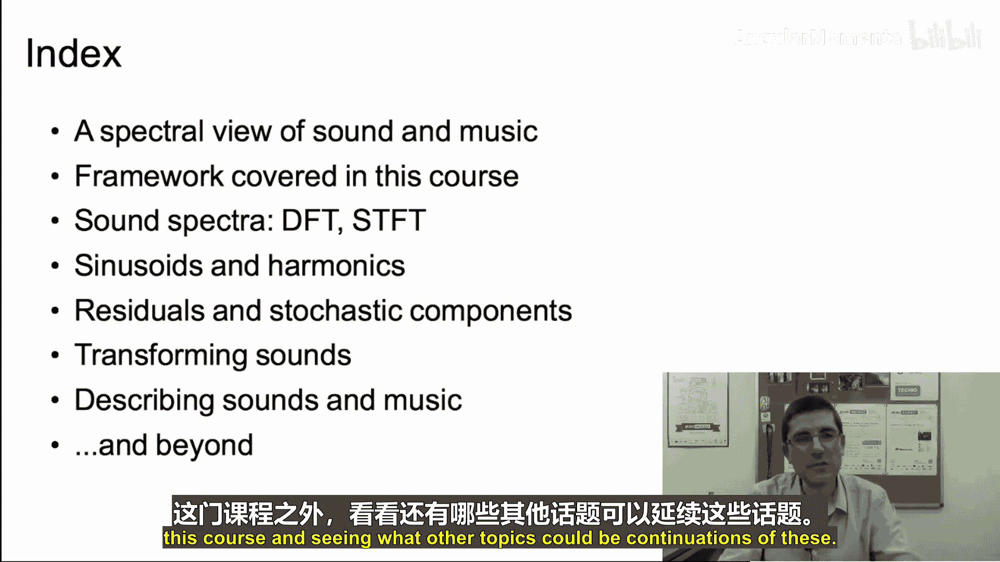

And this has some perceptual motivation in the sense that our hearing process does sum of that。

 basically we are doing some of these analysis ourselves in order then to understand better what a sound or a piece of music is。

 So there is some perceptual motivation behind the idea that the frequency domain。

 the spectrum of a sound is a very basic view of a sound after which we can do a lot of things from。

And the kinds of things we have been doing are can be captured with this diagram。

 So we have been starting from the the input signal x of n。

And all the analyses we have done have done quite a bit of this so basically the is to start with the Fastphoier transform the FFT。

 then obtain the peaks from the spectrum out of that we can obtain the partials。

 the harmonics of a sound， and these can be subtracted from the basically the original signal and obtain this residual so this is the basic analysis that a lot of the things we have been doing go through and out of that we can obtain interesting features so we can do feature analysis to obtain the fundamental frequency。

 we can obtain some ways of describing some sounds。But we can also transform these features。

 We can transform the sinusoid。 We can transform this residual and obtain a new sound。

 a synthesized sound。That can be a modified version of the input sum。

 or if we don't make any transformations， ideally， it should be very similar to the input sum。

So this is kind of the basic framework within which we have elaborated all our analysis。

 description and synthesis techniques。So let's now go through some of these individual aspects of all this framework。

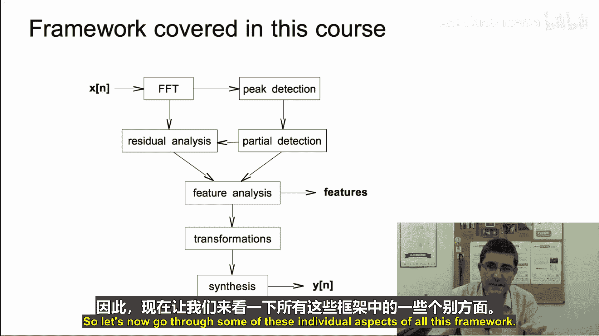

The first one was the idea of a spectrum of a salon。

The idea that we can start from a sound and obtain a spectrum and we had two versions。

 We had the single frame version， basically， and that's what we call a discrete for your transform in which we just analyze a fragment of a sound or a sound that is very short and obtain a single spectrum and then we went over the time varying version of that。

 which is the short time for your transform so that instead of having a single spectrum we have a sequence of spectrum and that the x sub L of K。

 which is this idea of time varying frequency representation of a sound and that was we could consider that as the first model that was useful for us。

 the first analysis a synthesis model that could capture any sound。 In fact。

 this was an identity system therefore we could analyze and synthesize any sound。

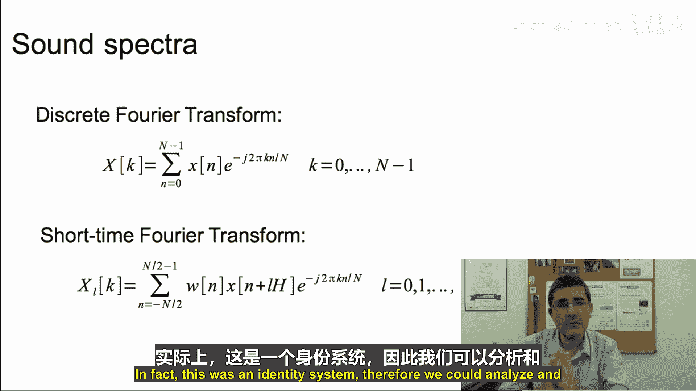

And then on top of that， we built this idea of sinusoidal or harmonic models。

The idea that we could capture parts of the sound that have a sinusoidal nature。Stly speaking。

 the DFT is also a sinnooid model， but this sinno sort model is a little bit different。

 These are the idea of stable sinnooids。Of sinusoids within a sound that have some stability。

 some coherence and that are really representing something meaningful from the acoustics of the sound。

 and that was the sinusoidial model。 and the harmonic model was step beyond that in the sense of there is quite a large family of sounds that these sinusoids have a harmonic relationship。

So the harmonic sounds have a series of harmonics， but they are all multiples of a fundamental frequency。

 So if we can use that restriction， so if we have sound that have that type of behavior。

 then the analysis can be done in a more restricted way and we can obtain a much more powerful representation。

 the idea of this harmonic model allows us to represent a sound in a very compact way and at the same time have a lot of potential for describing and transforming the sound。

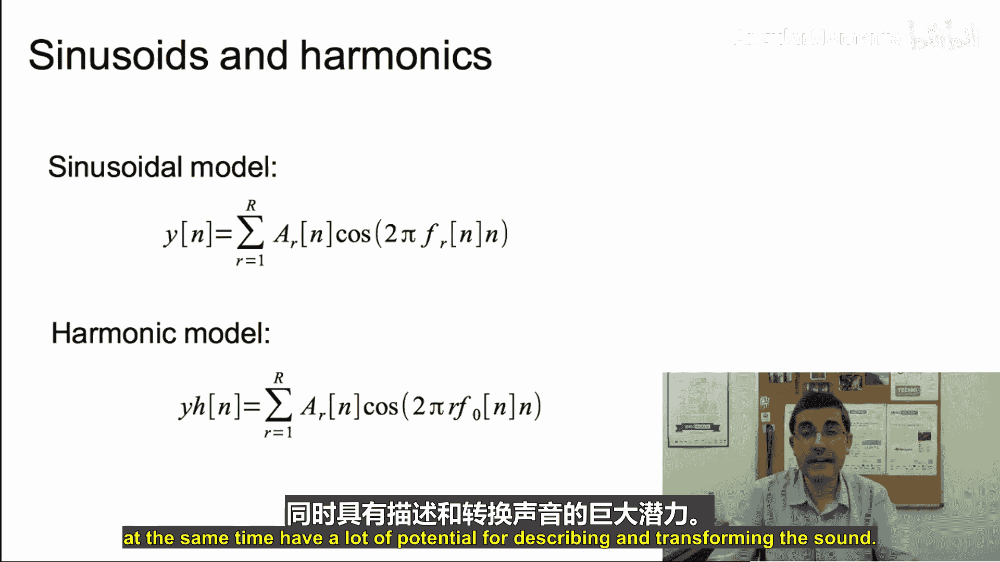

Then we saw that these sinusoidal， these harmonic components of sounds。

 do not capture everything in a sound that is a part of the sound that is left out。

 and this is these residual or stochastic components。

So when we have analyzed the sinusoids or the harmonics of a sound。

 we can actually subtract them from the original sound and obtain residual。

 that is what is left and in sometimes is quite relevant。

 sometimes that a very small part of the sound that can be discarded。

 So it's not perceptually relevant but in many cases this is an important part of the sound that needs to be preserved needs to be captured and we can just captured as it is and that will be the residual component or we can model it with an e stochastic model with the idea of filtered wide noise。

 So in the bottom a representation the residual is approximated with this idea of a time varying filter through which we put a white noise。

 So we have this complete model of sinnooidal plus a stochastic component and that captures many sounds。

 not all the。Sounds are properly modeled these way， but quite a large family of sounds。

 either sinnooidal plus stochastic or harmonic plus stochastic can be used to model many sounds。

 and that then yields a lot of potential for capturing the essence of the sound or being able to modify that sound。

 and that what's brought us to the idea of transforming sounds。

 when we have these type of representations。 we have this harmonics or these sinusoids。

 and we have the frequencies， the amplitudes and the faces， and they can be processed。

 They can be manipulated quite a lot。 we can change quite a bit their values and this stochastic component too。

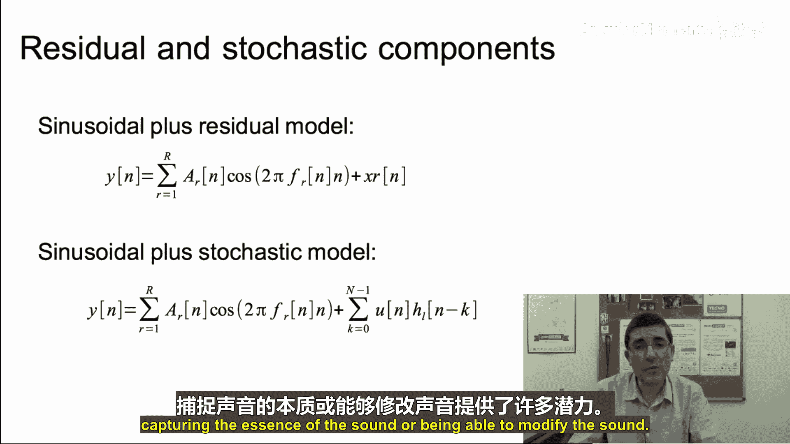

And things like time is stretching or shifting the frequencies or doing arbitrary changes。 In fact。

 in the class we went over some common transformations。

 but there are many more that we could do that go beyond what we cover in class。

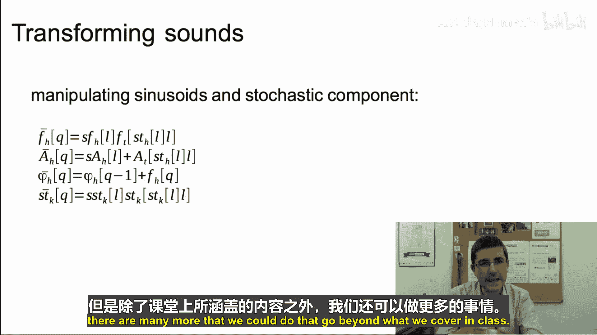

So apart from the transformation of sounds， we also talked about describing sounds and this is a huge feel。

 in fact， we only talk about a small part of it， the concept of describing sounds cover a wide variety of abstractions and we mentioned we use these diagram to show the different levels of abstraction or of description of sounds。

 we state very much in the low levels of descriptions and the physical sensorial and some perceptual type descriptors that are useful to describe sounds and music signals。

 but this is a very interesting area of application of these spectral analyses towards a much broader feel of describing sounds and music that are not just a collection of frames but there is。

Complete pieces of music and complete music collections and the type of problems are quite different from what we talked before。

 But anyway， so that was a good introduction to describe sounds and music using the techniques we have been talking the previous weeks and then finally in the last lecture we just kind of open up a door of saying okay and what's beyond that and beyond that there is a lot there is a lot within the audio signal processinging field So audio signal processinging is much more than what we have been looking at and you can explore many other methodologies to analyze。

 describe and transform sounds and even more than that sounds and music which is our target kind of information that we are trying to understand is much more than audio so we just hinted at the idea that we can use many other。

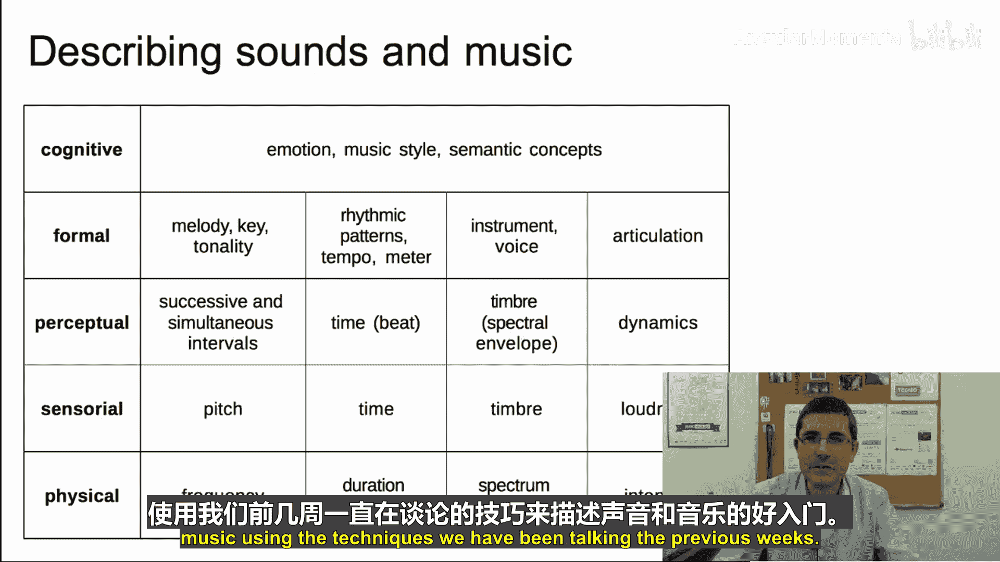

Cs of information to analyze describe sounds and music。

 and that's a very new area that is being explored in the last few years and that opens up very interesting new application and development areas。

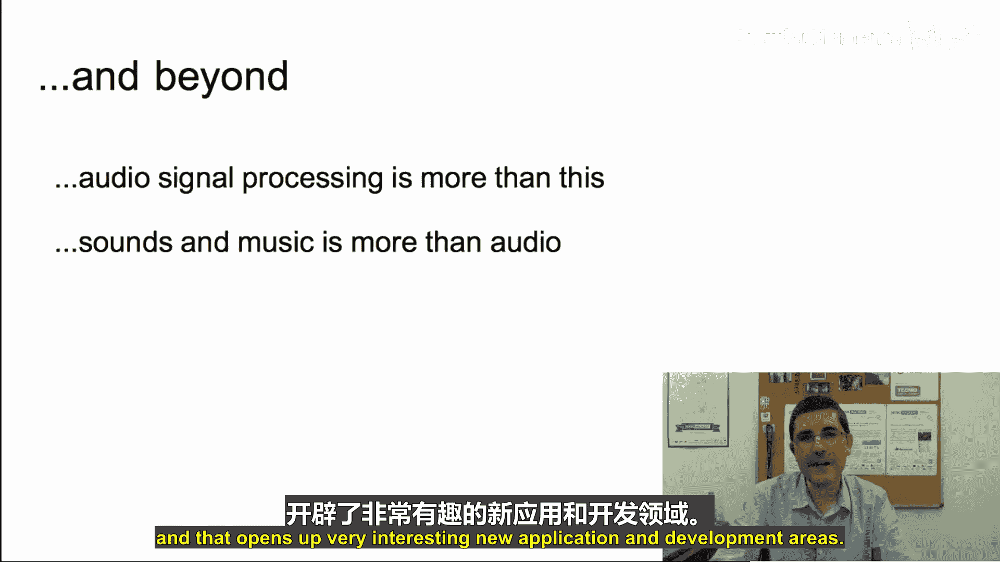

And that's all so well the slides are in theMS tools and hopefully that will suggest a a very brief summary of some highlights of the lectures that we went through the course and maybe that help you understand some of these overall view of the course and how we see the coherent of all the topics that we covered so thank you very much and I will see you in the next lecture bye bye。

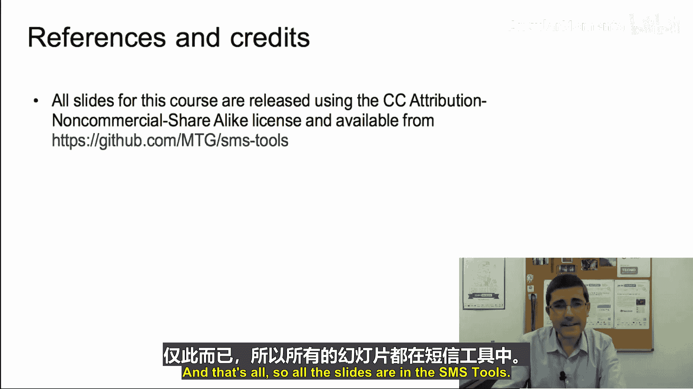

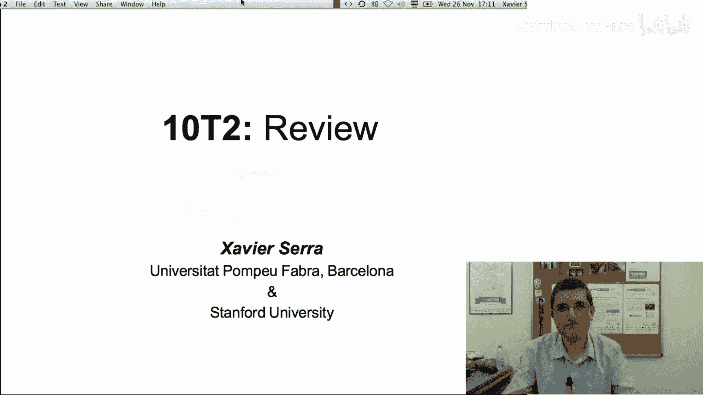