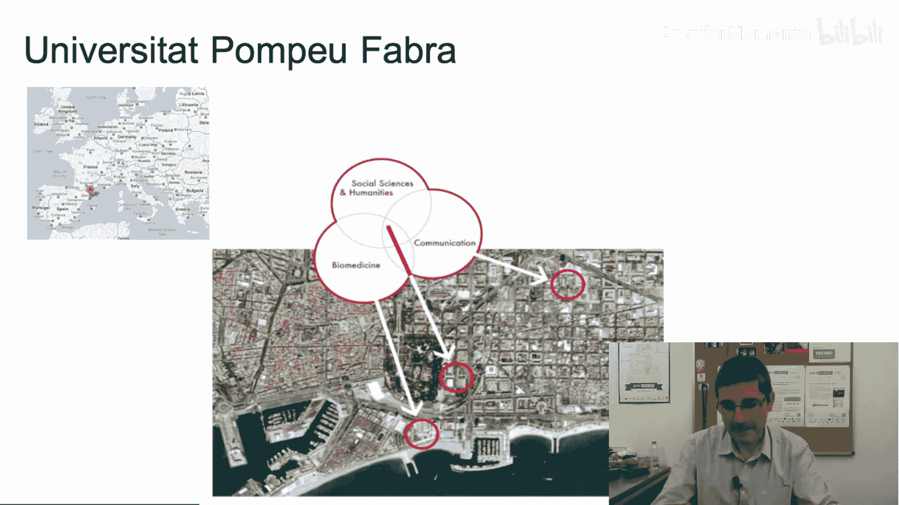
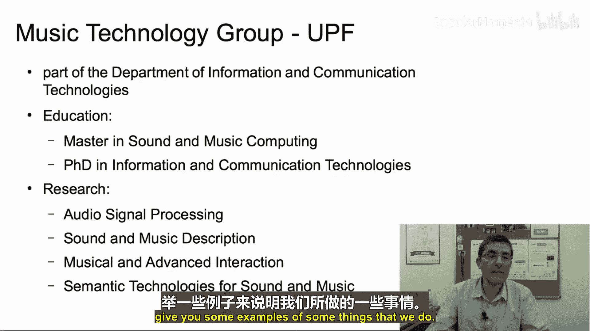
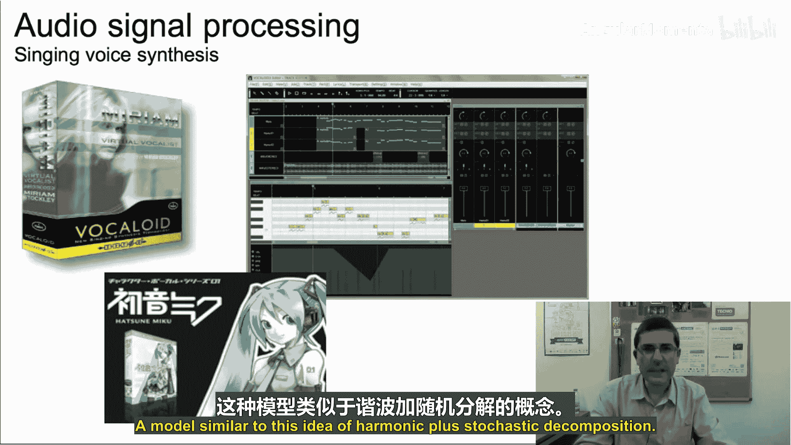
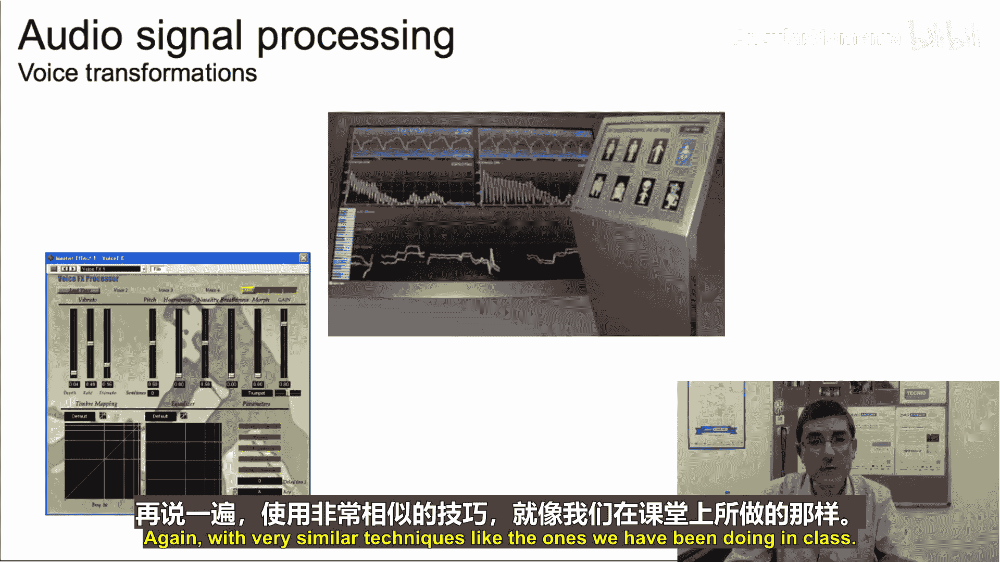
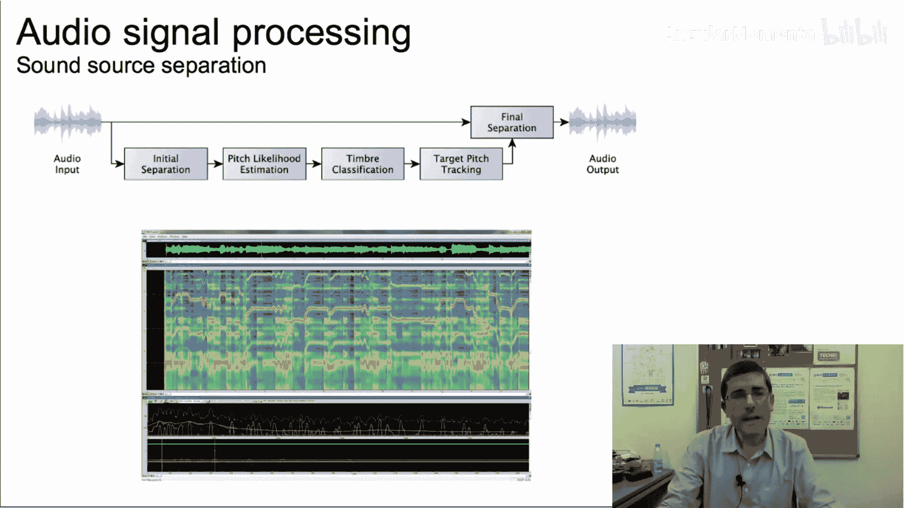
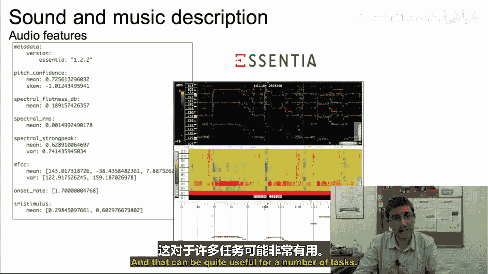
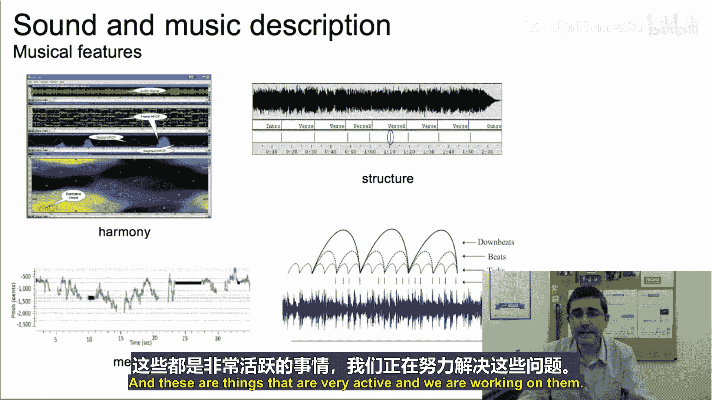
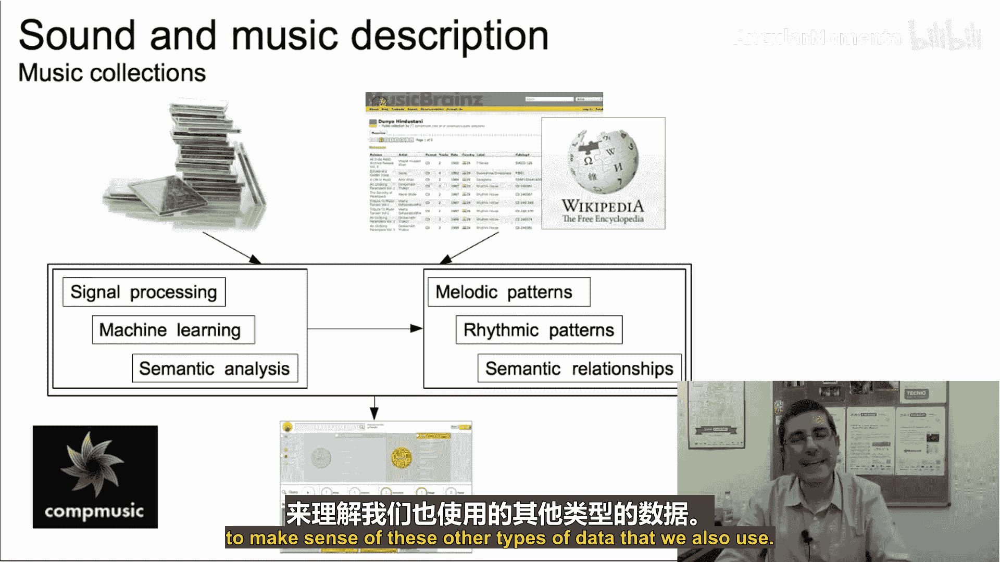
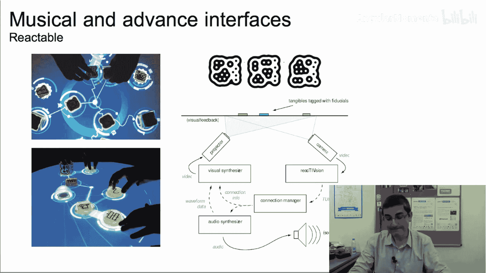
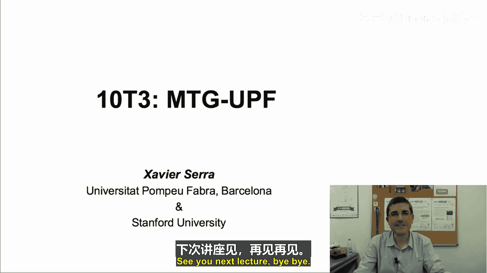

# 【巴塞罗那庞培法布拉大学】音乐应用中的音频信号处理-｜-Audio-Signal-Processing-for-Music-Applications-p71-10_01_03_魔法风云会：通用牌组格式--BV18Xr6BeEX5_p71-

Hello。Welcome to the course on another in processing for music applications。

We are in the last week of the course。And in this week we are touching different small topics with the idea of wrapping up the course and giving you some views that we haven't been able to cover in the course like highlighting some specific topics like identifying future directions of the kinds of things we're doing or topics that you might be interested in exploring after taking this course。

 and in this particular lecture， I want to introduce you my research group。

 the music technology group at the University at Pombofara。So that you know us's better。

 and especially， you know the type of research that we do。

And mainly the research that relates to what we have been talking about these last few weeks。

So the University of Poma Faa is in Barcelona in the northeast part of Spain。And in the city。

 the university has three campuses。 We are in the communication campus。

As part of the engineering department， but together with the Department of Journalism and Artvissual Communication。

And the Department of linguistics and departments that relate to the topic of communication in an interdisciplinary type of manner。

But our group is very much within the engineering department。

 what we call the Department of Information and Communication Technologies。And therefore。

 our teaching responsibilities relate to computer science， electrical engineering。

 and even biomedical engineering， and we teach courses that relate with music。

 audio and some general topics like programming or machine learning or some other generic topics that are offered in this undergra programs。

At the graduate level， we have more specific programs。

 we have this master in sound music computing that is very much within the scope of our research group。

This is a program that has been going on for a few years now and our course， in fact the course。

 the Coursera course is in fact one of the courses of the master。

 even though in the master we can complement these online teaching with some other types of activities that I believe complement and can help understand better some of the things we have been talking I guess you have figure out online teaching is amazing is wonderful。

 but also it's good to have some human contact from time to time in a classroom or in a personal situation。

So anyway， so you of course， you are most welcome to apply to this master。

 which apart from the other signal processing type of course。

 we also offer other courses and activities related with other areas of music technology。

 like related with the kinds of things we do in the music technology group that I will mention you。

And then the PhD program is a PhD program of the department and like all PhD programs is focused on a thesis and therefore it's a thesis under the supervision of a faculty member and so at the MDG we have many PhD students are working with our faculty and focusing on a variety of topics of the things we do and again that's what I will mention next。

So let me tell you a little bit about the research which is the core of what we do we can classify the research into four areas。

 one is audio signal processing and you should know about that by now another we call it sound and music description and we also hinted to that in the last week and we will now talk a little bit more about that and then we have another area which we call musical and advanced interaction which relate with developing interfaces for music applications。

And finally， another one that we kind of mention also to this week。

 which relate with semantic technology with semantic web。

 so all the technologies that are at a higher level than this audio processing that a lot deal with text related issues and that allow to make sense of sound and music related information and that can complement quite well。

 this audio processing type of approach。So let me just go through each of these topics and give you some examples of some things that we do。

 So let's start with audio signal processing。

One of the first research lines that we started was related to thinking voice synthesis and still is a very active line of research。

In fact， we started a collaboration with Yamaha quite a long time ago。

 and one of the projects that we have been developing has been Volo， what is now known as Volo。

 a singing voice synthesizer。And maybe the people in Japan know very well the Hatsunimiku character。

 Hatsunimiku is one of the virtual singers that Voollooid has and maybe for the people that don't know about that you might be interested in learning about it and just type Voollooidid or Hatsunimiku in YouTube or on Internet and you will see the kinds of things that Hatsunimiku has been doing。

So anyway， so the technology behind this singing voice synthesia is very much related to what we have been doing in class。

 it' a spectrovaase model of the voice in which we analyze the harmonics and we subtract the harmonics and we obtain a model similar to this idea of harmonic plus stochastic。

The composition。

In the area of audio signal processing， another topic related with that one is transforming the voice。

 and mainly again， the singing voice， so developing real time systems that allow to change the voice in real time from your own voice and change the character。

 and we have been doing several installations like in museums or。

Plugins that allow to do these type of transformations again with very similar techniques like the ones we have been doing in class。

Another more recent activity that we started working on is sound or separation。And again。

 we have hinted at some of these issues in the course。

 but sounds or separation is a quite welldefined problem by itself that has developed into sort of a set of methodologies that are used for this particular problem that deviate a little bit from what we have been doing。

 but it's a clear continuation of this course and as the word says。

 the idea is to separate sources within a polyphonic signal and try to get the individual sources to sound as good as possible。

Okay， now let's go to the other topic that we classify our research into and is the idea of sound and music description。

And this is something that we talked about last week is the idea of how to extract features from a sound that can be used to describe a sound or a piece of music。

So Ascentthia is a library that we have been developing and maintaining and we are extending constantly to which we are basically incorporating new research results that we obtain at this level at the level of obtaining features that might be of use to describe and in this case。

 for example， this is a visualization of some of these lowle features in a Sonic visualizer and that can be quite useful for a number of task。

In the same area of sound and music description and related with the kinds of things we mentioned about the different levels of abstraction。

 the level of abstraction that musically starts to be interesting is when we can extract features that have some musical significance。

So things like the harmony or the chords of a piece of music features that can allow us to segment our recording so that we can define the structure of a piece of music or features that allow us to characterize the melody so that we can extract the pe or the prominent pitch of a song and then identify certain notes or certain melodic landmarks that can be of of use。

And then another example is rhythm related features。

 so we are interested in trying to find ways to find the different levels of a rhythmic kind of structure and you can start from the onset but you can go higher up so it's a multilay kind of concept rhythm and we can define different patterns or structuring units that related rhythm and these are things that are very active and we are working on on them。

And then another。topicpic related with these is going towards music collections。

 not just describing sounds， but describing collections of sounds or collections of music recordings。

 and this is an example of a project that I am leading。

 which is called Com music in which we are studying several music collections from different music traditions around the world。

 in fact， we are studying five music traditions， the two Indian traditions， Carnatic and Hindutai。

 one tradition from China， the Beijing opera， another from from Turkey。

 what can be called the Turkish Makam tradition and finally another from the north part of Africa。

 the Magreb， which is the Arab and Dusian music， this are traditions。

 classical traditions that are very interesting， they have some specific peculiarities that required some particular。

Alysis and that's what we are interested in finding ways for describing the melodic。

 the rhythmni or the semantic issues of a particular music repertoire of a music tradition in a way that makes sense for that particular music tradition。

 And then out of that， we put that together into like a discovery type of proronan。

 which we call dumia。And I will talk about in a demonstration class that can be used to navigate through these different music collections。

 And in this case， we start both from audio signals and we also need information related to audio。

 all these metadata， all these editorial metadata and information about the music that we can extract。

 for example， from places like Wikipedia。 So anyway。

 so that's a quite complex project in which we do different types of analysis。

 it uses some some signal processing work。 it uses some machine learning and then finally it uses some semantic analysis to make sense of these other types of data that we also use。

Okay， and then let's go to the next area that we mention。

 and this does not relate much with the course is the idea of musical and advanced interfaces。

 so we have a team within the MG that specializes in developing interfaces and developing new ways of interacting with music。

And the Re table， which is a quite wellknown outcome of that group， has been quite popular。

 so this is a table with which a musician can interact with different objects and through that music。

 so it's basically it's a synthesizer and is interactive synthesizer that has this feedback。

 this visual feedback that is quite interesting that offers quite a lot of new possibilities for making music。

And then the last group of topics that I mentioned was the one called semantic technologiesologies for sound and music。

And this is this area in which apart from the audio content。

 we are interested in this textbased information， this metadata that is associated with the audio and that can be treated by itself and can be processed in different ways。

 For example， free sound which is this website that you all know it's a great platform to do some of these semantic type of work。

 So for example， all the work that we need to do to organize the tags and to recommend tags when you upload a sound and all the issues of searching and recommending things this can be done from the audio and we do it from the audio and it can be done from this text and this requires some semantic type of technology。

 So free sound is a great platform to do some of these semantic analysis research。And finally。

 the last project I want to mention is acoustic brains。

coustic Bras is a very new initiative that we started with music brains。That again。

 even though it has this audio related work， it allows us to explore semantic analysis。

 semantic technologies and develop very interesting research on these new areas so music brains is a great environment that has structured information about music and we will talk about that in demonstration class this week。

 so we start from that and in music brains， every single song。

 every single artist has an identifier and then we assign that to a particular audio recordings that people in acoustic brains analyze and upload to our server。

And so we have a huge collection of analyze sounds， analyze music。

 so we don't have the music and here it because of the copyright issues。

 So we just the the people just upload the analysis of those recordings， using an asthia extractor。

 we'll talk that we'll talk about that in the demonstration class。

 So you'll learn more about that also in in this class。 So anyway。

 so this is a very new and interesting project that I believe has a lot of future for exploring this combination of music description with audio content and semantic analysis and develop a lot of very interesting new ideas and and even possibilities for developing very interesting tools for music。

Here are some references to the things I have mentioned。

So you can go to the website of the university of the department or of the MTG where you will find much more information about what I have been talking about and here I just added some links that you might be interested in looking at so for example。

 the Wikipedia entry for Vocalloit。Or also the website of the project comm music in which we are studying all these world music traditions or the entry in Wikipedia for the reactable instrument。

Or the website of these new project，oustic Bras。And I guess， well。

 you could find these slides in the SMS tools too。Okay so I gave you a very brief overview of the kind of research we do at Den。

 we're doing more so if you want to learn more you can look at our website and you can learn all the kind of things we do we try to be very active at explaining what we do so you will find quite a lot of links and videos about all our work so I hope you enjoy it thank you very much see you next lecture bye bye。

