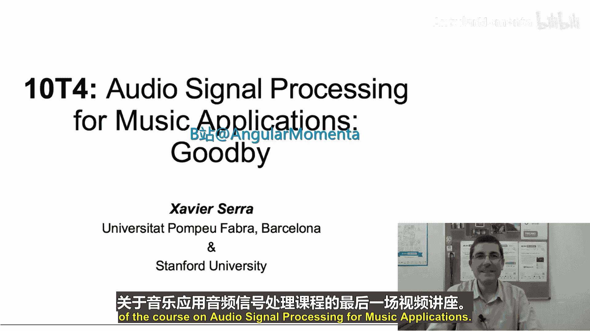
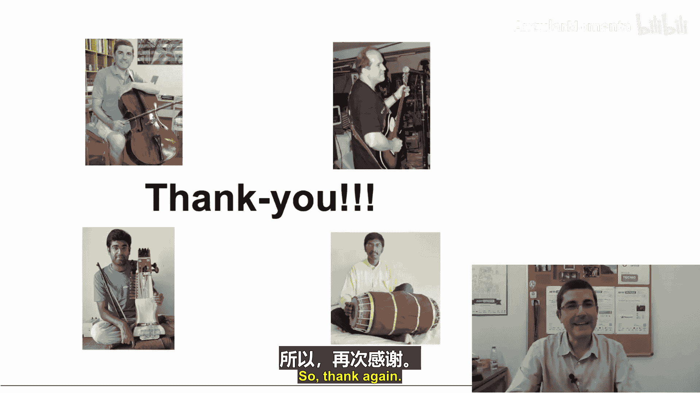
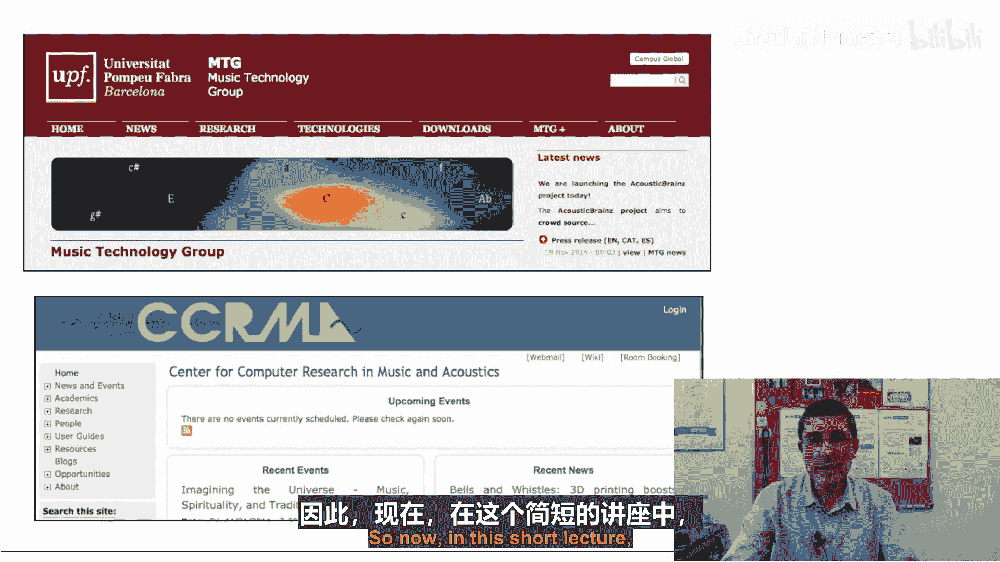
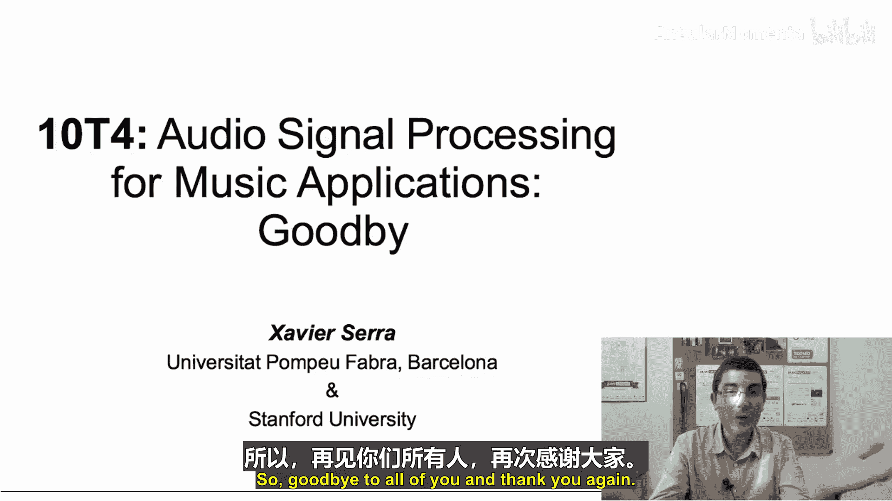

# 【巴塞罗那庞培法布拉大学】音乐应用中的音频信号处理-｜-Audio-Signal-Processing-for-Music-Applications-p72-10_01_04_再见--BV18Xr6BeEX5_p72-

This is it。 This is my last video lecture of the course on addressing or processing for music applications。

 so this is my good guy lecture。

And the first thing I want to say is thank you。Thank you for keeping up with the course with us and therefore giving a meaning to this experiment。

 this was the first time we offered an online course like this one， we have learned a lot doing it。

And hopefully， we will do this again， and we will use all that experience to improve it。

So think again。

And also we need to thank the institutions we come from University at Pompo Faabra and Stanford University for giving the institutional support to make it possible and especially the research groups that we are part of the music Technology Group and the Center for Computer Research in Music and Acoustics。

So now in this short lecture I want to give you some pointers to places where you can learn more about the topics of the course。

 I want to mention a few things about research centers， a few things about masters and PhD programs。

Also about conferences and about journals。So about research centers， there are many。

 this is a field that is quite consolidated by now and therefore is present in many universities around the world。

 however， being an interdisciplinary area of activity。

 every research center might be quite different。It's。

It's an activity that is present in different types of departments。

In different types of universities and therefore the research centers will have different disciplinary backgrounds and focus depending on their context on their faculty。

 the interests of the faculty that are running the center。

 so it's very important to really understand that and to understand the personality of every center before you actually approach or you try to join or to basically learn from one of these research centers。

Given that there are so many， I didn't want even to list any of them。

There is a partial listing of many centers in this link that I put here in this SMcnetwork。

org under resources， you will have a quite long list of centers that are active in the field of sound and music computing。

 music technology and in general， this area of activity。In terms of educational programs。

 graduate educational programs is again the same thing。

 there are not that many compared with the number of centers that exist。

Given that there are not that many large research centers。

 there are not that many institutions that can offer a program that is focused on these topics。

 our two institutions are definitely big enough to offer that so at the Polo Faabra University we have a master in sound and music computing and at Stanford University there is a master in music。

 science and technology。Clearly they are different。

 so you should look at them at the Unifara we are within an engineering department and that makes a particular context and therefore the method reflects that。

And Stanford University， the Center for Computer Research in Music and Aoustics。

 is part of the Music department， and that gives another type of focus or at least another type of context that implies certain certain interest or focus in the educational programs。

In terms of the PhD programs， the same， but clearly since PhD programs are not。

 let's say they don't have normally a series of lectures or a series of courses。

 they are just focused on a PhD thesis， there are as many PhDs as faculty members that do research in these topics。

 so you can do a PhD in these fields in basically most of universities around the world。

Again in our two universities being universities that have large groups in these fields。

 you can do a PhD that at the same time takes advantage of a large research group。

 which I think is a good thing， but again， there are many places that you can look and again。

 the important thing is to understand the particular context。

 the particular department understand the activity of a particular faculty member and identify things that you are interested in。

嗯。Okay， and now if we want to talk about conferences。

 every field has a set of referenceent conferences。

 places where the researchers and the PhD students。

 go to basically interact with other researchers to get feedback。

 it's impossible by yourself staying at home or at a given institution to get a feeling and to really learn about all the state of the art and all what is really going on。

 not everything is online。So attending conferences is an important part of people involved in advanced research of a particular field。

Our field has quite a few conferences that are kind of specialized in our topics。

 the first one that started was the International Computer Music conference。

 it started in the US and that started from a clear musical perspective so from the idea of the use of technology for composition。

And that still has that main focus， even though it has diversified a lot。 And nowadays。

 it includes presentations and topics that cover a wide variety of issues related with computer music。

Another conference is the sound and music Comp conference。

 This was it's a much more recent conference。 It started in Europe。And it started with a more。

 I would say more of an engineering sort of emphasis in Europe。

 the music conservatories are outside the university therefore at the university these type of activities are more under the umbrella of engineering departments and the sound and music Comp conference reflects a little bit that so it's a good general conference on topics。

 but again emphasizing the technical presentations and the lectures。

The next conference is the conference on digital audio effects that again is a more recent conference I would say it's kind of an spinoff of the ICMC or of the SMC in the sense that was created to emphasize a particular aspect。

 a particular aspect of audio signal processing in fact。

 so in fact these course is very much reflected in the activities of this conference So if you look at the proceedings of the conference you will see a lot of presentations related with the kind of things we have been talking about。

 so that's a very good place to look for advanced presentations and advancements in the field of audio signal processing related to music。

Another very important conference is the conference on music Information Retrieval is Miir。Which。

 again， was a conference created to specialize。In the area of music information retrieval in the topics related with music and sound description that we mentioned in the previous week。

 so that's an excellent conference for the people that are interested in in using technology for describing music both from the audio and from the signal processing point of view and also more from these other areas that I mentioned like the areas of machine learning or the areas of semantic type of analysis to really capture the whole field of music information and the description of all this type of data。

Then there is another conference the nine conference。

 the conference on new interfaces for musical expression that it's on a different area on the aspect of interaction。

 which is a very important aspect within music technology。

 but is not one that we have covered in this course。

 but for people that are more interested in this interfaces aspect with a clear musical goal。

9 is an excellent conference。And finally， well， there are quite a few conferences that are more general that come from societies that are well established and that within them are our field is also part of for example。

 the audio engineering Society conventions and conferences include most of the time or basically all the time topics related with audio signal processing with music technology。

 so that's a very good source of activity， the AES in their conferences it also includes the more industrial aspects so that's also a very interesting aspect of this conference。

And then we have the IEEE conferences in IriEee， this engineering society includes many conferences that relate or that involve aspects related with audio signal processing with music technology may be the most focus one is the ICP so the conference on acoustic speech and signal processing that has been a very active。

 it's a huge conference and there is always an important part of that dedicated to music information retrieval topics。

 audio signal processing topics etctera， so that's a very good engineering。

 general purpose engineering conference that these type of topics are covered and finally the ACM association has also that's another engineering。

More computer science focus has a lot of conferences that relate to these topics。

 and theyre very good places where to learn about these， for example。

 maybe the one that is most related is the ACM multimedia。In which it does not just cover audio。

 but it covers image， video and other type of multimedia data analysis。 So that's a good conference。

 but you can find quite a few general purposes conference in which now music and audio has a presence and there are interesting things to be learned from。

And in terms of journals， that's kind of the same situation。

All fields have certain journals that are the reference journals for a particular community。

Maybe I would say that our community does not have so many journals compared with some other fields。

 and I would say there is a lack in that aspect， at least compared with conferences。

 the oldest journal in our field and very well known is the computer music journal。

 that's from the 70s。And that's a journal that that again emphasize the music aspect of the field。

 so maybe the traditional computer music view of the field， but again。

 nowadays it includes quite a few articles on all areas。

 the kind of things we have been talking about。Another journal is the Journal of New Music Research that despite the name。

 its also very much focused on music technology and science of music type of topics and for example。

 lately the music information retrieval topics have a strong presence in that journal。

 so that's a good journal to read and to follow and to keep up with the field。

And then the last journals I mention here are from these societies that I mention that are more general。

 but that include topics related with audio music technology and therefore again are good to follow the audio engineering society has a journal。

 the journal of the AYes in which many papers related with these topics are published。

 the IEpoliee Society has quite a few journals， but there is one in particular。

 the transactions on audioio speech and language processing that includes always relevant articles。

And finally， the ACM has also some relevant journals and again。

 maybe one that is the most the one most related to what we have been talking about is the transactions on multimedia computing。

 communications and applications。But again， there are many other journals that might include some relevant articles and it's good to keep an eye on all these activities and all these journals。

Okay， to， to look to， for these references， the SM C network dot org website keeps a list of all the。

 the journals， the conferences that I have mentioned。

 So that's a good way to start looking for specific links。

 And there is other things there that you might be interested in。The entry。

 the Wikipedia entry for sounda music computing still is maybe is not that comprehensive。

 but it's a good starting point to get an idea of the general feel of sounda music computing and then look for sound specific references。

Okay， and that's all。 This is really it。 And I just want to say a personal thank you to everyone。

 So everyone that made this course possible。 and maybe I want to give a special thank to Kra。😊。

For providing this amazing platform to deliver these type of courses and be able to interact with all of you so goodbye to all of you and thank you again。

