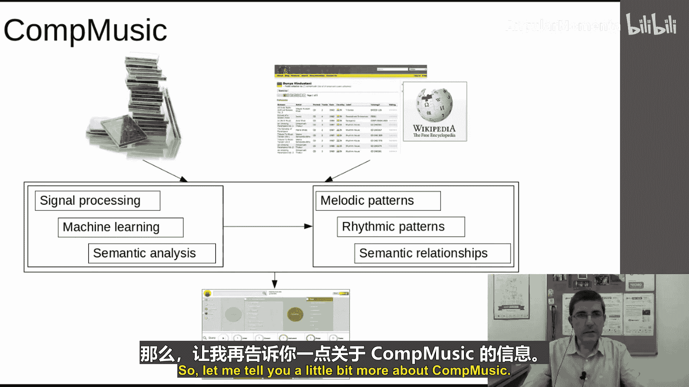
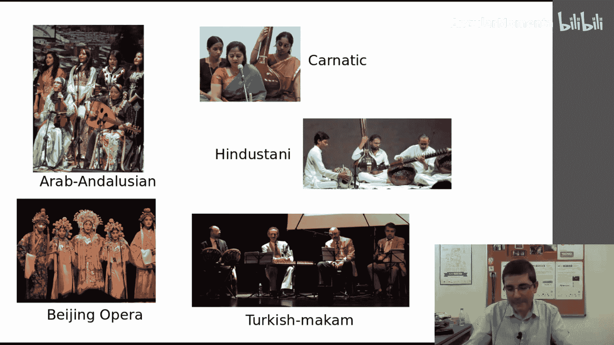
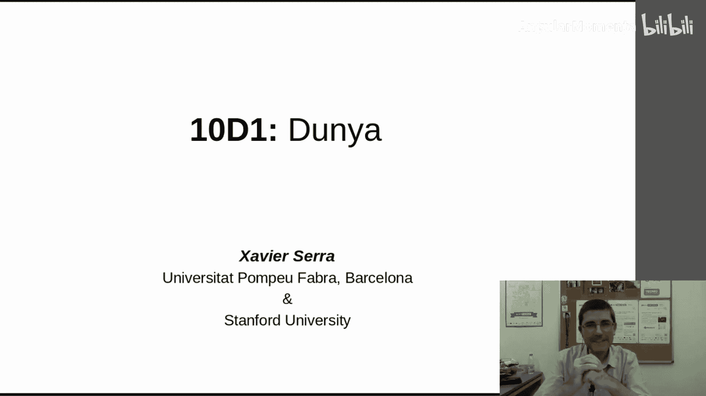

# 【巴塞罗那庞培法布拉大学】音乐应用中的音频信号处理-｜-Audio-Signal-Processing-for-Music-Applications-p73-10_02_01_世界--BV18Xr6BeEX5_p73-

Hello， welcome to the course on other signal processing for music applications。

In this last week of the course， in these demonstration lectures。I want to show some tools。

 some systems that can exemplify some potential of the techniques and methods that we have been talking during this last few weeks。

 so in this particular lecture I want to talk about Dununia。Donunia is a prototype， it's a website。

That we have been developing for a particular project called music。

 in which we want to develop technologies to explore music collections。

So let me first tell you a little bit about the project。Com music。

Com musicic is a project that has been going on already for close to three years。

 and in need we are trying to start from audio recordings and from information about these recordings of particular music repertoies of particular music traditions and then develop techniques with which we can navigate。

 we can explore， discover these music。And they do it the ideas is do it from a cultural specific approach。

 so by taking advantage of the knowledge we have of a particular music tradition。So at the end。

 what we have is this Dunia prototype， which is basically a navigator to explore the corpus。

 the collection of recordings and all the information that we have on these recordings。

And the techniques we use are based on C processing， machine learning， semantic analysis。

 and with that， some of the particular problems that we are focusing on are related to understanding the melody。

 the rhythm and the relationship between the concepts that appeared in these recordings。

So let me tell you a little bit more about comm music。

 we're doing what we call this cultural specific approach or knowledge driven sort of approach。

 the ideas that we start from particular music repertoiires that have been study enough so that we have enough knowledge that then we can use that knowledge to better analyze and describe the music so we have taken five music traditions that are non-western and they are quite different from the type of music that the feel of MIR has normally been paying attention to。

And these five music traditions are quite very well developed and there is a lot of information about them。

 so it's a good starting point to kind of challenge some of the technologies that we have been using so far。

 so the idea is to see how far we can take them and what new technologies we need to develop to characterize these music collections。

 so we have chosen to use the two classical traditions in India or the two main classical traditions in India。

 kinetic from the south of India and Hindustai from the north of India。

 then the music tradition from the North of Africa。

 what is called Arab andalusian tradition that area is called the Agrab。

Then we are also studying the music of the Beijing Opera from China。

 and so that of course is's within a theatrical operatic framework。

 but we're just focusing on the musical side of it。

 and then finally we are also studying the Turkish Maam music this is the music from the Ottoman classical tradition that is maintained in Turkey。

Okay， so let's go to Dunia to the website。This is the main page of Dununia。

 you can access it directly through this URL， Dunia。commusic。epf。edu。And it's a prototype。

 this is not a website to be used by the general public， this is a research prototype。

That we use for evaluating our research。嗯。However， it's open and you can access everything。

 everything is open， except the audio recordings， the audio recordings that we obtain。

 we bought non commercial recordings， therefore we don't have the right to distribute them freely。

 however， if you accept the conditions that we have in here and you apply for a login。

 we can give you a login if you accept basically to be a research subject of this project。

And then you will be able to actually listen to the recordings not to download。

 but just at least to listen to the recordings， and now I am login so we'll be able to listen to these recordings。

Okay and this first window here is the search or the navigation through the meta data that we have about the recording so you can do a standard text search or you can do search exploring the different entities that we have defined as being relevant for these particular music tradition and we decided that the name of artists concert instrument。

 Raga and Tla are the important entities concepts， Raga being the melodic framework and Tla being the rhythmic framework。

 so Raga for example these are the all the Raas that we have recordings of so you can click at any Raga search and you will return the recordings and entities that relate to these Raga and also you can do it for artists and you can search for instruments。

Or if you can click here， you search for the instruments that we have recordings of， or of course。

 the Tla too。Well I don't want to go explaining everything here， you feel free to do it yourself。

 I just want to go for example directly to one artist's page okay so for example。

 that is Amreta Morali she's a singer that I know and like her quite a bit I'm not that familiar with Knatic music but doing this project I have learned to appreciate quite a bit some of these music so you do well let's take the Raga out and we just will do the query of the artist。

So that will return I already have it， the research， the search outcome of having click Rita Morli。

 and the result are the page of her。And then the pages of the recordings of the concerts that we have offer her。

So let's go to her page。so this is the information we have from her and already this is quite interesting in the sense that we have been gathering data from internet from some websites。

Like in this case， for example， this biography is obtained from Cocherri。com。

Which is a website special in kinetic music。And all the metadata that you will be seeing comes from music brains。

I will tell you more about music Brains in the next demonstration class。

 but Music Brains is a website that basically has met data about recordings and in fact we have put ourselves all these information about all these recordings in music brains so then is available for everyone so that open data that can be accessible from a place like in this case。

 Dununia。So this is her page and for example interesting things we can also look for artists that are similar and thiss already doing some semantic analysis so these artists and we don't have pictures of but only of some of them are related to her then we establish a semantic relationship of similarity that in this case relates if they belong to the same school or they have had the same guru so they have some common kind of aesthetic relationship or training similar training they have gone through and also we can look for collaborating artists。

 so these are artists that have played with her in concerts。

 so for example we have this Madrona player and we can see in what concert they have been collaborating。

So then we can just click the concert。Okay and so this will be the page of this concert they played together in this December season 2009 and in here that's where we actually have the actual recordings okay so we have the different tracks of the CD of the concert。

And we have the list of artists that have played in that concert。

 and we also have similar concerts and that's also an interesting semantic relationship。

So these related concerts。ha been obtained by looking at the type of pieces that have been played in this first concert。

 so it looks for concerts that have pieces in which the raga being used and the tallla have a good overlap with our concerts so in that sense they may be musically related。

So now we can go to a particular track of this Cd or a song of this concert， for example。

 let's go to this last recording here in Latinno Paamo。I have it already open here。

This is what we call the recording page， so in here we can display some of the outcomes of the kind of research we have been doing。

Still， again， is very preliminary， but for example， we see the waveform。

 the waveform can be zoom into。More smaller chunks。

Here we have in the middle the view of the whole waveform for the whole song。

And below here we have the pitch track that we have analyzed automatically from the song so that we can see how it evolves in time and we have this horizontal lines that give us the values of the tonic kind of the fundamental frequency in Indian music that is a drone a tumbura that plays a note that is the reference node and every musician。

 every artist has a different one so in this case we have analyzed it and it's a G so it automatically obtained this value of 196 hertz as the tonic for this particular song the background color is the spectrum of the overall timbber so we can kind of visualize a little bit of the overall timbre of the piece of music and here on the left side is red。

Shape is what we call the peach istogram。In which we see kind of the distribution of pitches for the whole song。

 the average of the whole song， and that gives you a quite interesting view of what pitches are are being more emphasize for the song and theres a way to characterize a particular piece of music or the intonation of a singer for a particular raga。

 for example， but let's listen to that first。🎼哒的妈。🎼でな。🎼啦啦。🎼太来。🎼。🎼The。🎼The。So for example。

 now we are on the tonic she's singing the tonic of this particular song and here we see where that tonic is in this white line we see that the tonic is not the most common note or a soa of this particular song and in fact the octave is more common and in fact the fifth what is called the Pa is even more prominent in this particular song anyway with that you can really explore and learn quite a few things about the song and again。

 this is just some preliminary data that we are displaying the idea to display much more the kinds of things that we are aiming at are related to this bottom part of this display。

 the idea of similar recordings so the idea is to explore similarity within the song and across song so do we explore this。

Within the whole collection of music recordings， for example。

 here we are starting to explore the idea of similar recordings of the whole collection of Carnatic music based on the pitch Instagram so we are characterizing this shape and then looking for other shapes that might be similar on some key aspects so for example。

 these are songs， the first ones that were identify as somewhat similar within the same raga and I have here one of them。

 these verarum。This is s by another artist， completely different。In fact， let's listen to that。🎼。🎼。🎼。

Okay， anyway， so that gives you an idea of what we have and maybe a little bit of an idea of what we would like to have。

 which hopefully would allow us then to explore even further patterns that might be similar navigate in a more complex way。

 hopefully in the next year or two we' have a much more sophisticated exploration of all this。Okay。

 let's go back to the slide。We have basically presented Dunia。

 which is this website that you can we are most welcome to look at and navigate and explore if you need more information about the project and the kinds of things we are doing and all the publications that already have been been done and and shared so you can look at the comm music website and I'm sure you will have a lot of information。

 we have also quite a few tutorials of and videos of lectures that we have given so you will be able to learn quite a bit about that。

And that goes all， this was an example of a prototype of technology that is based on a number of the things we are doing。

A number of the things we have learned in this class and that push pushes definitely these type of technologies forward into the idea of exploring music and not just any kind of music。

 but music by making sure that it makes sense for a particular music tradition。Again。

 this is very much open research still， but hopefully some interesting results will come soon。

 so thank you very much and I will see you in the next lecture， bye bye。

