# 【巴塞罗那庞培法布拉大学】音乐应用中的音频信号处理-｜-Audio-Signal-Processing-for-Music-Applications-p74-10_02_02_AcousticBrainz_1--BV18Xr6BeEX5_p74-

Hello， welcome again to this last week of the course So now single processing for music applications。

In this week we are wrapping up the course by talking about some small topics in order to overview some things and to look ahead to identify topics that you might be interested to explore and to learn more about it after this course and this is the case of this lecture I want to introduce acoustic brains it's a brand new initiative develop by the music technology group in collaboration with music brains and so let me tell you about it。

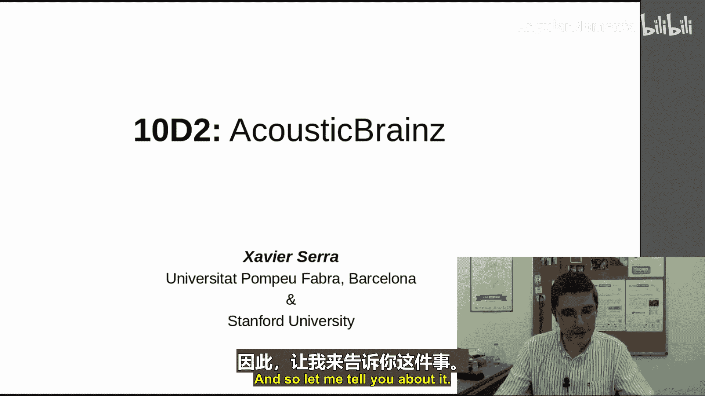

Let's go to the website。 So this is the。Fromron page of acoustic brains， we still do not have a logo。

 but that will come soon。So acoustic Bras is an initiative that aims to gather analysis data。

 so data obtained from analyzing music recordings。And provided by people。

 so the aim is to gather as much data as possible so that we can create repository a corpus of music data that can be used for many things can be use mainly for research。

 but also can be used to explore in different ways。So as guess as you might be aware。

 one of the difficulties of developing and carrying out research in music related data is the availability of audio recordings。

 audio recordings because of the copyright issues are not easily available and they cannot be gathered and shared in order to do research with。

So the alternative of acoustic brains has been to crowdsource that so that we distribute some code and then people are actually doing the analysis of the audio on their computer on their collection that they own and then they upload the resulting data。

In order to do that， we need two basic components， one is a way to identify uniquely every recording that the people analyze and with that have access to all the information of that recording。

 all the metada that surrounds that recording and that component is provided by music brains。

The other component is the actual analysis， analyzing the audio and obtaining some audio features with which then we can do interesting things and that's provided by asthia by one extractor of asthia Okay so that's the two basic components of acoustic brains as sort of the framework that we're talking about。

 Let me tell you a little bit more about acoustic brains。 So for example。

 here we see some of the statistics that in a few weeks we have been able to already obtain we have reached more than a million tracks analyze in just a few weeks。

 let me show you the overall statistics。Okay， so here we see the evolution of our collection in since we started in the mid September。

Up until now and in fact， during this time we have been putting together the framework and the software。

 so we didn't have much at the beginning。 we had some code that people had to compile so it was a little bit hard to do to use so that was this beginning increase。

And now in the for the past week or so， we have had some precompiled binaries that people can run on their computer。

 So it's much easier to analyze and therefore to obtain data。

 And this has been this second surge of increase of data。

And this top line is the total number of tracks that we have the light green one is the unique one。

 So there is a lot of duplicates with different format or one is compressed， the other is not。

 so the unique is and also an important number， and that's the one that is currently reaching 800000。

 And anyway， so there is different ways to measure which which recordings we have of loss less or loss equality。

 etc cetera， etc cetera。 So you can get an idea of how this has evolved。 So that's pretty good。

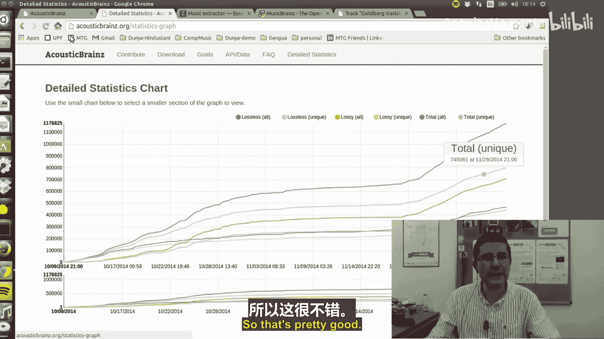

Okay， then。Let's talk about the actual two building blocks that we mentioned， the the music extract。

 the analysis engine that is based on Cythia。And then let's talk about the music brains and how this metadata is gathered。

Okay， so let's first go to Ecentia， this is the Acia website。And in it， in the documentation。

 you can access the premate extractors， and one of them is the music extractor。 Another one is。

 for example， the one we mentioned last week， which was the free sound extractor。

 So the music extractor is an extractor that has been put together in order to extract features。

 low level features that can be used to characterize describe music。

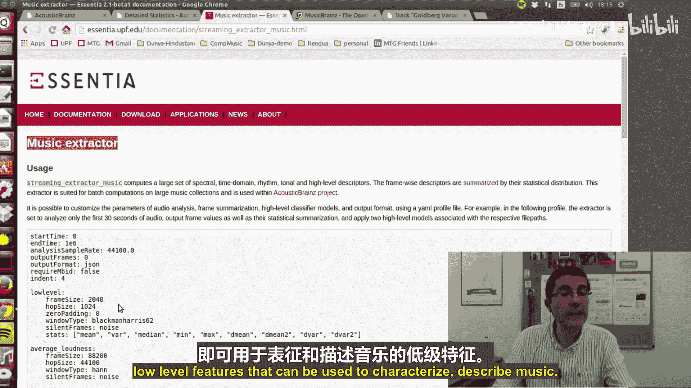

Okay， so that what it does。 and it outputs adjacent file。

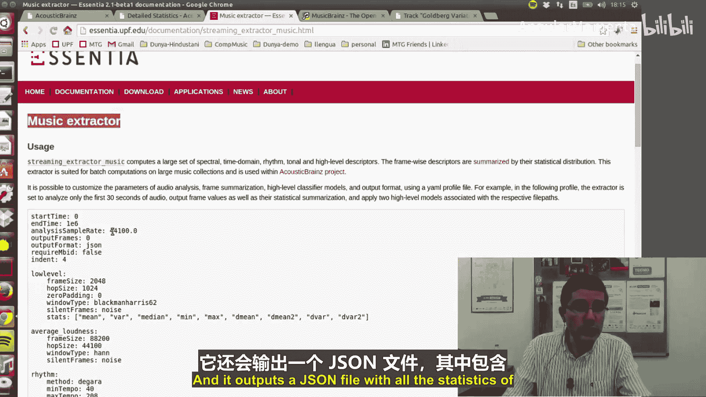

With all the values， the the statistics of the values for the whole music track。

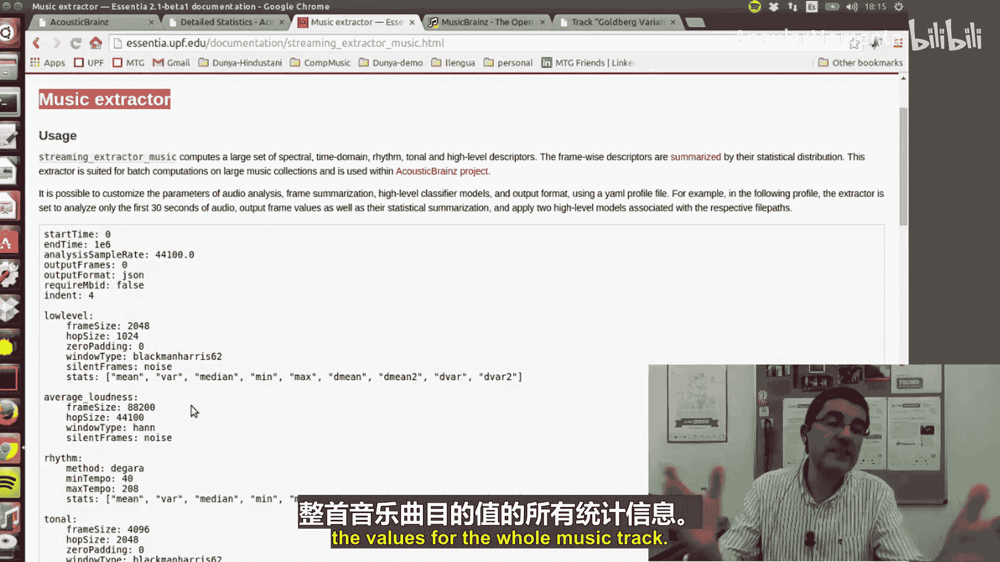

Okay， and below here， you have the list。Of all the features that have been extracted and that we have now in acoustic brains。

Then on top of that， there is also some high level descriptors that are extracted on our server from those level descriptors and using some machine learning approaches and classification techniques。

 we assign some labels to these tracks so that then can be useful for some higher level task。

And you can read more about these things。 Okay， so this is one of the components of acoustic brains。

The other component is music brains。So music Bras is these initiatives that has been going on for quite a while now that has been gathering metadata about music。

So here it says it's like a music in C Copeddia that collects music metada。And then of course。

 it's done in an open open type of license so that all this data is shared by everyone。And so anyway。

 so this is an excellent initiative and let's look at some of the statistics what they have obtained after all this time。

So， in this page。We see some of the numbers， how much data they have been able to collect。

 So they have the concept of entities。 and these are the core entities。

 So like artists or the number of releases or the tracks or for example， the works， the compositions。

 So， for example， they have information about 900000 artists。

Or they have information about 70 million tracks。 So this is basically our glass ceiling for acoustic brains。

 We are analyzing tracks that are identified by music brains。 every track。

 every single one of these entities has a unique identifier so that when we refer to a particular track a particular artist。

 We just have to refer to a number， and then that distinguish that entity。

 that artist that track uniquely on every service or every repository that we deal with So that's a great way to basically organize all the analysis data so that we have all these entities describing those analysis data。

 Let me now show you a particular example of an entity and how to basically navigate through that。

 I want to to look for。😊。

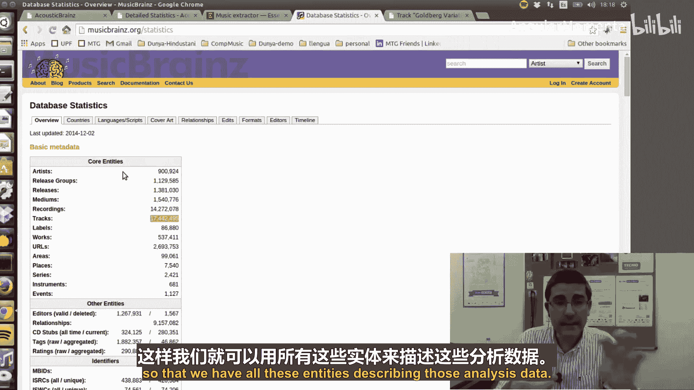

A piano recording of the Goldberg variations played by Apianist， her name is Kimmiko Shiaka。

 so let's type Kimikko。Okay， I don't know how to write the last name。

 so maybe let's just search Kimmiko okay， and yeah。

 that's the one that I was looking for already looked for it before。 So Kimikko Douglas Ihiaka。

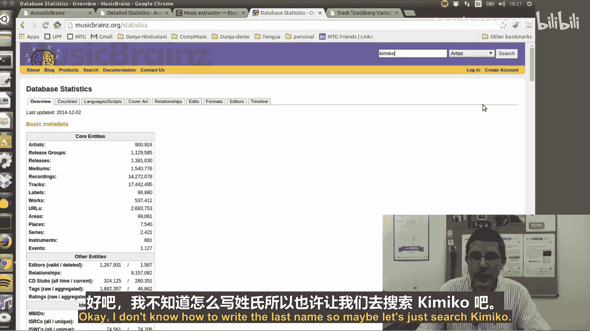

Okay。And so she's a pianist from Germany and also also originally from Japan。

 and so we can have some information about her and links to Wikipedia and some extra information。

 and then we have the recordings in which she's playing。

 so there is only one these Goldberg variations that was published in 2012。

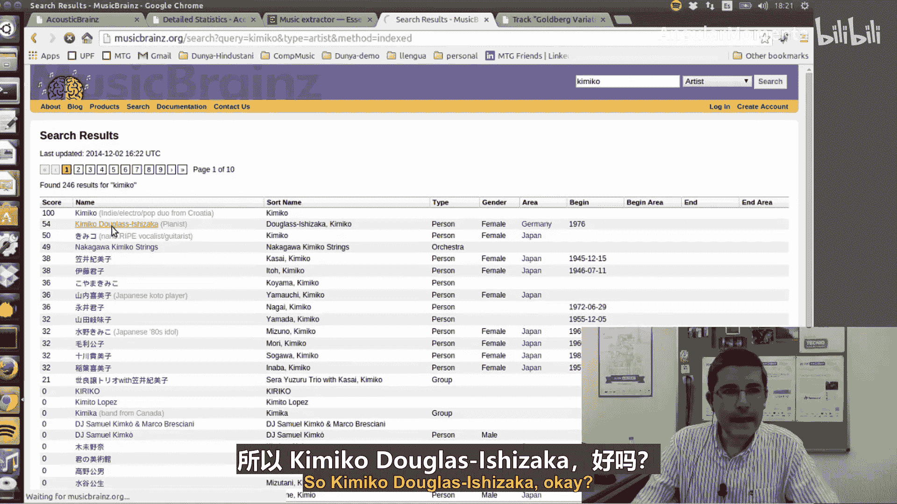

Okay， by bar。 and there are three versions of these recordings。

 The one is the digital media and the other is the C version。 So let's maybe look at this one。

Okay and these are all the tracks of these recordings so all the variations。

 the goldver variations and for each one we have quite a bit of information。

 but what is interesting is that for everyone there is a unique identifier。

 these numbers that appear here are the identifiers of every particular entity。 So these is。

 for example， the release identifier， So in fact， if we look at the details of this actual release。

We see the MBIDs， the music brains identifier for this particular release and if we go to one particular of the。

 for example， the well， let's go to the first variation。

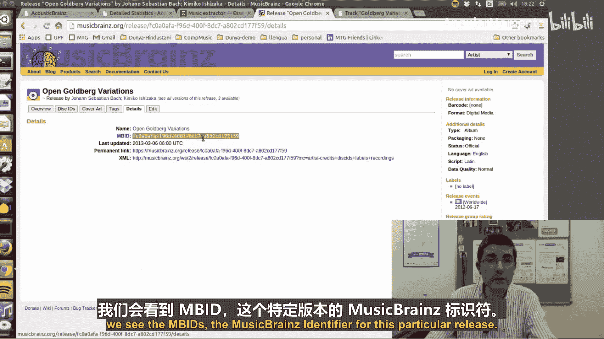

And then again， we can look for the detail and this is the music brains ID of this particular particular track of this C。

 Let's copy that because I'm going to use now。Okay， so now we have these two ingredients。

 so in order to be able to contribute to acoustic brains。

 the first thing we have to do is download two things we have download the tool that will be able to analyze the acoustic features with Cthia and so here we would use this apps submit this Linux version of the 64 bit so I already did that。

 so I copied I downloaded that and I have it in the computer and the other thing we also need is a tool that music Bras has which is called music brainins Picard。

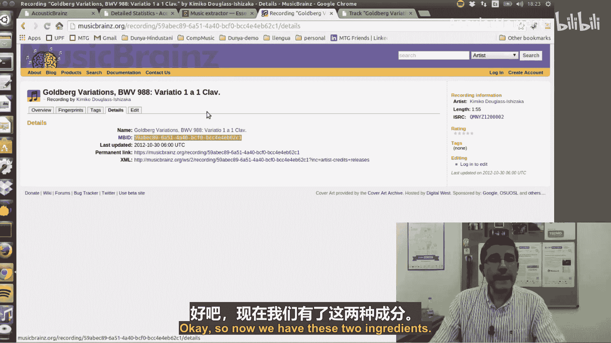

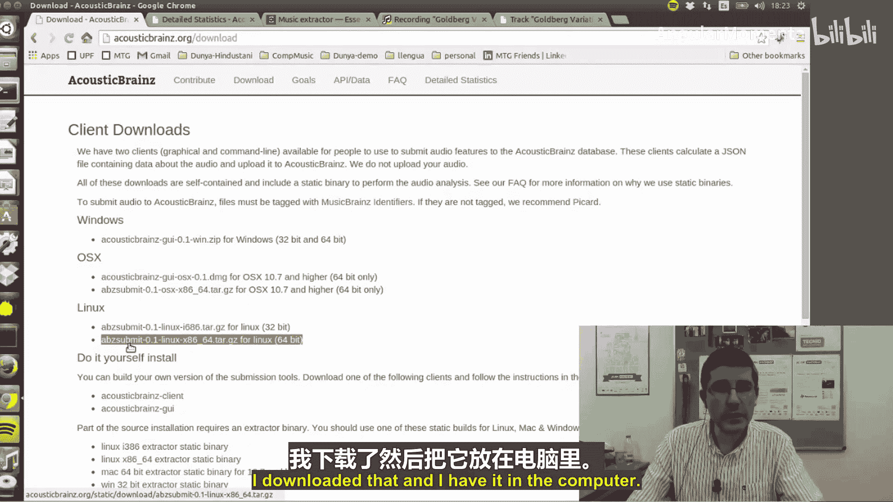

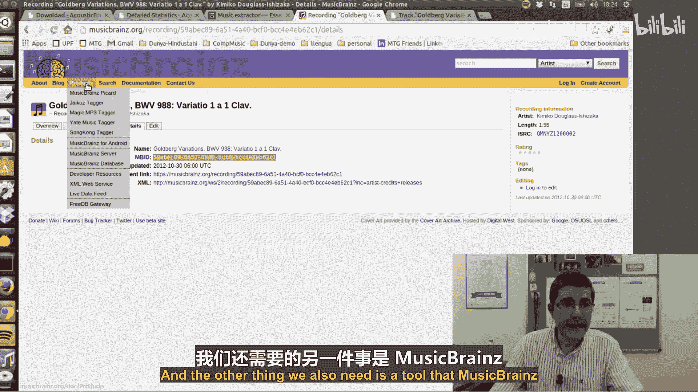

That's the tool that allows me to add these unique identifiers to a particular recording that we have。

O。So let's go to this music brain Sp art。And so this is the application。

 I download it and it has this graphical interface and now what I will do is I just copied the recordings of these gold variations and here they are so I just copy this directory this is by the way is a recording that is available under creativeative Common so you can just download it from online and that's what I did I downloaded the MP3 files so I can open it and this is what I downloaded all these files and now what I need in these MP3 files if I click on them。

 it has quite a bit of information， this is the information available in the header so this is the original values。

 the name， the artist， the composer etc， this is kind of the standard information that you can have in an MP3 file。

 but we need more。

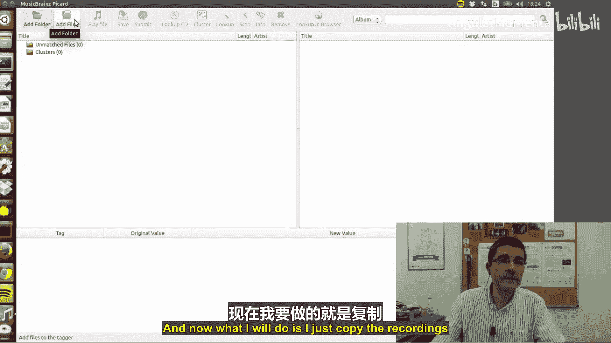

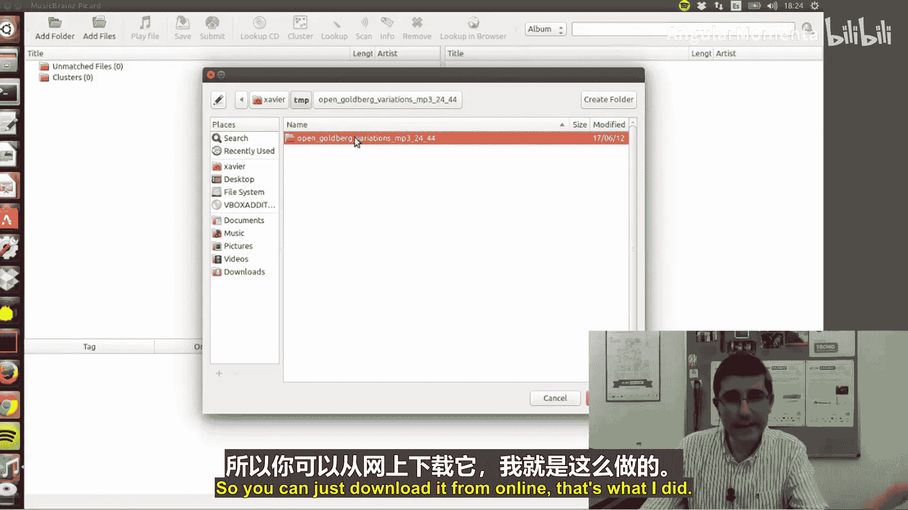

That we need these music brains ideas so that then we can uniquely identify these recordings so in order to do that what we will do is first cluster these and in fact it also should be here and understand why okay so we cluster all these tracks into one C basically in one album and now we can try to look at music brains in order to find all these unique identifiers and there are several ways to do that you can try do this lookup but these it's trying but it's not finding it uniquely there is also finger printinging way of accessing that and you can try to find using that but it doesn't work either so what I will do is manually just finding that entry in music brains that is in fact these one。

Okay， so looking up in browser， I can manually go to music Bras。

And then identify the release that correspond to my recordings and I looked before and the one that fits better is this one。

 so I click here。And now， it has。Addit this information in here。

 So now I have all the right release and metadata information with all the MB I Ds here。

 So it has for every track。 It has the corresponding identifiers。

 So now what I do is assigned my recording to this particular。

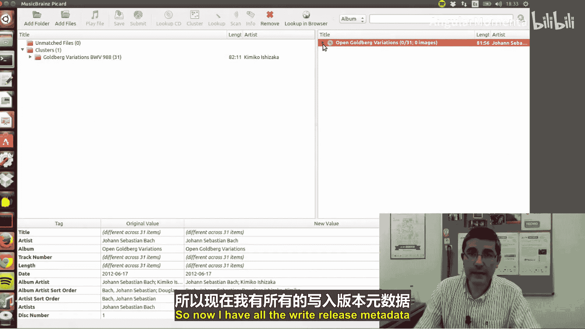

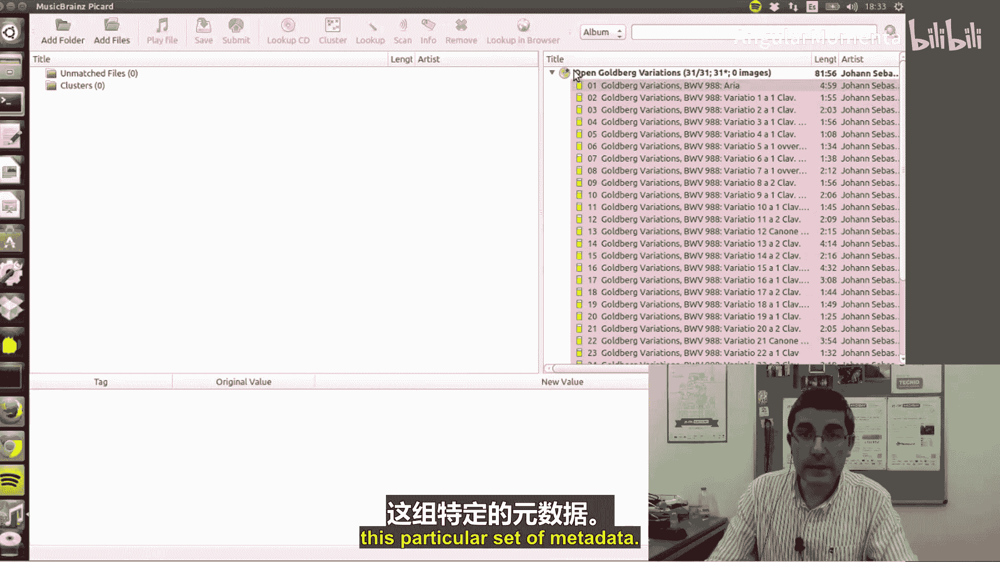

Set of metadata and I accept it， I say save。So this will save all the information I have in the MP3 files。

 so now within the MP3 files， I have all the music Bras ideas and everything。Okay。

 now I have in in my system the the actual。

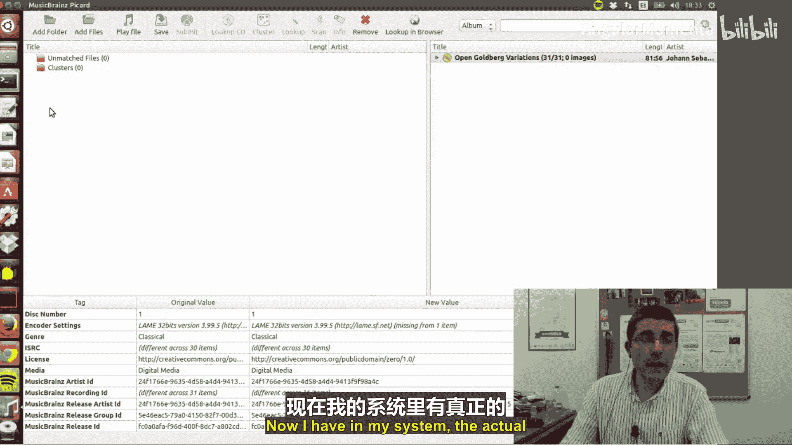

MP3 files with the information， the MBIDs of all the tracks。I also downloaded the analyzer。

 the analyzer was this apps apps submit directory here if I go there。Okay， so this is the code that。

I have downloaded from acousty Brains。It has a binary。

 which is the the already compile that has the extractor， the music extractor。

 So it calls this music extractor on whatever file or whatever directory I give it。

So now if I am in here， okay， I can just call this binary a submit okay and I will call it with the directory of the recordings I have been analyzing okay。

 so this is the directory where I have all the tracks of the goldberg variation and then I just click。

And this， I already had analyzed it while back。 So it already tells me that it has been done。

 So this。It has analyzed every single track and it has uploaded to acoustic brains the analysis data。

And now if we go to acoustic brains。Well， we can。Then type the ID of the track we have analyzed。

 So in order to do that， these are the last tracks that have been analyzed。

 I have to know the music brains I of a particular track。

 So I was looking at one particular track of this gold variations。

 So and this is the music brains I of this particular track。 So if I copy this particular track。

 and then I type it in the acoustic brains and I already did that。

 So this is acoustic brains follow by the music brains I of one of the tracks I analyze。

 So acoustic brains displays me the metadata coming from music brains or some of it。

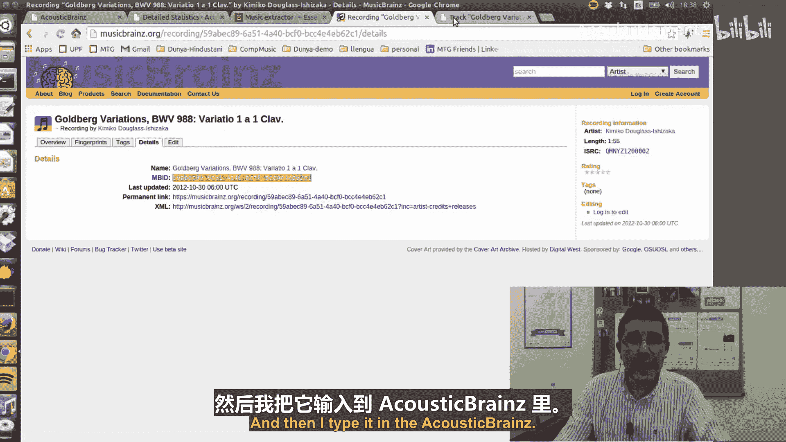

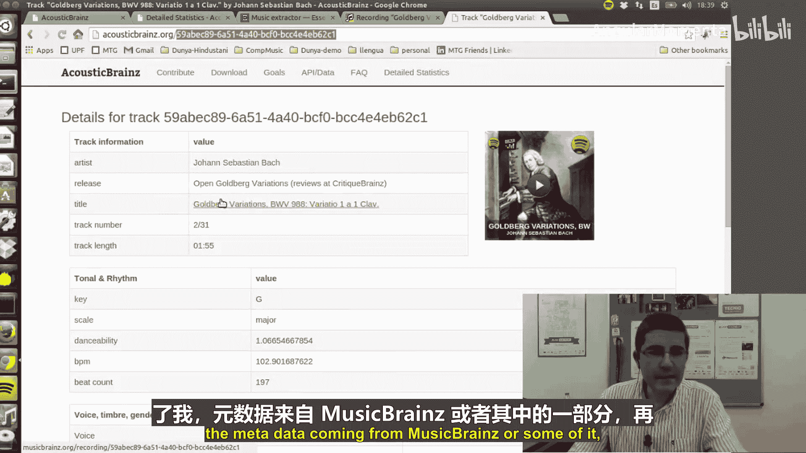

Plus， the acoustic data that we have analyzed some of it again， the complete files are these one。

 So we have this low level data。 So， for example， we can， we can look at that。

So this is the low level analysis， the J file。Or there is this high level data。

Which is this the data obtained from some training， from machine learning analysis。Okay。

So all this data is available here。 for example， automatically it tells me what is the key of this particular song In this particular case。

 it has worked。 this particular track is in g measure， but in some other cases may not do so well。

 This is research in progress， These are things that we are doing and hopefully with this process。

 this kind of open research type of initiative will get better。

 and then it knows about some aspects of timber analysis or tunnel analysis or even some mood。

 it has attempted to identify some of that and we use this facility in order to also even play attempt to play this recording if you have an account in for example。

 in in spotpotify or in dis or sometimes。

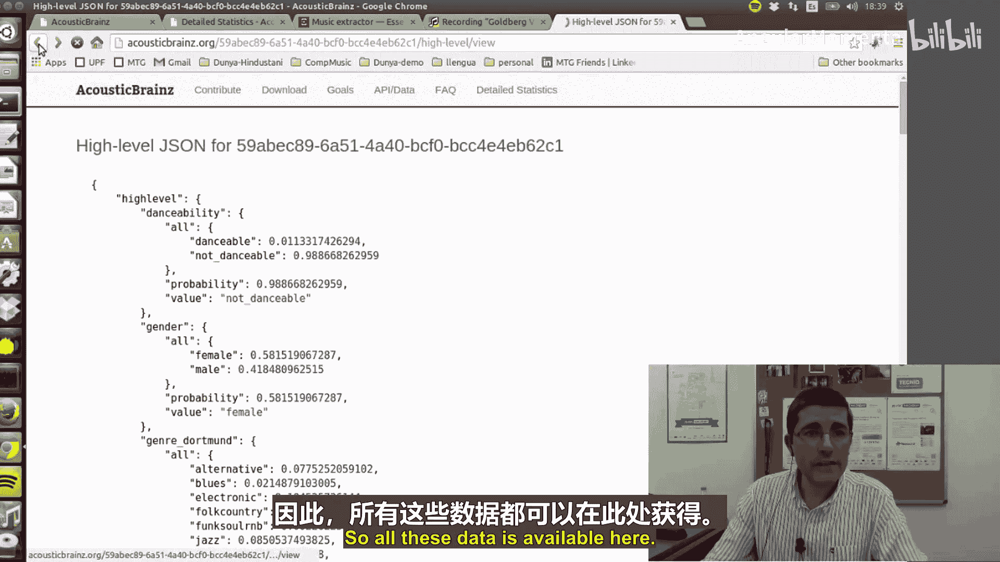

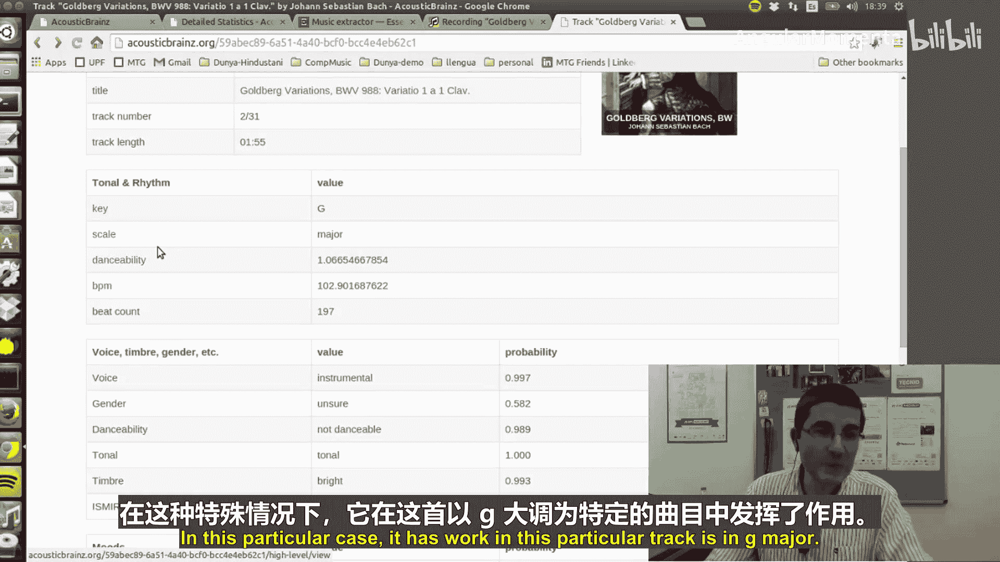

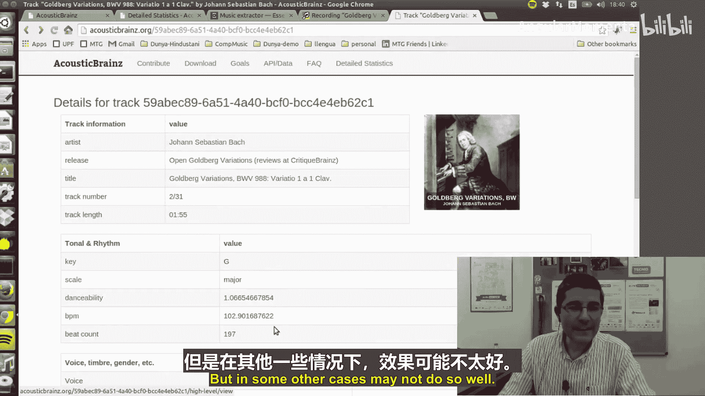

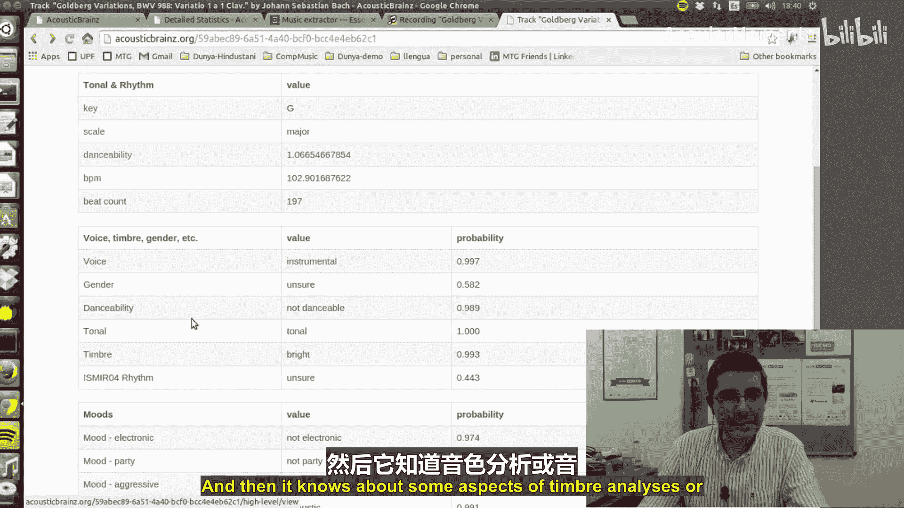

Find it in Soundcloud。 It attends from this metadata， find this recording， and we can even play it。

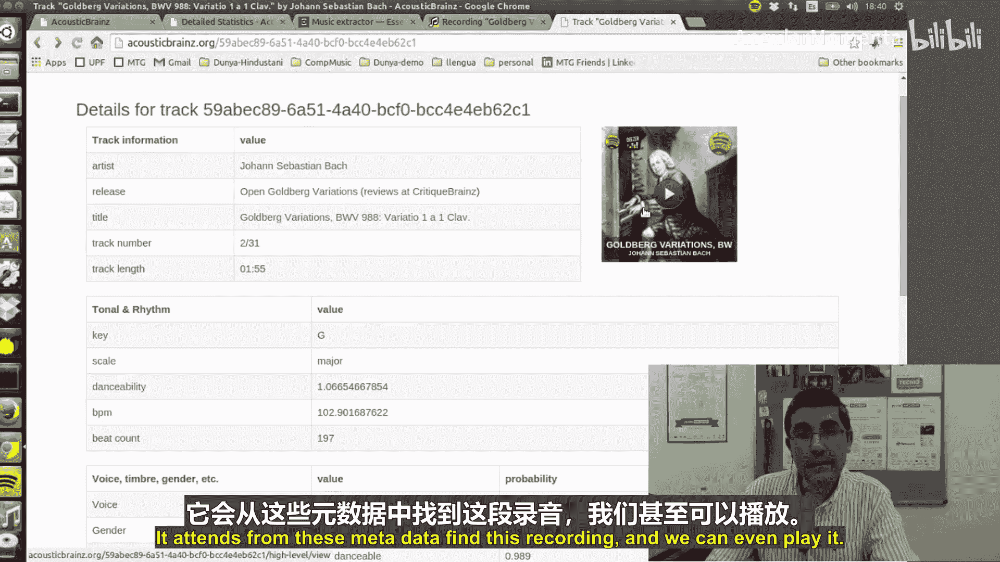

🎼So。Okay， so this has open Sified and from my account plate is not in fact the same recording。

 not the same artist， but is the same composition， though goldberg variations by Johansevastenba is not the open version that we had。

 but that music， so anyway， so that's pretty good， that's pretty useful。

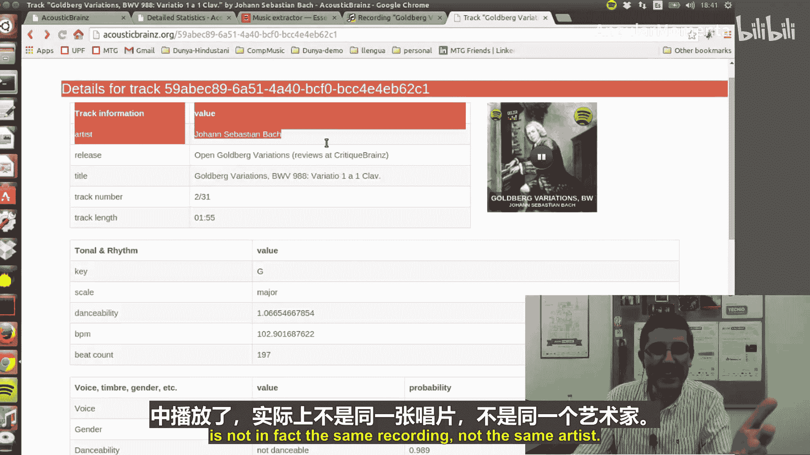

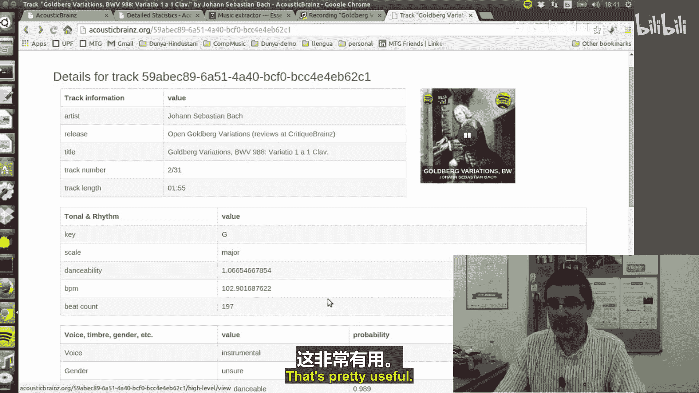

So okay sos that's acoustic brains， I could tell you more about it about the goals and about in fact there is an API that you can access directly all this information but again this is just a project that is starting we are very excited about it。

 I mean it would be great if you can contribute or you can benefit from it by using all these data。

 in fact you can download all the already analyze sound so for example here at the very end。

 you can download the zip file with the lowlel descriptors。

 the highle descriptors and we will keep making all these data available as we gather more and more data。

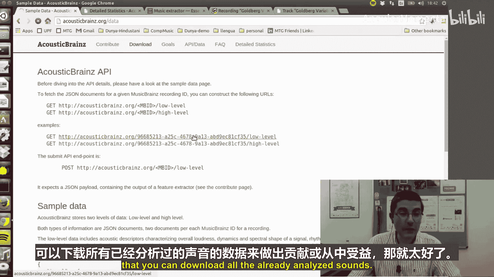

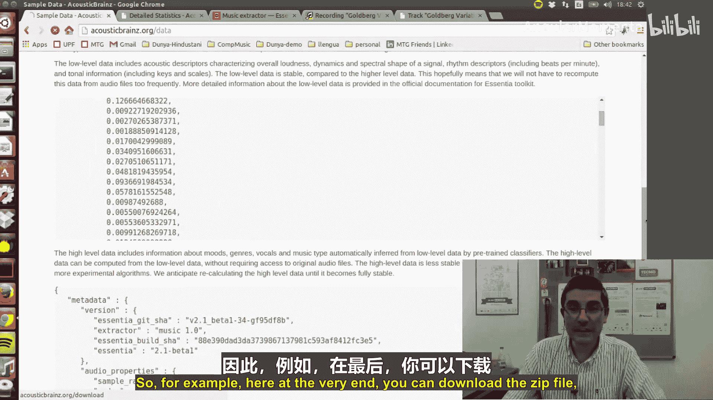

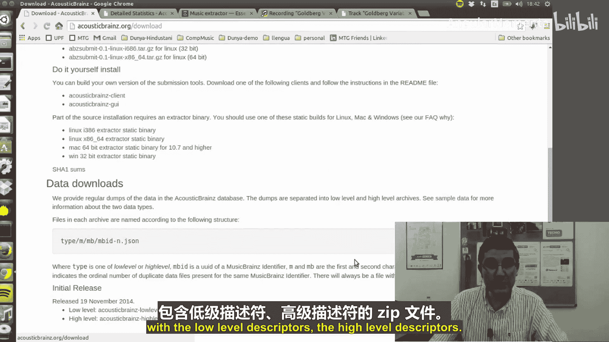

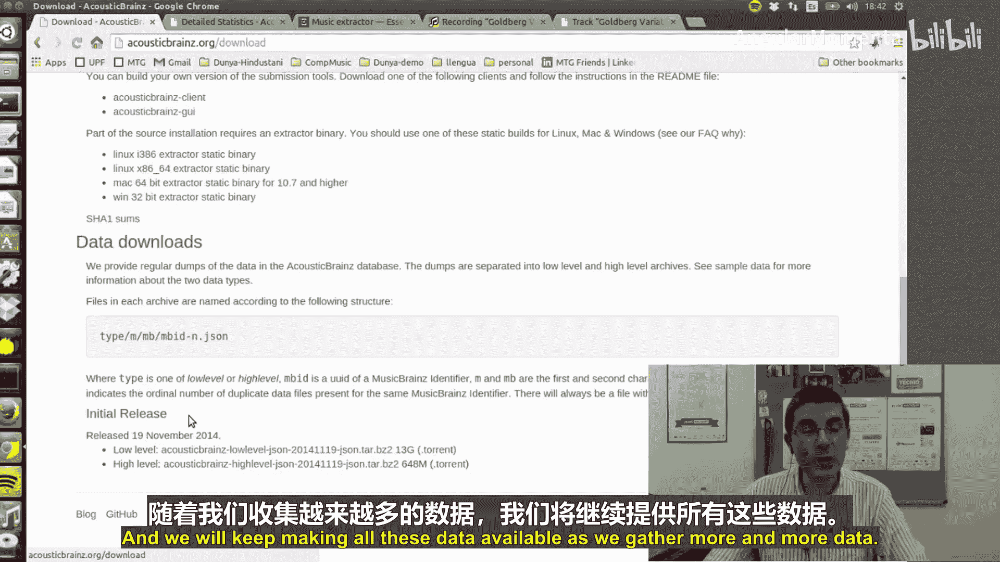

Okay， ands that's all in terms of references， acoustic brains， it's a great side。

 you can access from this URL， then music brains which is these website that we are using this initiative that is very much associated with acoustic brains。

 then P art is this software that we use to label to add the text to add the music brains IDs to the recordings that you might have in your collection。

 and this is needed in order that then to run the extractor。

 these sent the extractor in particular the music extractor so that if it has a music brains IDs。

 then it analyze it and it sent it to acoustic brains。And that's all。

 That's an example of a project that it's a recent project that clearly uses a lot of the things that we have been talking about。

 analyzing audio。 but in a much more complex situation in trying to analyze a lot of music and making sense of large repositories of music。

 So that's a very interesting initiative。 So thank you very much。 And I see next class。 Bye bye。😊。

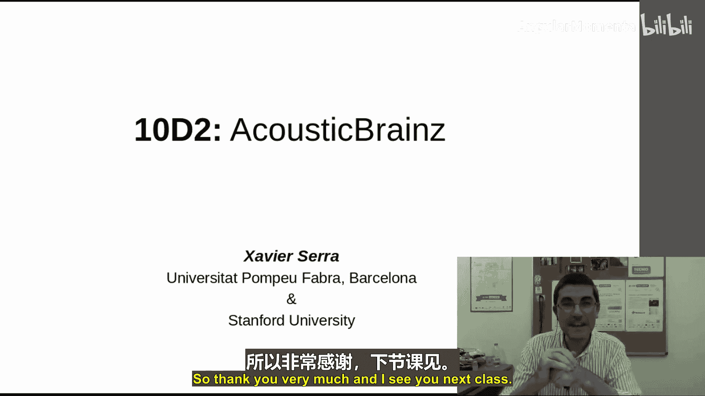