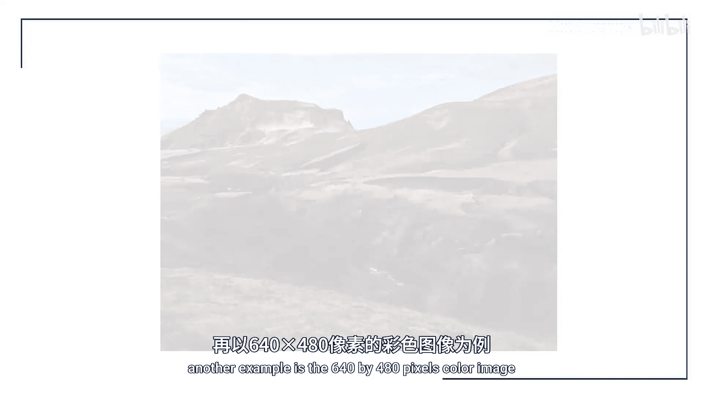
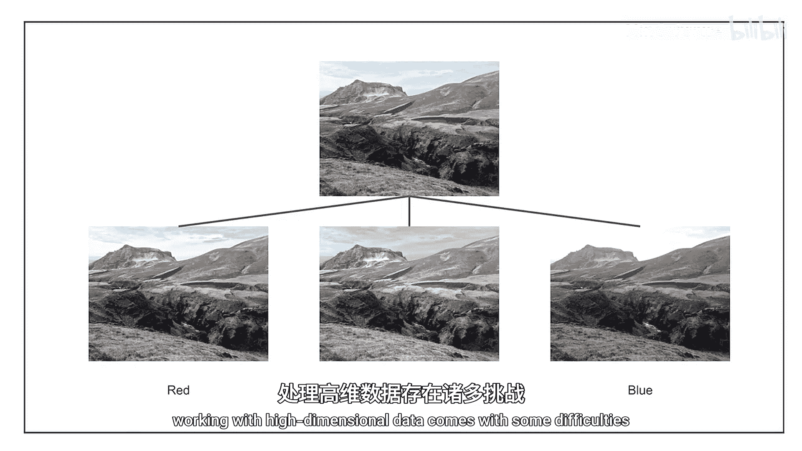
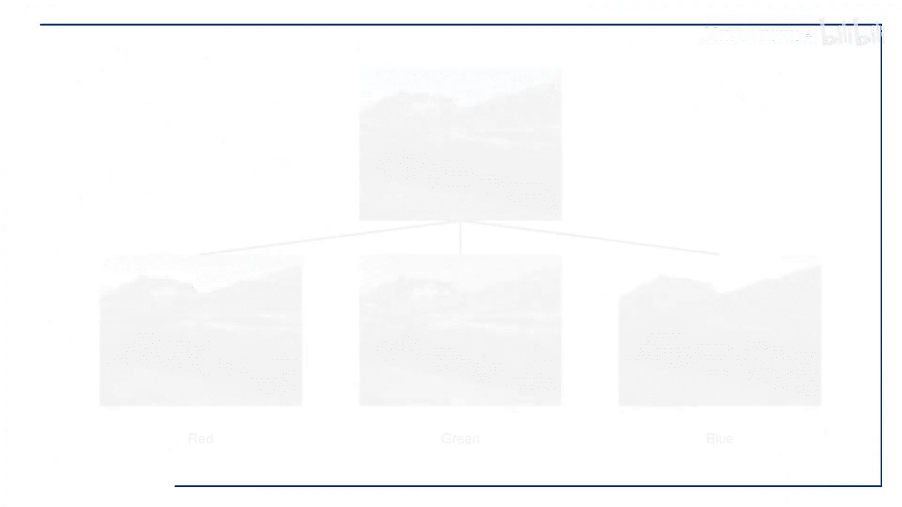
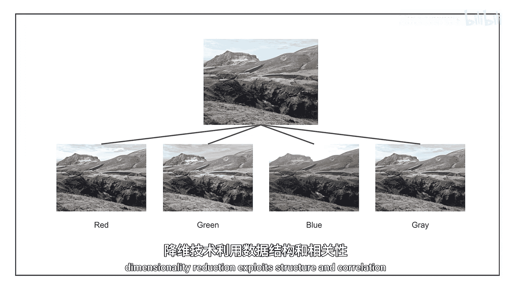

# 【帝国理工学院】机器学习数学：主成分分析Pca ｜ Pca Machine Learning p01 P01_课程介绍_01_01_01 -BV1fUYSzBEMp_p1-

Hi， I'm Mark， I'm a lecture in statistical Maine learning at Imperial College In this course we are going through the mathematical foundations that we need in order to do dimensionality reduction with principal component analysis。

Data in real life is often high dimensional。 For example。

 if we want to estimate the price of our house years time， we can use data that helps us to do this。

The type of the house， the size， the number of bedrooms and bathrooms。

 the value of houses in the neighborhood， when they were bought。

 the distance to the next train station and park， the number of crimes committed in the neighborhood。

 the economic climate and so on and so forth。 there are many things that influence the house price。

 and we collect this information in the data that we can use to estimate the price of our house。

Another example is the 640 by 480 pixels color image。

 which is a data point in a one dimensional space where every pixel corresponds to three dimensions。

 one for each color channel， red， green and blue。

Working with high dimensional data comes with some difficulties， it is hard to analyze。

 interpretation is difficult， visualization is nearly impossible， and from a practical point of view。

 storage can be quite expensive。

However， high dimensional data also has some nice properties， for example。

 high dimensional data is often overcomplete that means many dimensions are redundant and can be explained by a combination of other dimensions。

 For example， if we took a color image with four channels， red， green， blue and a grayscale channel。

 then the grayscale channel can be explained by a combination of the other three channels。

 and the image could equally be represented by red。

 green and blue alone as we can reconstruct the grayscale channel just using that information。

Dimensality reduction exploits structure and correlation and allows us to work with a more compact representation of the data。

 ideally without losing information。

We can think of dimensionality reduction as a compression technique similar to JP or MP3。

 which are compression algorithms for images and music。

 Let's take a small binary image of the handwritten digit 8。We're looking at 28 by 28 pixels。

 each of which can be either black or white。 Therefore。

 this image can be represented as a 784 dimensional vector。However， in this example。

 the pixels are not randomly black or white， theyre structure。

They often have the same value as the neighboring pixels。In this data set。

 there are many examples of an eight。 They differ a little bit。

 but they look sufficiently similar that we can identify them as8。

We can use dimensionality reduction now to find a lower dimensional representation of all8s that is easier to work with than a 784 dimensional vector。

The lower dimensional representation of a high dimensional data point is often called a feature or a code。

In this course， we will look at a classical algorithm for linear dimensionality reduction。

 principal component analysis or PCA。The purpose of this course is to go through the necessary mathematical details to derive PCA In the first module。

 we will look at statistical representations of data， for example， using means and variances。

And we also describe how means and variances change if we linearly transform our data。

In the second module， we will look at the geometry in vector spaces and define how to compute distances and angles between vectors。

In the third module， we'll use these results to project data onto lower dimensional subspaces。

 and in the fourth module we'll derive PCA as a way to reduce dimensionality of data using orthogonal projections。

