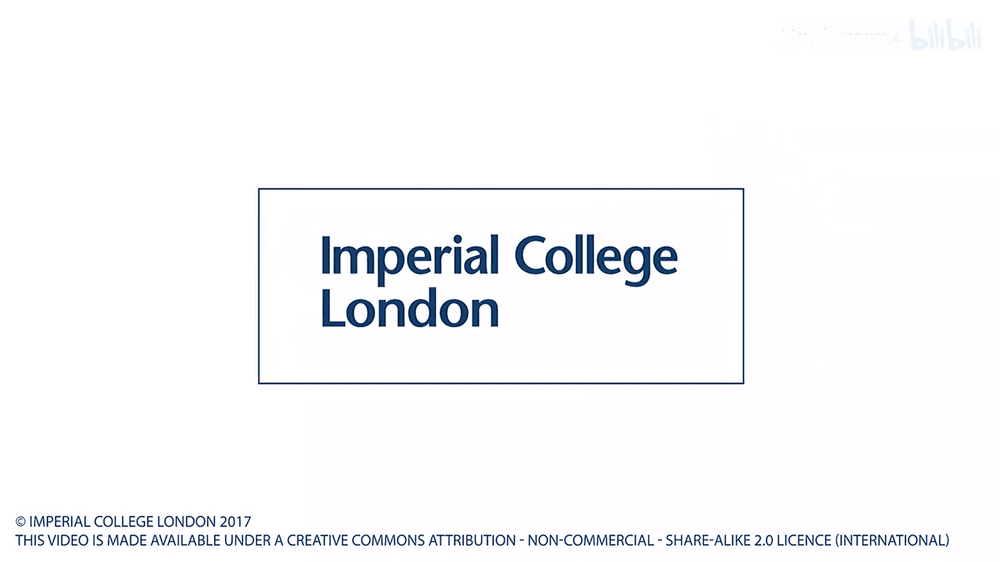

# 【帝国理工学院】机器学习数学：主成分分析Pca ｜ Pca Machine Learning p02 P02_欢迎来到模块1_01_02_01 -BV1fUYSzBEMp_p2-

When we work with data， we often need to find compact ways to describe some of its properties。

It wouldn't be particularly handy or useful to give somebody the entire data set。 Instead。

 we can use some statistical properties to describe the data。For example。

 we can say something about the center or the average of the data or the spread or orientation in the following videos we will be looking at exactly these kind of statistical properties and discuss mean values to describe average data points。

 variances that make statements about the spread and covariances which characterize orientation and correlations。

