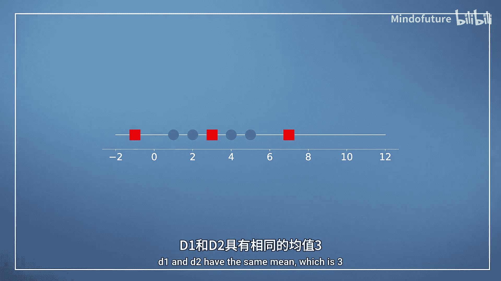

# 【帝国理工学院】机器学习数学：主成分分析Pca ｜ Pca Machine Learning p04 P04_一维数据集的方差_01_03_01 -BV1fUYSzBEMp_p4-

In the last video， we discussed mean values of data sets which represent an average data point。

 In this video， we will look at variances to describe other properties of a data set。

Let us have a look at two different data sets， D1 and D2。

D1 is represented by the blue dots located at1，2，4 and 5。

 and D2 is represented by the red squares at -1，3 and 7。D1 and D2 have the same mean， which is 3。

 but the data points in D2 are less concentrated around the mean than the data points in D1。

 Remember the mean value is the data point you would expect on average。

 But to describe the concentration of data points around the mean value。

 we can use the concept of the variance。

The variance is used to characterize the variability or spread of data points in a data set。

 In one dimension， we can look at the average square distance of a data point from the mean value of this data set。

 Okay， let's do this for D1 and D2。

So， D1。Was。1，2，4， and 5。And the mean value or expected value of D1 was 3。And D2。Was。-1。

3 and 7 with exactly the same。Mean value。So now we want to compute the average square distance of D1 from the mean and from D 2 from the same mean。

So let's do this for D1 first。So we get 1-3 squared。Plus，2-3 squared plus。4-3 squared。Plus。

 5-3 squared。 So these are the sum of the average of the square distances。 And to get the average。

 we divide by 4， which is the number of data points in D1。So if we do the computation， we get。

4 plus 1 plus 1 plus 4 divided by four whiches。10 over 4。So now we do the same for D 2。And for D2。

 we get。-1，-3 squared plus3-3 squared。Plus。7-3 squared。

 And we divide by the number of data points in D2， which is 3。

And we get 16 plus 0 plus 16 divided by 3， which is 32 over 3。

So now this number is now bigger than this number， which means that the average square distance of D2 from the mean value is bigger than the average square distance of D1 from the from the mean value。

 which indicates that the spread of the data is higher in D2 than in D1。

So what we have done can be formalized。 So assuming we have a data set consisting of n data points x1 to X N。

 then we can define the average square distance as the following。 So we have。X1 up to X， N。And then。

 we define。This to be。Our data X， and we define now the variance of this data。To be one over n。

Times the sum of small n equals sn to big n。off。X n minus mu squared where mu is the mean value of the data set X。

Yeah so what we have done here is exactly the same as what we did before with D1 and D2。

 We computed an average square distance of the data points in the data set from the mean value of the data set。

 And now we can also make some statements about this。 First， the variance as defined here。

 can never be negative， because we just sum up squared values。

 And that also means we can take the square root of the variances。

 And this is called the standard deviation。 The standard deviation is expressed in the same units as the mean value。

 whereas the variance， unfortunately is expressed in squared units。

 So comparing them is quite difficult。Therefore， when we talk about spread of the data。

 we usually look at standard deviations。So in this video。

 we looked at variances of one dimensional data sets， and in the next video。

 we will generalize this to higher dimensions。