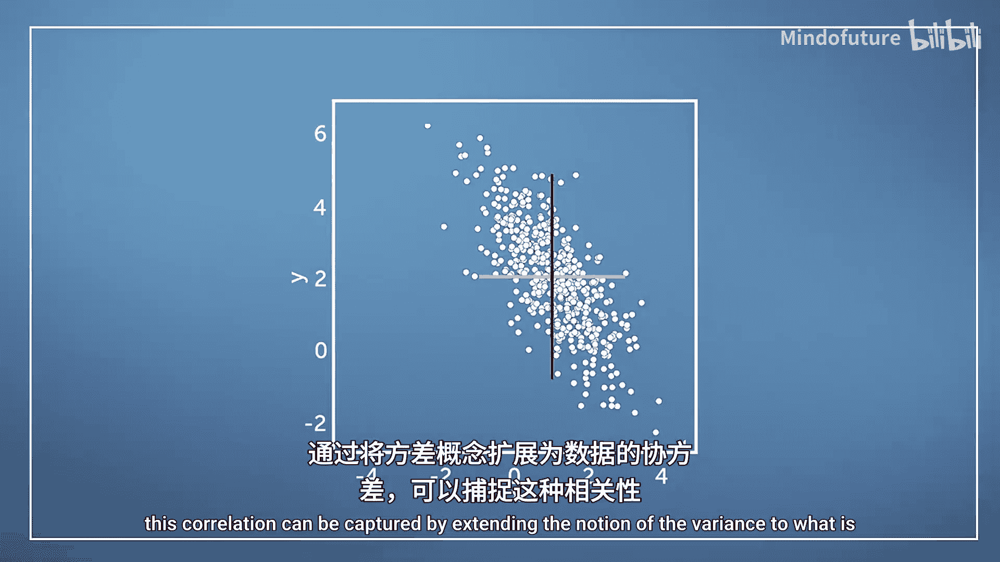
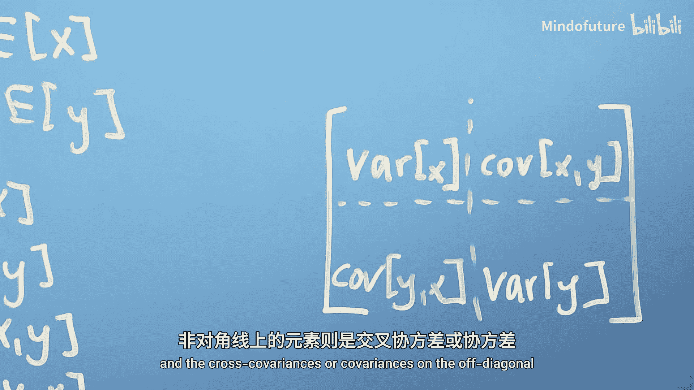

# 【帝国理工学院】机器学习数学：主成分分析Pca ｜ Pca Machine Learning p05 P05_高维数据集的方差_01_03_03 -BV1fUYSzBEMp_p5-

In the last video， we looked at variances for one dimensional data sets。

 and in this video we were looking at variances for high dimensional data sets。

The intuition and definition of the variances we had earlier does not really work in the same way in high dimensions。

 and squaring vectors is not really defined。Assuming we have a two dimensional data set。

 we can now compute variances in the x direction in the y direction。

But these variances are insufficient to fully describe what is going on in the data set。

In particular， we only have the variation of the data in either direction。

 independent of the other direction， but we may also be interested in the relationship between the x and y variables。

And this is where the concept of the covariance between these components comes into play。

Let's have a look at an example in two dimensions。 For this data set。

 we can compute the variances in the y direction and the variances in the X direction。

 which are indicated by these vertical and horizontal bars。But this can be insufficient。

Because we can look at other examples where the variances in the x and y directions are the same。

 but the data set look very different。If we look at this particular example。

 we have a different shape of the data， but the variances in the X direction and the variance in the y direction are exactly the same and the mean values of these dataset sets are also identical and I can look at different sets like this one here and this one。

These four data sets look very different。We've seen four different examples with four different properties or shapes of the data sets。

 but the variances in x and the variances in y and the mean values are identical。

If we exclusively focus on the horizontal and vertical spread of the data。

 we can't explain any correlationordation between x and y。In this last figure。

 we can clearly see that on average， if the x value of a data point increases， then on average。

 the y value decreases so that x and y are negatively correlated。

This correlation can be captured by extending the notion of the varianceance to what is called the covariance of the data。

 the covariance between x and y is defined as follows。

So covariance between x and y。Is defined as the expected value。Of x minus。

The mean in the x direction times y minus the mean in the y direction。 that' right。

 Mu X is the expected value。In the x direction and mu Y is the expected value。Of the Y coordinates。

For the 2D data， we can therefore obtain four quantities of interest。 We obtain。The variance of x。

You kept。The variance。Of why。And we also have the covariance terms。

The covariance between x and y and the covariance between。Y and x。

So we summarize these values in this matrix， called the covariance matrix。With。4 entries。

And in the top left corner， we have。The variance。In the x direction。Then we get the covariance term。

Between x and y。InThe top right corner。The covariance。Between Y and x in the bottom left corner。

And the variance。Of why in the bottom right corner。If the covariance between x and y is positive。

 then on average， the y value increases if we increase x。

 and if the covariance between x and y is negative。

 then the y value decreases if we increase x on average。

If the covariance between x and y is 0 and x and y have nothing to do with each other。

 they are uncorrelated。 The covariance matrix is always a symmetric， positive。

 definite matrix with the variances on the diagonal and the cross covariances or covariances on the off diagonal。

 If we now look at de dimensionmenal data sets， let's say we have a data consisting of n vectors。

X 1，2。X，n。And every X I is in RD， Then we can compute the variance of this data。As。

1 over n times the sum I equals1 to capital n。If X minus mu times X minus mu。

Transpose where mu is the mean of the data set。 and this is called the covariance matrix of the data。

And this is a。Di。By the matrix。

