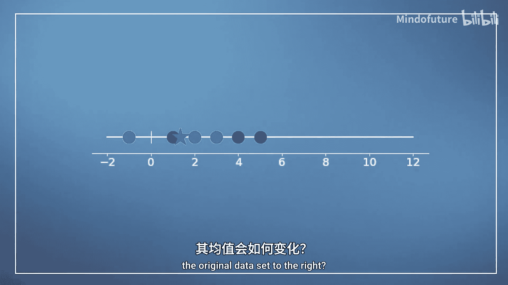

# 【帝国理工学院】机器学习数学：主成分分析Pca ｜ Pca Machine Learning p06 P06_对均值的影响_01_04_01 -BV1fUYSzBEMp_p6-

So previously， we looked at means and variances to describe statistical properties of data sets in this video。

 we'll discuss what happens to means and variances when we linear transform the data set that means we shift it around or stretch it。

So let's look at a data set D， which is given by these blue dots over here。 So we have a data set D。

Which is-1。2 and 3。 Now， let's compute the mean value of this data set to start with。

 So the expected value of D。Is -1 plus 2 plus 3 divided。By3。Which is。4 over 3。

So I'm indicating the mean value of his data set by this blue star。

So now the question is what happens to this data set when we shift it。

 so let's have a look at a shift by2 to the right， so we end up with these red dots now。

What happens to the mean value of this data set？ If we shift the data set。

 the original data set to the right。 Well， the answer is。

The mean also shifts by 2。So， let's define。D prime to be。The data set， one plus， sorry。1。4。And5。

Which is。D plus  two for every individual component in D。 Then the expected value of D prime is。

1 plus 4 plus 5， divided by 3。Which is 10 over3。And in particular。

 we can write this in a slightly different way。 We can write this。As。4 over3， which comes from here。

Plus，2。Which is the shift or the offset of the original data set。

So we can generalize this now to general shifts， and we can write an expected value。Of D plus a。

 where a is a constant。F is a plus the expected value of D。So up to this point。

 we know what happens to the mean of the data when we shift the data。

 but what happens if we stretch the data set， let's say we also stretch by a factor 2。

 and that means we multiply every individual component in the data D by2。

So then we end up with this data set on the indicated by the red dots here。

 and we define the double prime to be。min-2。four。And 6。

And if we now compute the mean of D double prime， then we end up with。-2 plus 4。Plus 6， divided by 3。

 which is。8 over 3。 And we can rewrite that again in a convenient way， which is。Four over three。

 which again， comes from here。Plus。That's sorry times。Two， which is the scaling factor。So in general。

 we can write that the expected value of alpha times t。Is alpha times the expected value。Of the。

Putting everything together， we can shift and scale our original data set。

 and the new mean of this linear transformation is given as follows。

 So if we compute the expected value of alpha times D plus a we get。

Alpha times the expected value of D。Plus， a， where alpha is the scaling factor， and a is the shift。

In this video， we looked at the effect of linear transformations on the mean value of a data set。

In the next video， we will look at exactly the same for the variances。

