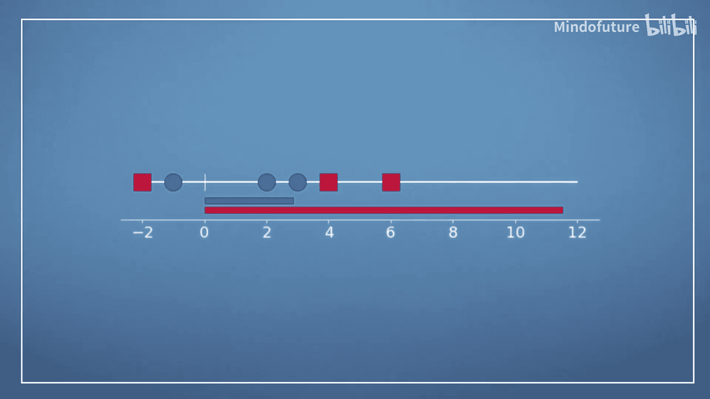

# 【帝国理工学院】机器学习数学：主成分分析Pca ｜ Pca Machine Learning p07 P07_对协方差的影响_01_04_02 -BV1fUYSzBEMp_p7-

We've seen what shifting and scaling a data set does to the mean Now let's have a look at the effects on the variant。

Remember that the variance is a measure of the spread of the data。

What do we expect when a data set is shifted。Let's have a look at this data set over here。

 We have three data points given at -1 plus 2 and plus 3。

And now we are shifting the data towards the right。

 The variance of the data is indicated by the blue bar at the bottom。

The shift of data set is now given by the red dots， and we shift every individual data point by 2。

 So question is now what happens to the variance。Well。

 the shift of the data does not really affect the relation of the data points among themselves。

 Therefore， the variance does not change。 The variance is identical。

 So the variance of the blue dataset set is identical to the variance of the red data set。 Therefore。

 a general result is that。If we have the variances。Of D。

That is exactly the same as the variance of our data set， D。Plus。

 a where a is an offset applied to every individual element of D。

Let's now scale the data set and see what effect that has on the variances of the data。

So're going to take exactly the same data set as before， the variance is indicated by the blue bar。

 and we're going to scale every individual data point by 2。

 So the question is what is the variance of two times t， So new data is indicated by these red dots。

Remember that the variance is the average squared distance of the data points from the mean。

 if we scale the data set by a factor of 2， the distance of every data point to the mean is scaled by2。

But the square distance is scared by4。And the variance is therefore four times as big as it used to be。

And our next result is。That the variance。Of alpha times t。Is alpha squared times the variance。Of D。

 where alpha is a real number that scales every individual element in the data set， D。Now。

 let's have a look at high dimensional problems。 Ass we have a data set， D。

Which is a collection of data points， x1 to xn。And the X， I。Live in RP P。

Remember the variance of this dataset is given by a covariance matrix。

 if you perform a linear transformation of every data point。

 say AX I plus B for a given matrix A and an offset vector B。

 the question is what happens to our data if we do this to every single data point？

While we get the covariance matrix of the transformed data set as follows。Forgetting。The variances。

Of a times D plus B。Is a times the variance of D times a transpose。In this video。

 we saw what effects a linear transformation of a data set has on the mean and the variance in particular we saw that shifting data has only an effect on the mean but not the variance。

 where scaling the data affects both the mean and the variance。

