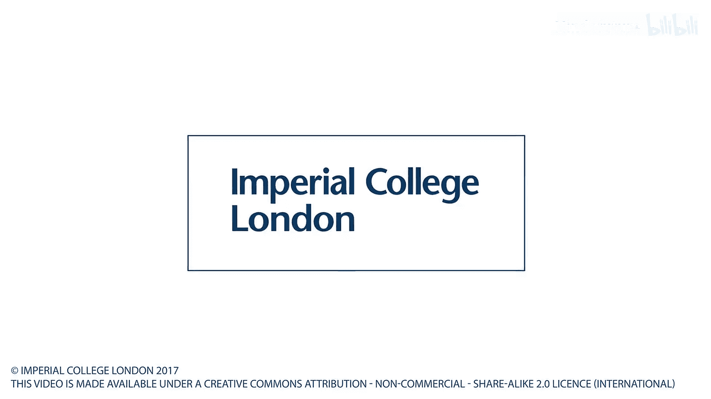

# 【帝国理工学院】机器学习数学：主成分分析Pca ｜ Pca Machine Learning p08 P08_下个模块见_01_04_03 -BV1fUYSzBEMp_p8-

We've already come to the end of this module。We look at statistics to summarize and characterize data sets。

Means variances and covariances。We looked at how these statistics change when we shift or scale the data set。

Well use meanss and covariances in module 4 when we discuss the PCA algorithm for dimensionality reduction。

 well done。

