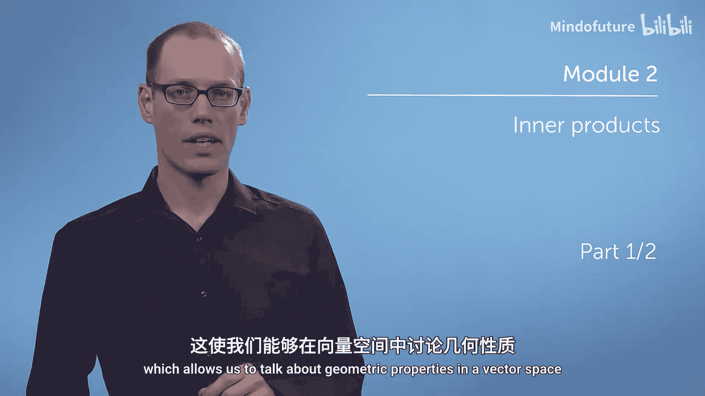

# 【帝国理工学院】机器学习数学：主成分分析Pca ｜ Pca Machine Learning p10 P10_点积_02_01_02 -BV1fUYSzBEMp_p10-

In order to measure angles， lengths and distances， we need to equip the vector space with an inner product。

 which allows us to talk about geometric properties in a vector space。

An example of an inner product that we may know already is the dot product between two vectors。

 x and Y。If x and y are two vectors in R N， so。Then the dot product is defined as。X transpose。

 Y is the sum。I equals1 to n of X I times Y， I where。X and y。A N dimensional vectors。

The length of x is then defined as the square root of the dot product of x with itself。

 So the length of x。Is。The square root。Of x transpose x。

Which we can also write as the square root of the sum of I equals 1 to n of X I squared。

Let's have a look at an example。 We take a vector X as 1，2 and a vector Y is 2。

1 in the two dimensional plane。 Then we can compute the length of vector of the。Vectctor。

Of x as the square root of。1 square plus 2 squared。Which is the square root of 5。And the length of y。

Similarly， is the square root of5 as well。If we're interested in the distance between two vectors。

 X and Y， we simply compute。The length of the difference vector。

 So we generally define then the distance between x and Y to be。The length or the norm of x minus y。

 which is the square root of x minus y transpose times x minus y。

So now let's compute the distance between our two vectors over here。

 So the distance between these two vectors is effectively just the length of this。Difference。So。

 we can write。This as。The norm of。1，2 minus。2，1。 So this is our difference vector。

And that is the norm。off。-1。And one。And this is the square road。Of one plus  one。

 which is the square root of2。So the length of this yellow segment。A square root 2。

So the last thing we are still interested in is the angle between two vectors。

And we can compute the angle also using the dot product。 The cosine of the angle。

 let's called this angle alpha。So， the cosine of alpha。Is given by。Ex trans pose。

Y divided by the length of x times。The length of y。And in our example over here。We'll get。

That the cosine of the angle between x and y。Is。X transpose times y， which is4。

Divided by the length of x times the length of y。 But we've done these computations already， which。

Come from here。So it's square root 5 in any case， so therefore。We get the cosine alpha is 4 over 5。

 which corresponds to approximately。0。64。Radance。And that is our angle alpha between these two vectors。

In this video， we looked at dot products as special cases of inner products to compute lengths of vectors。

 to compute distances between vectors and angles between two vectors。 And in part two of this video。

 we will be looking at general inner products to compute exactly the same quantities。

