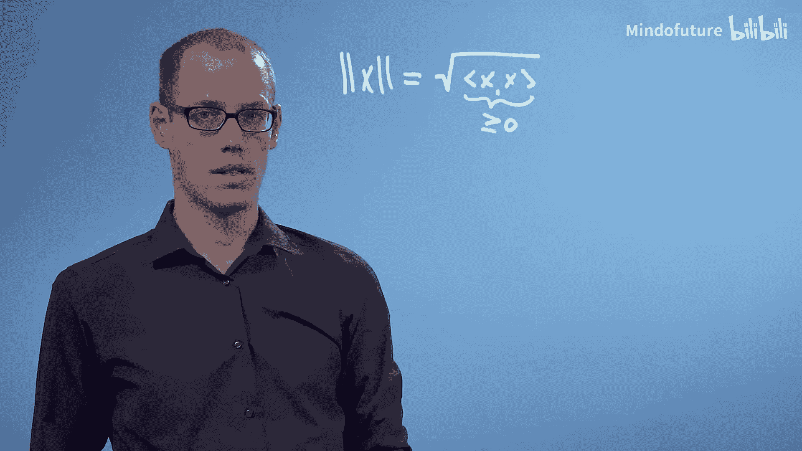

# 【帝国理工学院】机器学习数学：主成分分析Pca ｜ Pca Machine Learning p12 P12_内积-向量的长度_02_02_02 -BV1fUYSzBEMp_p12-

In the last video we defined inner products。Now， we will use inner products to compute lengths of vectors and distances between vectors。

The length of a vector is defined via the inner product using the following equation。

 So the length of a vector x。Is defined as the square root of the inner product of x with itself。

Remember that the inner product is positive definite。 That means this expression。

Its greater equal than 0。Therefore， we can take this square root。

We can now also see that the length of a vector depends on the inner product。

 and depending on the choice of the inner product， the length of a vector can be quite different。

Similarly， the geometry in the vector space can be very different。

The length of x is also called the norm of x。So let's have a look at an example。

As soon we are interested in computing the length of a vector in two dimensions and x is given。

As the vector。11。So， in a diagram。We have one here， and approximately here。Then， our vector x。

Would be here。 And now we're interested in computing the length of this vector。

So in order to compute the length of the vector， we need to define an inner product。

 So why don't we start with the standard dot product。So， if we define。X， Y to be x transpose y。

 So the inner product of x and y to be x transpose times y then。The length of x。Is。

The square root of 2。So it's one squared plus one squared， and we take the square root of this。Now。

 let's have a look at a different inner product。Let's define。X， Y to B。Ex trans suppose。Times，1。

us a half。 a half。1n。Times why。Which we can also write as。X1 times y 1。Minus a half。X 1， Y 2。Plus。

 x 2， Y 1。Plus。X 2。Why to。Using the definition of this inner product， then。The length of a vector。

Is the square root of。X1 squared， minus a half。X 1， x 2 plus X 2， X1。Plus。X2 squared。

And this is identical to the squared of。X1 squared minus。X 1， x 2 plus。X2 squared。

And well get smaller values。Then the dot product definition up here。If this。Expression。Is positive。

If we now use the definition of this。In our product to compute the length of our vector up here。

 we will get that。The squared norm or。The inner product of X with itself is。1 plus。1-1， which is one。

And therefore， the norm of x is just one。And one in this case would be the length of the vector using this unusual definition of an inner product。

 whereas the same vector would be longer had we used the dot product up here。

The norm that we just looked at also has some nice properties。 Let me write a few of those down。

So in particular， one of the properties is that if we take a vector and stretch it by a scalar lambda。

 then the norm of this stretched version is the absolute value of lambda times the norm of x。

The second。Property is the triangle inequality。Which says that。The norm of x plus y。

Is smaller or equal to than the norm of x plus the norm of y。 Let's have a look at an illustration。

So let's assume we have our coordinate system in two dimensions。And we use the standard vectors。

X equals。Bon 0， So x would be sitting exactly here。 So this is x， and y is 0，1。Then， x plus y。

Is sitting here。If we use the dot product as our inner product， then the norm。Of x is one。

 which is the same as the norm of y。And the norm。X plus y。Is square root 2。

So whether trying it inequality says that。X plus y norm is smaller equal than the norm of x plus the norm of y。

 And that is also true in our case， because squared of 2 is smaller， equal than 2。

And there's another inequality I would like to mention， which is the Kohi Schchwartz inequality。

And that says that the absolute value。Of the inner product of x with y is smaller or equal than the product of the individual norms of the two vectors。

In this video， we looked at length of vectors using the definition of inner product。

 And now we're going to use this to compute distances between vectors in the next video。

