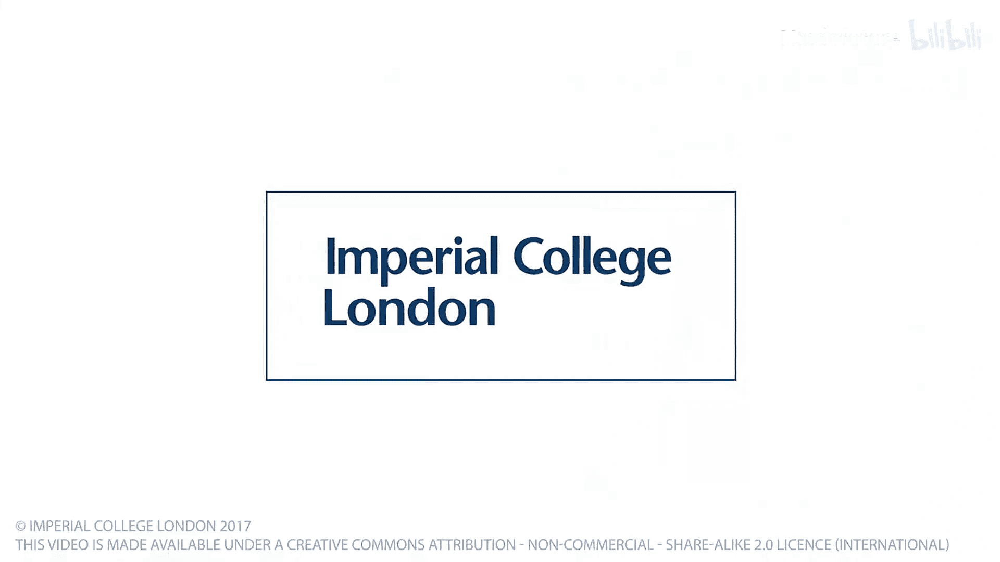

# 【帝国理工学院】机器学习数学：主成分分析Pca ｜ Pca Machine Learning p13 P13_内积-向量之间的距离_02_02_03 -BV1fUYSzBEMp_p13-

Now that we know how to compute the length of a vector。

 we can also compute distances between any two vectors x and Y。

 The distance between two vectors is defined as the length of the difference vector。

So we can write the distance between x and Y to be the norm of x。Minus y。 And as we know。

 this depends。On the definition。Of our inner product。If we use a dot product。

 then the distance is called the Euclidean distance。Let's have a look at an example。

You're going to look at two vectors， X and y。We're going to say x is。2，3。And why is4 one。

So let's draw this。So， this is x。And why。Is。Over here。In order to compute。

The distance between these two vectors， the first thing we actually need to do is let's have a look at this difference vector。

So。X minus y is。2 minus-4。In the first component。And 3-1 in the second component。

 That means we get -2。And plus 2 as the difference vector。So now we can define inner products。

 And let's now use。The dot product is our first example。

If we use the dot product to compute the length of this difference vector， we will get。

The square root of the first component squared plus the second component square， which is 4 plus 4。

 and that's the square root of8。And if we use a different inner product。Let's say， we define。

The inner product between x and y to be x transpose times1 minus half， minus a half and1。Times y。

Then， if we now use。The difference vector here。The result will be。The square root。Of 12。

So we can see that depending on the choice of our inner product。We will get different answers。

Of what the distance between x and y actually is。In this video。

 we computed distances between two vectors using inner products。

And we saw that depending on the inner product， the distance between these two vectors can differ。

