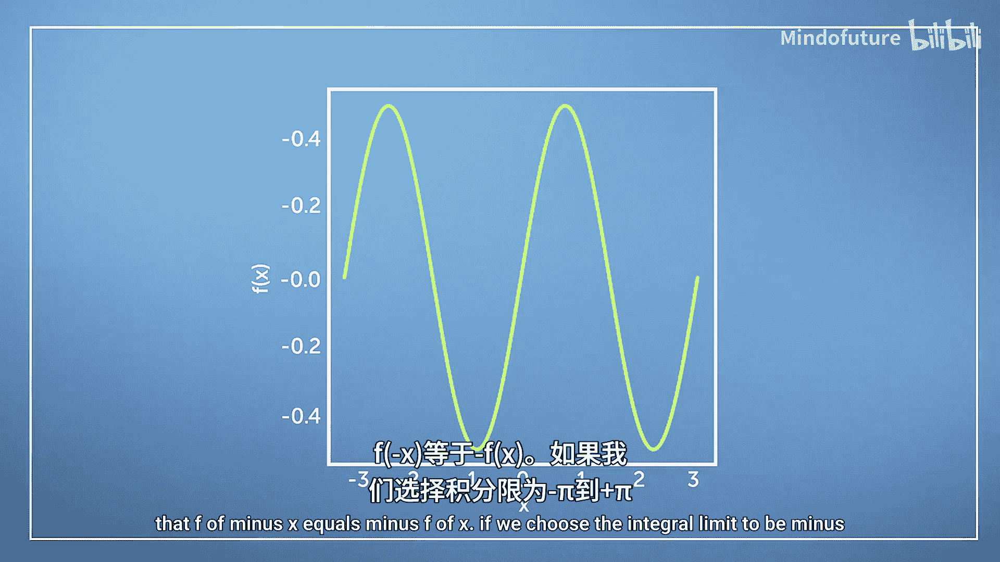

# 【帝国理工学院】机器学习数学：主成分分析Pca ｜ Pca Machine Learning p15 P15_函数的和随机变量的内积（可选）_02_02_06 -BV1fUYSzBEMp_p15-

In the previous videos， we looked at properties of inner products to compute lengths。

 angles and distances。We focus on inner products of finite dimensional vector spaces。In this video。

 we will look at two examples of inner products of other types of factors。

 inner products of functions and inner products of random variables。

The inner products we discussed so far were defined for vectors with a finite number of entries。

 and we can think of these vectors as discrete functions with a finite number of function values。

The concept of an inner product can be generalized to continuous valued functions as well。

 and then the sum over individual components of vectors turns into an integral。

 and the inner product between two functions is defined as follows。

You can write that the inner product between two functions， U and V。

Is the integral of an interval from a to B。Of u of x times v of x。Dx。

And as with our normal inner product， we can define norms and orthogonality by looking at this inner product。

If that integral evaluates to0， the functions U and V are orthogonal。Let's have a look at an example。

If we choose。U of x equals。Sinex。And v of x。I's cosine of x。And we define。F of x to B。

U of x times v of x， which is sine x times cosine x。Then we're going to end up with this function。

This function is cinex times cosinex。We see that this function is odd。

 which means that f of minus x equals minus f of x。

 If you choose the integral limit to be minus pi and plus pi。

Then the integral of this product signine of x times cosine of x。Evaluates to 0。

And that means that sine and cosine are orthogonal。

 And it actually holds that if you look at a set of functions， say one。Cosine x。Cosine of 2 x。

 cosine。3 x， and so on。That all of these functions are orthogonal to each other。

 If we integrate from minus pi to plus pi。Another example for defining an inner product between unusual types。

Are random variables or random vectors。If we have two random variables which are uncorrelated。

 then we know the following relationship。 We know that。The variance。Of x plus y。Is the variance of x。

Plus。The variances。Of y， where x and Y are random variables。

If you remember that variances are measured in squared units。

 this looks very much like the Pythagorean theorem for right triangles。

That one states that C squared equals a squared plus B squared。If you look at triangles of this form。

Where this is a。Bi。And this is C。Let's see whether we can find a geometric interpretation of the variance relation of uncorrelated random variables。

Random variables can be considered vectors in a vector space。

 and we can define inner our products to obtain geometric properties of these random variables。

If we define the inner product between two。Random variables。

 So between x and Y to be the covariance between。X and y。We see that the covariance is symmetric。

Positive， definite and linear。So linearity would mean。That。The covariance。Of lambda times x plus y。

And Z where X， Y and Z are random variables。And lambda as a real number is lambda times the covariance。

Between x and Z。Plus， the covariance between。Why， and Z。And if the length of a random variable。

Is the square root。Of the covariance between。Of X with itself。

Which is the square root of the variance of x。And this is the standard deviation。

Off the random variable x。So this is the length。Of a random variable。Therefore。

 the zero vector is a vector that has no uncertainty that means standard deviation is0。

If we now look at the angle between two random variables， we get the following relationship。You get。

The cosine。Theta， which is。The angle between two random variables is by definition。

 the inner product between the two random variables divided by the length。

Of the first random variable times the length of the second random variable。

 And if we now write this out。Using the definition。Of our inner product。We get。

The covariance between。X and y。Divided。Bai。The square would。Of the variance。Of x times the variance。

Of why。And this evaluates to 0。 if at only if the covariance between x and y is 0。

 and that is the case when x and y are uncorrelated， coming back now to our geometric interpretation。

We would now replace。A。With。The standard deviation。Of x。B is the standard deviation。Of why。And see。

Is the square root。off。The variance of x plus。The variance。Of why。

And this is how we get our geometric interpretation of random variables。In this video。

 we looked at inner products of rather unusual objects， functions and random variables。However。

 even with functions and random variables， the inner product allows us to think about lengths and angles between these objects。

 In the case of random variables， we saw that the variances of the sum of two uncorrelated random variables can be geometrically interpreted using the Pythagorean theorem。

