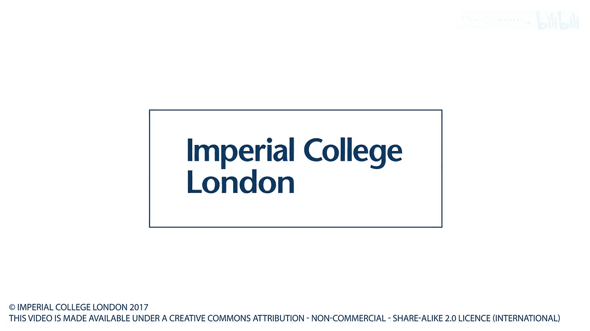

# 【帝国理工学院】机器学习数学：主成分分析Pca ｜ Pca Machine Learning p16 P16_前往下一个模块_02_02_07 -BV1fUYSzBEMp_p16-

This is the end of this module， congratulations。In this module。

 we introduced the concept of an inner product， a generalization of the dot product。

The inner product allows us to talk about geometric concepts。

 such as length distances and angles between vectors。

 One special case we discussed was orthogonality。😊，In the next modules。

 we will use orthogonality heavily for projections of high dimensional data onto lower dimensional subspaces。

 an integral part of principal component analysis。

