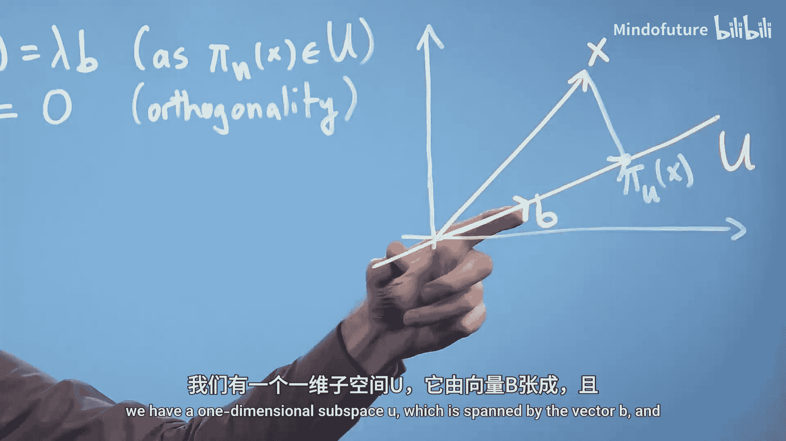

# 【帝国理工学院】机器学习数学：主成分分析Pca ｜ Pca Machine Learning p18 P18_到1维子空间的投影_03_01_02 -BV1fUYSzBEMp_p18-

In this video， we'll look at orthogonnal projections of vectors onto one dimensional subspaces。

Let's look at an illustration。We're given vector x in two dimensions。

 and x can be represented as a linear combination of the basis vectors of r2。

We also have a one dimension subspace U with a basis vector B。

 that means all vectors in U can be represented as Lada times speed for some lambda。Now。

 we're interested in finding a vector in U that is closest to x。Let's have a look at this。

When I compute the length of the difference of all vectors in U and the vector X。

 I'm getting the graph on the right。It turns out that we can find the vector in U that is closest to x by an orthogonal projection of x onto U。

 That means the difference vector of x and its projection is orthogonal to U。Overall。

 we are looking for the ortho projection of x onto U and we will denote this projection by pi U of x。

The projection has two important properties， first。Since。Pi U of X is in you。

It follows that there exists a lambda in R， such that pi U of x。Can be written as Lada time speed。

 a multiple of the basis vector that spans U。 Then Lada is the coordinate of the projection。

With respect to the basis B of the subspace U， the second property is that the difference vector of x and its projection ontoto U is orthogonal to U。

That means it's a formula to the basis vector that spans you。So， the second property is that。

The inner product between B and the difference between。Pi U of x and x。Is 0。

 So that's the orthogonality condition。These properties generally hold for any X in R D and one dimensional subspaces you。

 Now， let's exploit these two properties to find。Pi u of x。Ive found the setting once more over here。

 we have a two dimensional vector x。We have one dimensional subspace U。

 which is spanned by the vector B， and we're interested in finding the orthogonal projection of x onto U。

 which we call pi U of x。

And we have two conditions for pi U of x。 The first thing is that since pi U of x is an element of u。

 we can write it as a scaled version of the vector B。

 So there must be a lambda in our such that pi U of x is lambda times B。

 And the second condition is the orthogonality condition that the difference vector between x and pi U of x is orthogonal to。

To U， which means it's orthogonal to the spanning vector B。

And now let's exploit these two properties to find pi U of x。So first， we start writing。

We use the the condition that。B and pi u of x minus x。In a product is 0， which is equivalent to。

That the inner product with of B and。Pi u of x minus the inner product of B。

And x is 0 where we exploited now the， the linearity of the inner product。Now， we're going to。

Rewrite pi U of X as lambda times B。 So this is equivalent to。

B times lambda B or inner product with Lada B minus the inner product of B and X。 That must be 0。

 Now， we can move the Lada out again because of the linearity of the inner product。

Which is then lambda times the squared norm of B。Mus the inner product of B。At x。Must be 0。

 That is equivalent。2， lambda is。The inner product of B with its with x。

Divided by the square norm of B。So now， we found Lambda。Which is the coordinate。Of our projection。

 with respect to the basis B。And that means that our projection。Using the second condition。Sorry。

 first condition is lambda times B， which is now the inner product of B with x divided by the square norm of B。

Time speed。If we choose the dot product as the inner product。

 we can rewrite this in a slightly different way。 So we would， we would get。

B transpose times x times B divided by the square norm of B。So now， given that this one is a scalar。

 we can just move it。Over here。 So this is equivalent then just saying B times speed transpose divided。

By the square norm。Of B。Times x。Is our。Projected point。And。If we look at this。This is a matrix。

 and this matrix is a projection matrix that projects any point。

In two dimensions onto the one dimensional subspace。So now。

 if we look at the special case of B having norm 1。

 then we get a much simpler result and we would get。 So if， if the norm of B equals  one。

Then we will get that Lada is B transpose times x。And pi u of x。Is。B times B transpose times x。

So you would get the coordinate of the projected point with respect to the basis speed just by looking at the。

 the dot product of B with X。And the， the projection matrix is simply given by B time speed transpose。

Let me make a comment at the end。Our projection pi U of x is still a vector in R D。However。

 we no longer require deco coordinateordinates to represent it， but we only need a single one。

 which is the Lambda。In this video， we discussed orthogonnal projections of vectors onto one dimensional subspaces。

 We arrived at the solution by making two observations。

 We must be able to represent the projected point using a multiple of the basis vector that spans the subspace。

😊，And the difference vector between the original vector and its projection is orthogonal to the subspace。

In the next video， we will look at an example。

