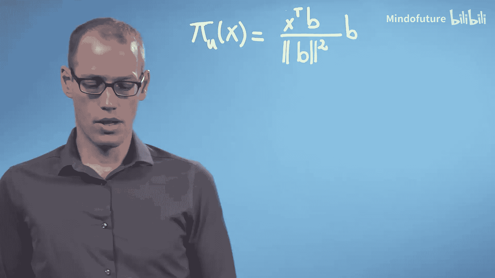

# 【帝国理工学院】机器学习数学：主成分分析Pca ｜ Pca Machine Learning p19 P19_示例_到1维子空间的投影_03_01_03 -BV1fUYSzBEMp_p19-

In the last video， we derived the formula for projections of vectors onto a one dimensional subspace。

 In particular， we arrived at this equation if we choose the dot product as the inner product here X is a d dimensional vector and B is the basis vector that spans that one dimensional subspace that we want to project x onto。

In this video， we are going to look at an example。 assume our vector B。

That spans our one dimensional subspace is the vector。Towen。And the vector to X。

 we want to project onto that subspace is given by。1，2。Let's quickly draw this。So， x。Is the vector。1。

2。 so x is living over here。And the vector B。It's going to be。The vector 2，1。And so， this is B。

And B spanning our subspace means that our subspace U is going to extend along。This one。

So now we are interested in computing the orthogonmal projection of x onto U。

So using now this equation here， we get so x transpose times B。Is。2。Plus，2。

And now we divide by the squared norm of B。 So the length of B is。

2 squared plus  one squared square root。 So overall， we get the squared norm to be。5。

And then time speed will get us。2。Towen。So overall four over five times the vector。To one。

This means that our orthogonal projection。Is four over five times the vector B。

 that means if we take4 fifth of this vector。Then we will get to our orthogonal projection。

So this point here。Is now pi U of x。 So the orthogonal projection of x onto U and the length。

Of this segment。Is。4 fifth times the length。Of b。We've gone through orthogonal projections onto one dimensional subspaces。

 In the next video， we're going to look at orthogonal projections onto high dimensional subspaces。

