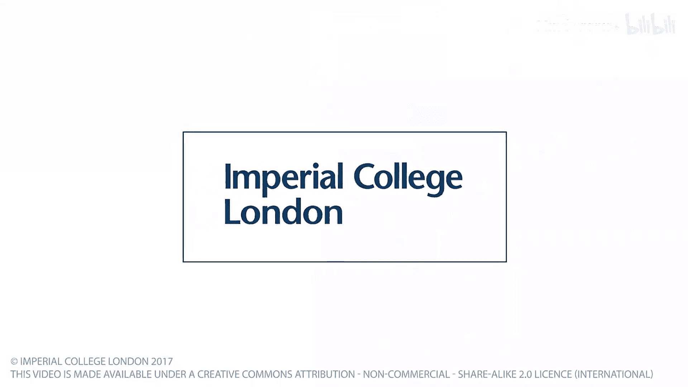

# 【帝国理工学院】机器学习数学：主成分分析Pca ｜ Pca Machine Learning p21 P21_示例_到2维子空间的投影_03_01_06 -BV1fUYSzBEMp_p21-

InThe last video， we derived fourgonnal projections of vectors onto m dimensional subspaces。

 In this video， we'll run through a simple example。

We're going to define x to be a three dimensional vectors given by 2，1，1， which is over here。

 and we define。Two basis vectors for our two dimensional subspace， B1 to be 1，2，0 and B2 to be 1，1，0。

 So that means。U， which is spanned by B1 and B2。I's going to be。Effectively， the plane。And it's。

Extension， so this。哦。Is you The orthoal projection was given as。Pi u of x is。

B times sda and we define B no。To be。B1 and B2， concatenated。Which is。1，2，0，1，1，0。

Andlandda was given as。Be transpose， B inverse times。Be transposedse。X。B transpose times x。

It's given as。4，3 vector。B transpose， B is。A2 by two matrix， which is 5，3。3，2。

Now we solve for lambda as B transpose B inverse times B transpose x。

 which means we find lambda such that B transpose B lambda。Equals。B transpose x。

Using Gaussian elimination， we arrive at lambda equals -1，3。

And this implies our projection of x onto the space spanned by the 2 B vectors。

Is-1 times B1 plus three times。B2， which is。2，1。0。In our diagram， over here。This would correspond。2。

This vector here。This is。Pi u of x。This result makes sense because our projected point has as a third component。

 the 0， and our subspace requires that a third component is always 0。

 Our projected vector is still a three dimensional vector。

 but we can represent it using two coordinates。If we use the basis defined by B1 and B2。Therefore。

 that is the compact representation of the projection of x onto this lower dimensional subspace。

In this video， we looked at a concrete example of the orthogonal projection of a three dimensional vector onto a two dimensional subspace。

In the next video， we're going to exploit orthogonal projections and derive a dimensionality reduction algorithm called principal component analysis。

