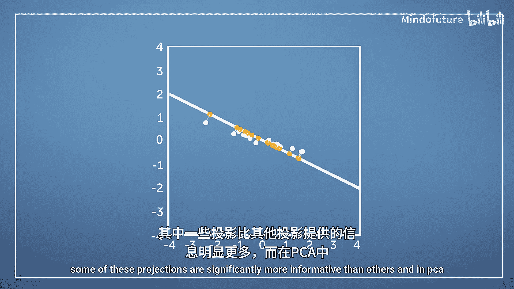

# 【帝国理工学院】机器学习数学：主成分分析Pca ｜ Pca Machine Learning p24 P24_问题设置和PCA目标_04_01_04 -BV1fUYSzBEMp_p24-

In this video， we will introduce the setting of PCA and the high level idea。

Assume we have a data set X and RD， consisting of N vectors。So X， the data set。

 and we have n vectors， x1，2， X， N， where the X I。D dimensional vectors。

Our objective is to find a low dimensional representation of the data that is as similar to X as possible。

Before we start， let's briefly review three important concepts。

The first one is that every vector in RD can be represented as a linear combination of the basis vectors。

So let's write this down to me， right。X N can be written。As the sum of I equals1 to D。

Of beta I N times B， I， where。In the following， we will assume that the BI are orthoormal basis of RD。

 If we assume that we use the dot product as our inner product and B1 to BD on ortho normalmal basis。

 we can also write the beta IN as x and transpose times B。

Which means we can interpret beta I N to be the orthogonal projection of X n onto the one dimension subspace span by the if basis vector。

The third property is that if we have an orthonor basis， B1 to be M of RD。

And we define B to be the matrix that consists。Of these orthonormal basis vectors。

Then the projection of x onto the subspace。We can write as Xtilde is。B times B transpose times x。

 That means x tilde is the orthogonal projection of x onto the subspace spanned by the M basis vectors。

And。B transpose times x are the coordinates of x tilder with respect to the basis vectors collected in the matrix B。

 This is also called the code。So， coordinates。Or。codeode。Now， let's have a look at PCA。

The key idea in PCA is to find a lower dimensional representation。

 x and tilde of xN that can be expressed using fewer basis vectors that's say M。

We assume the data is centered that means the data has mean zero。

 and we also assume that B1 to BD on ortho normalmal basis of RD。Generally。

 we can write any X N tilde in the following way。Xent tilde can be written as a sum。I equals1。To M。

Of beta I N times B， I。Plus， the sum。Of I equals M plus 1 to D。Of beta， I N times B， I。

So we took this entire。Thing is still living in RD。

So we took our general way of writing any vector in RD， which comes from property1。

 and we split the sum in property1 into two sums。One is living in a m dimensional subspace。

And the other one is living in a D minus M dimensional subspace。

 which is an orthogonal complement to this particular subspace。In PCA。

 we ignore the second term so we get rid of this part。

And then we call the subspace that is spent by the。Basis vectors B1 to BM， the principal subspace。So。

 B1。To B。San。Theyi。Princiipple。Subspace。Although Xilde is still a D dimensional vector。

 it lives in an M dimensional subspace of RD and only M coordinates。

Beta n1 to beta N M are necessary to represent it。 So these ones are the coordinate of this Xentil de vector。

The betas are then also called the code or the coordinates of tilde X and with respect to the basis vectors B1 to BM。

And the setting now is as follows。Assuming， we have。Data X1 to X， N。 We want to find parameters。

 beta I N。And also normalmal basis vectors， B。Such that the average squared reconstruction error is minimized。

And we can write the average squared reconstruction error as follows。Can write。J。

 that's the average squared reconstruction error is going to be1 over n times the sum。

N equals one to n。And then we write X n minus x n tilde。Squaquire。Let's have a look at an example。

We have data living in two dimensions， and now we want to find a good one dimensional subspace such that the squared or ever squared reconstruction error of the data original data points and their corresponding projections is minimized。

Here I'm plotting the original data with their corresponding projections onto oneal subspaces。

 and I'm cycling through a couple of options of subspaces。

 and you can see that some of these projections are significantly more informative than others。

And in PCA， we are going to find the best one。 Our approach is to compute the partial derivatives of J with respect to the parameters。

Proitus a。The beta I N。And the B Is。We set the partial derivatives of J with respect to these parameters to0 and solve for the optimal parameters。

But one observation we can already make。And that observation is that the parameterss。

Only enter this loss function through X N tilde。 This means that in order to get our partial derivatives。

 we need to apply the chain rule。So we can write。DJ， by D。Either beta， I N or B， I。Can be written as。

DJ by。D X and tilde times D X and tilde by D。Either。Beta， I， N， or B， I。And the first part。

 we can already compute。And we get。DJ by D X and tilde is minus-2 over n。Times。X， N， minus。

Exentilde transpose。And the other derivatives we compute in the next videos。

