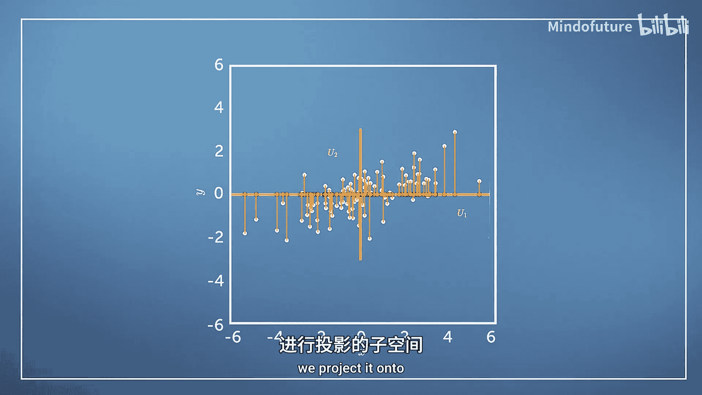

# 【帝国理工学院】机器学习数学：主成分分析Pca ｜ Pca Machine Learning p26 P26_目标的重新表述_04_01_07 -BV1fUYSzBEMp_p26-

In the last video， we determined the coordinates of the optimal projection with respect to the orthonormal basis that spans our principal subspace。

Before we go on and determine the optimal basis factors， let's rephrase our loss function first。

I have copied over the results that we have so far， so the description of our projected data point。

 our loss function， the partial derivative of our loss function with respect to our projected data point and the optimal coordinates that we found in the last video。

Before we go on and determine the optimal basis vector， let's rephrase our loss function。

This will make it much easier to find our base vector。For this。

 let's have a closer look at the difference vector between our original data point and our projected data point。

 So you can write。So Xilde is given。By equation A， which is the sum over J equals1 to M。Beta， J。

 N times。Bj。If we now use the results for our optimal beta J N parameters。From here， we get。This is。

J equals1。To M。X， N transpose times， B， J。Times， B， J will be used。地。Now。

 we rewrite this in the following way。This is just a scalar or dot product。 In this particular case。

 Dot products are symmetric so we can swap the order。And we can also move。The scalealar。Over here。

So what we end up with is。Bj。Times BJ transpose。Times X， N。

And this one we can write generally as J equals1 to M times B J times B， J transpose。X， N。

 where we move the X， N out of the sum。And if we look at this。This is a projection matrix。So。

 this means that。X and tilde is the orthogonal projection of X N onto the subspace spent by the M basis vectors B。

 J， where J equals 1 to M。Similarly， we can write X， N。Ass the sum J equals1 to M。Of B， J times。

 B J transpose。Times X， N。Plus。A term。That runs from m plus one to D。B， J times。

 B J transpose times X， N。So we write X N as a projection onto the principal subspace plus a projection onto the orthogonal complement。

And this term is the one that is missing。Over here。

 that's the reason why x and tilde is the approximation to X N。

So if we now look at the difference vector between x and tilde and X， N， what remains。Is。Exactly。

 this term。So。X n minus x and tilde。Is。The sum J equals m plus1 to D。Of B， J times Bj transpose。

Times X，n。So now we can look at this displacement vector。 So the difference between X。

 N and its projection。And we can see that the displacement vector lies exclusively in the subspace that we ignore。

 That means the orthoal complement to the principal subspace。😊，Let's look at an example。

 in two dimensions。We have a data set in two dimensions represented by these dots。

And now we are interested in projecting them onto the U1 subspace。

When we do this and then look at the difference vector。

Between the original data and the projected data， we get these vertical lines。

 That means they have no x component or no variation in X。

 That means they only have a component that lives in the subspace U 2。

 which is the orthogonal complement to U1， which is the subspace that we project it onto。

So with this illustration， let's quickly rewrite this in a slightly different way。

Go to write this as。Some of j equals m plus1 to D。Of BJ transpose X N times。BJ。

 and we're going to call this now equation E。We looked at the displacement vector between XN and its orthogonal projection onto the principal subspace。

 X and tilde。And now we're going to use this to reformulate our loss function。So from equation B。

 we get that our loss function。Is。1 over n times to sum n equals1 to n of X n minus x n tilde squared。

 So this is the average squared reconstruction error。 And now we're going to use equation E。

For the displacement vector here。So we rewrite this now。

Using equation E as1 over n times the sum n equals 1 to capital n。

And we're going to use inside that squared norm。This expression here。

 So we get the sum J equals m plus1 to D of。B， J time， B，j transpose times x， n times B， J squared。

And now we're going to use the fact。That the Bjs form an orthonormal basis。

And this will greatly simplify this expression。And we will get one over n。Times the sum。N equals 1。

2 capital n。Times。The sum J equals m plus 1 to D of B，j transpose times x N。Squad。

And now we're going to multiply this out explicitly。

And we get1 over n times the sum over n times the sum over J。Times。B， J transpose times X。

 N times X N transpose times B， J。So。This part is not identical。To this part。

And now I'm going to rearrange the sums。 So I'm going to move the sum over J。Outside。

 so I'll have some over J equals。M plus1，2 D。Times。B J transpo。 So this is independent of n。Times。

1 over N the sum。N equals  one to capital n。Of x n times xn transpose。

And there's a BJ from here missing times BJ。 So I'm going to bracket it now in this way。

 And what we can see now is that if we look very carefully， we can identify。This expression。

As the data covariance matrix S， because we assumed we have centered data。

 So the mean of the data is 0。 This means now we can rewrite our loss function using the data covariance matrix。

 and we get。That our loss is the sum over a j equals m plus 1 to D。Of Bj transpose times S。Times Bj。

And we can also use a slightly different interpretation by rearranging a few terms and using the trace operator so we can now also write this as the trace。

off。The some。Of j equals m plus 1。To D。Of B，J times B J transpose。Times S。And we can now。

 also interpret。This matrix。As a projection matrix。This projection matrix。

Takes our data covariance matrix and projects it onto the orthogonal complement of the principal subspace。

 That means we can reformulate the loss function as the variance of the data projected onto the subspace that we ignore。

 Therefore， minimizing this loss is equivalent to minimizing the variance of the data that lies in the subspace that is orthogonal to the principal subspace。

 In other words， we're interested in retaining as much variance after projection as possible。

The reformulation of the average squared reconstruction error in terms of the data covariance gives us an easy way to find the basis vector of the principal subspace。

 which we'll do in the next video。

