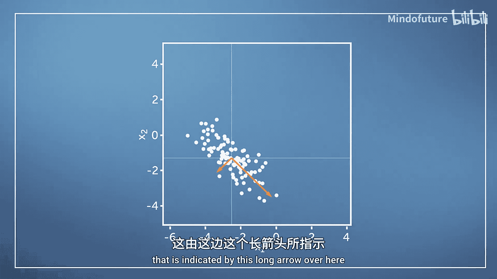

# 【帝国理工学院】机器学习数学：主成分分析Pca ｜ Pca Machine Learning p27 P27_找到构成主子空间的基础向量_04_01_09 -BV1fUYSzBEMp_p27-

🎼In the last video， we found that minimizing the average squared reconstruction error is equivalent to minimizing the projection of the variances of the data when projected onto the subspace that will ignore in PC A In this video。

 we will exploit this insight and determine an ortho normalmal basis of the m dimensional principal subspace using the results from earlier。

Over here。We can write our loss function， as。The sum。J equals m plus 1。To D。Of P J transpose S。

Times Bj， where S is the data covariance matrix。Minimizing this objective requires us to find the ortho normalmal basis that spans the subspace that we will ignore。

And when we have that basis， we take it a formal complement as the basis of the principal subspace。

Remember that the orthogonal complement of a subspace U consists of all vectors in the original vector space that are orthogonal to every vector in U。

Let us start with an example to determine the B vectors。

 and let's start in two dimensions where we wish to find a one dimensional subspace such that the variances of the data when projected onto that subspace is minimized。

So we're looking at two basis factors， B1 and B2 in R2。So， B1 and B2。

And B1 will be spanning the principal subspace and B2， its orthogonal complement。

 That means the subspace that we will ignore。 We also have the constraint that B1 and B2 are orthonormal。

 which means that。B， I transpose times B J is Delta I J， meaning that。This dot product is one。

 If I equals J and 0， otherwise。In our example， with our two vectors， our loss function is。Jay is。

B2 transpose times S times。B2。With the constraint that。B2 transpose times B2 is1。

To solve this optimization problem， we write down the Lagrangian and the laggrangian is B2 transpose S B2 plus lambda times 1 minus B2 transpose times B2。

 where lambda is the laggrange multiplier。So now we compute the gradients of the Rian with respect to B2 and with respect to lambda and set them to0。

 So D L。The lambda is 1 minus B2 transpose times B2。 And this is 0。

 if and only if B2 transpose times B2。Is one。 So we recover our constraint。

 So now let's have a look at the partial derivative of L with respect to B2。So， we get。2。

 B2 transpose times S from the first term。And2 lambda B2 transpose from the second term。

And this needs to be 0， and that is 0。If and only if。S times B2 is lambda times。B2。

Here we end up with an iconigenvalue problem。B2 is an eigenvector of the data covariance matrix。

 and the R branchch multiplier plays the role of the corresponding eigenvalue。

If we now go back to our loss function， we can use this expression。You can write。Jy， which was。

B2 transpose times S times B2。Now， we know that S times B 2 can be written as Lada times speed2。So。

 we get。B2 transpose。Times B2 times lambda。 And because we have an orthoormal basis。

We end up with lambmbda。As our loss function。Therefore。

 the average squared reconstruction error is minimized if Lada is the smallest eigenvalue of the data covariance matrix。

And that means we need to choose B2。As the corresponding eigenvector and that one will span the subspace that we will ignore。

B1， which spans the principal subspace， is then the eigenvector that belongs to the largest eigenvalue of the data covariance matrix。

Keep in mind that the eigenvectors of the covariance matrix are already orthogonal to each other because of the symmetry of the covariance matrix。

 So if we look at a two dimensional example， if this is our data。

 then the best projection that we can get that retains most information。

Is the one that projects onto the subspace that is spanned by the eigenvector。

Of the data covariance matrix， which belongs to the largest eigenvalue。

 And that is indicated by this long arrow over here。 Now， let's go to the general case。

 If we want to find the m dimensional principle subspace of a D dimensional data set。

And we solve for the basis vectors， B，J。Where J equals。M plus 12 D。 We optimize these ones。

We end up with the same kind of eigenvalue problems that we had earlier with a simple example。

 we end up with。S times B， J equals lambmbar J times B， J。4our。J equals M plus 1。To D。

And the loss function is given by the sum of the corresponding eigenvalues。

 So we can write J is the sum。From M plus one to D of all。冷的 j。Also， in the general case。

 the average reconstruction error is minimized if we choose the basis vectors that span the ignored subspace to be the eigenvectors of the data covariance matrix that belong to the smallest eigenvalues。

This equivalently means that the principal subspace is spanned by the eigenvectors belonging to the m largest eigenvalues of the data covariance matrix。

This nicely aligns with properties of a covariance matrix。

The eigenvectors of the covariance matrix are orthogonal to each other because of symmetry。

And the eigenvector belonging to the largest eigenvalue point in the direction of the data with the largest variances。

 and the variance in that direction is given by the corresponding eigenvalue。Similarly。

 the eigenvector belonging to the second largest eigenvalue points in the direction of the second largest variance of the data and so on。

In this video， we identified the orthonormal basis of the principled subspace as the eigenvectors of the data covariance matrix that are associated with the largest eigenvalues。

In the next video， we will put all the pieces together and run through the PC A algorithm in detail。

