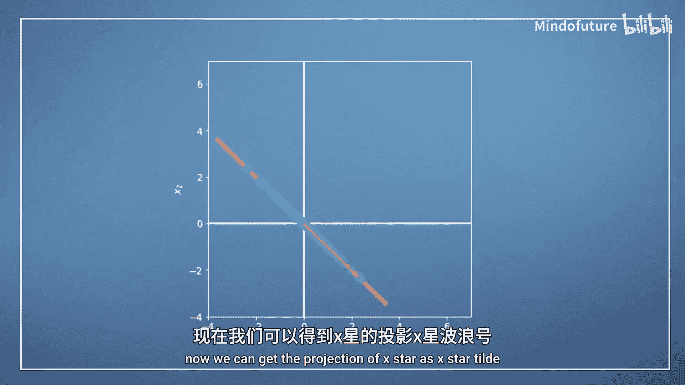

# 【帝国理工学院】机器学习数学：主成分分析Pca ｜ Pca Machine Learning p28 P28_PCA的步骤_04_02_01 -BV1fUYSzBEMp_p28-

In this video， we'll go through the individual steps of PCA， but before we do this。

 let me make two comments。When we derive PCA， we made the assumption that our data is centered。

 That means it has mean 0。 This assumption is not necessary to derive PC。

 and we would have come to the same result， but subtracting the mean from the data can avoid miracle difficulties。

Assume the values of our data are centered around 10 to the 8。

 then computing the data covariance matrix requires us to multiply huge numbers。

 which results in numerical instabilities。An additional second step that is normally recommended after subtracting the mean is to divide every dimension of the centered data by the corresponding standard deviation。

This makes the data unit free and guarantees that the variance of the data in every dimension is one。

But it leaves the correlations intact。Let's have a look at an example。Clearly。

 this data spreads much more in one dimensions than the other dimension。

 and the best projection of PCcaA is clear。 However， there's a problem with this data set。

The two dimensions of the dataset set are both distances。

 but one is measured in centimeters and the other one in meters。

The one measured in cent naturally varies much more than the other one。

When we divide each dimension of the data set by the corresponding standard deviation。

 we get rid of the units and make sure that the variance in each dimension is one。

When we look at the principal subspace of this normalized data set。

 we can now see that there is actually quite a strong correlation between these two dimensions。

And the principal axis have changed。But now let's go through PCA step by step。

 and we'll have a running example。We're given a two dimensional data set and we want to use PCA to project it onto a one dimensional subspace。

The first thing that we do is to subtract the mean。The data is now sented。Next。

 we divide by the standard deviation。Now， the data is unit free。

 and it has variance one along each axis， which is indicated by these two arrows。

 but keep in mind that the correlations are still intact。Third。

 we compute the data covariance matrix and its eigenvalues and corresponding eigenvectors。

The eigenvectors are scaled by the magnitude of the corresponding eigenvalue in this picture。

The longer vector spends the principal subspace， let's call it U。And in the last step。

 we can project any data point X star onto the principle subspace。 To get this right。

 we need to normalize X star using the mean and standard deviation of the data that we use to compute the data covariance matrix。

So we are going to have a new X star。And the new X star is going to be the old X star minus the mean of the data set divided by the standard deviation。

 And we do this for every。Dension。In X。Now we can get a projection of x star is。

X star tilde。Or the projection of x star onto the principal subspace U as B times B transpose times x star。

Where B is the matrix that contains the eigenvectors that belong to the largest eigenvalues as columns。

En。B transpose times X star are the coordinates of the projection with respect to the basis of the principal subspace。

 In this video， we went through the steps of PCA。First。

 we subtract the mean from the data and send it at 0 to avoid numerical problems。 Second。

 we divide by the standard deviation to make the data unit free。Third。

 we compute the eigenvalues and eigenvectors of the data covariance matrix。

 and finally we can project any data point onto the principal subspace that is spanned by the eigenvectors that belong to the largest eigenvalues。

