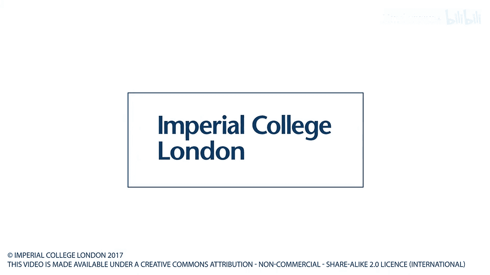

# 【帝国理工学院】机器学习数学：主成分分析Pca ｜ Pca Machine Learning p32 P32_PCA课程结束_04_02_05 -BV1fUYSzBEMp_p32-

In this course， we looked at PCA， a practical machine learning algorithm for dimensionality reduction and data compression。

We covered a lot of material to get to the point where we could derive and understand how PCA works。

We started off with some summary statistics of data， means and variances。

 which we later used to compute the data covariance matrix in PCA。Then we looked at inner products。

 which allowed us to compute the length distances and angles between vectors。

We use these inner products for thermal projections of data onto lower dimensional subspaces。

And in the end， we put everything together for the PCA algorithm。

I'm aware that this course was challenging at times， but I hope you enjoyed it nevertheless。😡。

A big thanks to everyone who made it this far and completed the course。Very well done。

