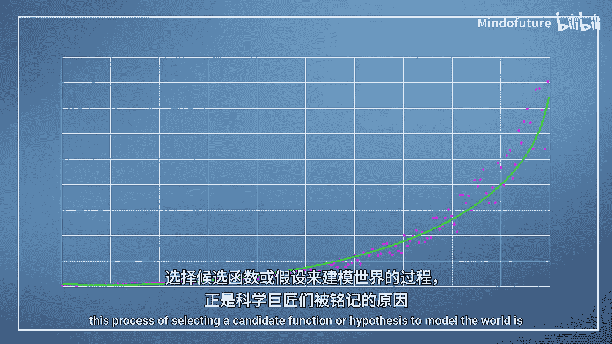

# 【帝国理工学院】机器学习数学：多元微积分 ｜ Multivariate Calculus Machine Learning p03 P03_函数_01_02_02 -BV1wnYDzmEdV_p3-

Before diving into calculus， we should first talk briefly about what functions are and where we use them。

Essentially， a function is a relationship between some inputs and an output。So for example。

 if I had a function for modeling the distribution of temperature in this room， I might input the X。

 Y and Z coordinates of a specific location I'm interested in， as well as the time T。

 and then the function would return me the temperature at that specific point in space at that moment in time。

😊，Like so many areas of math， even if the idea is quite straightforward。

 often the notation can make things unnecessarily confusing。😊。

We'll be confronted by this again later in the course。

 and although it's sometimes fairly arbitrary historical reasons that decide this。

 like different people inventing different parts of maths at different times。

It can also be because a particular notation style is more convenient for the specific application than it was developed for。

 However， and here is where a lot of the problems seem to arise in order to use and play with the interesting applications of maths。

 it requires you to have done quite a large amount of often quite boring groundwork。😊。

Mathematical language is like learning any other language in that respect。

 You can't enjoy French poetry until you've learned a lot of French vocabulary and grammar。

 including all its quirks and irregularities。 Qui understandably。

 some people find this off puttinging。 My French is still terrible， for example。

This is made worse by the fact that most people have not even realized that there is mass poetry waiting for them at the end of this algebra tunnel。

😡，Machine learning is a whole genre of this poetry。

 so stick with us for the rest of the specialisation and you'll be ready to appreciate it and even write some of your own back to functions。

 We often see expressions such as。😊，F of x equals x squared plus 3。

Perhaps the only thing worth mentioning about this notation style is， yes， I admit it。

 It is absurd that you should somehow just know that F brackets X means F is a function of x and not F multiplied by x。

 sometimes this gets genuinely unclear when other bracket terms appear in your expression。

 For example。F of。X equals。This thing over here。You can assume that G， H and A are all not variables。

 otherwise I would have to write。😡，F of X， G， H， and A。

But you could only know for sure what was going on here if it was explained to you with more context。

 for example， is G a function being applied to x， What about H and A over here？

Maybe they're both just constants， although you do face the same problem of missing context in any language。

 like the famous panda who goes to a restaurant and eats， shoots and leaves。

 And they were both delicious。 I can only apologize on behalf of math and hopefully console you with two facts。

 Firstly， maths is at the core of my day job。 and I often still get confused myself。 And secondly。

 I still love it。 and it get better at second getting any missing context all the time。

 just like any other language。 In the following exercise。 I'm either going to show you some data。

 or describe a concept to you。 And you're going to have to select a function which you think might be used to represent it。

😊，This is not intended to be a difficult exercise， but what I would like you to understand is that selecting a function is the creative essence of science。

 this process of selecting a candidate function or hypothesis to model a world is what the great geniuses of science are remembered for。

😊。

There then follows a potentially long and difficult process of testing this hypothesis。

 but there would be nothing to test without that first creative step。

Calculus is simply the study of how these functions change with respect to their input variables。

 and it allows you to investigate and manipulate them。

 but ultimately it's just a set of tools and by the end of this course you'll be using them yourself to model some real world data。

