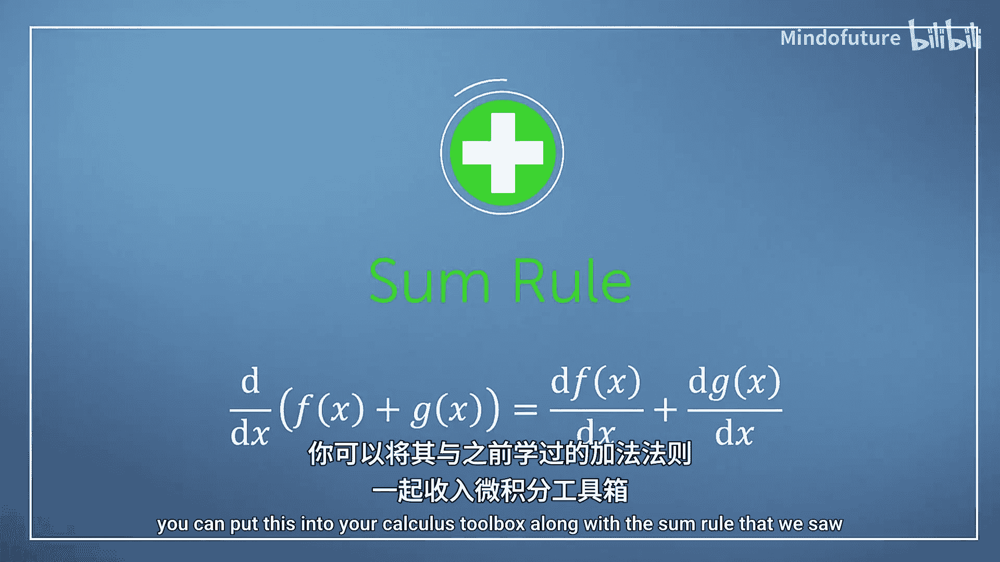

# 【帝国理工学院】机器学习数学：多元微积分 ｜ Multivariate Calculus Machine Learning p05 P05_导数的定义_01_03_02 -BV1wnYDzmEdV_p5-

Now that we've explored the relationship between functions and their gradient。

 we should be ready to lay out the more formal definition of a derivative。😊。

All we're going to do is translate the understanding about gradients that we saw in the previous video into some mathematical notation that we can write down。

😊，Unfortunately， this is the bit that a lot of people seem to find uncomfortable。

 So I will do my best to make it as painless as possible。

We talked in the last video about horizontal lines having a gradient of zero。

 whilst upwards and downward sloping lines having positive or negative gradients respectively。

We can write down a definition of this concept by taking the example of a linear function。

 which has the same gradient everywhere。 So if we start by picking any two points。

Let's say here and here。We can then say that the gradient of this line is equal to the amount of that function that increases in this interval。

 divided by the length of the interval that we're considering。

 This description is often just condense to the expression rise over run。

 where rise is the increase in the vertical direction and run is the distance along the horizontal axis。

😊，So。Got the rise here， and the run。downown here。If our function was sloping down and wed pick points at the same horizontal locations。

 then our run would be the same， but our rise would now be negative。So our gradient。Equals rise。

Divided by。Run。😡，Fairly straightforward so far。 But how does it relate to the more complicated functions we saw previously。

 where the gradient is different at every point。Now。

 the rise over run type gradient varies depending on where we choose our points。😡。

Let's pick a single point where we'd like to know the gradient。

 which will say is at point x on the horizontal axis。

The value of our function at this point is therefore clearly just F of x。

 We're going to use the same logic as before， So we now need to pick a second point to draw our rise over run triangle。

We can call the horizontal distance between our two points Delta X， where， as usual。

 a delta is being used to express a small change in something。

 which means our second one must be at position x plus deelta x。

We can also write down the vertical position of our second point as the function F evaluated at our new location x plus delta x。

 Re F of x plus delta x， so we can now build an expression for the approximate gradient at our point x based on the rise over run gradient between point x and any second point。

 remembering that the run will be our distance delta x。

 and our rise is just a difference in heights of the two points。😊。

The last step in this process is simply to notice that for nice， smooth。

 continuous functions like the one we're showing here， as deelta X gets smaller。

 the line connecting two points becomes a better and better approximation of the actual gradient at our point x。

😊，We can express this concept formally by using the limit notation scheme。

 which says that as deelta x goes to 0， our expression will give us a function for our gradient at any point we choose。

 which we write as F dash of x or D F by D X， depending on which notation scheme you prefer。

 This is a slightly strange concepts as we're not talking about deelta x equals 0 as dividing by0 is not defined。

 But instead， just when x is extremely close to 0。 This process of extreme rise overrun is what differentiation is。

 So when you're asked to differentiate a function， this literally just means substitute the function into this expression。

😊，We could fill up several videos with more robust interpretations of this infinitely small but nonzero deelta X。

 But for now， just don't worry about it too much。 We know more than enough to continue on our journey。

 Let's now put our new derivative expression into practice and see if it works。 First。

 we should try this out on a linear function once again。

 as we know that the answer is just going to be a constant。 So what will the gradient of。😊。

F of x equals 3 x plus 2 B。So we can immediately sub this straight in and say， okay。

F dash of x is going to equal the limit as Delta x goes to 0 of。

 So we're taking our function and subbing it in3。X plus deelta x plus 2。Minus3 x plus 2。

All divided by。Delta X， okay， and now we just work through the algebra so we can say the limit。

Of Delta X。Goes to 0 of。 And so we can expand these brackets out。

 So we're gonna get 3 x plus 3 Delta x plus 2-3 x，-2。All divided by Delta x。Okay。

 and now we can look at this and say some of the terms are going to cancel。

So this3 x here goes with this 3 x here， and this plus2 here goes with this minus2 here so we can keep going with this line and say。

 well， the limit。And it's going be。3， Delta x。All over Delta x。And then working down here。

 we can say， okay， well， the deelta x's themselves are just going to cancel。

 So you end up with the limit。Of Delta as Delta x goes to 0 of just 3。 Now。

 this thing doesn't have a Delta X in it。So actually。

 the answer for this one is just the number three， because all of the deelta X terms have disappeared in this case。

 then the limit expression has no effect。 so we can just ignore it。

The gradient of our linear function is just a constant， as we expected。 In fact。

 I'm sure many of you would have known already that the gradient of an equation of the form F equals a X plus B is just a。

 but it's reassuring to see this result emerging from our expression。

 something else to take away from this simple example is that we actually differentiated two things at once。

 A3 x bit and a plus2 bit。😊，We could have differentiated them separately and then added them together and still got the same result。

This interchangeability of the approach is called the sum rule， and it's pretty handy。

 Let's now try a slightly more complicated example。 So if we take the function。

F of x equals5 x squared。All we're going to do is take this thing and put it into our differentiation expression at the top。

😊，F dash of x equals the limit。As Delta x goes to zero of。Well。

 we've got5 x plus deelta x all squared。😡，Minus5 x squared。All divided by。Delta X。

 And all we're going to do now is work through the algebra and see what comes out the other side。

So equals the limit once again as deelta x goes to0 of， and let's expand this thing out。

 So we're going to think x plus delta x squared， we're going to get x squared plus 2 x delta x plus delta x squared。

 which means we're going to get 5 x squared plus 10 x delta x plus 5 delta x squared。Once again。

 minus our 5 x squared here。And all of that is divided by deelta X。

 And now what have we got on this top row here so we've got a pair of 5 x squares so we can get rid of those because it's 5 x squared and minus 5 x squared over here。

Okay， and we can also see that we've got a deelta x in both the top terms and also in this bottom term here so we can get rid of that with this and this over here。

 Okay， so let's write that line again so we can now say it's the limit as Delta X goes to 0。Of。

We've just got 10。X。Plus。呃。5 Delta x。Okay， and we're looking at this thing。

 So it's saying the limit as Delta X goes to 0 of this expression here。 Now。

 only the second term has got a deelta X in it。 So what's going to happen as our Delta X goes to 0。

 we're going to just forget about this term。 It's going to become extremely small。

 So we can write that this is equal to just 10。X。So the derivative of the expression。

5 x squared is just 10 x。We can generalize the lesson from this example to a rule for handling functions with powers of X。

 For example， if we take the function， F of x equals ax to the power of B and substitute it into our differentiation expression。

 we will find that the derivative is always F dash of x equals a B X to the power of B minus-1。

 So the original power gets multiplied to the front。

 and then the new power is just one less than it was before。 This is known as the power rule。

 and you can put this into your calculus toolbox along with the sum rule that we saw earlier。

 So you've now seen two examples in which we've applied the limit of rise overrun method to differentiate two simple functions。

 But as you can probably imagine if we wanted to differentiate a long complicated expression。

 this process is going to become quite tedious。😊。

What we're going to see in later videos are more rules like the sum rule and the power rule。

 which will help us speed up the process。 However， before we do that。

 we're just going to look at some fairly magical special case functions。

 which differentiate in an interesting way。😊。

