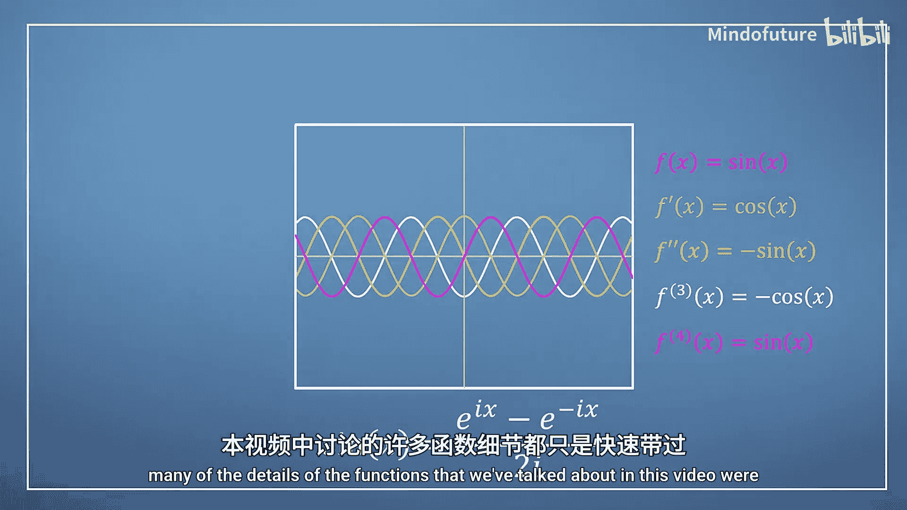

# 【帝国理工学院】机器学习数学：多元微积分 ｜ Multivariate Calculus Machine Learning p06 P06_微分示例_特殊情况_01_03_03 -BV1wnYDzmEdV_p6-

In this video， we're going to run through three special case functions which give us interesting results when differentiated。

😊，The first example we're going to work through is the function F of x equals 1 over x。

 which you can see plotted in the corner。😊，Now， take a minute to notice that the gradient of this function is negative everywhere。

 except at the point x equals 0， where we can't see what it is。 And actually。

 something quite interesting must be happening at this point。 As on the negative side。

 the function drops down presumably towards negative inity。

 but it somehow reemerges from above on the positive side。

 This sudden break in our otherwise smooth function is what we refer to as a discontinuity。

 We've mentioned already that the operation divide by0 is undefined。

 which means that this function simply doesn't have a value at the point x equals 0。

 But what about the gradient。 Well， lets subbar function into the differentiation expression to investigate。

😊，So， if we take it。F of x equals1 over x。 We can say that F dash of x must equal the limit as deelta x goes to 0 of one over x plus deelta x。

 minus1 over x all divided by。Delta X。 and we look at this thing and we say。

 we're going to have to make this top row， the numerator。Have a single fractions。

 So we're gonna have to combine these two fractions here。

 which means that we're going to have to make the denominators the same。

 So we'll multiply top and bottom by x here and top and bottom by x plus delta x here。

 So we can say that the limit。Of。X over x brackets， X plus deelta x minus。X minus x plus deelta x。

Over X brackets， X plus deelta X。All divided by， once again。Delta x。NowLooking at these two。

 we can see that we've got an X and a minus x， both with the same denominator。

 so we can subtract these now。 So this cancels with this。So we can say， okay。

 this thing is going to be the limit。Of。Minus Delta x。Divided by。X brackets， X plus deelta X。

 all divided by。Delta x。Now， at this point， you can see that you've got a deelta x at the very top and a deelta x at the bottom。

 So once again， these two terms。Countel each other out。And what you're left with is the limit。

As Delta x goes to 0。Of。-1。Divided by。X squared， we're going to open up this bracket plus X delta X。

And this once again， is where the magic of limits comes into play。

 so we look at this function and we say， okay， this term here has got a deelta X in it。😊。

This means that as deelta X becomes very， very small。

 this term itself health is going to become very small and therefore eventually become irrelevant。

 So what we can say is as we apply our limit， we can actually ignore this term here entirely。

 and we get -1 divided by。X squared。Which looks like this。😡，So as we realize just by looking。

 this derivative function is negative everywhere， and like our base function。

 the derivative is also undefined to x equals0。😊，The second function we're going to look at。

 I'll start simply by explaining what it does。 It's a function that has the special property that the value of the function。

 F of x is always equal to the value of its own gradient F dash of x。 Now。

 there is a boring function， which has this property， which is the function F of x equals 0。

 because as it's a horizontal line， clearly both the function and the gradient of 0 everywhere。

 But there's also a much more interesting case。 We're not going to work through the rigorous derivation。

 but we can skip through some of the more interesting bits。

 So let's start by noticing that our mystery function must always either be positive or always be negative。

 As if it ever tried to cross the horizontal axis。 then both the function and the gradient will be 0。

 And so it gets stuck。😊，So we'd just be at our boring function zero again。😡。

The next thing to realize is that by virtue of always increasing or always decreasing。

 it can never return to the same value again。Plenty of functions could fit these criteria。

And focusing on the positive case， they all look something like this。However。

 besides the zero function， there is only one function that will satisfy all our demands。

 This is the exponential function E to the X， where E is Oer's number。

Named after the 18th century mathematician。The number E， which is approximately 2。718。

 is very important for the study of calculus， but more than that。

 E like pi turns up all over mathematics and seems to be written all over the fabric of the universe。

😡，As differentiating E to the X gives us E to the X。 Clearly。

 we can just keep differentiating this thing as many times as we'd like。

 and nothing is going to change。 This self similarity is going to come in very handy。

The last special case function that we're going to talk about in this video are the trigometric functions。

 sine and cosine。😊，You may recall that for a right angle triangle。

 sine of angle x multiplied by the hypotenuse R gives you the length of the opposite side to the angle。

 and the graph of sine x looks like this。Let's take a look at this function and see if we can work out what shape its derivative would be by I。

😊，So。Sinex starts with a positive gradient， which gently decreases until it's 0 at the top of the bump。

 and then it starts being negative again until it gets to the bottom of the next bump。

 And it turns out that the derivative of cineex is actually just cosineex。😊，Now。

 what happens when we differentiate cosine X？ Well， actually， we get minus sine x。

Differentiating a third time gives us minus cosine x。

 and then amazingly differentiating a fourth time brings us all the way back to our original function。

 sine X。😊，And then the pattern， of course， repeats。

This self-simarity may remind you somewhat of the exponential function we discussed above。

 and that is because these trigoometric functions are actually just exponentials in disguise。

 albeit quite a convincing disguise， which we won't be discussing here。

 Many of the details of the functions that we've talked about in this video were skimmed over rather quickly。

 But for the benefit of this particular course， All I need you to understand is that differentiation is fundamentally quite a simple concept。

 even when you might not be able to battle through all the algebra。

 You're ultimately still just looking for the rise of a run gradient at each point。😊。

This pragmatic approach to calculus is going to come up again when we start talking about calculating ingredients with computers。

😊，Sometimes we really can just find an equation for the gradient as we've been doing for all of our examples so far。

 however， if instead of a nice smooth function， we just have discrete data points。

 then it can seem as if there's nothing for us to differentiate。😊，But as we shall see。

 R ever Run comes back once again to save the day。