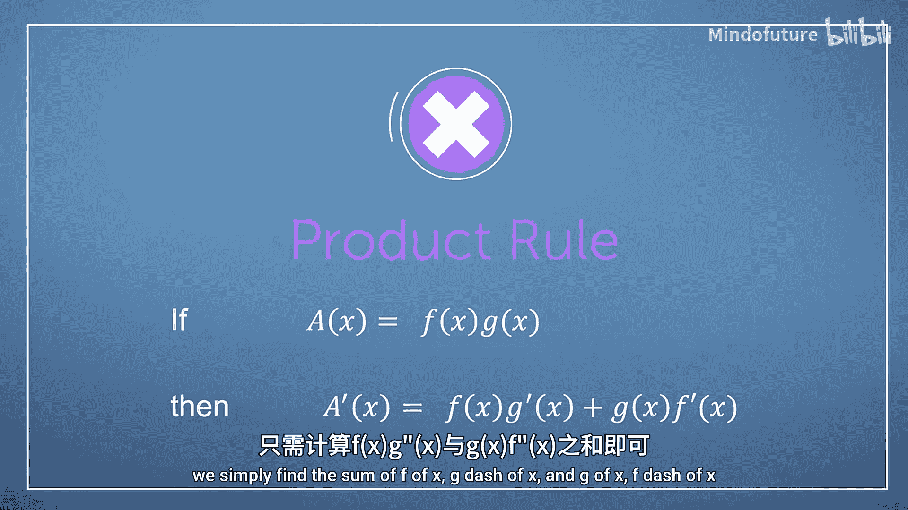

# 【帝国理工学院】机器学习数学：多元微积分 ｜ Multivariate Calculus Machine Learning p07 P07_乘积法则_01_04_01 -BV1wnYDzmEdV_p7-

Now that we've defined the differentiation operation in terms of an exact mathematical formula。

 it's become clear that even for relatively simple functions。

 calculating derivatives can be quite tedious。😊，However。

 mathematicians have found a variety of convenient rules that allow us to avoid working through the limit of rise ever run operation whenever possible。

 So far， we've met the sum rule and the power rule In this video。

 we will cover a convenient shortcut for differentiating the product of two functions。

 which sensibly enough is called the product rule。It is。

 of course possible to derive the product rule purely algebraically。

 but it doesn't really help you to develop much insight into what's going on。

For all the topics covered in this course， I'd always prefer you came away with some degree of intuitive understanding rather than just watching me grind through examples。

 so let's see if we can make any progress by drawing things。😡。

Imagine a rectangle where the length of one side is the function F of x and the other side is the function G of x。

 This means that the product of these two functions must give us the rectangles area。

 which we can call a of x。Now consider that if we differentiate f of x times g of x。

 what we're really looking for is the change in area of our rectangle as we vary x。😊。

So let's see what happens to the area when we increase x by some small amount， deelta x。😡。

A quick footnote here， for the case we've shown， we've picked a particularly friendly pair of functions where they both happen to increase with X。

 however， this won't necessarily always be the case。

 but it does just make drawing things a lot easier and the conclusions would ultimately be the same。

😊，We can now divide up our rectangle into four regions， one of which was our original area， A of X。

As the total edge length along the top is now F of x plus deelta x。

 this means that the width of the new region must be the difference between the original width and the new width。

And of course， the same logic applies to the height。😡。

We can now write an expression for just the extra area， which we will call Delta A。

This is the sum of the area of the three new rectangles。😡。

I want to avoid a drawn out conversation about limits。

 but fundamentally I hope you can see that as deelta x goes to0。

 although all of the new rectangles will shrink， it's the smallest rectangle that is going to shrink the fastest。

😊，This is the intuition that justifies how we can ultimately ignore the small rectangle and leave its contribution to the area out of our differential expression altogether。

 Now that we've got our expression for approximating deelta x。 we return to our original question。

 What is the derivative of a with respect to X。 So we want the limit of deelta a divided by X I。

e rise over run， which means we also need to divide the right hand side by deelta x。

 We are so close at this point， all we need to do is slightly rearrange this equation。 So firstly。

 by splitting it into two fractions。 And then secondly。

 by moving f of x and G of x out of the numerators。

 What I hope you can see now is that the first part contains the definition of the derivative of G of x。

 And the second part contains the derivative of F of x。

 which means that we are now ready to write down our final expression for the derivative of a with respect to X。

😊，Which has now just been reduced to this。😡，The derivative of a of x is just f of x times the derivative of G of x plus G of x times the derivative of f of x。

So we can now add the product rule to the list of tools in our calculus toolbox。

 if we want to differentiate the product of two functions， F of x and G of x。

 we simply find the sum of F of x， G dash of x and G of x， F dash of X。😊。

This is going to have come in really handy in later videos as we start to deal with some more complicated functions。

 See them。😊。

