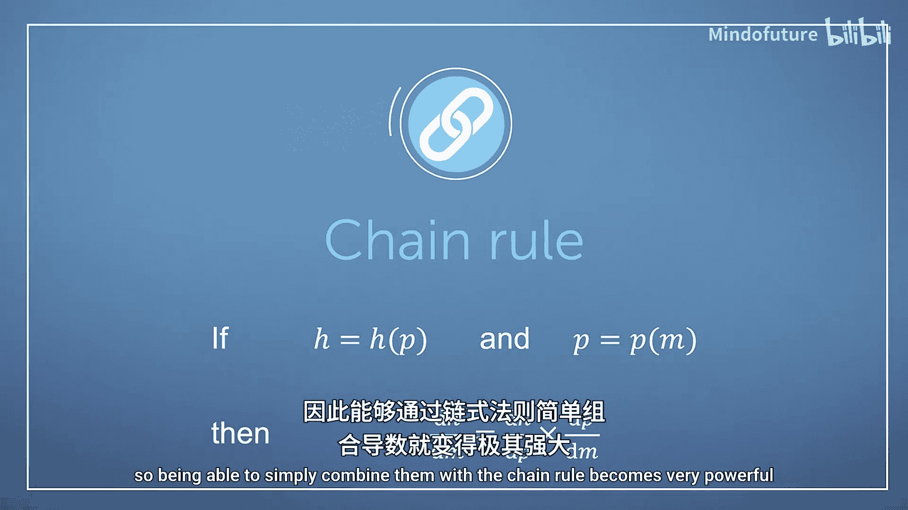

# 【帝国理工学院】机器学习数学：多元微积分 ｜ Multivariate Calculus Machine Learning p08 P08_链式法则_01_04_02 -BV1wnYDzmEdV_p8-

So far， we have learned about the sum rule， the power rule and the product rule in this video。

 we will be discussing our fourth and final tool for this module， which is called the chain rule。😊。

Following this， our toolbox will then be sufficiently well stocked that will be ready to start tackling some heftier。

 more interesting problems。 Sometimes we use functions as the inputs of other functions。

 As you can probably imagine， describing this can get a little bit confusing。

 So what we're going to do is give each of our functions meanings so that we can hopefully keep track of what's going on。

😊，Consider the nested function H of P of M。We have the function H。

 which is describing how happy I am as a function of P。 How many pizzas I've eaten that day。

 Then the pizzas I get to eat per day is itself a function of M， which is how much money I make。😊。

So we're still ultimately relating money to happiness， but via the concept of pizza。

 this nested function scenario comes up a lot in science and engineering as you relate chains of concepts together。

 and I suppose this particular example I've chosen here also gives you some insight into my priorities in life。

😊，So first I'm going to give you the function relating happiness and pizza。

 which has the following polynomial form。😊，H of p equals minus a third p squared plus p plus 1 over 5。

 which is easily understandable from a plot。😡，What we can see is that although without any pizza。

 it's still possible to be happy in principle， my peak happiness is with about one and a half pizzas。

 any more pizza than this。 and I become less happy。 and then beyond about three pizzas。

 my happiness becomes rapidly negative。😊，Next is our function relating pizza and money P of M equals E to the power of M minus1。

😊，Which is also fairly straightforward to understand by looking at a plot if you've got no money。

 you can't buy any pizza， but the more money you have。

 your pizza purchasing power increases exponentially。

As at first you can take advantage of bulk by discounts， but as you start getting really rich。

 you can buy your own pizza oven and eventually even build your own pizza factory。😊。

What we'd like to know is by considering how much money I have now。

 how much effort should I put into making more if my aim is to be happy。To work this out。

 we're going to need to know what the rate of change of happiness is with respect to money， which is。

 of course just DH by Dm。For now， this relatively simple example。

 we could just directly substitute our pizza money function into our happiness pizza function。

 which would give us this。😊，And then differentiate this thing directly， however。

 the chain rule provides us with a more elegant approach。

 which importantly will still work even for complicated functions where direct substitution like this may not be an option。

😊，Consider the derivative of H with respect to P and of P with respect to M。😡。

You'll notice that in this particular notation convention。

 where the derivatives are represented by quotients。

 the product of these two quantities looks like it would give you the desired function DH by DM。😊。

And in actual fact， this is a perfectly sensible way to think about what's going on。

 This approach is called the chain rule because in a sense。

 we are making a chain of derivative relationships。

 Now this is certainly not what you might describe as a formal derivation。

 but it is already good enough to enable you to make use of the chain rule effectively。😊，So。

Let's now apply this rule to our function。 Firstly， let's differentiate our two functions。

 which give us DH by DP equals 1 minus 2 over 3 p。D P by the M equals E to the power of M。

 And then multiplying these together is simple enough。 However。

 we just need to remember that if we don't want pizzas P to appear in our final expression。

 then we just need to sub in our expression for P in terms of M。And then finally。

 by simply rearranging the terms， we recovered the expression that we saw at the start of the video。

 So DH by DM equals one third E to the M times 5-2 equal to the power。😊，And there we have it。Now。

 don't forget that although for this simple example。

 the chain rule didn't save us a huge amount of time compared to substituting in before the differentiation。

 don't let that fool you。 What's magic about the chain rule is that for some real world applications。

 we may not have a nice analytical expression for our function。

 but we may still have the derivatives， So being able to simply combine them with the chain rule becomes very powerful。

 indeed。😊。

Before we finish， let's have a quick look at our money happiness function and its derivative on a graph。

😊，As we can see， if you're broke and it's really worthwhile making some money。

 but the benefit of getting more， especially once you have enough pizza decreases dramatically and quickly becomes negative。

We now have a fourth and final tool for the module。

 and in the next video we'll be putting them all to use in an example。

