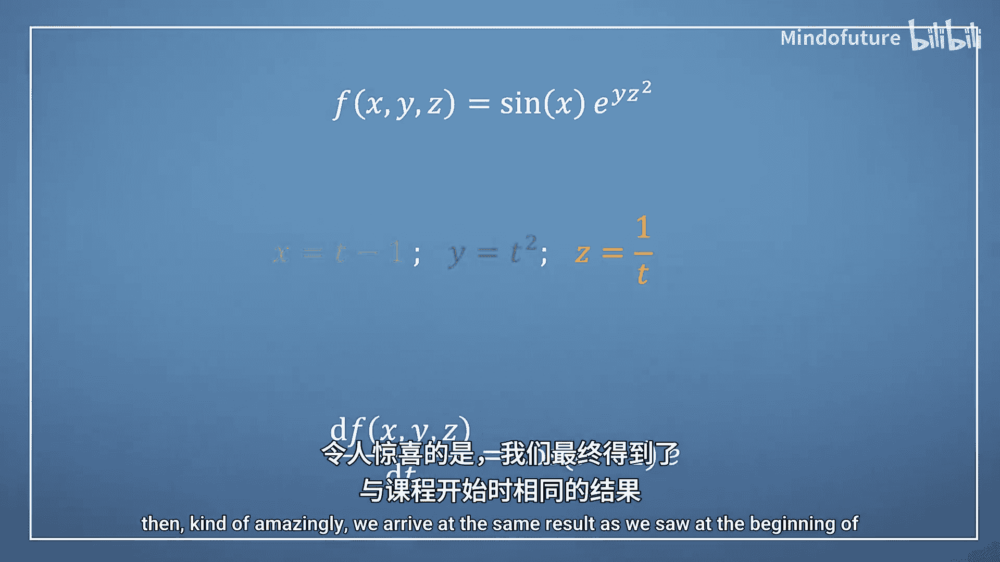

# 【帝国理工学院】机器学习数学：多元微积分 ｜ Multivariate Calculus Machine Learning p13 P13_对任何事物求导_02_01_03 -BV1wnYDzmEdV_p13-

We've already seen how to think about partial differentiation as just a simple extension of the single variable method that we derived in the last module in this video we're going to explore some slightly more complicated partial differential examples and we're also going to build something called the total derivative of a function。

 So let's dive straight into a slightly more tricky problem than we saw last time。😊。

Consider the function F of x， Y and Z equals sine of x E to the power of Y Z squared。

We're now just going to work through and find the derivatives with respect to each of these three variables。

So let's start with x。 as the exponential term does not refer to x， we can treat it as a constant。

 and sine， as we saw last week differentiates to cosine so we can write。

D F by D X is just going to equal cos X E to the Y said squared。Next。

 we'll differentiate with respect to Y。 In this case， the s term does not refer to y。

 so we treat this as a constant， but for the exponential term。

 we can either apply the chain rule to it or just remember that the result of this operation for an exponential will just be to multiply the derivative of the exponent to the front。

And the derivative of y Z squared with respect to Y is just Z squared。 so we can write。

The F by Dy is going to equal sine of X。🤢，E to the Y Z squared， multiplied by。Z squared。Lastly。

 we'll differentiate with respect to Z。 Once again， the only Z is in the exponential term。

 So similar to the previous example， we simply multiply through by the derivative of the exponential with respect to Z。

 So we just get。D F by D Z is going to equal sine X once again。E to the Y Z squared。 And this time。

 the derivative of this thing is2 y。Z， so now that we have these three partial derivatives。

 we're going to introduce a new idea called the total derivative。 Imagine that the variables X。

 Y and Z were actually all themselves a function of a single other parameter T， where x equals t -1。

 Y equals T squared and Z equals 1 over T。😊，And what we're looking for is the derivative of x with respect to T。

 In this simple case， we could just substitute for all our three variables directly in terms of T。

 simplify a little bit and then differentiate directly with respect to T。

 which gives us s of t -1 times E。 However， in a more complicated scenario with many variables。

 the expression we needed to differentiate might have become unmanageably complex。

 and perhaps we won't have a nice analytical expression at all。

 The alternative approach is to once again use the logic of chain rule to solve this problem。

 where the derivative with respect to our new variable T is the sum of the chains of the other three variable as shown in this expression。

😊，Since we've already got our three partial derivatives of F with respect to X， Y， and Z。

 now we just need to find the derivatives of the three variables with respect to T and we'll have all the things we need to evaluate our expression。

So D X by the T is clearly1。 D Y by the T is2 T。 and D z by the T。

 if you remember from our1 over t example is minus t to the power of -2。

 Nothing hugely complicated here。 However， when we then subit into our total derivative expression。

 you can probably see why I have chosen not to write this all out by hand。 as at first。

 the expression is a bit of a monster。 However， after substituting for X。

 Y and Z all in terms of T and then simplifying down again。

 we can see that the second and third terms are the same， just with opposite signs。

 And so they will cancel each other out。 Then kind of amazingly。

 we arrive at the same result as we saw at the beginning of the lecture。😊。

So hopefully now you'll be feeling reasonably comfortable with partial differentiation as we've already done quite a lot of it。

 and maybe you can even see why the total derivative function might be quite handy。😊。

You are now ready to have a go yourselves in the following exercises and then you'll have all the pieces that you'll need in place for us to build our partial derivatives into something really useful。

 See you then。😊。