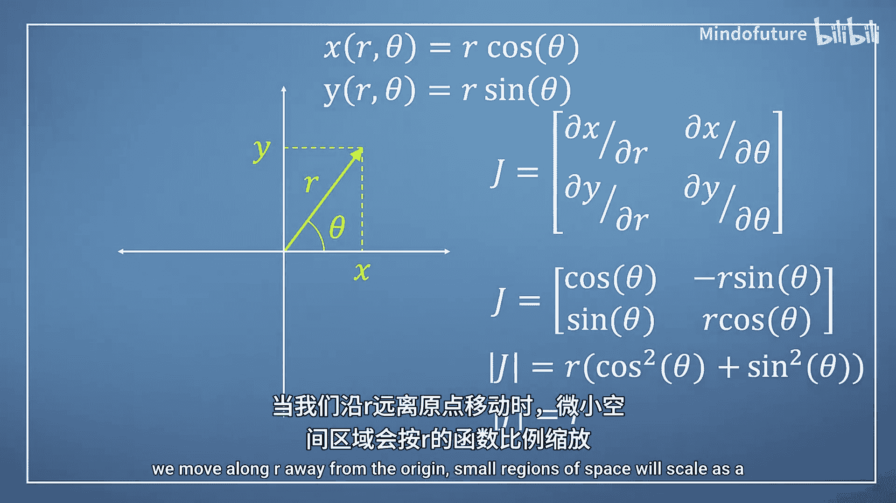

# 【帝国理工学院】机器学习数学：多元微积分 ｜ Multivariate Calculus Machine Learning p15 P15_雅可比矩阵的应用_02_02_02 -BV1wnYDzmEdV_p15-

In this video， we are going to extend the concept of the Jacobian from vectors up to matrices。

 which will allow us to describe the rates of change of a vector valued function。😊，However。

 before we do this， we are first going to recap by applying what we've learned so far about Jacobians to another simple system。

😊，If we consider the function F of x and y equals e to the power of minus x squared plus y squared。

 then using our knowledge of partial differentiation。

 it's fairly straightforward to find its Jacobbian vector so we're now going to do the reverse of our approach from the last time and start by looking at the vector field of the Jacobbians。

 then see if we can understand how the function must look。😊。

Let's start by finding the Jacobian at a few specific points。Firstly， the point minus11。

 which will highlight on our access in pink。Substituting these coordinates into our Jacobian expression and simplifying。

 we can see a vector pointing directly towards the origin。😊，Next， if we move further out to the 0。22。

😡，Find the Jacobian。 We now get a much smaller vector。

 but pointing once again directly at the origin。 Lastly， before I reveal the whole vector field。

 let's look at what's going on at the origin itself。Subbbing the point 00 returns the0 vector。

 suggesting that the function is flat at this point， which must mean one of three things。

 Either this point is a maximum minimum or something called a saddle。

 which we'll cover later in this module。However， if we now reveal the rest of the Jacobian vector field。

 it becomes clear that the origin must be the maximum of this system。

Let's now move back to the color map representation of this function。

 where the brighter regions represent high values of F。😡，So finally。

 we can remove the vector field and observe the function in 3D。

 which I hope matches up with your expectations。😊，Next。

 we're going to build a Jacobbian matrix which describes functions that take a vector as an input。

 but unlike our previous examples， also give a vector as the output。

 if we consider the two functions， U of x and y equals x plus2 Y。

 and v of x and y equals 3 y minus2 x， we can think of these as two vector spaces。

 one containing vectors with coordinates in UV and the other with coordinates in x and y。

 each point in X Y has a corresponding location in UVV。 So as we move around x Y space。

 we would expect our corresponding path in UVV space to be quite different， and so it is。

For those of you familiar with a linear algebra， you may have guessed already where this is going。

 We can， of course， make separate row vector Jacobians for U and V。 However。

 as we are considering U and V to be components of a single vector。

 it makes more sense to extend our Jacobcobian by stacking these vectors as rows of a matrix like this。

😊，So now that we have the structure and motivation for building a Jacobbian matrix for vector valued functions。

 let's apply this to our example functions and see what we get。So we have U of X， Y。

Equals x minus2 y。 And we've also got V of X， Y。Equals3 y minus2 x。

We can build the Jacobian from these two by simply saying， well， the Jacobian is going to be。

Let's open some big brackets and say， well， it's D U DX， D U， DY。🤢，DV， D X。Dvi。D why。

So let's just work through it。 So do UDX is just going to be。1。DUDY is just minus2。😡。

DVDx is minus2 again。And DVDD Y。Is three。Our Jacobbian matrix no longer even contains any variables。

 which is what we should expect when we consider that clearly both U and V are linear functions of x and Y。

 so the gradient must be constant everywhere。 Also this matrix is just the linear transformation from X Y space to UVv space。

 So if we were to apply the X Y vector 23。 we'd get the following23。😊，And that's going to equal 2-6。

 That's -4 and-4 plus 9。That's5。Now， this is all well and good， but of course。

 many of the functions that you' will be confronted with will be highly nonlinear and generally much more complicated than the simple linear example that we've just looked at here。

However， often they may still be smooth， which means that if we zoom in close enough。

 we can consider each little region of space to be approximately linear and therefore by adding up all the contributions from the Jacobian determinants at each point in space。

 we can still calculate the change in the size of a region after transformation。😊。

A classic example of this occurs when transforming between Cartesian and polar coordinate systems。

 So if we have a vector expressed in terms of a radius R and the angle up from the X axis theta。

 but we'd like them expressed in terms of X and Y instead。

 we can write the following expressions just by thinking about trigonometry。

 Now we can build the Jacobbian matrix and take its determinant。

The fact that the result is simply the radius R and not the functioned theta tells us that as we move along R away from the origin。

 small regions of space will scale as a function of R。

 which I hope will make a lot of sense to you when we look at our little animation here。

That's all for this video I hope you will now be able to build Jacobbian vectors and matrices for yourself with confidence in the exercises and more importantly that your intuition on the meaning of this concept is starting to develop See you next time。

😊。

