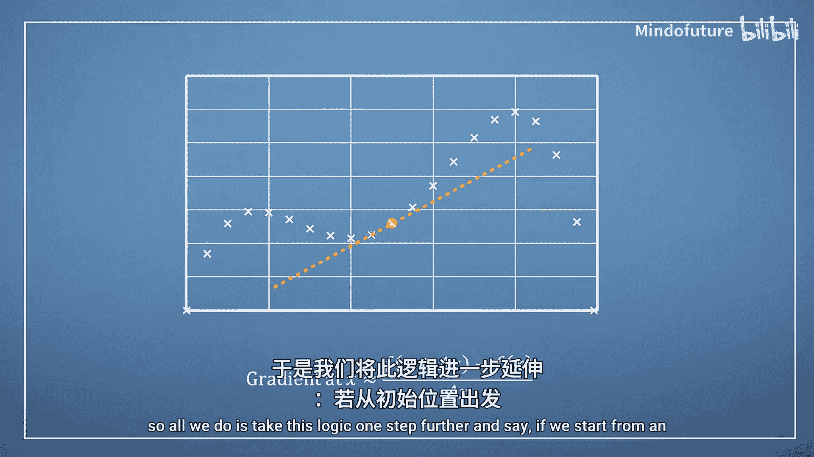

# 【帝国理工学院】机器学习数学：多元微积分 ｜ Multivariate Calculus Machine Learning p18 P18_现实是残酷的_02_03_03 -BV1wnYDzmEdV_p18-

In this module we've discussed how to think about twodial functions as landscapes。

 and we've also seen that we can construct Jacobian vectors which tell us both the direction and the magnitude of the gradient at each point in space。

😊，Last video， we added one further tool to our toolbox。

 which allowed us to double check what kind of feature we were standing on when we landed on a point with a zero gradient。

These concepts will all be very useful to develop your understanding of optimization problems and have also let you see why multivariate calculus is worth knowing。

 however， in this video we are going to remind ourselves about two features of real systems which so far we've avoided firstly。

 for many applications of optimization such as in the training of neural networks you are going to be dealing with a lot more than two dimensions。

 potentially hundreds or thousands of dimensions。 This means that we can no longer draw our nice surface and climb mountains All the same maths still applies。

 but we now have to use our 2D intuition to guide us and enable us to trust the maths。😊，Secondly。

 as we mentioned briefly before， even if you do just have a 2D problem。

 very often you might not have a nice analytical function to describe it and calculating each point could be very expensive。

 so even though in principle a plot could possibly be drawn。

 you wouldn't be able to afford either the supercomputer time or perhaps the laboratory staff to fully populate this thing。

😡，Thirdly， all the lovely functions that we've dealt with so far were smooth and well behaved。

 However， what if our function contains a sharp feature like a discontinuity。😊。

This would certainly make navigating the sandpi a bit more confusing。 Lastly。

 there are a variety of factors that may result in a function being noisy。

 which as I'm sure you can imagine， might make our Jacobian vectors pretty useless unless we were careful。

 So this brings us nicely to the second topic in this video which is a question that I hope you've all been screening at your screens for the past few minutes。

 if， as I said a minute ago， we don't even have the function that we're trying to optimize how on earth are we supposed to build a Jacobbian out of the partial derivatives。

😊，This is an excellent question and leads us to another massive area of research called numerical Me。

😊，There are many problems which either don't have a nice。

 explicit formula for the answer or do have a formula。

 but solving it directly would take until the end of time to fight back against the universe mocking us in this way。

 we have developed a range of techniques that allow us to generate approximate solutions。

 One particular approach that is relevant to our discussion of the Jacobian actually takes us right back to the first few lectures on this course。

 where we defined the derivative。We started by using an approximation based on the rise of a run calculated over a finite interval and then looked at what happens as this interval approached zero。

All we're doing with the finite difference method is accepting that we're not going to work out the value of the function at every single point in space。

 So we're just going to use the points that we do have and build an approximation for the gradient based on that。

 in the example shown here， we have already calculated lots of points on this onedial function。

 but clearly， that's not going to be practical for higher dimensional scenarios。

 So all we do is take this logic one step further and say， if we start from an initial location。

 and we would like to approximate the Jacobian， we will simply approximate each partial derivative in turn。

 So taking a small step in X allows us to calculate an approximate partial derivative in X。

 and a small step in Y gives our approximate partial in Y。 two things to bear in mind here。 Firstly。

 how big should our little step be。 Well， this has to be a balance as if it's too big you will make a bad approximation for reasons that I hope will be obvious by this point。

 But if it's too small， then we might run into some numerical issues。😊。

Remember， when your computer calculates the value of the function at a point。

 it only stores it to a certain number of significant figures。 So if your point is too close。

 your computer might not register any change at all。Second， as we mentioned earlier。

 what happens if your data is a bit noisy to deal with this case。

 many different approaches have been developed， but perhaps the simplest is just to calculate the gradient using a few different step sizes and take some kind of average。

 So brings us to the end of this video。 So I hope you can see that once we leave the world of nice。

 smooth functions and enter the real world of noisy data and computationally expensive functions。

 Things start to get a lot more interesting。 See you next time。😊。

