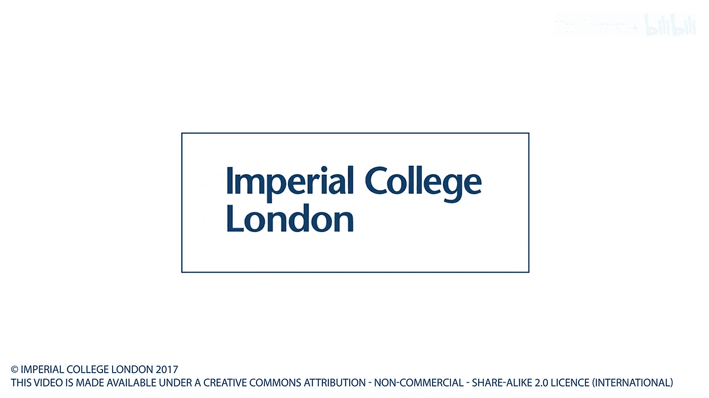

# 【帝国理工学院】机器学习数学：多元微积分 ｜ Multivariate Calculus Machine Learning p20 P20_欢迎来到模块3_03_01_01 -BV1wnYDzmEdV_p20-

Welcome to Mo 3 of the course In the previous two modules。

 we've seen how to differentiate functions in single and multivariable spaces as well as hopefully developing some intuition about what's really going on when we do this。

😊，We've also learned a selection of useful tools for both rapidly calculating derivatives and for navigating high dimensional spaces In this module。

 we're going to upgrade the univariate chain rule so that it can tackle multivariate functions and then see an example of where this might come in handy。

 See you then。😊。

