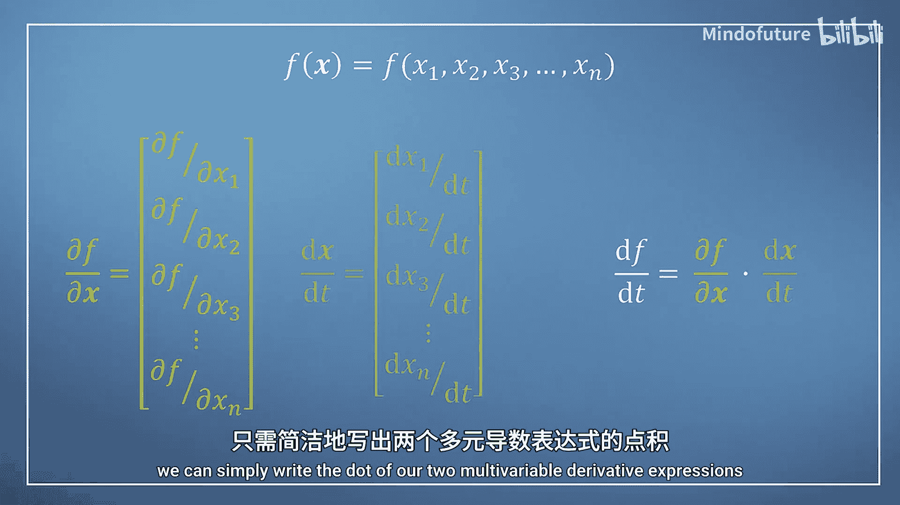

# 【帝国理工学院】机器学习数学：多元微积分 ｜ Multivariate Calculus Machine Learning p21 P21_多元链式法则_03_01_02 -BV1wnYDzmEdV_p21-

In the last module， we saw something called the total derivative。

 which showed us that when we have a multivariable function， such as F of x Y and z。

 but the variables x Y and z with themselves each a function of some additional variable T。

 then if we want to calculate the derivative of F with respect to T we can use this expression which is simply the sum of the chains relating f to T through each of its three variables。

 this allowed us to calculate the result in a piecewise manner rather than substituting everything in at the start。

 and computers are really good at solving piecewise problems quickly。😊。

What we're now going to do is generalize this concept and also simplify the notation a little。

If we had a function F of n variables， x1， x2， x3， all the way up to X N。

 I can write this as just F of x。 but now you'll notice that I've written that x in bold just to help you remember that this x represents a sequence of variables。

 which will now more conveniently think of as an n dimensional vector。 Once again。

 each of the components of our x vector are themselves functions of some other variable T。

 And what we'd like to know is the derivative of F with respect to T。😊，At this point。

 we're going to need some more space to write。😡，So we'll keep our function F at the top。

 but you'll just have to remember that each component of x is also a function of T。Now。

 we are looking to once again build an expression linking F to T through the sum of the chains of each of its variables。

 So we're going to need all the partial derivatives of F with respect to X。

 as well as the derivatives of each component of X with respect to T。 Once again。

 we're going to store all of these objects in a pair of ndimenal vectors。 Finally。

 were looking to build a multivariable chainable expression。

 So we are looking to find the sum of the product of each pair of terms in the same position in each vector。

😊，Thinking back to our linear algebra， this is exactly what the dot product does。

 but there is no need for us to write out these vectors in full so we can simply write the dot of our two multivariable derivative expressions。

And that's it。 We now have our generalized form of the multivariable chain rule expressed nice and neatly。

 so we can now update our list of tools to reflect this。 But actually。

 although we've seen this in practice already in the last module。

 it's worth pointing out that all the rest of our time saving rules already work for multivariate problems as they are。

 So we'll be ready to put these into practice very soon。 See you then。😊。

