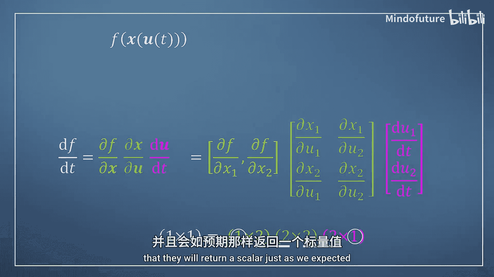

# 【帝国理工学院】机器学习数学：多元微积分 ｜ Multivariate Calculus Machine Learning p22 P22_更多多元链式法则_03_01_03 -BV1wnYDzmEdV_p22-

Last video， weve finished up with an expression from the multivariate chain rule in this video。

 we're going to start by picking up one more little detail which you might have already spotted and then follow this up by adding another link to our chain。

😊，If we have a function f of x， where x is a vector in which each term in x depends on t。

 which we can compactly write like this， we also have our compact form of the multivariate chain rule to go with it。

 What I hope you might have noticed last time is that our vector of partial derivatives Df by Dx is just the same as the Jacobbian vector。

 which we saw last module， except that we wrote it as a column instead of a row vector。

 So from our knowledge of linear algebra， we can say that Df by Dx must be the transpose of the Jacobbian of F。

 The last thing to realize is that taking the dot product of two column vectors is the same operation as multiplying a row vector by a column vector。

 So finally， we can see that our old friend， the Jacobbian offers us perhaps the most convenient representation of the multivariate chain rule。

😊，Next we're going to see that the chain rule still works for more than two links to start us off。

 we'll work through a really quick Uniivevaria example where we're going to add in another function separating F from T。

So we can say F of x is going to equal5 x， and we can have x of U now can equal1 minus u and U of T finally can be T squared。

 So we've got three functions。 and we're separating F from T now by an extra step。Of course。

 we can just sub in each step into each other and find an expression for。F。

As a function directly of T， well we say， well， it's going to be five of whatever x is and x is1 minus whatever u is and u is T squared。

So this thing goes to 5-5 T squared。 And， of course。

 we can now directly differentiate this thing and say D F by D T。Equals。us10 T。

Or we can apply a two step chain rule。And say， the following。

So we can have the F by Dt is going to equal。D F by D， X times D， X by D， U。 And finally， D， U by D。

Tea。Okay， now subbbing in for each of our terms。We just get， well， this thing is going to equal。

The F by D， T。Is so Df by Dx is just five。We're going to multiply that by d x by the U。

 which is just minus1。And finally， do U by DT is just going to be2 T。So once again。

 we're going to recover the same answer， which is minus 10。T。

So we can see that this approach works for chains of univariate functions。

 and we could extend it out to as many intermediary functions between F and T as we'd like。😊。

But what about the multivariate case， Well， the chain rule does work here， too。

 but we do just have to pay attention to a few extra details。

Let's start by considering the function F of X of U of T again。

 where the function F takes the vector X as an input。 but this time， x is a vector valued function。

 which also takes a vector U as its input。As the last video， the bold symbols indicate vectors。

 so U is again a vector valued function， and it takes the scalar T as its input。Ultimately。

 we are still relating the scalar input T to a scalar output F。

 but we're doing this via two intermediary vector valued functions， x and U。😊，If once again。

 we'd like to know the derivative of F with respect to T。

 we can essentially write the same expression as the Uniivariate case。

 except that now several of our terms are in bold。 We've already seen that differentiating the scalar valued function F with respect to its input vector X gives us the Jacobbian row vector。

 We've also seen that differentiating the vector valued function U with respect to the scalar variable T gives us a column vector of derivatives。

But what about the middle term D X by D U， Well， for the function X。

 we need to find the derivative of each of the two output variables with respect to each of the two input variables。

 So we end up with four terms in total， which as we saw in the last module can be conveniently arranged as a matrix。

We still refer to this object as a Jacobian， so we can now say that the derivative of F with respect to T is the product of the Jacobian of F with the Jacobian of x and the derivative vector of U notice that the dimensions of these vectors and matrices as shown here are such that this operation is possible and that they will return as scalar just as we expected。

😊。

That's it for this video。 I hope you're now starting to see the various threads of linear algebra and multivariate calculus weave together。

 See you in the next one。😊。