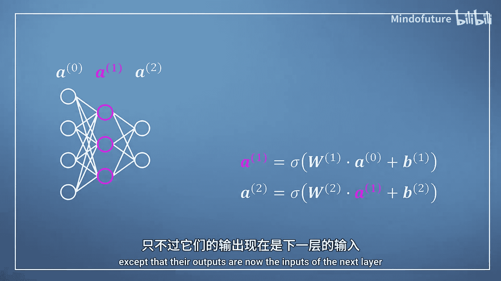

# 【帝国理工学院】机器学习数学：多元微积分 ｜ Multivariate Calculus Machine Learning p23 P23_简单神经网络_03_02_01 -BV1wnYDzmEdV_p23-

In this video， I'm going to introduce to you the concept of artificial neural networks in just enough detail that we will be ready to see how the multivariate chain rule is crucial for bringing them to life。

😊，I think it's safe to assume that everyone watching this video will at least have heard of neural networks。

 and you're probably also aware that they've turned out to be an extremely powerful tool when applied to a wide variety of important real world problems。

 including image recognition and language translation， but how do they work？😊。

You will often see nice diagrams like this one， where the circles are our neurons and the lines are a network of connections between them。

 This may sound a long way removed from the topics we've covered so far， but fundamentally。

 a neural network is just a mathematical function， which takes a variable in and gives you another variable bank where both of these variables could be vectors。

 Let's now have a look at the simplest possible case so that we can translate these diagrams into some forming。

😊，Here we have a network which takes in a single scalar variable。

 which we'll call a 0 and returns another scalar a1。 We can write this function down as follows。

 A1 equals sigma of w times a0 plus B。 where B and W are just numbers。

 But sigma is itself a function。 It's useful at this point to give each of these terms a name。

 as it will help you keep track of what's going on when things get a bit more complicated。

 So our a terms are called activities。 W is a weight。 B is a bias。

 and sigma is what we call an activation function。 Now。

 you might be thinking how come all the terms use a sensible letter， except for sigma。

 But the answer to this comes from the fact that it is sigma that gives neural networks their association to the brain。

 neurons in the brain receive information from their neighbors through chemical and electrical stimulation。

 And when the sum of all these stimulations goes beyond a certain threshold amount。

 the neuron is suddenly activated and starts。😊，Stimulating its neighbors in turn。

 an example of a function which has this thresholding property is the hyperbolic tangent function。

 Tch， which is a nice， well behaveved function with a range from -1 to1。

 You may not have met Tch before， but it's just the ratio of some exponential terms。

 And nothing your calculus tools can't already handle。

Tanch actually belongs to a family of similar functions all with this characteristic S shape called sigmoids。

 hence why we use sigma for this term。😊，So here we are with our nonlinear function that we can evaluate on a calculator and also now know what all the terms are called。

 At the start of this video， I mentioned that neural networks could， for example。

 be used for image recognition。 But so far our network with its two scalar parameters W and B doesn't look like it could do anything particularly interesting。

 So what do we need to add。 Well， the short answer is more neurons。

 So now we're just going to start building up some more complexity whilst keeping track of how the notation adapts to cope。

😊，If we now add an additional neuron to our input layer。

 we can still call this scalar output variable A1， but we will need to be able to tell a difference between the two inputs so we can call them a 0。

0 and a01 to include this new input in our equation。

 we simply say that a1 equals sigma of the sum of these two inputs each multiplied by their own weighting plus the bias。

😊，As you can see， each link in our network is associated with a weight so we can even add these to our diagram。

😊，Adding a third node to our input layer， A 0，3 follows the same logic。

 And we just add this weighting value to our sum。 However， things are starting to get a bit messy。

 So let's now generalize our expression to take n inputs for which we can just use the summation notation or even better。

 notice that each input has a weight so we can make a vector of weights and a vector of inputs and then just take their dot products to achieve the same effect。

😊，We can now have as many inputs as we want in our input vector。

 So let's now apply the same logic to the outputs。Adding a second output neuron。

 we'd call these two values A10 and A11， where we now have twice the number of connectors。

 each one with its own weighting and each neuron has its own bias。

So we can write a pair of equations to describe this scenario with one for each of the outputs where each equation contains the same values of a0。

 but each has a different bias and vector of weights。 unsurprisingly。

 we can again crunch these two equations down to a more compact vector form where the two outputs are each rows of a column vector。

 meaning that we now hold our two weight vectors in a weight matrix and our two biases in a bias vector now。

😊，Let's have a look at what our compact equation contains in all its glory。😡。

For what we call a single layer neural network with M outputs and N inputs。

 we can fully describe the function it represents with this equation。And peering inside。

 we can see all the weights and biases at work。😊，The last piece of the puzzle is that as we saw at the very beginning。

 neural networks often have one or several layers of neurons between the inputs and the outputs。

 We refer to these as hidden layers， and they behave in exactly the same way as we've seen so far。

 except that their outputs are now the inputs of the next layer。

And with that we have all the linear algebra in place for us to calculate the outputs of a simple feed forward neural network。

 however， persuading your network to do something interesting such as image recognition then becomes a matter of teaching it all the right weights and biases。

 which is what we're going to be looking at in the next video as we will bring the multivariate chain rule into play see you then。

😊。

