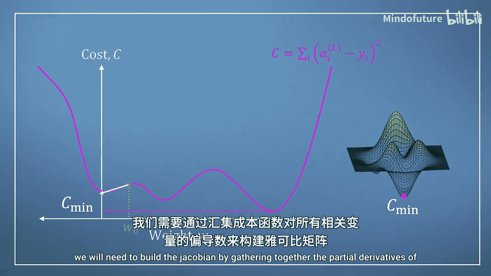

# 【帝国理工学院】机器学习数学：多元微积分 ｜ Multivariate Calculus Machine Learning p24 P24_更多简单神经网络_03_02_02 -BV1wnYDzmEdV_p24-

In the previous video we introduced the concept of neural networks and then we worked through the algebra required to describe a fully connected feed forward network with hidden layers in this video we're going to see how the multivariate chain rule will enable us to iteratively update the values of all the weights and biases such that the network learns to classify input data based on a set of training examples。

😊，When we say that we are training a network we typically mean using some kind of label data which are pairs of matching inputs and outputs。

 for example， if we were to build a network to recognize pictures of faces and predict if they were happy then for our training data each of the inputs might be the intensity of a single pixel from the image and this would be paired with an output which just says whether this image contains a face and whether it was a happy face。

 the classic training method is called back propagation because it looks first at the output neurons and then works back through the network。

If we start by choosing a simple structure such as the one shown here with four input units。

 three units in the hidden layer and two units in the output layer。

 what we're trying to do is find the 18 weights and five biases that cause our network to best match the training inputs to their labels initially we will set all of our weights and biases to be a random number and so initially when we pass some data into our network。

 what we get out will be meaningless however， we can then define a cost function。

 which is simply the sum of the squares of the differences between the desired output why and the output that our untrained network currently gives us。

If we were to focus on the relationship between one specific weight and the resulting cost function。

 it might look something like this， where if it's either too large or too small， the cost is high。

 but at one specific value the cost is at a minimum now based on our understanding of calculus if we were somehow able to work out the gradient of C with respect to the variable W at some initial point W0。

 then we can simply head in the opposite direction， for example。

 at the point shown on the graph the gradient is positive and therefore increasing W would also increase the cost。

 so we should make w smaller to improve our network。However， at this point。

 it's worth noting that our cost function may look something more like this wiggly curve here。

 which has several local minima and is more complicated to navigate。 Furthermore。

 this plot is just considering one of our weights in isolation。

 but what we'd really like to do is find the minimum of the multidimensional hypersurface。

 much like the 2D examples we saw in the previous module。 So also like the previous module。

 if we want to head downhill we will need to build the Jacobian by gathering together the partial derivatives of the cost function with respect to all of the relevant variables。

 So now that we know what we're after， we just need to look again at our simple two node network。

 and at this point， we could immediately write down a chain rule expression for the partial derivative of the cost with respect to either our weight or our bias。

 and I've highlighted the a1 term， which links these two derivatives。 However。

 it's often convenient to make use of an additional term， which we'll call。😊。

Z1 that will hold our weighted activation plus bias terms。

 This will allow us to think about differentiating the particular sigmoid function that we happen to choose separately。

 So we must therefore include an additional link in our derivative chain。

 We now have the two chain rule expressions we'd require to navigate the twodimensional WB space in order to minimize the cost of this simple network for a set of training examples。

 Clearly， things are going to get a little more complicated when we add more neurons。

 but fundamentally， we're still just applying the chain rule to link each of our weights and biases back to its effect on the cost ultimately allowing us to train our network in the following exercises。

 we're going to work through how to extend what we saw for the simple case to multilayer networks。

 But I hope you've enjoyed already seeing calculus in action。 See you next time。😊。

