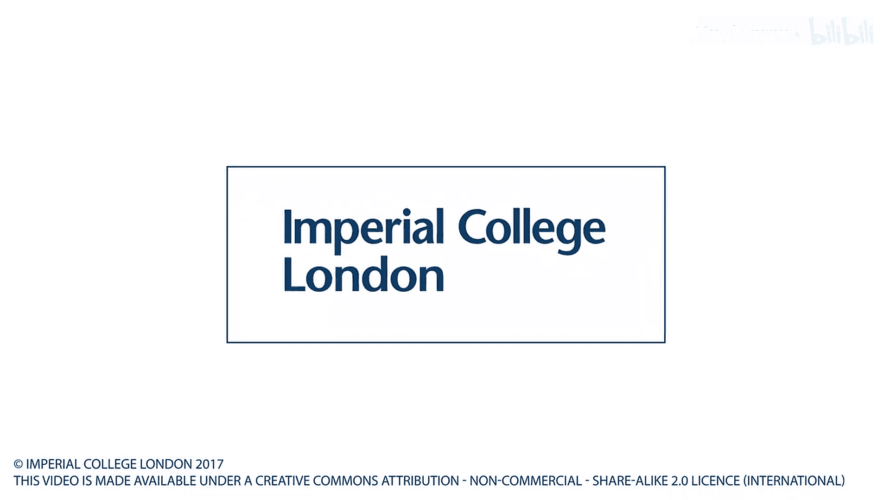

# 【帝国理工学院】机器学习数学：多元微积分 ｜ Multivariate Calculus Machine Learning p26 P26_欢迎来到模块4_04_01_01 -BV1wnYDzmEdV_p26-

Welcome to Mo 4 of the course In this module， we are going to learn how to take a complicated function and build an approximation to it using a series of simpler functions The particular approach that we're going to be looking at is known as the Taylor series and it will require all of the calcus skills you've learned so far to be put into practice。

😊，Both the Jacobian and the Hessum will be making appearances again when we consider the multivariate case。

 which will hopefully allow you to see how all of the concepts that you've seen so far are actually linked together see then。

😊。

