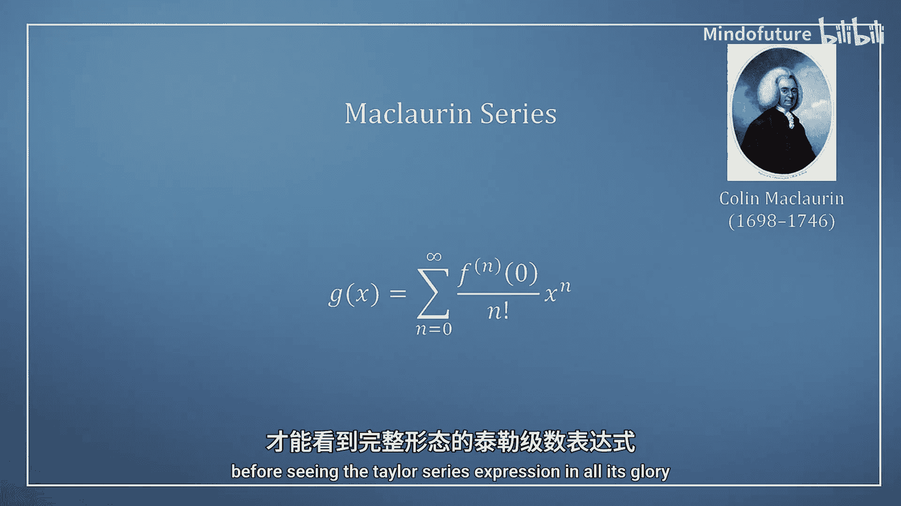

# 【帝国理工学院】机器学习数学：多元微积分 ｜ Multivariate Calculus Machine Learning p29 P29_幂级数推导_04_01_04 -BV1wnYDzmEdV_p29-

In this session we're going to work through the derivation of power series representation of functions which in short is the idea that you can use a series of increasing powers of x to reexpress functions just to warm up by blowing your minds we can take the function E to the X which we met earlier in the course and reexpress it as the series1 plus x plus x squared over 2 plus x cubed over6 plus higher order terms Now I hope you would agree with me that this is pretty incredible and hopefully by the end of this video you will understand how to build series like this for many other interesting functions。

😊，What the Taylor series method tells us is that if we know everything about the function at some point。

 whereby everything， I mean the functionss value， its first derivative， second derivative。

 third derivative， etc ce。 Then we can use this information to reconstruct the function everywhere else。

 So if I know everything about it at one place， I also know everything about it everywhere。 However。

 this is only true for a certain type of function that we call well behaveved。

 which means functions that are continuous， and that you can differentiate as many times as you want。

 That said， we know lots of functions like that。 So it turns out to be a very useful tool indeed。

 So now we're going to try and explain this concept graphically by looking at a graph of some arbitrary function F of X。

 which looks like this。 and building a sequence of gradually improving approximations。

 So our first approximation， which we can call G0。 We are going to build using just one piece of information from our function。

😊，F of X， which will be the value of the function at our point of interest， which in this case。

 is just x equals 0。 As you can imagine， if all we're going to build our function off is this one single value。

 then clearly， our guest function isn't going to be able to capture a very complicated shape like this。

 And， in fact， all it can be is a horizontal line at the point F at 0。

 So we can plot this first approximation。 And also write an expression for calculating G0 of x。

 which is just F of 0。 We call this our0th order approximation and clearly， it's not very good。

 but also notice that as this line is flat。 It's actually not even a function of X。😊。

We can do better。 So let's now find our first order approximation。 For this。

 we're now going to use two pieces of information。 The value of the function at x equals 0。

 but also the value of the gradient at x equals 0， which we will call F dash at 0。😊，Using these。

 we can build another straight line of the form y equals mx plus C。

 where the vertical axis intercept C is just f of0。

 but just substituting in for F dash of0 as the gradient of our line so we can now plot our first order approximation to the function。

 which has the same value of the gradient and of the function， f of x。

 and we can also write down its expression G1 of x is f of0， F dash of0 times x。😊。

This thing clearly does a better job than g 0 at approximating F of x near the0 x equals 0。

 but it's still not great。 Moving quickly on to our second order approximation G2 of x。

 We're going to use three pieces of information， F of 0。

 F dash of0 and the second derivative of F double dash of 0。

Now to have a function that can make use of these three pieces of information。

 we're going to need a quadratic equation。So we can write y equals。A X squared plus B， X plus C。

Differentiating this thing twice， we can just say， well。

 y prime equals 2 a X plus B and y double prime equals2 a。

 Now what we want is for this function to be the same as F of x when we subit in at the point equals0 x equals 0。

 so we can say， okay， at x equals 0。We want this thing to equal。F double prime。Of zero。

 so clearly are coefficient A because this thing is not even a function of x。Therefore。

A is just going to equal。F double dash0。Divided by2。Now， if we look up at this equation here。

 we also want the first derivative to be equal to the function at 0。

 so we can set this equal to F dash。Of0。And we're subbbing in 0 for this x here。

 So this term just disappears。 So we can now say that also B equals。F dash。At 0。 Lastly。

 suming in0 here and here and setting this thing just equal to F。Of0。

 we can say that clearly C is also just equal to F of 0。 C equals F。At 0。

 so we now have all three coefficients for our equation。 And we can say。

 let's now go back to our graph and add our second order approximation。Which。

 as it's just an x squared term， will be a paraboler。

 Notice that each time we update our approximation。

 the region in which it matches up with F of x grows a little。

 So let's now take one more step down the rabbit hole and find the third order approximation。

So we can write y equals A X cubed plus B X squared plus C， X plus D。

As based on what we've already seen from the first three steps。

 it's only the coefficient A that we need to find as B， C and D will be the same as we found for G2。

 So let's now differentiate this thing three times。Y prime equals 3， A X squared plus 2， B， X plus C。

 Y double prime equals 6， A X plus 2 B， and Y 3。Its just gonna be 6。A。So， clearly， we want。

This thing， the third derivative our approximation function to equal。Our function f of x。

 when we've differentiated it three times and evaluated at the point x equals0。

So' setting this x to 0。 Now， there is no x in this bit。 We can say F。3 at 0 equals 6， a， therefore。

A just equals。F 3 at 0， divided by。6ix。😡，Finally， we can add this third order approximation to our graph and write out its expression。

You can now see that not only has the approximation improved significantly。

 but also that we can add higher order terms piecewise。

 and in each case the lower order terms remain the same。

What we now want to build is a general expression that the lower order terms remain to just write down the fourth order approximation without working through it。

 noticeice that the one over6 coefficient in front of the cubic term。

 was the result of having to differentiate a cubic term twice。

 So when we differentiate x to the fourth power three times we are going to get four times 3 times 2 in front。

 leading to a coefficient of1 divided by four times3 times2， which is1 divided by 24。

 We have a name for the operation 4 times 3 times 2， which is four factorial And in fact。

 all the terms can be thought of as having a factorial in front of them Even zero factorial。

 which for reasons I won't going into here， is in fact equal to1。

So with this last piece of the puzzle in place， we can now say that the nth term in the approximation is just the nth derivative of F evaluated at0。

 divided by n factorial， multiplied by x to the power of n。

 and therefore the complete power series can be written as follows。😊。

So you can see it's the sum from n equals zero to infinity of these terms。

Although what we've written here certainly does count as a Taylor series。

 because we're specifically looking at the point x equals0。

 we often refer to this case as a McLaan series， so you're still going to have to wait one more video before seeing the Taylor series expression in all its glory。

😊。

In the rest of this module， we're going to be applying the concept of power series to some interesting cases as well as generalising it to higher dimensions。

 where rather than building approximation curves， we will be constructing approximation hyperurfaces see you then。

😊。