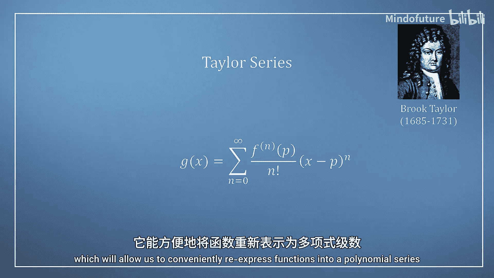

# 【帝国理工学院】机器学习数学：多元微积分 ｜ Multivariate Calculus Machine Learning p30 P30_幂级数细节_04_01_05 -BV1wnYDzmEdV_p30-

I began our last session by trying to motivate you with the fact that we can reexpress the function E to the X as a power series。

 so I want to make sure that your mind is well and truly blown by showing you that when we differentiate this function term by term。

 which isn't very difficult to do is it's just a polynomial。

 something rather satisfying happens where just as we'd expect for the derivative of E to the X。

 this infinitely long series remains unchanged， which I think is pretty awesome。😊，So now finally。

 you're going to get to see the Taylor series。 Fundmently。

 we are applying the same logic as the McLaran series that we derived previously。

 but whereas the McLaran series says that if you know everything about a function at the point x equals0。

 then you can reconstruct everything about it everywhere。

 the Taylor series simply acknowledges that there is nothing special about the point x equals 0 and so says that if you know everything about the function at any point。

 then you can reconstruct the function anywhere， So a small change but an important one。😊。

Let's look again at the function E to the X。As well as the first four approximation functions。Now。

 using our understanding of the McLaron series， we can also rewrite this in a compact summation notation such that we could if we wanted。

 build a polynomial approximation function to an arbitrary degree of accuracy。😊，So what if now。

 instead of expanding around the point x equals0， we wanted to start from the point x equals P。Well。

 to begin with， let's have a look at the first four approximation functions at this point。

The expressions to describe these approximations are still going to require the value of the function。

 as well as all of its derivatives at this point， but how do we now adjust our general equation to allow for an arbitrary expansion point x equals p Well clearly the zeroth order term this is just straightforward。

 it's going to be a horizontal line that just uses the point F of p everywhere but what if we take a closer look at the first order approximation this should give us enough insight that will then be able to tackle all the other higher order terms。

😊，So we're essentially looking to build a tangent to the curve at point P。

 all straight lines are of the form y equals Mx plus C。

 so let's now work through this by putting in place all the information that's available to us。

So we can say， okay。Here is some nice function that we're going to deal with。

And if we're looking at the point。P here。This is， of course， at。F of P height。

 So its's coordinates of this point are P F of P。 And we want to build an approximation function that is first order。

 So it's got a， it's got a y axis intercept， and it's got a gradient。

 And it's going to look something like。This， okay， the same gradient。

 the same height of the function at that point。 So， of course。

 that green line is going to have the equation Y equals M X plus C。Now。

 we know immediately the M is the gradient of this straight line。

 and we know the gradient of our function here is just F dash at p。

 So we can say y equals F dash at P X plus C。 So all that's left is for us to find C。 And to do that。

 we're going to need to know X and Y。 But we do know a point on our alliance， the point P F of P。

 So we just sub these in。F of P equals F dash。Of P。At P。pl。C， rearranging for C。😡。

We can just see that C is going to equal。F of P。Minus F dash of P。A pay。

Soubbbing the C back into our general equation， we can now bring it around and say， well。

 this line has the equation y equals。M， which is just F dash。Of P times x plus C， which is just F。

Of P minus F dash。Of P multiplied by P。 Okay， now the last thing I'm going to do is take this and factorize this F dash of P out。

And that'll leave you with a nice form of this expression， Y equals。F dash of P multiplied by。

There's an X of it here， and there's a - one of it here and minus p of it here。

 So we can say X minus P。Plus， just this term here。F。Of pay。

What this shows us is that by building our approximation around the point P when we use our gradient term F dash of p rather than applying it directly to X。

 we instead now apply it to x minus p， which you can think of as how far are you away from P。

 So we can now write down our first two approximation functions to F of x at the point P。

 the0th and the first thinking back to the McLaron series from the previous video。

 All we need to do to convert the Taylor series is use the second derivative at p rather than0 and also replace x with x minus p。

 but notice that the factor of one half still remains。😊。

So we can now look at our concise summation notation for the McLaron series and upgrade the whole thing to the more general Taylor series form。

 noticing of course， that if we decide to set P to zero。

 then the expressions would actually become identical。😊。

So we now have our one dimensional Taylor series expression in all its glory。

 which will allow us to conveniently reexpress functions into a polynomial series。😊。

In the remainder of this module， we're going to play around with this result as well as extending it to high dimensions。

 See you then。