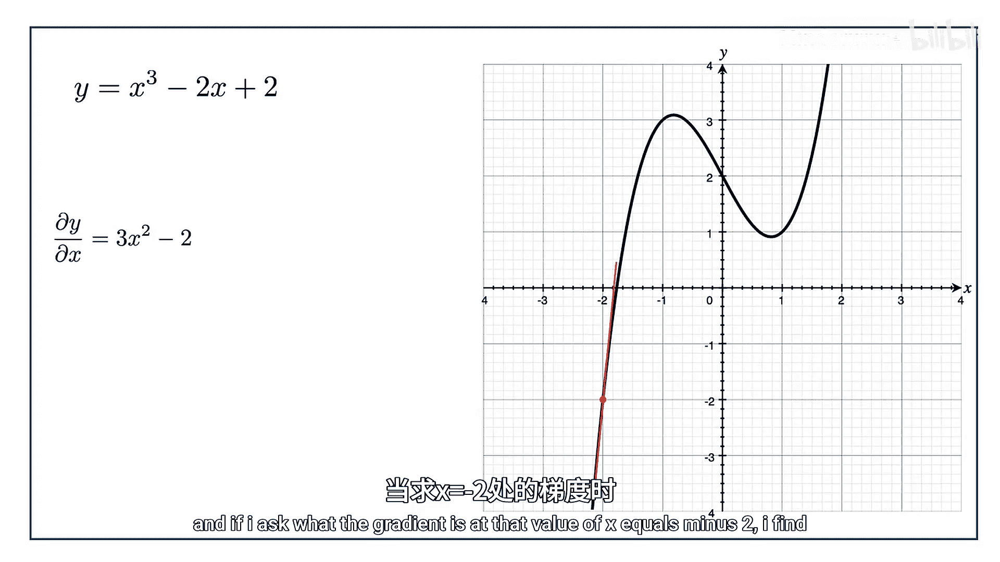
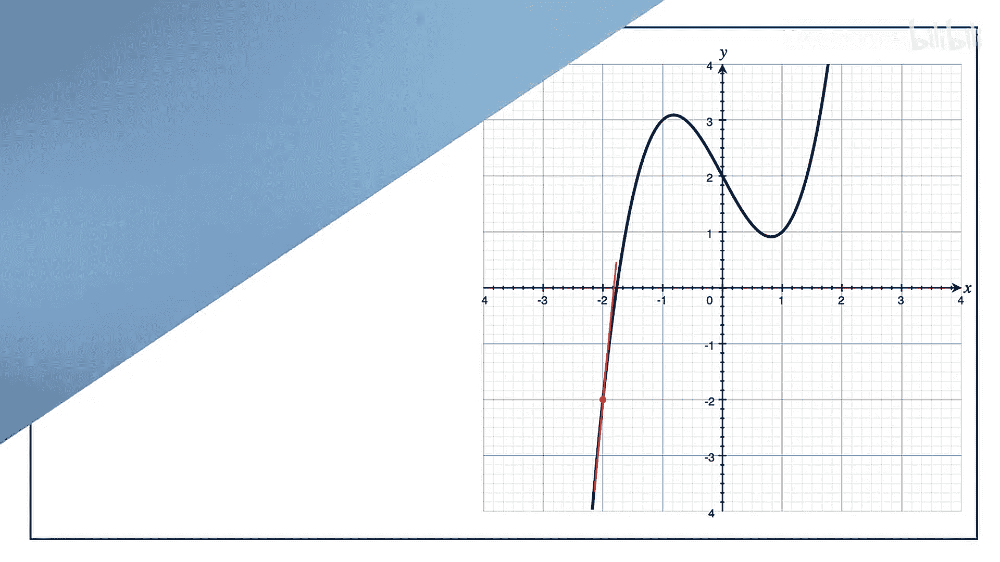
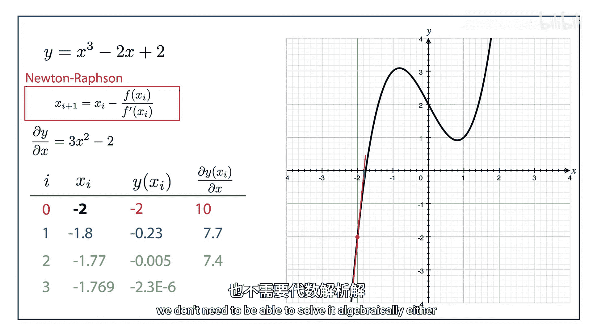
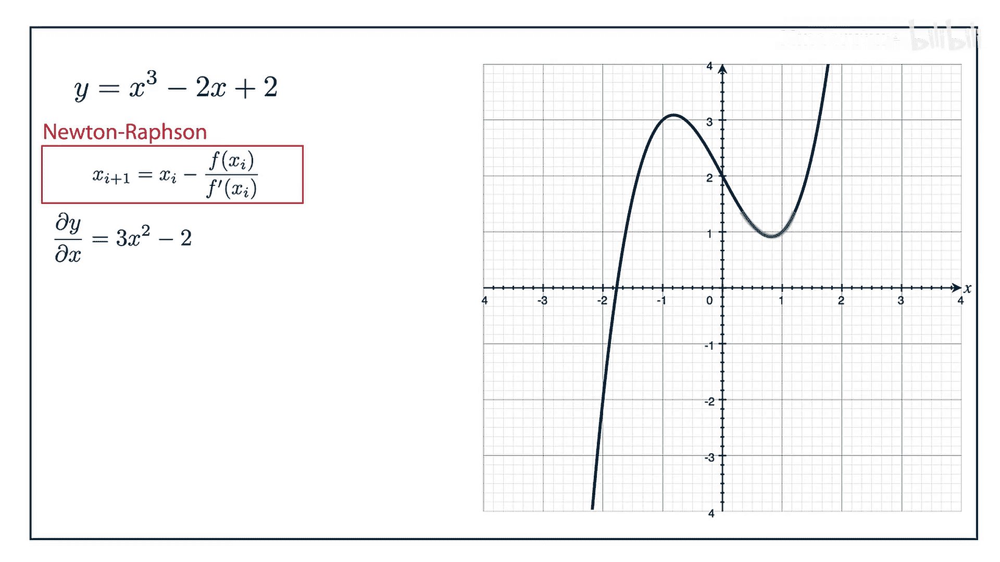

# 【帝国理工学院】机器学习数学：多元微积分 ｜ Multivariate Calculus Machine Learning p35 P35_欢迎来到模块5_05_01_01 -BV1wnYDzmEdV_p35-

Hi there。 I'm David Dye and I'll be taking through the last few modules of this course in this module。

 we'll start to use the calculus we've done and put it together with vectors in order to start solving equations。

😊，In this first video， we'll look at a nice， simple case where we just need to find the gradient the derivative in order to solve an equation using what's called the Newton Raffson method。

 Now， say we've got that distribution of heights again with a mean an average， mu and a width sigma。

 and we want to fit an equation to that distribution that So we don't have to after we fitted it。

 bother about carrying around all the data points， we just have a model with two parameters。

 a mean and a width and we can do everything using just the model And that would be load faster and simpler and would let us make predictions and so on。

 So it be much， much nice， But how do we find the right parameters for the model。

 How do we find the best mu and sigma we can。😊，Well what we're going to do is we're going to find some expression for how well the model fits the data and then look at how that goodness of fit varies as the fitting parameters me and sigma vary。

 So we're trying to solve an equation where the fitting parameters of variables in the equation。😊。

But in order to get there in the next module actually。

 we're first going to need to a bit more calculus。 So first， let's look at the equation of a line。

 say here y equals x cubed minus2 x plus 2 if we differentiate this equation we get the quadratic 3 x squared minus2 and that quadratic will have two solutions and therefore two turning points will exist1 a maximum 1 a minimum just as we see here。

😊。

Now， say that I don't know what the equation looks like。 I'm blind。

 and I haven't got enough computer resources to graph out the values at every point。 Or more likely。

 in reality， say the function exists in so many dimensions that I can't visualize it at all。

 But say I only need to find the solutions to the equation where y equals n。

 So where x cube-2 x plus 2 is equal to 0。We can see that there's actually only one solution here on this graph。

 but there could be more depending on the exact form of the equation I was trying to solve。😊，Now。

 say that I have an idea that I want to hunt for a solution somewhere near some initial guess。

The red dot here。For instance， the constant is pretty small and positive。

 so I might guess that I need a slightly negative value of x。

 say minus2 might be somewhere near a solution。Now。

 if I can evaluate the value of the function at my guess of x equals minus2。

 I find that the function has a value of minus2。And if I ask what the gradient is at that value of x equals -2。

 I find that the gradient is positive， and it's 10。

Now I can extrapolate the gradient to the intercept with a Y axis。

 which is be my first guess of the solution of the equation。

 let's try and try to solve where it finds that intercept with a y axis。😊。

So I can use that value of x at the intercept as a new estimate for what the solution to the equation is effectively I'm guessing that the function is a straight line。

 and then I'm using the gradient to extrapolate to find the solution。

 It isn't really a straight line of course， but the first order approximation would be that it's a straight line and we'll use that to update our guess and then go again and evaluate。

😊，So I can write down an equation for my new guess， X I plus 1 based on my previous guess。

 I'd attempt X I as being my original guess minus the value of the function divided by its gradient。

😡，So let's see how it plays out。😊，We can make a table starting with our initial guess at I equals naught。

 and then we can find the gradient and the intercept。😊，And then use that to generate a new guess。😊。

In this case，2 minus2 divided by 10 gives us2 plus 0。2， which is minus1。8。😡。

Then we can evaluate the result for that guess and find that it's just a little less than 0 minus 0。

23， and the gradient is 7。7。😊，So we've gone from being out by2 on y to being out by just 0。23。

 So in some sets， we've got like 10 times better in our estimate， just in our first go。

If we carry on， then we get the next guess for x2 is-1。77， and that's just 0。005 away from the axis。

 It's really close。 Then if we have another go after just three iterations。

 we get an answer of x'es equal-1。769， which is just 2。3 times 10 to the -6 from the axis。

 So in just 3 iterations， we pretty much solve the problem， which is pretty cool。😊。

This method is called the Newton Raerson method， and it's really pretty neat to solve an equation。

 All we need to be able to do is evaluate it and differentiate it。

 We don't need to graph and visualize it everywhere， calculating it lots and lots of times。

 We don't need to be able to solve it algebraically either。😊。

Which if we have lots of dimensions to a data set， say and a big multi multiver function。

 we're trying to fit that data is's going to be much too expensive to try and solve it analytically or even plot it out for all the possible values of the variables。

 This sort of method， where we try a solution and evaluate it and then generate a new guess and then evaluate that and again and again and again is called iteration。

And it's a very fundamental computational approach。😊，Now。

 there are some things that can go wrong sometimes with this method。 So let's briefly look at those。

Say I started off with a guess of x equals0。😡，Which evaluates to y equals 2。

When I find the gradient for that and extrapolate it。

 that takes me away from the solution to the other side of the turning point。

 it gives me a new guess that x equals 1。😊，When I evaluate that。

 then I get a value for y at x equals1 of one。😡，When I find the gradient and extrapolate back。

 then my new estimate lands me back at x equals0 which is where I've begun。😡，So I have a problem。

 I seem to have magically landed in a closed loop where my estimates just cycle back between x equals n and x equals1。

 and I never get close， I'll never even go anywhere near to the solution x equals minus1。769。😊。

There's another problem， which is that if I'm close to a turning point this bottom here to a minimum or a maxima。

 then because my gradient will be very small when I divide by the gradient in the newton Rason equation here。

 my next estimate will take me zapping off to some crazy value。

 and therefore it won't converge easily to dive off somewhere。

Those are the problem。So that's the Newton Ravson method。

 We iterate to a solution to an equation by each time making a new estimate for the solution。

 using the gradient to extrapolate towards the solution， then going again and again and again。😊。

And most of the time， this works really well as it means to step towards the solution。😊。

So what we've done in this video is look at a method for using just the gradient to step our way towards solving a problem。

This method is called the Newton Raerson method， and it's a really powerful way to solve an equation just by evaluating it and its gradient a few times。

😊，It's as if you're standing on a hill in the fog and you can know your height and you can know locally what's going on around you。

 You can sit know how steep the hill is， but you can't see the whole landscape around you。

 You don't know what it looks like。 You don't know how to get down the mountain， if you like。

 down to a nice， safe place that doesn't have cliffs。

So what you do is you guess based on how steep the hill is locally around you， which way to go。

 but you want to go down to sea level so you go down the hill。

Then you take that step blindfolded and when you get there you ask again what height you out and how steep it is and then you keep making more steps down the hill until either something goes wrong and you need to go back down the other way or you get home to where you want it to be。

😊，The points， you don't need to know what the landscape looks like。 the function。

 You just need an altimemeterter， the value of the function and to be able to feel with your toe。

 what the gradient is like locally around you。What we'll do in the next video is look at how to apply this where we've got multiple variables。

 not just x， and that will involve finding the gradient vector how to go down a hill on a contour plot。

😊。