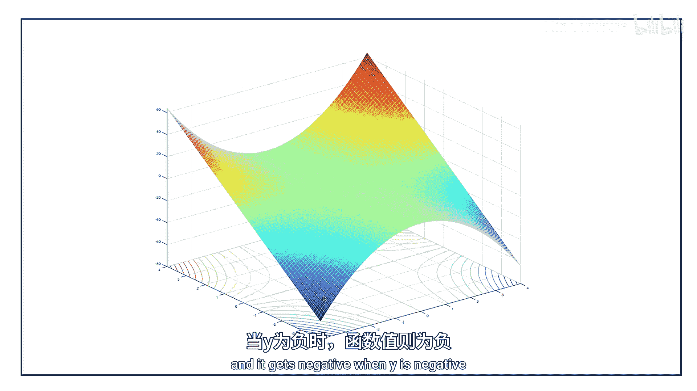
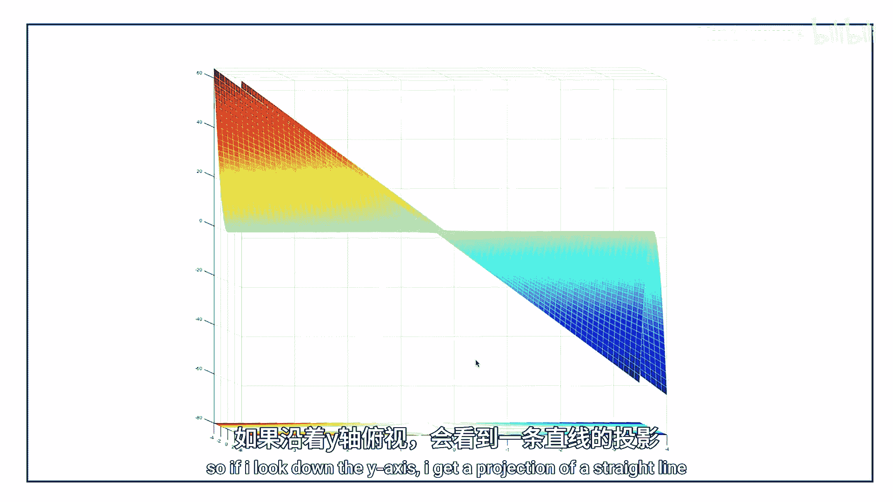
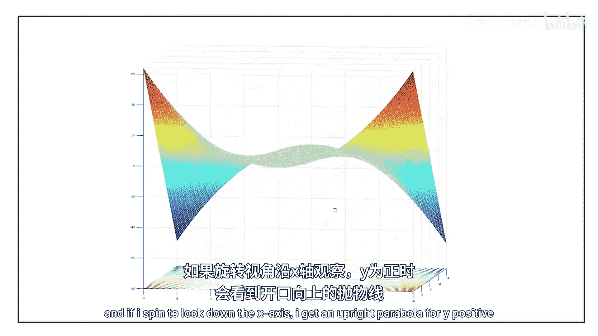
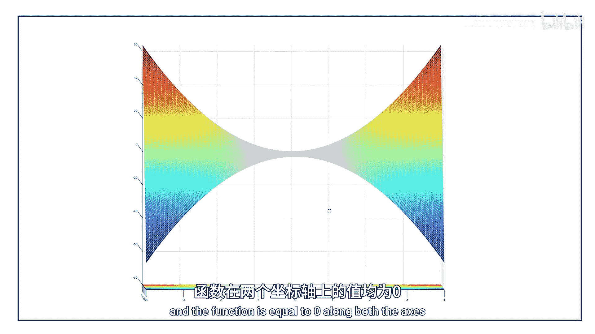
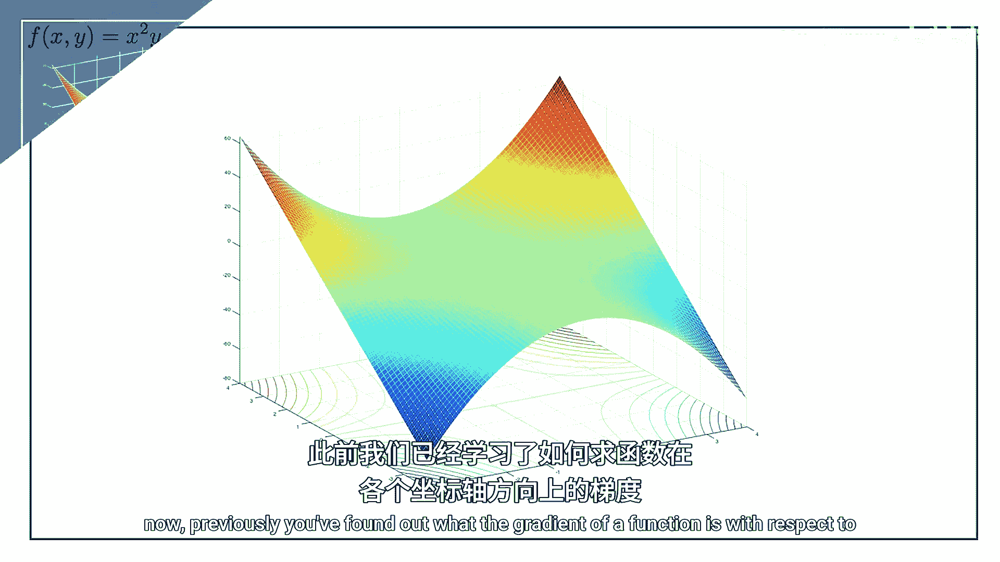

# 【帝国理工学院】机器学习数学：多元微积分 ｜ Multivariate Calculus Machine Learning p36 P36_梯度下降_05_01_02 -BV1wnYDzmEdV_p36-

Okay， so now we've looked at the Newton Raftom method。

 which uses the gradient to iteratively solve a 1 d function of x， say。

Now we'll generalize that to figure out how to do something similar with a multidimensional function。

 a function of multiple variables and how to use the gradient to find the maxima and minia of such a function。

Later on， this will let us optimizeise， find the best fit for the parameters of a function that we're trying to fit。

😊，Saying I've got a function like F equals x squared y here。

This function looks like this and what I've got here is a function that gets big and positive when x is big and y is positive and it gets negative。

 when y is negative。😊。

So if I look down the y axis， I get a projection of a straight line。

 and if I spin to look down the X axis， I get an upright pallaber for Y positive。😊。

And one going down for Y negative。And the function is equal to zero along both the axes。😊。

Now， at the bottom here in Matlab， I've used the Sur C function to plot contours when the function has a constant value。

 just like the contours of constant height on a top graphical map。

So the question we want to answer in this video is how do I find the fastest or steepest way to get down this graph？

Now， previously， you've found out what the gradient of a function is with respect to each of its axes。

 so you can find the FDX just by differentiating the function F。

 treating all the other variables as constants。

So in this case， we've got a function F of X， Y。Is equal to x squared y。And so， DfDX。

Is equal to differentiate that treating Y is a constant。 That's just 2 x times y。And D F。

 DY is equal to well the x squared we treat as a constant and y differentiates just to one。

 So it's just x squared。Now we can write down these two gradients in a vector。

 which we call the grad of F。😡，So this guy we call grad。😡，嗯。

And this vector is just the vector where we write them down。As。AThe components。Of a vector。

So we say that grad。Is that。It's just the vector found by writing down D F by D X and D F by D Y in the X and Y locations of the vector。

 And grad is like the most awesome vector ever。 grad is the little vector that combines linear algebra and calculus together。

 So grad's a lot of fun。😊，So if we run along a little vector， R is equal to Dx 0。

Then if we dotted that with grad F， then we get DfDx times dx plus 0。

 So we'd move the amount Dx along the X axis。 So this is doing the right sort of thing right。

 a dot product of grad F with a vector is going to take。

 it looks like some amounts of DfDX along the X bit of that vector and some amounts of DfDY along the y bits of that vector。

 So it's going to tell us how much we've gone down。 That's sort of how grad works。

 and the important thing is to remember， this is evaluated at F has some values in the space A B。😊。

So it's evaluated at a location。😊，So then if we want to know how much the function will change when we move along some unit vector in an arbitrary direction。

 So we'll call that unit vector R hat and。We'll give it components C And D。

 So C squared plus D squared is equal to1。So D。😊，Is going to be。DfDx。Time C plus Df。D y。Times D。

So what we're doing here is we're doing gra of F dotted with our hat。

And we call this thing the directional gradient。 So another question we can ask is。

 what's the maximum value this directional gradient can take。So we've got Grd F as a vector。

 and we're dotting it with our hat。And our question is。

 what's the maximum value they can take given that our hat is a unit vector。

 Well the only thing then left when we dot them together is going to be the co theta term because it's A B co theta and that's going to be maximized when co thes 1。

Which means the 0， which means our hat is parallel。To Grd F。

So in order to find the maximum value of the directional gradientd。

 we want an R hat that's actually the normalized version of grad。😊，So we can write that down。

 We can do that calculation。 So we'll have grad F。Dotted with the normalized version of itself。

 So Grdf divided by its modulus。But Grd F dotted with itself is it just equal to the size of GrdF。😡。

Squared。Got to divide by the size。So the maximum value the directional grading can take is just the size of grad F。

😊，And that's， therefore， the steepest gradient we can possibly have。

 the size of the steepest gradient we can possibly have is just the size of grad F some of the squares of the components of grad。

 So that's really fun。 The other question to ask is， which way does grad point。😊。

This is less easy to see， but Gr points out the direction's steepest descent。

Perpendicular to the contour lines。So think if you're on a mountain and it's foggy and you can only see locally around you and you want to go down the hill。

 you don't walk around the contour， you go down the hill。

 So if the contours like this and I'm stirring down the hill down the hill is at 90 degrees to the contour line and think about the way it's defineds it up or down the FDX is positive if you're going up So actually grad F points up the hill in the steepest way of minus grad points down the hill。

 the steepest way。So grad points up the direction's steepest descent。😊，Now。

 if we have some data science problem where we want to minimize the difference between our data values and our model fit。

 then what we want to do is find the lowest point in the function。

 the function is kind of the badness。 so we want to find the best。

 so we want to find the point where the badness is minimized。And like Newton Ratom。

 we can use the gradient to go from some trial point down towards the solution。But in Newton Raton。

 we're trying to find the zero point here we don't know what the minimum value of the function is。

 so we don't know how far we down we need to go as as if we're somewhere on our mountain。😊。

But we don't know the altitude of the valley。So what we do in what's called the gradient descent method is we take a series of little steps down the hill。

 That is if we started at some position S N， then our next position S N plus1 is given by S N plus some little step down the hill。

 and that little step is given by minus some amount times grad。😊。

And Gr evaluated at the previous position SN。😊，On the graph。

 that's going to look like taking a little step， the little blue one down the hill。

 and then we reevaluate， make another SN plus one and make another step and take a series of steps down the hill。

😊，If we overshoot， that's okay， Ca Gr will just take us back to the minimum and notice that as the gradient gets shallower as we come towards the turning point。

 then the steps automatically get smaller because Gr gets smaller。 So this is quite a nice method。

 There are lots of ways to enhance it。😊，But that's the main idea。 It's very powerful， and simple。

The other thing to notice is that there are multiple local men in the landscape。

 Then we might get stuck in one of them。 And， of course。

 which one we find depends on our starting point。 We won't find the others We'll only find one at a time。

 So in the general case， there are some problems。 But nevertheless， this is quite a neat method。

 This just following little steps down the hill。 And this is probably the main way in which most numerical opts work that people use in the real world。

Sai。What we've done in this video is we've introduced ourselves to grad the gradient vector。

 and merge calculus and vectors together to take our first steps in vector calculus。😊。

And that's allowed us to find a method for just using the gradient to step our way towards solving a problem for multivariable cases。

 and that method is called gradient descent。😊。

